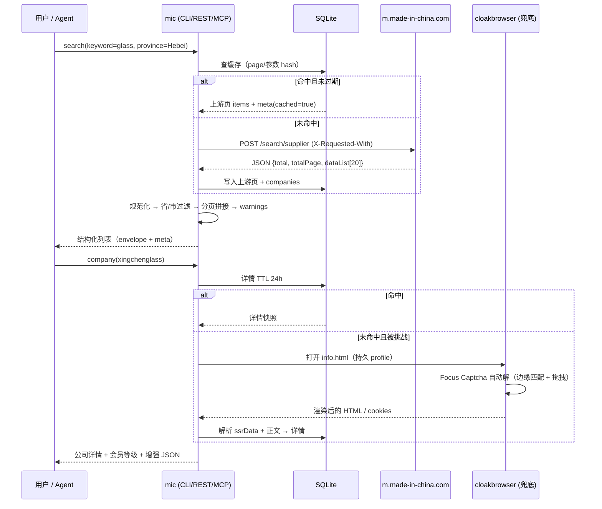

# MIC Client

<p align="center">
  
</p>

<p align="center">
  <b>Made-in-China.com 本地客户端</b><br/>
  按省市/关键词搜索中国工厂 · 结构化列表 · 公司详情 · 会员等级识别<br/>
  <b>REST API · CLI · MCP</b> 三入口 + SQLite 缓存 + Focus Captcha 自动通过
</p>

<p align="center">
  <a href="LICENSE"></a>
  
  
  
  
  
</p>

---

## 目录

- [为什么做这个](#为什么做这个)
- [功能一览](#功能一览)
- [架构](#架构)
- [工作流](#工作流)
- [安装](#安装)
- [快速开始：CLI](#快速开始cli)
- [REST API](#rest-api)
- [MCP（给 AI Agent 用）](#mcp给-ai-agent-用)
- [配置](#配置)
- [缓存与限速](#缓存与限速)
- [会员等级与认证](#会员等级与认证)
- [验证码与会话（自动通过 + 人工兜底）](#验证码与会话自动通过--人工兜底)
- [匿名数据边界与合规](#匿名数据边界与合规)
- [项目结构](#项目结构)
- [文档](#文档)
- [开发与测试](#开发与测试)
- [路线图与已知限制](#路线图与已知限制)
- [License / 免责声明](#license--免责声明)

---

## 为什么做这个

Made-in-China（made-in-china.com，中国制造网）是外贸供应商调研的常用平台，但网页端只能逐页浏览：

- **没有结构化输出**，难以进入脚本 / 表格 / 自己的系统；
- **按省市筛选**要层层点击，城市维度不直观；
- **会员等级（钻石/金牌）、认证、入驻时间**散落在列表/详情/迷你站不同位置；
- 上游存在**多层风控**（EdgeOne challenge、Focus Captcha），自动化不稳定。

本项目把「搜索工厂 → 列表 → 公司详情」这条链路封装成本地客户端，并基于实测逆向结论做了三件关键设计：

1. **JSON 优先**：使用移动站匿名 JSON（`POST m.made-in-china.com/search/supplier`、`company-<account>/info.html` 页内 `ssrData`），不走 HTML 解析、不依赖浏览器；
2. **地区词模式**：把 `hebei` / `langfang` 等地区英文词当关键词，配合 `province` 过滤与客户端 `city` 过滤，实现「纯地区列举」；
3. **验证码自动通过 + 浏览器兜底**：Focus Captcha 用图像匹配 + 模拟拖拽自动解；若 HTTP 通道仍被挑战，用已验证的浏览器会话渲染页面兜底。

> 更完整的事实依据见 [`docs/research/`](docs/research/)（上游接口逆向、匿名字段审计、验证码方案、会员体系）。

## 功能一览

| 能力 | 说明 |
|---|---|
| 🔍 工厂搜索 | 关键词 / 地区（省、市）/ 组合三种模式；32 省字典 + 河北 10 城；中文地区自动映射 |
| 🧮 结构化过滤 | 会员等级（diamond/gold）、认证供应商、经营模式、年营收、研发能力、管理体系认证、类目代码 |
| 📄 结果列表 | 公司名、账号、地区、主营、会员等级、认证、星级、员工数/厂房/营收、广告标记 `is_ad` |
| 🏢 公司详情 | 成立日期、**入驻/会员起始年 `since_year`**、主营、员工数、地址、厂房、营收、认证体系、评分、响应率、联系人、审核章节 |
| 🏅 会员识别 | `diamond / gold / free / unknown` + `audited` 布尔 + 证据链（csLevel、memberLevel、Since、徽章）+ 冲突告警 |
| 🗄️ 本地缓存 | SQLite（WAL）+ TTL + `stale-while-error` 回退 + single-flight |
| 🖥️ 三入口 | CLI（10 个子命令）、REST（8 个端点）、MCP（4 tools + 2 resources），共用同一 core |
| 🛡️ 风控处理 | 1.5–2.5s 限速抖动、302 重试、Focus Captcha 自动通过、`mic auth` 人工兜底 |
| 🧪 可测试 | 244 个自动化测试 + golden fixtures + `live-smoke` / `mcp-smoke` 脚本 |

## 架构

<p align="center">
  
</p>

```
┌─────────────────────────────── 入口层 (adapters) ───────────────────────────────┐
│   CLI (commander)        REST (Fastify, 127.0.0.1:8787)      MCP (stdio)        │
└───────────────────────────────────┬─────────────────────────────────────────────┘
                                    │ 共用 AppContext（config / logger / cache / http）
┌───────────────────────────────────▼───────────────────────── core ─────────────┐
│  search service (关键词/地区/混合, 分页拼接, city/audited 本地过滤, warnings)     │
│  company service (ssrData + 正文补充 + 增强 JSON, 会员合并, evidence/availability)│
│  membership · regions(32 省+城市) · cache(SQLite) · http(cookie jar/重试/限速)   │
└───────────────┬───────────────────────────────┬────────────────────────────────┘
                │ JSON (主链路)                  │ browser (兜底)
        ┌───────▼────────┐              ┌───────▼──────────────────────┐
        │ m.made-in-china │              │ cloakbrowser 持久 profile     │
        │ /search/supplier│              │ Focus Captcha 自动解 / auth   │
        │ company/info    │              │ 渲染 HTML 兜底                │
        └─────────────────┘              └──────────────────────────────┘
```

**核心原则**：JSON 优先 → 缓存 → 验证码/浏览器兜底 → 明确错误。任何降级都写入 `meta.warnings`（canonical 22 码，见 [docs/README](docs/README.md) §3.5）。

**技术栈**：Node 22 · TypeScript（strict, ESM）· Fastify 5 · better-sqlite3（WAL）· `@modelcontextprotocol/sdk` · commander · zod · cloakbrowser 0.6.5（stealth Chromium，仅兜底）。

## 工作流

<p align="center">
  
</p>



## 安装

### 前置要求

- **Node.js ≥ 22**（本项目在 v22.23.2 验证）
- 可选（仅验证码/浏览器兜底需要）：`~/cloak-env` 共享 CloakBrowser 环境（cloakbrowser 0.6.5 + playwright-core 1.65.0 + stealth Chromium 146 缓存）
- Linux（NixOS 已验证）/ macOS；`mic auth` 需要图形会话（`DISPLAY`）

### 从源码安装

```bash
git clone https://github.com/CindyRIng/mic-client.git
cd mic-client
npm ci            # 或 npm install
npm run build     # tsc → dist/
npm test          # 244 tests
npm link          # 可选：把 `mic` 链接到 PATH
```

> 浏览器兜底（验证码自动通过 / `mic auth`）需要在 cloak-env 的 FHS 里运行：
>
> ```bash
> ~/cloak-env/bin/cloak-run node dist/cli.js <command>
> ```
>
> 只使用 JSON 主链路（搜索/列表/缓存）时直接 `node dist/cli.js` 即可。

## 快速开始：CLI

```bash
mic version
# mic-client 1.0.0
# node v22.23.2
# sqlite schema v1
# upstream contract checked 2026-11-15
```

### 1. 按关键词 + 省份搜索

```bash
mic search --keyword glass --province Hebei
```

```
#  │ Company                                                          │ Region              │ Main products                                  │ Tier    │ AS │ ★ │ AD
───┼──────────────────────────────────────────────────────────────────┼─────────────────────┼────────────────────────────────────────────────┼─────────┼────┼───┼───
1  │ QINHUANGDAO GREEN STAR MIRROR CO., LTD.                          │ Qinhuangdao, Hebei  │ Mirror, Clear Glass, Tempered Glass            │ diamond │ AS │ 0 │
2  │ HF GLASS PRODUCTS CO., LIMITED                                   │ Cangzhou, Hebei     │ Glass Smoking Pipes, Glass Pipes, ...          │ diamond │ AS │ 5 │
3  │ CenerTech Insulation Engineering Co., Ltd.                       │ Tangshan, Hebei     │ Foam Glass Plate                               │ gold    │ AS │ 2 │
...
page 1/34  total 670  mode mixed  word=glass  cache
```

- `--json`：输出与 REST 完全一致的 envelope（`ok/data/meta`），适合脚本。
- `--page/--page-size`、`--refresh`、`--exclude-ads`、以及全部结构化过滤参数（见 `mic search --help`）。
- `--format ndjson --pages 1-5`：流式分页事件（`start → page* → summary`），便于 `jq` 管道实时消费。

### 2. 纯地区列举（不带产品关键词）

```bash
mic search --province 河北 --city 廊坊 --page 1
```

```
page 1/1  total 20 (lower bound)  mode region  word=langfang  cache
```

> 上游不支持空关键词搜索；客户端把地区英文词当关键词（`langfang`），再用 `province` 过滤 + 本地 `city` 校验去噪。`total_is_lower_bound=true` 表示「至少这么多，非穷尽」（扫描预算/上游封顶）。

### 3. 公司详情（含会员/认证/入驻年）

```bash
mic company xingchenglass --include audit,response,contacts,reviews
```

```
公司：Hebei Xingchen Glass Technology Co., Ltd.
账号：xingchenglass   comId：1800987236   encodeComId：UCJfyzwThnqK
地区：Hebei / Langfang / China
会员：diamond（Since 2025；confidence high；evidence: json:memberLevel=diamond, json:memberSince=2025）
认证：Audited Supplier（enrichment.audit：已审章节 8/9）
主营：Glass Cup, French Press, Coffee Pot, Glass Jar, Teapot, ...
成立：2015-10-30   员工：21
认证体系：CE, FDA, LFGB, ISO 9001, BSCI
评分：4.9/5（评论数 24）   星级：2/5
响应：平均 9.12h；及时率 77.33%（近 30 天）
联系人：cindy, Emma, octavia, edward, ...
状态：success   缓存：命中   来源：cache   请求：req_...
```

> 首次抓取如果碰到 Focus Captcha：客户端会自动解；若 HTTP 通道仍被挑战，会自动切到「已验证浏览器渲染 HTML」兜底（`detail_source=browser`）。整个过程无需人工。
>
> `--json` 输出与 REST `data` 逐字段一致。

### 4. 字典与缓存

```bash
mic regions --province 河北      # 省/市字典（32 省 + 已核验城市）
mic cache stats                  # 缓存命中/条目/TTL
mic cache clear --scope all
mic doctor                       # 环境自检（Node/cloak-env/profile/data/网络/上游/契约）
mic auth                         # 人工兜底：可见浏览器过验证码/登录并固化会话
```

## REST API

```bash
mic serve --host 127.0.0.1 --port 8787      # 前台启动，仅回环监听
```

### 端点

| 方法 | 路径 | 说明 |
|---|---|---|
| GET | `/health` | 服务/会话/缓存/上游状态 |
| GET | `/api/version` | 版本、SQLite schema、上游契约检查时间 |
| GET | `/api/regions` | 省/市字典（含 `api_value`、`cities_complete`） |
| GET | `/api/search/factories` | 搜索工厂（keyword/province/city 至少一个；过滤/分页/refresh/include_ads） |
| GET | `/api/companies/{account}` | 公司详情（account/comId/encodeComId；`include=audit,response,contacts,reviews`） |
| GET | `/api/membership/levels` | 会员等级说明（含 KA/SKA 澄清） |
| POST | `/api/cache/refresh` | 按 scope 刷新缓存 |
| GET | `/api/cache/stats` | 缓存统计 |

统一响应：`{ ok, data, meta: { request_id, cached, stale, fetched_at, source, warnings } }`；
错误：标准 HTTP 码 + `{ ok:false, error:{code,message,details}, meta }`（11 个 canonical 错误码，见 [docs/03](docs/03-rest-api.md)）。

### 示例

```bash
curl "http://127.0.0.1:8787/api/search/factories?keyword=glass&province=Hebei&page=1"
curl "http://127.0.0.1:8787/api/search/factories?province=%E6%B2%B3%E5%8C%97&city=%E5%BB%8A%E5%9D%8A"
curl "http://127.0.0.1:8787/api/companies/xingchenglass?include=audit,response"
curl "http://127.0.0.1:8787/health"
```

```jsonc
// GET /api/search/factories?keyword=glass&province=Hebei
{
  "ok": true,
  "data": {
    "query": { "keyword": "glass", "province": "Hebei", "search_mode": "mixed" },
    "pagination": { "page": 1, "page_size": 20, "total": 670, "total_page": 34,
                    "has_more": true, "total_capped": false, "total_display": "670" },
    "items": [ { "account": "tianyaoglass", "company_name": "Qinhuangdao Tianyao Glass Co., Ltd",
                 "membership": { "tier": "diamond", "raw_cs_level": 50 }, "audited": true } ]
  },
  "meta": { "request_id": "req_...", "cached": false, "source": "json", "warnings": [] }
}
```

## MCP（给 AI Agent 用）

MCP server 走 stdio，`stdout` 只输出 JSON-RPC 协议，日志走 `stderr`。

```jsonc
// Claude Code: .mcp.json 或 `claude mcp add --transport stdio mic -- ...`
{
  "mcpServers": {
    "mic": {
      "type": "stdio",
      "command": "/home/<user>/cloak-env/bin/cloak-run",
      "args": ["node", "/path/to/mic-client/dist/cli.js", "mcp"],
      "env": { "MIC_PROFILE_DIR": "/home/<user>/.mic-client/profiles/default" }
    }
  }
}
```

```bash
mic mcp --print-config     # 打印可直接粘贴的 MCP 客户端配置
```

| Tool | 说明 | 关键参数 |
|---|---|---|
| `search_factories` | 搜索工厂列表 | `keyword`, `province`, `city`, `page`, `page_size`, `membership_tier`, `audited`, `include_ads` |
| `get_company` | 公司详情 + 会员/认证/增强 | `account`, `com_id`, `encode_com_id`, `include` |
| `list_regions` | 省/市字典 | `province?` |
| `explain_membership` | 会员等级语义（含 KA/SKA 澄清） | — |

| Resource | 内容 |
|---|---|
| `mic://regions` | 省/市字典 JSON |
| `mic://membership-levels` | 会员等级说明 JSON |

## 配置

优先级：**命令行参数 > 环境变量 > `~/.mic-client/config.json` > 默认值**。

| 键 | 环境变量 | 默认 | 说明 |
|---|---|---|---|
| `profile_dir` | `MIC_PROFILE_DIR` | `~/.mic-client/profiles/default` | cloakbrowser 持久 profile |
| `data_dir` | `MIC_DATA_DIR` | `~/.mic-client/data` | SQLite / 会话 cookie |
| `log_dir` / `log_level` | `MIC_LOG_DIR` / `MIC_LOG_LEVEL` | `~/.mic-client/logs` / `info` | 结构化日志 |
| `rest.host` / `rest.port` | `MIC_REST_HOST` / `MIC_REST_PORT` | `127.0.0.1` / `8787` | REST 监听（仅回环） |
| `upstream.timeout_ms` | `MIC_UPSTREAM_TIMEOUT_MS` | `15000` | 单请求超时 |
| `upstream.rate_min_ms` / `rate_max_ms` | `MIC_RATE_MIN_MS` / `MIC_RATE_MAX_MS` | `1500` / `2500` | 上游间隔抖动 |
| `cache.ttl_list_s` / `ttl_detail_s` / `ttl_regions_s` | `MIC_CACHE_TTL_*` | `6h` / `24h` / `30d` | 缓存 TTL |
| `search.scan_max_pages` | `MIC_SCAN_MAX_PAGES` | `10` | city/audited 本地过滤扫描预算 |
| `captcha.autosolve` / `max_attempts` | `MIC_CAPTCHA_AUTOSOLVE` / `MIC_CAPTCHA_MAX_ATTEMPTS` | `true` / `5` | 验证码自动解 |
| `browser.headless` | `MIC_BROWSER_HEADLESS` | `true` | 兜底浏览器是否无头 |

完整配置见 [docs/07-operations.md](docs/07-operations.md) §3。

## 缓存与限速

- **SQLite（WAL）**：`search_page_cache`（上游 20 条/页，6h）、`company_details`（24h）、`membership_info`、`audit_info`（7d）、`response_info`（6h）、`contact_info`（24h）、`review_summary`（12h）、`cache_entries`（refine/regions 30d）等 16 张表。
- **stale-while-error**：上游失败且有过期缓存 → 返回旧数据 + `stale=true` + `STALE_DATA` warning。
- **single-flight**：同参数并发请求合并，避免重复打上游。
- **限速**：串行 + 1.5–2.5s 随机抖动；队列等待超限返回 `429 RATE_LIMITED` + `Retry-After`。
- **非穷尽保护**：上游 `total>2000` 显示 "2,000+"（`total_capped=true`）；本地过滤扫描预算用尽 → `total_is_lower_bound=true` + `NON_EXHAUSTIVE`，文档/接口明确「样本非穷尽」。

## 会员等级与认证

| tier | 页面/接口依据 | 说明 |
|---|---|---|
| `diamond` | 列表 `csLevel=50` / 详情 `memberLevel=diamond` | Diamond Member（钻石会员，公开最高等级） |
| `gold` | 列表 `csLevel=30` / 详情 `memberLevel=gold` | Gold Member（金牌会员） |
| `free` | 详情完整且明确无会员徽章 | 免费会员（列表侧无法判定时保持 `unknown`） |
| `unknown` | 证据缺失/冲突 | 不猜测，附 `evidence` |

- **`audited`** 是与会员等级正交的独立布尔（Audited Supplier 第三方审核）。
- **`since_year`** = 入驻/会员起始年（详情 `memberSince` / 徽章 tooltip `Since YYYY`），不是成立年 `established_at`。
- **KA / SKA / GSKA 不是 MIC 术语**，是阿里巴巴国际站的客户分层；MIC 页面/API 无此标识，本客户端不把它们混入 `tier`。详见 [docs/research/membership-tiers.md](docs/research/membership-tiers.md)。

## 验证码与会话（自动通过 + 人工兜底）

- 上游 Focus Captcha（vemic FCaptcha 3.0.2 blockPuzzle）采用 **Sobel 边缘 + 拼图 alpha 边界模板匹配** 求偏移，再用 humanized 拖拽完成；实测自动通过（无需人工）。
- HTTP 通道仍被挑战时，自动切换到**已验证浏览器会话渲染 HTML**（`detail_source=browser`）。
- 仍失败/需要登录 → 返回 `NEED_HUMAN_VERIFICATION`，执行 `mic auth` 打开可见浏览器人工完成一次滑块（可顺手登录），会话写入 `~/.mic-client/profiles/default`，后续复用。
- 会话/cookie 属敏感数据：`0600` 权限、不进仓库、不写日志。

## 匿名数据边界与合规

- 匿名可获取供应商**公开档案**：公司信息、主营、成立日期、员工数、认证、地址、审核机构/报告号、联系人姓名/部门/职位、评分、响应率等。
- **电话 / 邮箱 / WhatsApp / Skype / 微信：平台不公开**（不是登录墙），本客户端字段恒 `null` 且带 `not_public_by_platform`；不抓取站内信/账号私有数据。
- 仅本地回环使用；默认限速 + 缓存优先，**请勿**用于高并发批量采集或转售数据；使用需遵守目标站点服务条款与当地法律。

## 项目结构

```
mic-client/
├── src/
│   ├── cli.ts                      # CLI 入口（bin: mic）
│   ├── core/                       # 与入口无关的业务内核
│   │   ├── api/{search,company,enrich}.ts
│   │   ├── cache/{cache,migrations}.ts
│   │   ├── search/service.ts       # 三种搜索模式/分页/本地过滤/warnings
│   │   ├── company/service.ts      # 详情/会员合并/增强/缓存
│   │   ├── membership/tiers.ts
│   │   ├── regions/{dict,data}.ts  # 32 省 + 城市字典
│   │   ├── session/{browser,captcha}.ts  # 验证码/浏览器兜底
│   │   ├── http/client.ts          # cookie jar/重试/限速/single-flight
│   │   ├── config.ts · logger.ts · errors.ts · models.ts · container.ts
│   ├── adapters/
│   │   ├── cli/                    # 10 个子命令
│   │   ├── rest/                   # Fastify 8 端点
│   │   └── mcp/                    # MCP stdio 4 tools + 2 resources
│   └── index.ts
├── data/regions.json               # 省/市字典数据
├── tests/                          # 244 tests + golden fixtures
├── scripts/e2e/{live-smoke,mcp-smoke}.mjs
├── docs/                           # 需求/架构/API/CLI-MCP/数据/测试/运维/路线图
│   ├── 01-requirements.md … 08-roadmap.md
│   ├── research/                   # 上游接口/会员/匿名边界/验证码调研与证据
│   └── decisions/                  # ADR-0001…0007
├── assets/                         # README 插图（图像模型生成）
├── CHANGELOG.md · LICENSE · README.md
```

## 文档

| 文档 | 内容 |
|---|---|
| [docs/README.md](docs/README.md) | 文档地图、阅读顺序、固定契约（FR/错误码/warnings/枚举） |
| [01 需求规格](docs/01-requirements.md) | FR-01…15、NFR、57 条验收标准 |
| [02 系统架构](docs/02-architecture.md) | 模块职责、11 张 Mermaid 图、重试/降级矩阵、配置 |
| [03 REST API](docs/03-rest-api.md) | 8 端点、11 个 Schema、错误码、示例 |
| [04 CLI 与 MCP](docs/04-cli-mcp.md) | 10 子命令、4 tools/2 resources、退出码 |
| [05 数据与缓存](docs/05-data-and-cache.md) | 数据模型、16 表 DDL、缓存键/TTL、地区字典 |
| [06 测试与验收](docs/06-test-acceptance.md) | 测试策略、TC 用例矩阵、DoD |
| [07 运维手册](docs/07-operations.md) | 安装/配置/auth/排障/安全合规 |
| [08 路线图](docs/08-roadmap.md) | M0–M4 里程碑、开放问题 |
| [research/](docs/research/README.md) | 上游接口 22 端点、匿名字段矩阵、验证码方案、会员体系 |
| [decisions/](docs/decisions/README.md) | 7 篇 ADR（JSON 优先、浏览器兜底、城市过滤、会员枚举…） |

## 开发与测试

```bash
npm run typecheck     # tsc --noEmit
npm run build         # 编译到 dist/
npm test              # 244 tests（vitest）
npx vitest run tests/core tests/company tests/adapters
```

真实上游冒烟（限速、自动缓存、无人工）：

```bash
~/cloak-env/bin/cloak-run node scripts/e2e/live-smoke.mjs
# summary: 7 steps — PASS=7 WARN=0 SKIP=0 FAIL=0

~/cloak-env/bin/cloak-run node scripts/e2e/mcp-smoke.mjs
# ALL MCP SMOKE CHECKS PASSED
```

> 开发纪律：先改文档/补 ADR，再改代码（[ADR-0006](docs/decisions/0006-docs-first-workflow.md)）；上游事实以 `docs/research/` 与 `recon/artifacts/` 为准。

## 路线图与已知限制

**状态：M0–M4 已完成，v1.0.0。** 详见 [docs/08-roadmap.md](docs/08-roadmap.md)。

已知限制（有意为之/待验证）：

- 上游 `total` 超过 2000 封顶、`page` 上限 100：结果为**样本非穷尽**（接口已显式标注）。
- 城市字典目前只核验了河北 10 城；其它省城市可透传（`cities_complete=false` + `CITY_NOT_IN_DICTIONARY` warning）。
- 电话/邮箱等联系通道平台不公开，字段恒 `null`（不是 bug）。
- 登录态差异未逐字段验证（`mic auth` 可登录后复测）；审核报告全文/PDF 平台不公开。
- 无头浏览器下验证码自动通过依赖上游实现细节，升级可能失效 → 保留 `mic auth` 人工兜底。

## License / 免责声明

[MIT](LICENSE) © 2026 CindyRIng and MIC Client contributors.

本项目为**本机个人检索辅助工具**，与 Made-in-China.com / 焦点科技无关联、未获其背书。
使用者需自行遵守目标网站服务条款与当地法律；请保持限速与缓存优先，不要用于高并发批量采集、数据转售或其他侵权用途。软件按「原样」提供，作者不对使用后果承担责任。
