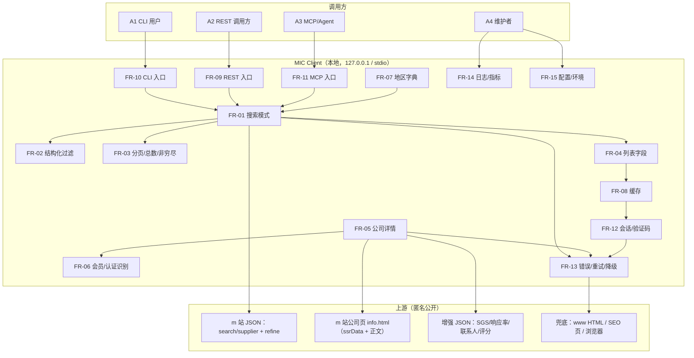
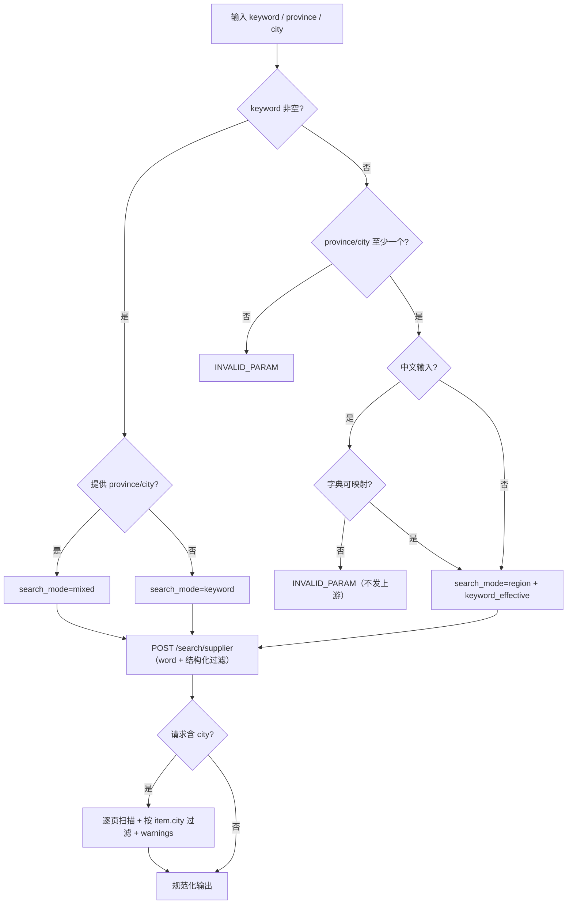

# 01 需求规格说明书 — MIC Client（Made-in-China 本地客户端）

> 版本：0.1 ｜ 状态：Approved（M0 评审通过） ｜ 负责人：req-writer ｜ 最后更新：2026-11-15 ｜ 关联：[docs/README.md](README.md)（固定契约）、[02 架构](02-architecture.md)、[03 REST API](03-rest-api.md)、[04 CLI/MCP](04-cli-mcp.md)、[05 数据与缓存](05-data-and-cache.md)、[06 测试与验收](06-test-acceptance.md)、[07 运维](07-operations.md)、[research/upstream-api.md](research/upstream-api.md)、[research/anonymous-completeness.md](research/anonymous-completeness.md)、[research/membership-tiers.md](research/membership-tiers.md)、[research/captcha-autosolve.md](research/captcha-autosolve.md)、[recon/notes.md](../recon/notes.md)

> **文档定位**：本文是 M0 文档阶段的**需求基线**，定义「做什么、为什么做、验收什么」。
> **不变量**：FR/NFR 编号、错误码、状态/来源枚举、响应包结构严格遵循 [docs/README.md](README.md) §3.5；本文只**引用**错误码，不新增错误码。接口细节（REST/CLI/MCP）以 03/04 为准，数据模型与 DDL 以 05 为准；本文规定其**语义与验收**，冲突时以本文为准并回改 03/04/05。
> **事实纪律**：所有上游事实来自 2026-11-15 实测（`recon/artifacts/api/`、`recon/notes.md`、`docs/research/`）；尚未实测的结论标注 **「待验证」**，不得作为实现依据。

---

## 0. 摘要（TL;DR）

- **目标**：把 Made-in-China（made-in-china.com）的「工厂搜索 → 列表 → 公司详情（入驻年/成立时间/主营/会员等级/认证）」封装成本地单用户客户端，提供 **REST / CLI / MCP** 三入口 + **SQLite 缓存**。
- **主链路（JSON 优先）**：匿名移动站 JSON —— `POST https://m.made-in-china.com/search/supplier`（列表/分页/过滤）+ `GET https://m.made-in-china.com/company-<account>/info.html`（页内 `ssrData`）+ 匿名增强 JSON（审核章节/响应率/联系人/评分）；HTML 与浏览器只作兜底。
- **不做**：全量/高并发爬取、产品搜索、询盘/交易写操作、登录后私有数据、UI、非公开字段（电话/邮箱等）。
- **验收**：57 条功能验收（AC-01…AC-57）+ 6 条非功能验收（AC-N01…AC-N06），详见 §9；对应测试计划见 [06-test-acceptance.md](06-test-acceptance.md)。

---

## 1. 背景与目标

### 1.1 背景

用户（外贸/采购/销售研究场景）需要按**中国省市**或**关键词**批量了解 Made-in-China 上的供应商情况：有哪些工厂、在哪个城市、主营什么、入驻/成立时间、会员等级（钻石/金牌）、是否认证。官网只能逐页浏览、无结构化输出、难以与本地脚本/Agent 集成；同时上游存在**匿名可用的移动站 JSON 接口**，使「结构化、低风险、可缓存」的本地客户端在技术上可行（见 [research/upstream-api.md](research/upstream-api.md) §0）。

本项目在 **M0 文档阶段**先固化需求与验收，再进入 M1–M4 实现（见 [08-roadmap.md](08-roadmap.md)）。

### 1.2 产品目标

| ID | 目标 | 衡量方式 |
|---|---|---|
| G-01 | 一条命令/一次调用完成「按省市或关键词搜工厂」并拿到结构化列表（含分页、总数、过滤） | AC-01～AC-13 |
| G-02 | 单公司详情可拿到入驻年、成立时间、主营、会员等级、认证、评分等公开字段，且缺失语义明确 | AC-19～AC-25 |
| G-03 | 会员等级/认证识别**可追溯、不臆测**（diamond/gold/free/unknown + audited + evidence） | AC-26～AC-30 |
| G-04 | REST/CLI/MCP 三入口共享同一 core，同查询结果一致；本地缓存可用、可刷新、可降级 | AC-39～AC-45、AC-34～AC-38 |
| G-05 | 在匿名、限速、可人工兜底的前提下稳定运行，不触碰登录墙/非公开数据 | AC-46～AC-50、AC-N02～N03、AC-N06 |

### 1.3 成功指标（M1–M2 验收后回填）

| ID | 指标 | 目标 |
|---|---|---|
| M-01 | 冷启动搜索首屏成功率（真实匿名上游） | ≥95%（受上游风控影响，允许重试） |
| M-02 | 缓存命中率（连续人工使用场景） | ≥60% |
| M-03 | 详情核心字段（入驻年/成立时间/主营/会员等级/认证）可得率 | ≥90%（样本 ≥20 家） |
| M-04 | 会员等级误判率（人工抽检） | 0%（unknown 不算误判；`free` 抽检误判率 ≤5%） |

### 1.4 设计原则

| ID | 原则 | 说明 |
|---|---|---|
| P-01 | JSON 优先 | m 站匿名 JSON 为主；HTML/浏览器仅兜底（ADR-0001） |
| P-02 | 匿名只读 | 只访问公开页面/公开 JSON，不做登录态爬取、不做写操作 |
| P-03 | 本地单用户 | 仅监听 `127.0.0.1`，无鉴权但不出本机；MCP 走 stdio |
| P-04 | 缓存优先 + 限速 | 缓存降低上游请求；串行 + 1.5–2.5s 抖动，避免风控 |
| P-05 | 可追溯 | 每个结论带 source/evidence/fetched_at；缺失带 `availability_reason` |
| P-06 | 不虚构 | 上游无此字段就返回 `null`，不猜、不补、不编造端点 |

---

## 2. 调用方与用户故事

### 2.1 调用方（Actors）

| Actor | 描述 | 主要入口 | 关键诉求 |
|---|---|---|---|
| A1 CLI 用户 | 人工在终端查询、导出 JSON | `mic` 子命令 | 命令可复制、表格/JSON 可选、退出码可判 |
| A2 REST 调用方 | 本地脚本/其他程序 | `GET http://127.0.0.1:8787/api/...` | 稳定 Schema、统一响应包、错误码、缓存语义 |
| A3 MCP/Agent | Claude Code 等 MCP 客户端/LLM Agent | stdio MCP tools | 工具自描述、只读、错误可读、字段稳定 |
| A4 维护者 | 开发者/排障者 | `mic doctor`、日志、缓存命令、测试 | 可观测、可复现、可回归 |
| A5 后续平台扩展方 | 未来接入其他 B2B 平台 | core 抽象 | 平台适配层可插拔（M4+，本文件仅约束边界） |

### 2.2 用户故事（US-01…US-12）

| ID | 用户故事 | 主要 FR | 验收 |
|---|---|---|---|
| US-01 | 作为研究中国供应商的用户，我想用「省份+城市」查工厂（可中文输入），以便了解河北廊坊的玻璃厂有哪些 | FR-01、FR-02、FR-07 | AC-02、AC-03、AC-31、AC-32 |
| US-02 | 作为用户，我想用英文关键词搜工厂（如 glass），并翻页看完前 N 页，以便收集候选名单 | FR-01、FR-03、FR-04 | AC-01、AC-10、AC-12 |
| US-03 | 作为只想按地区浏览的用户，我想只给省市、不给关键词也能搜，以便做地区蒙查（region-keyword 模式） | FR-01、FR-07 | AC-02、AC-03 |
| US-04 | 作为用户，我想按会员等级/认证/经营模式/营收/类目过滤，以便缩小候选（如只看钻石+ISO9001 的河北工厂） | FR-02 | AC-05、AC-06、AC-07 |
| US-05 | 作为用户，我想知道结果总数并明确「2,000+」不是精确值、深页不能穷尽，以便正确解读数据 | FR-03 | AC-10、AC-11 |
| US-06 | 作为用户，我重复查询同一条件时希望秒回（缓存），并能在需要时强制刷新 | FR-08、FR-09 | AC-34、AC-36 |
| US-07 | 作为用户，我想查看单家公司的入驻年、成立时间、主营、会员等级、认证、评分、地址，以便判断匹配度 | FR-05、FR-06 | AC-19～AC-25 |
| US-08 | 作为销售/采购，我想按会员等级（钻石/金牌）与认证筛选，并确认等级判定依据（evidence），以便优先联系高价值供应商 | FR-02、FR-06 | AC-05、AC-26、AC-27 |
| US-09 | 作为脚本作者，我想通过本地 REST 拿到稳定 JSON 并区分 cached/stale/partial，以便自动化流水线 | FR-08、FR-09、FR-13 | AC-39、AC-40、AC-51～AC-53 |
| US-10 | 作为 Agent，我想通过 MCP 工具完成「搜工厂→取详情」两步，且不会触发写操作，以便安全集成到对话流程 | FR-11、FR-09、FR-10 | AC-44、AC-45 |
| US-11 | 作为用户，遇到验证码/风控时我希望客户端自动处理，失败时提示我人工过一次（`mic auth`），以便不中断工作 | FR-12 | AC-46～AC-50 |
| US-12 | 作为维护者，我想自检环境、看结构化日志与缓存统计，以便快速排障与回归 | FR-14、FR-15 | AC-54～AC-57 |

### 2.3 用例图

---

## 3. 范围

### 3.1 In Scope（首期，M1–M3）

| # | 能力 | 说明 |
|---|---|---|
| I-01 | 工厂搜索 | 关键词模式 / 地区模式（地区词当 keyword）/ 组合模式；支持分页 |
| I-02 | 结构化过滤 | 省（上游原生）、市（客户端按 `item.city` 过滤）、类目、会员等级、认证、经营模式、年营收、R&D/贸易能力 |
| I-03 | 结果列表 | 公司名/account/地区/主营/会员等级/认证/星级/认证清单/经营模式/推荐产品摘要等（FR-04） |
| I-04 | 公司详情 | 入驻年（memberSince）、成立时间、主营、员工数、地址、认证文本、评分、星级、会员等级、Audited、审核机构/编号/章节、响应率、公开联系人姓名/部门/职位（分期交付） |
| I-05 | 会员等级识别 | diamond/gold/free/unknown + audited 布尔 + evidence + confidence（FR-06） |
| I-06 | 地区字典 | 32 省英文/中文/上游取值（31 省 refine + Qinghai）；已实测城市字典（河北 10 城 + 样本城市） |
| I-07 | 本地缓存 | SQLite（WAL）+ TTL + refresh + stale 回退 + single-flight + 统计 |
| I-08 | 三入口 | REST（127.0.0.1:8787）、CLI（`mic`）、MCP（stdio，4 个只读 tool） |
| I-09 | 会话与风控 | cookie jar、302/挑战检测、Focus Captcha 自动通过、`mic auth` 人工兜底、限速 |
| I-10 | 错误与降级 | 统一错误码（README §3.5）、重试/降级矩阵、stale/partial 语义 |
| I-11 | 可观测与配置 | 结构化日志、关键指标、配置优先级、`mic doctor` |

### 3.2 Out of Scope（首期不做）

| # | 不做 | 原因/边界 |
|---|---|---|
| O-01 | 全量/高并发爬取、批量导出全站 | 合规与风控；只做按需查询 + 缓存 |
| O-02 | 产品搜索（`POST /search/product`，36/页） | 非首期目标；接口已探明但不在 FR 内（未来可扩展） |
| O-03 | 询盘、发信、收藏、交易等**写操作** | 只读客户端；不触碰登录态买家功能 |
| O-04 | 登录后的私有数据 | 无账号需求；且匿名页面不存在「登录才有」的供应商字段（见 research/anonymous-completeness.md §0） |
| O-05 | Web UI / 桌面 GUI | 只做 API/CLI/MCP |
| O-06 | 电话/邮箱/WhatsApp/Skype/微信等直接联系方式 | **平台不公开**（不是登录墙），恒 `null` + `not_public_by_platform`；不建模为「登录可得」 |
| O-07 | 审核报告全文/PDF/明细 | 平台不公开（report.html 301→About Us，可见文本相同） |
| O-08 | 营业执照注册号/执照图 | 平台仅展示 "verified business licenses" 文案 |
| O-09 | KA/SKA/GSKA 识别 | 阿里国际站口径，MIC 页面无标识；不进入 tier |
| O-10 | 员工数过滤（SEO `NE_`） | 无 JSON 支持，SEO 兜底风控高；首期不支持（开放问题 OQ-06） |
| O-11 | 多平台（阿里/环球资源等）适配 | M4+；本文只要求 core 边界可扩展 |
| O-12 | 价格区间 / 榜单 / 广告投放分析 | 非首期目标 |
| O-13 | 猜测性字段补全（如从简介猜成立年） | 违反 P-06；一律 null + reason |

### 3.3 里程碑边界

| 阶段 | 本文 FR 覆盖 | 说明 |
|---|---|---|
| M1 | FR-01/02（省市）/03/04/07/08/10（基础） | JSON 搜索 + 列表 + 地区模式 + 城市本地过滤 + SQLite 缓存 + CLI `--json` |
| M2 | FR-05/06 + FR-08（详情缓存）+ 增强字段（P1） | 详情 ssrData + 正文 + 会员识别 + 审核章节/响应率（P1） |
| M3 | FR-09/10/11/12（auth）/13/14/15 | REST + MCP + `mic auth` + 错误/日志/配置 |
| M4 | 全量回归与文档收尾 | 06 测试执行、已知限制记录 |

---

## 4. 功能需求（FR-01…FR-15）

> 说明：每条 FR 给出描述/输入/输出/依赖/优先级/验收映射与规则细则。规则编号 `R<n>` 在本条内唯一。
> 优先级：**P0** = M1–M2 必须；**P1** = M2–M3 应做；**P2** = 可延后。
> 错误码/状态枚举/响应包只引用 [docs/README.md](README.md) §3.5，不在此重定义。

### 4.1 FR-01 搜索模式（关键词 / 地区 / 组合）｜P0

**描述**：一次搜索请求支持三种模式（ADR-0004）：`keyword`（仅关键词）、`region`（仅省市，用地区英文词作为上游 keyword，自动推导 province 过滤并后置校验）、`mixed`（关键词 + 省市过滤）。中文省/市输入按 FR-07 字典映射为英文；无法映射的中文输入返回 `INVALID_PARAM`（不发上游请求，避免无意义风控）。

| 项 | 内容 |
|---|---|
| 输入 | `keyword`（可选，字符串）、`province`（可选，英文名/中文名）、`city`（可选，英文名/中文名）、`page`（默认 1）、`page_size`（默认 20）、结构化过滤（FR-02）、`refresh`（默认 false） |
| 输出 | `SearchResult`：`items[]`、`pagination`、`query`（含 `search_mode`/`keyword`/`keyword_effective`/`province`/`city`/`region_validated`/`filters`）、`meta` |
| 依赖 | FR-02/03/04/07/08/12/13 |
| 优先级 | P0 |
| 验收标准 | AC-01、AC-02、AC-03、AC-04 |

**规则**

- **R1（模式判定）**：`keyword` 非空 → 有省/市则 `query.search_mode=mixed`，否则 `keyword`；`keyword` 为空且 `province`/`city` 至少一个 → `region`；三者皆空 → `INVALID_PARAM`。`query.region_validated` 标记地区输入是否通过字典校验（ADR-0004）。
- **R2（参数校验）**：`keyword` 去首尾空白、折叠连续空白；长度 1–100 字符，允许字母/数字/空格/`-`/`'`；禁止 `*`（上游空结果）、禁止纯空白；仅空白按空处理。`page` 为 1–100 整数；`page_size` 默认 20、合法 1–100（非 20 时由 03 §1.7 拼接/裁剪并 warning `PAGE_SIZE_NOT_NATIVE`；NFR-01 性能基线仅 `page_size=20`）。
- **R3（地区派生 keyword）**：region 模式派生规则——有 `province` 用省英文名（如 `hebei`）；仅有 `city` 用城市英文名（如 `langfang`）并自动推导其所属省份（ADR-0003/0004）；派生词小写、去空白。派生行为通过 `query.search_mode=region` 与 `query.keyword_effective` 回显（03 §7.4），**不新增 warning 码**。
- **R4（中文映射）**：中文省/市名按 FR-07 字典映射英文（ADR-0004）；无法映射的中文地区输入、或在 `keyword` 模式传入中文产品词（英文站不索引中文，实测返回 0）→ **不请求上游**，返回 `INVALID_PARAM`（`details.field` + 「仅支持英文关键词/已支持的中文城市」提示）。中文映射词典范围见 OQ-01。
- **R5（组合语义）**：keyword 与省/市/过滤条件为 **AND** 语义，由上游参数组合实现（实测 `province=Hebei&memberLevel=50&managementCertification=-5&catCode=1500000000&comBusinessType=1` → total=45）。
- **R6（城市）**：`city` 不传给上游（JSON 接口无 city 参数，`city/cityName/comCity` 被忽略，见 [research/upstream-api.md](research/upstream-api.md) §3.9）；由客户端对结果 `item.city` 过滤（FR-02 R4）。
- **R7（响应回显）**：`query` 必须回显用户原始输入与派生值（`search_mode`、`keyword`、`keyword_effective`、规范化后的 `province`/`city`、`region_validated`、`filters`），便于复现与排障。
- **R8（联想 P2）**：搜索联想接口（`keywordsuggestions...getEnSupplierSuggest.do`）为 P2 可选能力，不阻塞首期；若实现，仅用于提示，不改变搜索语义。

**验收要点**：`keyword=glass` → `search_mode=keyword`、20 条/页（AC-01）；`province=Hebei` 无 keyword → `search_mode=region`、派生 `keyword_effective=hebei`（AC-02）；`province=河北&city=廊坊` → 中文映射 + 客户端城市过滤（AC-03）；`keyword=glass&province=Hebei` → `search_mode=mixed`、total=669（AC-04）。

### 4.2 FR-02 结构化过滤（省/市/类目/会员等级/认证/经营模式/营收/R&D）｜P0（省/市）/ P1（其余）

**描述**：支持与关键词 AND 组合的结构化过滤。上游原生支持省及 6 类过滤；市与员工数无 JSON 支持，其中**市由客户端过滤**（员工数首期不支持）。

| 项 | 内容 |
|---|---|
| 输入 | `province`、`city`、`category_code`、`membership_tier`、`audited`、`business_type`、`annual_revenue`、`rd_capacity`（含义见下表） |
| 输出 | 上游参数映射（`query.upstream_params` 脱敏后回显）+ 客户端过滤后的 `items[]`；过滤类 warning |
| 依赖 | FR-01/03/07/08 |
| 优先级 | P0：`province`、`city`；P1：其余 |
| 验收标准 | AC-05、AC-06、AC-07、AC-08、AC-09 |

**参数与上游映射**

| 客户端参数 | 取值（语义值） | 上游参数/取值 | 传递方式 | 备注 |
|---|---|---|---|---|
| `province` | 31 个英文省名（如 `Hebei`）或中文（`河北`） | `province=Hebei` | 服务端 | 非法/中文未映射 → `INVALID_PARAM`（上游非英值会静默 total=0，不能透传） |
| `city` | 城市英文名（如 `Langfang`）或中文（`廊坊`） | 无（上游忽略） | **客户端过滤** | 大小写不敏感；缺失 `city` 的条目排除并 warning（R4） |
| `category_code` | 数字类目码（如 `1500000000`） | `catCode` | 服务端 | 取值以 refine 字典为准（移动 refine 仅 top-10，OQ-02） |
| `membership_tier` | `diamond`→50、`gold`→30 | `memberLevel` | 服务端 | 仅支持 diamond/gold；`free`/`unknown` → `INVALID_PARAM`（`UNSUPPORTED_MEMBERSHIP_FILTER`，03） |
| `audited` | `true` | 无（首期在**客户端**对扫描结果按 `CompanyListItem.audited` 过滤） | 客户端 | 03 §7.6：本地过滤 + `CLIENT_SIDE_FILTER`/`NON_EXHAUSTIVE`；上游 `memberLevel=0,1,3` 实测可用，作为后续一致性优化（待验证） |
| `business_type` | `manufacturer`→1、`trading`→2、`group`→4、`other`→8 | `comBusinessType` | 服务端 | 也可兼容传数字码（03 定表示法） |
| `annual_revenue` | 7 档枚举（`<1m`…`>100m`） | `annualRevenue` 1–7 | 服务端 | 字典见 `filters/facet-dictionaries.json` |
| `rd_capacity` | `oem`→4、`odm`→5、`quick_response`→01、`fast_delivery`→02、`small_amount_payment`→03 | `rdCapacity` | 服务端 | 可多值（以 03 定义为准） |
| `management_certification` | 认证名（如 `ISO9001:2015`）或上游码（`-5`） | `managementCertification` | 服务端 | 44 项字典；未知 → `INVALID_PARAM` |

**规则**

- **R1（服务端过滤透传）**：仅透传上表「服务端」列且通过字典校验的值；顺序与组合不影响语义（AND）。
- **R2（省校验）**：`province` 必须是 FR-07 字典中 31 个英文名之一（中文先映射）；否则 `INVALID_PARAM`，不得请求上游（上游对非法值返回 total=0，会制造「假空结果」）。
- **R3（过滤组合）**：`membership_tier` 走服务端 `memberLevel`；`audited=true` 走客户端过滤（扫描/本地判定）；二者可同时使用（AND），但客户端过滤会消耗扫描预算并可能产生 `NON_EXHAUSTIVE`。
- **R4（城市客户端过滤）**：按 ADR-0003/03 §7.6 执行——① 城市在字典中则自动推导所属省份（回显 `query.province_inferred`，不产生 warning）；字典不完整时英文城市可透传（`CITY_NOT_IN_DICTIONARY`）；② 从第 1 页开始按扫描预算（`scan_max_pages`，03 默认 10 页；可配置）逐页拉取该省结果，对每条比较 `item.city`（trim、大小写不敏感）；命中保留、不命中丢弃、`item.city` 为空丢弃；③ `meta.warnings` 必含 `CITY_FILTERED_LOCALLY`（`scanned_pages`/`matched`/`scan_budget` 等 details）；④ 扫描预算耗尽或该省 `total` 封顶 → `pagination.total_is_lower_bound=true` + `NON_EXHAUSTIVE`（`reason=scan_budget_exhausted`），明确「非穷尽」；⑤ 结果顺序按上游顺序，分页窗口语义以 03 为准，不得把下界当精确值。
- **R5（过滤回显）**：`query.filters` 回显规范化后的过滤值；`query.upstream_params` 回显实际传给上游的参数（不含 cookie/敏感头）。
- **R6（组合验证）**：多条件 AND 组合必须可用；golden 基线：`province=Hebei&member_level=diamond&management_certification=ISO9001:2015&category_code=1500000000&business_type=manufacturer` → total=45（实测）。
- **R7（非法取值）**：任何过滤值不在字典/枚举内 → `INVALID_PARAM`，附 `details.field`。

### 4.3 FR-03 分页、总数、非穷尽保护｜P0

**描述**：把上游「20 条/页 + total/totalPage + 2000 封顶 + 页码夹取」的语义安全地暴露给调用方，并明确「数据非穷尽」。

| 项 | 内容 |
|---|---|
| 输入 | `page`、`page_size`、缓存/上游返回的 `page/pageSize/total/totalNum/totalPage` |
| 输出 | `pagination {page, page_size, total, total_display, total_capped, total_page, has_more, page_clamped, total_is_lower_bound}`（与 03 §1.7 一致） |
| 依赖 | FR-01/08/13 |
| 优先级 | P0 |
| 验收标准 | AC-10、AC-11、AC-12、AC-13 |

**规则**

- **R1（页大小）**：上游每页固定 20（实测传 `pageSize=100` 时响应 `pageSize=100` 但 `dataList` 仍 20 条）；对外 `page_size` 默认 20、合法 1–100；非 20 时按 03 §1.7 拼接/裁剪并 warning `PAGE_SIZE_NOT_NATIVE`；NFR-01 性能基线仅 `page_size=20`。
- **R2（页码范围）**：`page ≥ 1`；`page > 100` → `INVALID_PARAM`（上游 `totalPage ≤ 100`，见 R3）。
- **R3（total 封顶）**：上游 `total > 2000` 时返回 `total=2000`、`totalNum="2,000+"`、`totalPage=100`。客户端输出：`pagination.total=2000`、`total_display="2,000+"`、`pagination.total_capped=true`、`total_page=100`，并附 warning `NON_EXHAUSTIVE`（03 §1.7）。`total ≤ 2000` 时 `total_display` 为带千分位的精确值（如 `"669"`），`total_capped=false`。
- **R4（末页夹取）**：请求页超过上游末页时，上游返回**末页内容**且响应 `page` 字段为末页（实测 page=101 → 返回 page=100 的内容）。客户端 MUST 比较「响应 page」与「请求 page」：不一致 → 视为已到末页，`pagination.page_clamped=true`、`has_more=false`（03 §1.7）；不得把被夹取页重复当作新页输出。
- **R5（去重）**：跨页/多次请求按 `account`（缺省回退 `company_id`）去重（03 §1.7）；广告可能跨页重复，去重时保留首次出现；发生去重 → warning `DUPLICATES_REMOVED`。
- **R6（has_more）**：`has_more = (remote_page == requested_page) && (remote_page < total_page) && (items 非空)`。
- **R7（空结果）**：`total=0` → `items=[]`、`status=success`、`has_more=false`；**不得**返回 `NOT_FOUND`（NOT_FOUND 只用于公司/资源不存在）。
- **R8（非穷尽声明）**：`total_capped=true`、城市过滤扫描预算耗尽、或覆盖不完整时，响应必须带 `pagination.total_is_lower_bound=true` 与 warning `NON_EXHAUSTIVE`；03/04 的输出必须把该语义暴露给调用方（CLI 表格页脚/JSON 字段），不得把下界当精确值展示。
- **R9（深页保护）**：单次请求不自动无限循环抓取；城市过滤扫描受 `scan_max_pages`（03：默认 10，可配置）约束，批量 `--pages all` 默认 10、硬上限 100（04）；预算用尽 → `NON_EXHAUSTIVE`（扫描）或 warning `PAGE_LIMIT_REACHED`（批量翻页，04）；上游请求受 FR-12 限速约束。

### 4.4 FR-04 结果列表字段与规范化｜P0

**描述**：把上游列表 JSON 归一化为稳定的 `CompanyListItem`（snake_case），默认过滤广告，缺失字段显式 `null` 并给原因。

| 项 | 内容 |
|---|---|
| 输入 | 上游 `dataList[]`（每页 20 条） |
| 输出 | `items: CompanyListItem[]`、`meta.warnings[]`（含广告过滤/字段缺失统计） |
| 依赖 | FR-01/02/06/08 |
| 优先级 | P0 |
| 验收标准 | AC-14、AC-15、AC-16、AC-17、AC-18 |

**字段清单（列表）**

| 本地字段 | 类型 | 上游来源 | 规范化/缺失规则 |
|---|---|---|---|
| `account` | string（必填） | `mainUserAccount` | 小写、trim；缺失 → 该条剔除并计数（不应出现） |
| `company_id` | string | `id` | 数字转字符串；去重键 |
| `encode_com_id` | string/null | `encodeComId` | 增强接口必填；缺失 → 增强不可用（warning） |
| `company_name` | string | `name` | trim |
| `province` / `city` / `country` | string/null | 同名 | trim；保持上游英文 |
| `main_products` | string[]/null | `mainProduct`（逗号分隔） | 拆分、trim、去空；空 → `null` |
| `business_types` | string[]/null | `businessTypeList` | 原样数组；空 → `null` |
| `system_certifications` | string[]/null | `systemCertificationList` | 原样；字段存在且空 → `[]`；字段缺失 → `null` |
| `is_ad` | boolean | `showAd`/`ad`/`advertise`/`deliveryType` | 广告位标记；默认保留（不删除） |
| `membership.tier` | enum | `csLevel`（50/30） | 见 FR-06；无值 → `unknown` |
| `membership.raw_cs_level` | number/null | `csLevel` | 保留原值 |
| `audited` | boolean/null | `auditType`/`showAuditLogo`/`logoText` | 见 FR-06 |
| `capability_stars` | number/null | `companySymbol.stars` | 字符串数字转 int（0–5） |
| `company_url` | string | 上游 `companyUrl` | `https://m.made-in-china.com/company-<account>/`（03 示例；PC 迷你站 URL 如需要另派生 `minisite_url`，05 定） |
| `company_info_url` | string | `companyInfoUrl` | 原值 `https://m.made-in-china.com/company-<account>/info.html` |
| `employees` / `turnover` / `plant_area` | number/string/null | `comEmployee`/`comTurnOver`/`comPlantArea` | 列表多为空；缺失 → null（详情更全） |
| `detail_source` | enum | 客户端 | `json\|html\|browser\|cache`（同 `meta.source`） |
| `rd_capacity` | string[]/null | `rdCapacityList` | 原样 |
| `business_labels` | string[] | `businessTypeForShow`/`rdCapacityForShow`/`quickResponse`/`fastDelivery`/`leadingFactory` | 仅保留上游明确给出的标签；不臆造 |
| `fetched_at` / `source` | string/enum | 客户端 | ISO8601（+08:00）/ `json\|cache` |
| `raw` | object/null | 上游行 | 可选：调试用原始关键字段（默认不返回，03 定） |

**规则**

- **R1（广告标记）**：识别广告：`showAd=true` 或 `ad=true` 或 `advertise` 存在 或 `deliveryType=="ads"`；**默认保留**并置 `is_ad=true`（03 §7.6：保证与上游分页 1:1），`items` 不因广告被删除；CLI 人类可读输出默认隐藏广告行（04），JSON 保留供调用方按 `is_ad` 自行过滤。
- **R2（去重）**：同页/跨页按 `account`（缺省回退 `company_id`）去重（03 §1.7）；重复时保留首次出现并 warning `DUPLICATES_REMOVED`。
- **R3（不省略 key）**：`CompanyListItem` 的固定字段必须全部出现，缺失用 `null`（数组字段可用 `null`/`[]`，语义按上表）；**不得**输出 `undefined`/省略字段（保证调用方稳定）。
- **R4（类型规范化）**：数字字符串 → number（`stars`）；空字符串 `""` → `null`；`&nbsp;` trim 后判空；数组元素 trim 去重。
- **R5（排序）**：保持上游返回顺序（含广告条目），不本地重排；同 `account` 只保留首个。CLI 表格展示层可隐藏 `is_ad=true` 行（04），JSON 顺序与上游一致。
- **R6（不虚构）**：不得用 `csLevel` 推断 `audited`，不得用营收/员工数推断等级（见 research/membership-tiers.md §4.1「绝不使用」清单）。
- **R7（字段缺失统计）**：对必填核心字段（account/company_name/province/city）缺失的条目剔除并在 `meta.warnings` 计数；非核心字段缺失不剔除。

### 4.5 FR-05 公司详情字段与规范化｜P0（核心）/ P1（增强）

**描述**：按 `account`（或 `comId`/`encodeComId`）获取公司详情：`ssrData` JSON 为主，`info.html` 正文补充员工数/地址/认证文本，匿名增强 JSON 补审核章节/响应率/联系人（P1）。

| 项 | 内容 |
|---|---|
| 输入 | `account`（mainUserAccount）、或 `comId`（数字）、或 `encodeComId`；`include`（P1：`none\|all\|audit\|response\|contacts\|reviews`，逗号组合，03 §8.3） |
| 输出 | `CompanyDetail`（含 `membership`、`enrichment{audit,response,contacts,reviews}` 可选子对象、`channels`、`availability[]`）、`meta` |
| 依赖 | FR-04/06/08/12/13；上游公司页 + 增强接口 |
| 优先级 | P0：ssrData 核心字段 + 正文补充；P1：增强 JSON；P2：PC contact-info/About HTML 兜底 |
| 验收标准 | AC-19、AC-20、AC-21、AC-22、AC-23、AC-24、AC-25 |

**字段清单（详情）**

| 本地字段 | 类型 | 上游来源 | 规范化/缺失规则 |
|---|---|---|---|
| `account` | string | 路径/ssrData `logUsername` | 必填 |
| `company_id` | string | 页顶 `ssrData.comId`（数字） | 与 `companyInfo.content.comId`（encodeComId）**注意区分** |
| `encode_com_id` | string | `companyInfo.content.comId`（实为 encodeComId，见样例） | 增强接口用 |
| `company_name` | string | `companyInfo.content.comName` | trim |
| `membership.tier` / `raw_member_level` | enum/string | `memberLevel`（diamond/gold） | 见 FR-06 |
| `membership.since_year`（内部 `member_since_year`） | number/null | `memberSince`（"2025"） | 只来自详情；不是成立年（对外字段名以 03/04 为准） |
| `audited` | boolean/null | `sgsMember` + `auditReportLogo.logoText/showAuditLogo` | 见 FR-06 |
| `established_at` | string(date)/null | `establishment`（`2015-10-30`） | ISO 日期 `YYYY-MM-DD`；缺失 → null + `not_provided_by_supplier` |
| `main_products` | string[]/null | `mainProducts` | trim、去重 |
| `business_types` | string[]/null | `businessTypes` | 原样 |
| `rd_capacity` | string[]/null | `rd`（["OEM"]） | 原样 |
| `capability_stars` | number/null | `companySymbol.intStars`/`stars` | 0–5 |
| `rating` | string/null | `reviewStatistics.rating`（`"4.9/5"`） | 保留原文；缺字段 → null + `no_reviews`；详情 API 映射到 `enrichment.reviews.rating_display`（03） |
| `logo_url` | string/null | `logoUrl` | 协议相对 `//` → 补 `https:` |
| `employees` | number/null | info.html 正文 `Number of Employees: N` | 正则提取；无 → null + `not_provided_by_supplier` |
| `address` | string/null | info.html 正文 `Address: …` | trim；无 → null + reason |
| `management_certifications` | string[]/null | info.html `Management System Certification: …` | 拆分逗号；无 → null + `not_provided_by_supplier` |
| `company_overview` | string/null | info.html/About 正文 | 长文本可选（P1） |
| `enrichment.audit` | object/null | 增强 SGS 章节 + About 文本 | `{audited, sections[], audited_section_count, agency, report_no, verify_url, verified_items_count, source, fetched_at}`（03 §8.5） |
| `enrichment.response` | object/null | 增强 `replyRate` | `{avg_response_hours, timely_reply_ratio, top_avg_response_hours, top_timely_reply_ratio, range_display, window_days, as_of, source, fetched_at}` |
| `enrichment.contacts` | object/null | 增强 `getSubAccount` + 正文 | `{persons[{name,id,title,department,online,chat_available}], primary, channels{phone,email,whatsapp,skype,wechat,reason}, inquiry_url}`；**不含电话/邮箱**（恒 null + `not_public_by_platform`；title/department 首期 null，03 §8.3） |
| `enrichment.reviews` | object/null | 增强评价接口 + `reviewStatistics` | `{rating_value, rating_display, review_count, items[]}`（明细 P2） |
| `channels`（`enrichment.contacts`） | object | 客户端/派生 | `{phone:null,email:null,whatsapp:null,skype:null,wechat:null,reason:"not_public_by_platform"}`（03） |
| `availability` | object[] | 派生 | `[{field, reason}]`：已尝试解析且确认缺失的字段（03 §8.6；reason 五枚举） |
| `sources` | string[] | 客户端 | 如 `["json:ssrData","html:info","json:sgs_report"]` |
| `fetched_at` | string | 客户端 | ISO8601 +08:00 |

**规则**

- **R1（查找解析）**：`account` 直接请求 `GET https://m.made-in-china.com/company-<account>/info.html`（**移动端 UA**，桌面 UA 会 302 到 PC 迷你站）；`comId`（数字）先查本地映射（列表/详情缓存）→ 未命中则请求 `https://m.made-in-china.com/company/<comId>` 跟随 301 取 `Location` 中的账号；`encodeComId` 只能查本地映射（无公开反查接口，**待验证**）→ 均失败返回 `NOT_FOUND`。查找请求受 FR-12 限速。
- **R2（JSON 解析）**：提取 `<script type="text/json" id="ssrData">` 并解析 `companyInfo.content`；`companyInfo.code != 0` 或脚本缺失 → 记 `PARSE_ERROR`/`UPSTREAM_CHANGED`，按 FR-13 降级（可继续尝试 HTML 正文兜底）。
- **R3（正文补充）**：同一次响应内用稳定正则提取员工数/地址/认证文本；正文缺失不视为失败，字段置 `null` + `availability_reason`。
- **R4（增强字段）**：仅在请求含 `include` 或 CLI `--enrich` 时调用；单个增强接口失败 → 该子对象 `null`、整体标 partial 派生状态（`warnings` 非空而主体成功；是否显式 `status` 字段以 03 为准）、warning `ENRICHMENT_PARTIAL`，不得整体失败；`encode_com_id` 缺失 → 跳过增强并 warning。
- **R5（一致性校验）**：详情 `membership.tier` 与列表已知 `csLevel` 冲突时，以详情为准并记录双源 evidence（FR-06 R6）。
- **R6（缺失语义）**：所有可为 `null` 的字段必须按 §6.3 给出 `availability_reason`；区分「供应商未填」与「平台不公开」。
- **R7（缓存）**：详情缓存 24h；`refresh=true` 强制刷新；上游失败时按 FR-08 回退 stale。
- **R8（审核报告页）**：`<host>.en.made-in-china.com/audited-supplier-reports/report.html` 是 About Us 别名（301），客户端**不得**重复抓取当作独立数据源；审核信息以增强 JSON + About 文本为准。
- **R9（不解析非公开）**：不提取、不存储电话/邮箱/WhatsApp 等（平台不公开）；`contact.html` 仅取公开联系人姓名/部门/职位。

### 4.6 FR-06 会员等级与认证识别（tier / audited / evidence）｜P0

**描述**：输出稳定枚举 `membership.tier = diamond|gold|free|unknown` + `audited: boolean|null` + `membership.since_year`（会员起始年，内部 `member_since_year`）+ `evidence[]` + `confidence`；多来源冲突按优先级裁决；绝不臆测。

| 项 | 内容 |
|---|---|
| 输入 | 列表 `csLevel`/`memberType`/`auditType`/`showAuditLogo`/`logoText`；详情 `memberLevel`/`memberSince`/`sgsMember`/`auditReportLogo`；HTML 徽章文案（兜底） |
| 输出 | `MembershipInfo`（见 §6.1）+ `audited` + `evidence[]` + `confidence` |
| 依赖 | FR-04/05 |
| 优先级 | P0 |
| 验收标准 | AC-26、AC-27、AC-28、AC-29、AC-30 |

**判定优先级（从高到低）**

| 优先级 | 来源 | 规则 |
|---|---|---|
| P0 | 详情 `ssrData.memberLevel` | `diamond`/`gold` → 对应 tier（confidence=high）；空/缺失 → 继续 |
| P1 | 列表 `csLevel` | `50`→diamond、`30`→gold（high）；其他值/缺失 → unknown |
| P2 | 列表 `memberType` | `10`↔diamond、`1`↔gold（仅校验用，不作主依据，**待验证**语义映射） |
| P3 | 公司站 HTML 徽章（兜底） | 文本 `Diamond Member`/`Gold Member` 或 `icon-diamond`/`icon-gold`（high，需配合文本） |
| P4 | 兜底 | 新版搜索卡片无等级标识 → `unknown`（不猜） |

**规则**

- **R1（tier 枚举）**：仅 `diamond|gold|free|unknown`；**禁用** `ka/ska/gska`、`audited`、`premium`、星级作为 tier（见 research/membership-tiers.md §4.1）。
- **R2（audited 独立三态）**：`true`/`false`/`null`；判定来源：列表 `auditType=1` 或 `showAuditLogo=true` 或 `logoText="Audited Supplier"` → true；`auditType=0` 且 `showAuditLogo=false` → false；详情 `sgsMember=true` → true；`sgsMember=false` → false；无任何信号 → null。**不得**由 `csLevel` 反推。
- **R3（since_year / member_since_year）**：仅取详情 `memberSince`（或 HTML `.J-member-since-tooltip .txt-year` 的 `Since YYYY`）；**不得**从公司简介正文的 `Since 20xx`、成立年、注册年推断。对外字段名以 03/04（`membership.since_year`）为准。
- **R4（free 判定）**：仅当「公司页完整加载 + 无任何会员徽章 + 无 AS + 无 member-since」时判 `free`（confidence=medium）；仅有列表数据无 `csLevel` → `unknown`，不判 free（新版列表页可能不显示等级，见 research/membership-tiers.md §3.3）。
- **R5（unknown）**：无法判定/被风控/结构异常/仅新版列表 → `unknown` + `confidence=low|medium` + evidence 说明原因；不返回猜测值。
- **R6（冲突与 evidence）**：多来源不一致时按优先级取高者，`evidence` 保留全部冲突来源（如 `json:csLevel=30`、`json:memberLevel=diamond`），`confidence` 降为中或低并进 open question 复核；evidence 格式 `来源:字段=值`，如 `json:csLevel=50`、`json:memberLevel=diamond`、`html:badge_text=Diamond Member`、`html:member_since=Since 2025`。
- **R7（capability_stars 独立）**：`Supplier Capability Index` 0–5 单独字段，不映射 tier；单颗灰色星 = 0/无指数（实测 lvxingmirror）。
- **R8（大客户/KA 边界）**：按 ADR-0005，预留独立字段 `external_customer_tier`（默认 `null`，只能由销售/CRM 等外部数据回填）；抓取阶段一律 `null`。`tier` 枚举不得出现 `ka/ska/gska`；优享/尊享/MKA 与大客户标识公网不可识别，不写入 tier（字段定义与呈现以 04/05 为准）。
- **R9（解释接口）**：`GET /api/membership/levels` / MCP `explain_membership` 返回静态说明（含 Diamond 59,800/年、Gold 31,100/年、Audited 正交、KA/SKA 非 MIC 概念），供调用方展示。

### 4.7 FR-07 地区字典（省/市，中英映射）｜P0（省）/ P1（城市全量）

**描述**：维护省/市字典（英文名、中文名、上游取值/SEO 代码），供中文输入映射、搜索参数校验、地区模式派生、`/api/regions` 输出与缓存使用。

| 项 | 内容 |
|---|---|
| 输入 | 用户省/市（中文或英文）；`GET /api/regions?province=`；refine/SEO 字典数据 |
| 输出 | `Region` 字典：32 省 + 城市列表（含中英名、上游取值、SEO code） |
| 依赖 | 上游 refine（31 省）+ SEO 过滤面板（32 省含 Qinghai）→ 本地字典 32 项（05 §5）；河北 10 城 count；列表 `city` 值；缓存 FR-08 |
| 优先级 | P0：省字典（31）；P1：已实测城市字典（河北 10 城 + 样本城市）；P2：全量城市 |
| 验收标准 | AC-31、AC-32、AC-33 |

**32 省清单（上游 `province` / SEO `CP_` 合法值 + 中文；与 05 §5 一致）**

| # | 英文名（上游值） | 中文 | # | 英文名（上游值） | 中文 |
|---|---|---|---|---|---|
| 1 | Guangdong | 广东 | 17 | Chongqing | 重庆 |
| 2 | Shandong | 山东 | 18 | Shaanxi | 陕西 |
| 3 | Zhejiang | 浙江 | 19 | Guangxi | 广西 |
| 4 | Jiangsu | 江苏 | 20 | Shanxi | 山西 |
| 5 | Hebei | 河北 | 21 | Hainan | 海南 |
| 6 | Fujian | 福建 | 22 | Yunnan | 云南 |
| 7 | Henan | 河南 | 23 | Gansu | 甘肃 |
| 8 | Shanghai | 上海 | 24 | Hongkong S.A.R. | 香港特别行政区 |
| 9 | Anhui | 安徽 | 25 | Inner Mongolia | 内蒙古 |
| 10 | Tianjin | 天津 | 26 | Jilin | 吉林 |
| 11 | Hunan | 湖南 | 27 | Guizhou | 贵州 |
| 12 | Jiangxi | 江西 | 28 | Heilongjiang | 黑龙江 |
| 13 | Hubei | 湖北 | 29 | Xinjiang | 新疆 |
| 14 | Beijing | 北京 | 30 | Ningxia | 宁夏 |
| 15 | Liaoning | 辽宁 | 31 | Taiwan, China | 台湾 |
| 16 | Sichuan | 四川 | 32 | Qinghai | 青海 |

> 说明：移动 refine 返回 **31 项**（缺 Qinghai，无结果项不出现），SEO 过滤面板返回 **32 项**（多 Qinghai）；`province=Qinghai` 实测为合法参数（glass 下 0 条）。本地字典**收录 32 项**（避免青海供应商漏检，05 §5），以 `in_mobile_facet`/`in_seo_facet` 记录来源差异；Macao（澳门）两套 facet 均未出现，暂不收录（待验证）。

**规则**

- **R1（输入归一）**：接受中文/英文、大小写混排、前后空格；中文按上表映射；英文按字典匹配（大小写不敏感）；空串按未提供。
- **R2（省校验）**：未知名（含中文未映射名）→ `INVALID_PARAM`；不得透传给上游（避免假空结果）。
- **R3（城市字典）**：M1 城市字典以实测数据为准——河北 10 城（Shijiazhuang/Hengshui/Cangzhou/Xingtai/Baoding/Langfang/Handan/Tangshan/Qinhuangdao/Zhangjiakou）+ 采样中出现城市（Langfang 等）；每个城市含英文名、中文名、所属省、SEO code（`C1--CP_<Prov>--CC_<Prov>_<City>`）。**全量城市字典生成方案与覆盖率待验证（OQ-02）**。
- **R4（城市透传）**：用户给的城市不在字典但为英文 → 透传为客户端过滤目标并 warning `CITY_NOT_IN_DICTIONARY`（不阻断）；中文且不在字典 → `INVALID_PARAM`。
- **R5（地区模式映射）**：地区模式派生 keyword 用英文小写（省名→`hebei`，市名→`langfang`）；可选多词 `"hebei shijiazhuang"`（实测 AND 匹配）作为 P2 增强。
- **R6（regions 输出）**：`GET /api/regions` 返回 32 省（含 Qinghai）；`?province=` 返回该省城市列表；数据来源标注 `source`（`upstream|static|cache`）；缓存 30d。
- **R7（可追溯）**：城市字典的每个条目保留 evidence（来源：refine/SEO/list 值），无法确认的城市不标 `verified`。

### 4.8 FR-08 缓存（键/TTL/刷新/降级）｜P0

**描述**：SQLite 缓存搜索结果页、公司详情、地区字典与原始快照（可选），降低上游请求、支持 stale 回退与刷新。

| 项 | 内容 |
|---|---|
| 输入 | 查询参数/详情 account/refresh 标志；配置 TTL |
| 输出 | 命中数据 + `meta.cached/stale/fetched_at/source`；缓存统计 |
| 依赖 | SQLite（05 定义 DDL）、FR-03/04/05/07/13 |
| 优先级 | P0 |
| 验收标准 | AC-34、AC-35、AC-36、AC-37、AC-38 |

**规则**

- **R1（缓存键）**：`params_hash = hash(规范化参数)`，规范化包括：mode、keyword（trim+小写）、province/city（字典标准英文名）、filters（按固定字段名排序、值规范化）、page、page_size、上游接口版本标签。详情键 = `account`（及 `include` 子集）；地区键 = `province`。
- **R2（TTL）**：列表搜索页 6h；公司详情 24h；地区字典 30d；均可配置（FR-15）；`refresh=true` 跳过读、成功后覆盖写。
- **R3（stale 回退）**：缓存存在但已过期 + 上游请求失败（UPSTREAM_UNAVAILABLE/PARSE_ERROR/UPSTREAM_CHANGED）→ 返回旧数据，`meta.stale=true`（派生状态为 stale）、warning `STALE_DATA`（含原 `fetched_at`）；无缓存则返回错误（FR-13）。
- **R4（single-flight）**：相同缓存键的并发请求合并为一次上游请求，其余等待复用结果；避免缓存击穿。
- **R5（不缓存错误）**：错误/挑战页不写缓存；空结果（total=0）可缓存（TTL 同列表），但 `refresh` 必须重新请求。
- **R6（刷新接口）**：`POST /api/cache/refresh` 支持 scope=`search|company|regions|all` 或精确 key；CLI `mic cache refresh`；刷新请求受限速与风控约束，不得批量轰炸。
- **R7（统计）**：`GET /api/cache/stats` 返回条目数（按类型）、命中/未命中计数、SQLite 大小、最旧/最新 fetched_at；CLI `mic cache stats`。
- **R8（原始快照 P2）**：可选保存原始响应（gzip）用于 PARSE_ERROR 举证；默认关闭，开启时有大小上限与保留期（默认 7 天，05 定）；不得保存含 cookie 的请求头。
- **R9（一致性）**：命中/未命中返回的数据结构必须一致（仅 meta 不同），调用方无需区分分支。

### 4.9 FR-09 REST API 入口｜P0

**描述**：提供本地 REST 服务（默认 `http://127.0.0.1:8787`），仅监听回环地址、无鉴权（说明见 NFR-03），统一响应包/错误码遵循 README §3.5。

| 项 | 内容 |
|---|---|
| 输入 | HTTP 请求（GET/POST） |
| 输出 | 统一响应包 `{ok, data\|error, meta}` |
| 依赖 | FR-01/02/03/04/05/06/07/08/13/14 |
| 优先级 | P0 |
| 验收标准 | AC-39、AC-40、AC-41 |

**端点能力（语义；详细参数/Schema/示例以 03 为准）**

| 方法 | 路径 | 能力 | 关联 |
|---|---|---|---|
| GET | `/health` | 服务/会话/缓存状态（不触发上游） | NFR-03 |
| GET | `/api/regions` | 省/市字典，支持 `province` | FR-07 |
| GET | `/api/search/factories` | 搜索工厂：keyword/province/city/过滤/page/page_size/refresh | FR-01/02/03/04 |
| GET | `/api/companies/{account}` | 公司详情；`account` 也接受 comId/encodeComId 查找规则 | FR-05/06 |
| GET | `/api/membership/levels` | 会员等级静态说明（含 KA/SKA 澄清） | FR-06 |
| POST | `/api/cache/refresh` | 按 scope/key 刷新缓存 | FR-08 |
| GET | `/api/cache/stats` | 缓存统计 | FR-08 |
| GET | `/api/version` | 版本信息（可选） | FR-15 |

**规则**

- **R1（本地边界）**：默认且必须只监听 `127.0.0.1`（回环）；若配置为非回环地址，启动日志必须 WARN 并要求显式确认（NFR-03）。
- **R2（统一响应包）**：成功 `{ok:true,data,meta:{request_id,cached,stale,fetched_at,source,warnings}}`；失败 `{ok:false,error:{code,message,details},meta}`；字段与枚举严格遵循 README §3.5。
- **R3（参数校验）**：缺失/非法 → HTTP 400 `INVALID_PARAM`（`details.field` 指明字段）；未知路径 → 404；方法不允许 → 405（03 定）。
- **R4（缓存语义）**：`meta.cached/stale/fetched_at/source` 必须如实反映；`source` 枚举 `json|html|browser|cache`。
- **R5（错误映射）**：错误码 → HTTP 状态严格按 README 表；`RATE_LIMITED` 必须带 `Retry-After`；`request_id` 同时写入响应与日志（FR-14）。
- **R6（时间格式）**：所有时间字段 ISO8601 带时区偏移（`2026-11-15T22:59:00+08:00`）。
- **R7（无鉴权声明）**：README/07 文档与 `/health` 说明中必须提示「本机无鉴权，请勿暴露到公网」；服务不得内置任何远程监听默认值。
- **R8（三入口一致）**：REST 返回字段/排序/分页与 CLI `--json`、MCP tool 输出一致（见 FR-11 R5）。

### 4.10 FR-10 CLI 入口｜P0

**描述**：提供 `mic` 命令行（Node 22，经 cloak-env 启动），覆盖搜索/详情/地区/缓存/授权/自检；`--json` 输出与 REST 同 Schema。

| 项 | 内容 |
|---|---|
| 输入 | 子命令与选项 |
| 输出 | stdout（结果：table/json/ndjson）+ stderr（日志/进度）；退出码 |
| 依赖 | FR-01～FR-09、FR-12、FR-14、FR-15 |
| 优先级 | P0 |
| 验收标准 | AC-42、AC-43 |

**子命令（语义；参数/输出细节以 04 为准）**

| 子命令 | 用途 | 关键选项 |
|---|---|---|
| `mic search [keyword]` | 搜索工厂 | `--keyword --province --city --page --page-size --pages --membership-tier --audited --category-code --business-type --annual-revenue --rd-capacity --refresh --no-cache --format --json` |
| `mic company <account\|comId>` | 公司详情 | `--include audit,response,contacts --json` |
| `mic regions` | 地区字典 | `--province` |
| `mic membership` | 会员等级说明（静态，含 KA/SKA 澄清） | `--json` |
| `mic serve` | 启动本地 REST 服务（默认 127.0.0.1:8787） | `--host --port` |
| `mic cache stats\|clear\|refresh` | 缓存管理 | `--scope --key` |
| `mic auth` | 弹可见浏览器人工过验证/登录并固化会话 | `--timeout --profile` |
| `mic mcp` | 启动 stdio MCP server | `--profile` |
| `mic config show\|path` | 配置查看 | — |
| `mic doctor` | 环境自检（Node/cloak-env/profile/数据目录/上游连通性） | — |
| `mic version` | 版本 | — |

**规则**

- **R0（全局选项）**：至少支持 `--config --json/--format table|json|ndjson --timeout --no-cache --refresh --verbose --quiet --profile --help --version`；配置优先级与语义见 FR-15 与 04。
- **R1（输出分离）**：结果只写 stdout；日志/进度/错误说明写 stderr（`--quiet` 抑制非错误日志）；`--json` 时 stdout 必须是**纯 JSON**（可被 `jq` 解析）。
- **R2（Schema 一致）**：`--json` 的 data 结构与 REST 相同（AC-42）。
- **R3（退出码）**：0 成功；2 参数错误（INVALID_PARAM）；3 未找到（NOT_FOUND）；4 上游不可用（UPSTREAM_UNAVAILABLE/UPSTREAM_CHANGED/PARSE_ERROR）；5 需要人工验证（NEED_HUMAN_VERIFICATION/CAPTCHA_SOLVE_FAILED）；6 限流（RATE_LIMITED）；1 其他（INTERNAL_ERROR/CONFIG_ERROR）。映射以 04 为准并与 FR-13 一致。
- **R4（人类可读输出）**：默认 table 格式（列宽自适应/截断），关键列含公司名/地区/等级/认证/星级；不输出电话/邮箱占位；非穷尽/封顶须在页脚标注（FR-03 R8）。
- **R5（NDJSON P2）**：`--format ndjson` + `--pages` 逐行输出分页事件（start/page/warning/summary），便于流式处理；字段与 04 §2.5.4 一致。

### 4.11 FR-11 MCP 入口｜P1

**描述**：提供 stdio MCP server，暴露只读 tools 供 Agent/LLM 使用；工具自描述、输入 Schema 校验、错误可读。

| 项 | 内容 |
|---|---|
| 输入 | MCP JSON-RPC（stdio）；tool 参数 |
| 输出 | tool content（结构化 JSON 文本）+ `isError` |
| 依赖 | FR-01～FR-08、FR-13、FR-14 |
| 优先级 | P1 |
| 验收标准 | AC-44、AC-45 |

**Tools（name 固定；inputSchema 细节以 04 为准）**

| tool | 用途 | 主要参数 |
|---|---|---|
| `search_factories` | 搜索工厂 | `keyword`、`province`、`city`、`page`、`page_size`、过滤参数、`refresh` |
| `get_company` | 公司详情 | `account` 或 `com_id`/`encode_com_id`、`include` |
| `list_regions` | 地区字典 | `province` |
| `explain_membership` | 会员等级说明 | 无（静态） |

**规则**

- **R1（只读）**：不得暴露任何写操作 tool（询盘/收藏/登录/缓存清空不在 MCP 暴露；缓存刷新 P2 再议）。
- **R2（Schema 校验）**：参数非法 → tool error（含 `code=INVALID_PARAM`），不调用上游。
- **R3（错误语义）**：上游/业务错误 → MCP error content（`isError=true`）+ 统一错误码文本；不得把上游 HTML 原文直接回给模型（截断 + 提示）。
- **R4（安全）**：错误/日志不得包含 cookie、profile 路径、完整上游响应；单次响应大小上限（03/04 定，建议 256KB）。
- **R5（三入口一致）**：同一查询经 MCP 返回的数据字段/排序/分页与 REST/CLI 一致（AC-45）；MCP 与 REST 共用 core（架构见 02）。

### 4.12 FR-12 会话、风控与验证码（自动通过 + 人工兜底）｜P0（基础）/ P1（自动解）

**描述**：以 JSON 优先降低风控触发；维护 HTTP cookie jar 与浏览器会话；识别并处理 302/Focus Captcha/JS challenge；自动通过失败时返回 `NEED_HUMAN_VERIFICATION` 并用 `mic auth` 人工兜底。

| 项 | 内容 |
|---|---|
| 输入 | 上游响应状态/头/体；cookie jar；浏览器 profile；配置限速 |
| 输出 | 正常数据；或 `CAPTCHA_REQUIRED`/`CAPTCHA_SOLVE_FAILED`/`NEED_HUMAN_VERIFICATION`；会话状态 |
| 依赖 | cloakbrowser（`~/cloak-env`）、profile 目录、FR-13/14/15 |
| 优先级 | P0：cookie jar/302 检测/限速/人工兜底；P1：Focus Captcha 自动解 |
| 验收标准 | AC-46、AC-47、AC-48、AC-49、AC-50 |

**规则**

- **R1（JSON 优先）**：搜索/详情/增强默认走纯 HTTP JSON；浏览器仅在「需要解验证码/JS challenge/HTML 兜底」时启动（冷却复用同一 profile/会话）。
- **R2（挑战识别）**：三特征识别，任一命中即判为挑战而非业务数据：① 302 `Location` 含 `captcha.made-in-china.com/verification.html`；② 响应体 < 3000B 且含 `__tst_status`（EdgeOne JS challenge，约 987B）；③ 响应体含 `请验证`/`Focus Captcha`（约 5.6–5.9KB）。识别后不得解析为业务数据。
- **R3（自动过码）**：按 [research/captcha-autosolve.md](research/captcha-autosolve.md) 方案（拦截 `/captcha/get`、边缘模板匹配求偏移、`310*domX/imgWidth` 换算、人化分步拖拽、读 `/captcha/check` `repCode=0000`）；失败自动刷新重试，**上限 5 次**。
- **R4（失败兜底）**：自动解失败 → 返回 `CAPTCHA_SOLVE_FAILED`，或直接 `NEED_HUMAN_VERIFICATION`（映射以 03 为准）；提示运行 `mic auth` 弹出可见浏览器人工处理并固化会话；人工会话成功后复用 `storageState` 供 HTTP 快速通道。
- **R5（会话复用）**：解挑战成功后写入 cookie（`__tst_status`/`EO_Bot_Ssid` 等）并复用；连续请求前先探活；会话失效（再次 302）触发一次重新挑战，仍失败按降级处理。
- **R6（限速）**：上游串行，请求间隔 1.5–2.5s 随机抖动（可配置）；公司页尤其禁止并发；同查询并发合并（FR-08 single-flight）；单页失败退避重试 ≤2 次（间隔 3–5s）。
- **R7（熔断）**：连续 3 次 `UPSTREAM_UNAVAILABLE`/挑战失败 → 熔断 60s，期间直接返回 `RATE_LIMITED` 或 stale（若可用），并记录指标。
- **R8（不登录）**：不调用任何登录后接口（如 `auditReport.do?xcase=viewReportDetail` 需登录，禁止请求）；`mic auth` 的登录仅用于提升浏览器信任度/降低验证频率，**不用于抓取私有数据**（登录态差异待验证，OQ-08）。

### 4.13 FR-13 错误分类、重试与降级｜P0

**描述**：把上游/本地失败映射为 README 统一错误码，并定义可重试性、降级链与调用方语义。

| 项 | 内容 |
|---|---|
| 输入 | 异常/HTTP 状态/挑战/解析结果 |
| 输出 | 统一错误对象；`status`（success/partial/stale）；warnings |
| 依赖 | README §3.5 错误码表；FR-08/12 |
| 优先级 | P0 |
| 验收标准 | AC-51、AC-52、AC-53 |

**错误处理矩阵（错误码含义引用 README，不重定义）**

| 场景 | 错误码 | HTTP | 可重试 | 降级/处理 |
|---|---|---|---|---|
| keyword 与地区全空、省名非法、page/page_size 非法、过滤值非法 | `INVALID_PARAM` | 400 | 否 | 立即返回，details.field |
| 公司/资源不存在（含 comId/encodeComId 无法解析） | `NOT_FOUND` | 404 | 否 | 返回空/错误 |
| 上游 5xx/超时/连续 302，重试耗尽 | `UPSTREAM_UNAVAILABLE` | 503 | 是（≤2 次，3–5s 退避） | 缓存 stale → 返回旧数据；无缓存则错误 |
| 上游返回结构/契约不符（ssrData 缺失、字段改名） | `UPSTREAM_CHANGED` | 502 | 否（可尝试 HTML 兜底 1 次） | HTML 兜底 → stale → 错误 |
| 上游 2000+ 封顶/页码夹取 | 非错误 | — | — | 封顶/夹取标记 + warnings，派生状态 success |
| 本地限速队列/熔断 | `RATE_LIMITED` | 429 | 是（按 `Retry-After`） | 调用方等待重试 |
| 需要验证码（内部状态） | `CAPTCHA_REQUIRED` | 409 | 自动解（≤5） | 内部使用；失败转 `CAPTCHA_SOLVE_FAILED` |
| 自动解验证码失败 | `CAPTCHA_SOLVE_FAILED` | 502 | 否（人工兜底） | 提示 `mic auth` |
| 需要人工验证/登录 | `NEED_HUMAN_VERIFICATION` | 409 | 否（人工） | 提示 `mic auth`，可附挑战类型 |
| 页面/JSON 解析失败 | `PARSE_ERROR` | 502 | 否（可缓存回退） | 附 snapshot 引用；stale → 错误 |
| 配置/环境错误（profile 缺失、数据目录不可写、Node 版本不符） | `CONFIG_ERROR` | 500 | 否 | 提示 `mic doctor`/`mic auth` |
| 未分类内部错误 | `INTERNAL_ERROR` | 500 | 否 | 日志含 request_id |

**规则**

- **R1（不新增错误码）**：仅使用 README 表中的 11 个错误码；warning 码见 §6.4（不占错误码空间，03/06 引用）。
- **R2（降级链）**：搜索：JSON 主链 →（302/挑战按 FR-12）→ 缓存 stale → 错误。详情：ssrData →（缺失/解析失败）info.html 正文兜底 → 缓存 stale → 错误；增强字段失败只影响子对象（partial）。HTML/浏览器兜底若启用（首期默认关闭），必须在 `meta.source` 标注 `html|browser` 并给 warning `HTML_FALLBACK`/`BROWSER_FALLBACK`（03）。
- **R3（派生状态语义）**：`success` = 全部请求字段完整；`partial` = 主体可用但部分字段/增强缺失或存在降级 warning；`stale` = 返回缓存旧数据（附原 `fetched_at`）。状态由 `stale` 标志与 `warnings` **派生**（04 §1.4：不新增 `meta.status` 必填字段；03 若显式暴露则以此语义为准）。`meta.stale=true` 时派生状态为 stale。
- **R4（重试边界）**：仅对可重试错误重试；`INVALID_PARAM/NOT_FOUND/UPSTREAM_CHANGED/PARSE_ERROR/NEED_HUMAN_VERIFICATION` 不重试；重试必须走 FR-12 限速与退避，不并发。
- **R5（敏感信息）**：错误 `details` 不得包含 cookie/token/profile 路径/完整 HTML；`PARSE_ERROR` 只给 `snapshot_id` 与摘要。
- **R6（调用方契约）**：任何失败都必须返回 `ok=false` + `error.code`；禁止「200 + 空数据」掩盖错误（空结果必须是真实 total=0）。

### 4.14 FR-14 日志、指标与可观测｜P1

**描述**：结构化日志 + 关键指标，便于排障与回归；默认本地落盘，不外发遥测。

| 项 | 内容 |
|---|---|
| 输入 | 请求生命周期事件、缓存/上游/风控事件 |
| 输出 | JSON Lines 日志（stderr + `~/.mic-client/logs/`）、指标计数、`/api/cache/stats` 等 |
| 依赖 | FR-08/09/12/13/15 |
| 优先级 | P1 |
| 验收标准 | AC-54、AC-55 |

**规则**

- **R1（日志字段）**：`ts`（ISO8601）、`level`、`request_id`、`entry`（rest|cli|mcp）、`phase`、`method`、`host`、`path`、`status`、`duration_ms`、`cache`（hit|miss|stale）、`source`、`retry_count`、`captcha_triggered`、`error_code`、`warnings`。
- **R2（脱敏）**：禁止记录 cookie、`Set-Cookie`、`storageState`、profile 绝对路径中的用户名、电话/邮箱（本来也没有）、完整上游响应体；URL 查询串只记录白名单参数。
- **R3（分级）**：`error/warn/info/debug`；`--verbose`/`MIC_LOG_LEVEL=debug` 才输出 debug；默认 info。
- **R4（指标）**：至少统计 cache hit/miss/stale、上游请求数/时延、302 次数、验证码触发/通过/失败、错误码分布；通过 stats/日志聚合可读（不要求 Prometheus）。
- **R5（无外发）**：默认不发送任何遥测到外部；如未来增加需显式配置并更新 NFR-06。

### 4.15 FR-15 配置与运行环境｜P0

**描述**：统一配置（CLI > 环境变量 > 配置文件 > 默认值）与运行环境约定（Node 22、cloak-env、目录布局）。

| 项 | 内容 |
|---|---|
| 输入 | 配置文件、环境变量、CLI 选项 |
| 输出 | 生效配置（`mic config show` 可读、敏感项脱敏）、目录与启动行为 |
| 依赖 | cloakbrowser 0.6.5 + playwright-core 1.65（`~/cloak-env/bin/cloak-run`）、SQLite |
| 优先级 | P0 |
| 验收标准 | AC-56、AC-57 |

**配置项（名称/默认值；07 详表）**

| 名称 | 默认值 | 说明 |
|---|---|---|
| `MIC_REST_HOST` / `MIC_REST_PORT` | `127.0.0.1` / `8787` | REST 监听（非回环需显式确认） |
| `MIC_DATA_DIR` | `~/.mic-client/data` | SQLite 与快照 |
| `MIC_PROFILE_DIR` | `~/.mic-client/profiles/default` | 浏览器 profile |
| `MIC_LOG_DIR` / `MIC_LOG_LEVEL` | `~/.mic-client/logs` / `info` | 日志 |
| `MIC_UPSTREAM_TIMEOUT_MS` | `15000` | 单次上游请求超时（04/07：范围 1000–120000） |
| `MIC_RATE_MIN_MS` / `MIC_RATE_MAX_MS` | `1500` / `2500` | 上游限速区间 |
| `MIC_MAX_RETRY` | `2` | 可重试错误次数（内部默认；公开环境变量名以 04/07 详表为准） |
| `MIC_CACHE_TTL_LIST_S` / `MIC_CACHE_TTL_DETAIL_S` / `MIC_CACHE_TTL_REGIONS_S` | `21600` / `86400` / `2592000` | 缓存 TTL（列表 6h/详情 24h/地区 30d） |
| `MIC_CAPTCHA_AUTOSOLVE` / `MIC_CAPTCHA_MAX_ATTEMPTS` | `true` / `5` | 自动过码开关/上限 |
| `MIC_USER_AGENT` | 移动端 UA | m 站公司页必需（桌面 UA 会 302） |

**规则**

- **R1（优先级）**：CLI 选项 > 环境变量 > 配置文件 > 内置默认；冲突时高优先级覆盖并在 `mic config show` 标注来源。
- **R2（启动自检）**：启动时检查 Node 版本（≥22）、数据目录可写、SQLite 可打开、cloak-env 可执行；不满足 → `CONFIG_ERROR` + 修复提示。
- **R3（profile 缺失）**：普通 JSON 请求不需要浏览器 profile；仅在浏览器兜底/`mic auth` 时需要；缺失时给出 `CONFIG_ERROR`（含 `mic auth` 提示），不静默失败。
- **R4（目录权限）**：`profiles/` 与 `data/` 目录权限 700、敏感文件 600；日志不得包含敏感项。
- **R5（无网络/离线）**：离线时缓存命中可用；未命中 → `UPSTREAM_UNAVAILABLE`，提示网络。
- **R6（可移植）**：不使用绝对路径写死；所有路径可由配置覆盖（便于测试临时目录）。

---

## 5. 非功能需求（NFR-01…NFR-06）

> NFR 目标为验收阈值；测量方法写入 06 测试方案。目标值在 M4 用真实环境复测后可能调整（需 Lead 批准并更新本文）。

### 5.1 NFR-01 性能时延｜P0

| 场景 | 目标（p95） | 条件/说明 | 验证 |
|---|---|---|---|
| 缓存命中：REST 搜索/详情 | < 100 ms | 本地 SQLite 命中，不含网络 | AC-N01 |
| 冷请求：搜索首页（JSON 上游） | < 3 s | 单次 `POST /search/supplier`，不含人为限速等待 | AC-N01 |
| 冷请求：公司详情（ssrData+正文，无增强） | < 5 s | 单次 info.html 请求，不含限速等待 | AC-N01 |
| 公司详情 + 增强（SGS/响应率等 ≤3 个增强接口） | < 8 s | 串行受 FR-12 限速影响，目标为上限参考 | AC-N01 |
| CLI 单次 `mic search --json`（冷） | < 5 s | 含 Node 启动 + 1 次上游 | AC-N01 |

> 测量口径：`duration_ms` 来自结构化日志；排除人为 `MIC_RATE_*` 等待时间；样本 ≥20 次取 p95（06 定义）。

### 5.2 NFR-02 稳定性与风控｜P0

| 指标 | 目标 | 说明 |
|---|---|---|
| 连续分页抓取成功率 | ≥95%（20 页内，允许 302 重试） | 单会话、限速 1.5–2.5s |
| 302/挑战恢复 | 重试 ≤2 次内恢复 ≥90%（待实测） | 失败则降级/人工 |
| 验证码自动通过率 | ≥80%（≥20 次样本；当前实测 2/2，样本小） | 失败 → 人工兜底，不阻塞 |
| 会话连续可用性 | 解挑战后连续 12 页无验证码（实测） | 复用 cookie |
| 熔断 | 连续 3 次不可用 → 熔断 60s | 避免雪崩/封禁 |
| 资源 | 单进程内存稳定、SQLite 无损坏（WAL） | 7×24 空转 s 级可用 |

### 5.3 NFR-03 安全与本地边界｜P0

| 要求 | 验收 |
|---|---|
| REST 仅监听回环地址（默认 127.0.0.1） | 启动日志/`/health` 可见监听地址；非回环需显式确认 |
| 无鉴权但不出本机：文档/README/help 必须声明「本地个人用途，勿暴露公网」 | 文档检查 + help 输出 |
| MCP 仅 stdio，不监听端口 | 进程检查 |
| profile/cookie/数据文件权限 700/600，日志/错误不泄漏 cookie | 文件权限检查 + 日志抽样 |
| 只读：不实现写操作；不调用登录后接口 | 代码审查/端点清单 |
| 不建模非公开字段；电话/邮箱恒 null | 数据 Schema 检查 |

### 5.4 NFR-04 可维护性｜P1

| 要求 |
|---|
| TypeScript strict；模块边界清晰（core/adapters/models，见 02） |
| 字段映射表（05）与实现单一来源（zod schema）；上游字段名只出现在映射层 |
| 上游契约测试（golden fixtures）；改版时先失败后修 |
| 文档先行：实现变更同步 01–06；重大决策补 ADR（[decisions/](decisions/README.md)） |
| 错误码/warning 枚举集中定义，禁止散落字符串 |

### 5.5 NFR-05 可测试性｜P1

| 要求 |
|---|
| core 依赖可注入（fetch/clock/limiter/DB 路径），单测不依赖真实网络 |
| golden fixtures（`recon/artifacts/api/`）可离线跑契约测试 |
| core 单测行覆盖率 ≥80%；每条 FR 至少 1 个自动化用例（06 矩阵） |
| 确定性：固定时间/随机种子/限速可在测试配置为 0；可重放原始快照 |
| 真实上游 E2E 标记 `@live`，默认不跑（避免风控与不稳定） |

### 5.6 NFR-06 合规与访问礼仪｜P0

| 要求 |
|---|
| 仅访问匿名公开页面/公开 JSON；不绕过登录墙、不抓取私有数据；验证码自动通过仅用于通过公开页面的风控挑战，且保留人工兜底与频率限制 |
| 限速串行（1.5–2.5s 抖动）、单页重试 ≤2、禁止并发轰炸/全站爬取；发现封禁信号立即停止并降级 |
| 数据最小化：只保留公开供应商档案；公开联系人姓名/部门/职位按原样展示，不聚合画像；不留存电话/邮箱（平台不公开） |
| 本地存储与删除：数据仅存本地；提供 `mic cache clear`；不上传/转售/再分发 |
| 使用声明：README/07 明确「个人研究用途、遵守平台条款」；平台条款/robots 的允许边界**待法务确认（OQ-09）**，确认前不扩大抓取范围 |
| 登录态仅用于降低浏览器风控频率，不用于获取非公开数据 |

---

## 6. 数据需求

> 数据模型/DDL/字段映射细节以 [05-data-and-cache.md](05-data-and-cache.md) 为准；本节为需求级约束（字段必须存在、语义、匿名边界、null 规则）。

### 6.1 数据实体与关键字段

| 实体 | 主键 | 关键字段 | 来源 |
|---|---|---|---|
| `SearchQuery` | params_hash | search_mode、keyword、keyword_effective、province、city、region_validated、filters、page、page_size | 客户端 |
| `CompanyListItem` | company_id | account、encode_com_id、company_name、province、city、main_products、business_types、membership{tier,raw_cs_level}、audited、capability_stars、system_certifications、rd_capacity、company_url、company_info_url、fetched_at、source | m 站搜索 JSON |
| `CompanyDetail` | account | company_name、company_id、encode_com_id、membership、audited、established_at、main_products、business_types、rd_capacity、capability_stars、rating、employees、address、management_certifications、company_overview、enrichment{audit,response,contacts,reviews}、channels、availability[]、sources、fetched_at | ssrData + info.html 正文 + 增强 JSON |
| `MembershipInfo` | account | tier、audited、since_year（内部 `member_since_year`）、capability_stars、confidence、evidence[]、raw{cs_level,member_level,badge_texts[],member_since_text} | 列表/详情/HTML |
| `AuditInfo` | account | audited、sections[{name,audited}]、audited_section_count、agency（SGS/CTI/BV/…/null）、report_no、verify_url、verified_items_count、source、fetched_at | SGS 章节 JSON + About 文本 |
| `ResponseInfo` | account | avg_response_hours、timely_reply_ratio、top_*、range_display（`≤1.74h`）、window_days、as_of、source、fetched_at | replyRate JSON |
| `ContactInfo` | account | persons[{name,id,title,department,online,chat_available}]、primary、channels{phone,email,…,reason}、inquiry_url（**无电话/邮箱**） | 增强/正文（公开部分） |
| `ReviewSummary` | account | rating、count（明细 P2） | reviewStatistics / 评价 JSON |
| `Region` | 名称 | name_en、name_zh、province、mic_value、seo_code、verified | refine/SEO/静态表 |
| `SearchPageMeta` | params_hash+page | total、total_display、total_capped、total_page、has_more、page_clamped、total_is_lower_bound、fetched_at、source | 派生 |
| `CacheEntry` | cache_key | kind、payload、fetched_at、expires_at、source | 客户端 |
| `RawSnapshot`（P2） | snapshot_id | kind、gzip 内容、size、created_at、expire_at | 客户端 |

### 6.2 匿名字段边界（必须遵守）

> 依据：[research/anonymous-completeness.md](research/anonymous-completeness.md)（5 家样本 × 4 类页面 × 公开 XHR 审计）。

| 字段/能力 | 匿名可得 | 处理要求 |
|---|---|---|
| 公司名/地区/主营/经营模式/成立时间/员工数/认证/地址/评分/星级/会员徽章+Since | ✅ | 正常采集 |
| 审核机构 + 报告编号 + Verify Now 外链 + 被核验项数 | ✅（audited 时） | 作为 `audit` 字段 |
| SGS 审核章节（哪些章节已审） | ✅（JSON） | `audit.sections_*` |
| 公开联系人姓名/部门/职位 | ✅（可能缺） | 仅存公开字段；缺 → null |
| 响应率/响应时长、在线状态、联系人名单（TM） | ✅（公开 XHR） | P1 增强；遵守限速 |
| 评分/评论聚合 | ⚠️ 有评论才有 | 无评论 → null + `no_reviews` |
| **电话/邮箱/WhatsApp/Skype/微信** | ❌ 平台不公开 | 恒 `null` + `not_public_by_platform`；**不设计「登录解锁」** |
| 营业执照详情/注册号 | ❌（仅 "verified business licenses" 文案） | 不建模注册号；可保留 `verified_business_license=true` |
| 审核报告全文/PDF | ❌ | 不抓取；仅章节状态 + 编号 |
| 站内信/询盘篮/收藏/管理 | 🔒 需登录 | 不实现 |
| 聊天会话 | 🔒/⚠️ 需身份 | 不实现；仅公开在线状态（P2） |
| 登录后额外公司字段 | ⚠️ 未验证 | 不作为需求依据（OQ-08） |

### 6.3 null 语义与 `availability_reason`

固定枚举（README §3.5）：`not_provided_by_supplier | not_public_by_platform | no_reviews | fetch_blocked | needs_login`。

| 场景 | 字段值 | availability_reason | 说明 |
|---|---|---|---|
| 供应商未填（员工数/认证/经营模式/成立年） | `null` | `not_provided_by_supplier` | 有则显示、无则整块缺失，不是登录问题 |
| 平台不公开（电话/邮箱/IM 账号/审核全文） | `null` | `not_public_by_platform` | 即使登录也没有；不得标 needs_login |
| 无评论导致评分缺失 | `null` | `no_reviews` | 有评论时 rating 才有 |
| 挑战/超时导致未取到 | `null` | `fetch_blocked` | 必须同时考虑缓存 stale 回退 |
| 仅登录可得（如审核报告详情接口） | 不建模/或 `null` | `needs_login` | 首期不纳入需求字段；用于标记明确登录墙资源 |
| 字段存在且确认无（如认证清单为空数组） | `[]`/`false` | 不适用 | 区分「确认无」与「未知」 |

**规则**：`null` 分「未知」与「确认无」两类；关键字段为 `null` 时应尽量附 `availability_reason`（至少详情核心字段与增强字段），列表可选。禁止用 `""`/`"N/A"`/`0` 表达缺失。

### 6.4 warning 码（非错误码，03/06 引用）

> warnings 用于解释降级/覆盖度，不占用 README 错误码空间；结构 `{code, message, details}`。下列为本文要求的最小集合，03 可补充但不得改名/改变语义（新增需同步本文与 06）。

| code | 触发场景 | 关键 details | 定义位置 |
|---|---|---|---|
| `NON_EXHAUSTIVE` | 结果非穷尽（封顶/扫描预算/客户端过滤） | `reason`、`scan_budget`、`upstream_total_page` | 03 §7.6 |
| `CITY_FILTERED_LOCALLY` | 城市过滤在客户端执行 | `city`、`scanned_pages`、`matched`、`scan_budget` | 03 §7.6 |
| `CLIENT_SIDE_FILTER` | `audited` 等非上游过滤 | `filters`、`matched`、`scanned_pages` | 03 §7.6 |
| （地区模式不产生 warning） | 通过 `query.search_mode=region` / `keyword_effective` 回显 | — | 03 §7.4 |
| （city→province 推导不产生 warning） | 通过 `query.province_inferred` 回显 | `city`、`province` | 03 §7.4 |
| `CITY_NOT_IN_DICTIONARY` | 城市字典不完整时透传 | `city`、`province` | 03 §7.5 |
| `DUPLICATES_REMOVED` | 跨页/拼接去重发生 | `count` | 03 §1.7 |
| `PAGE_SIZE_NOT_NATIVE` | `page_size≠20` 拼接/裁剪 | `upstream_page_size` | 03 §1.7 |
| `STALE_DATA` | 上游失败回退过期缓存 | 原 `fetched_at`、`reason` | 03 §1.8 |
| `ENRICHMENT_PARTIAL` | 增强字段部分失败 | `failed` 子项 | 03 §9 |
| `HTML_FALLBACK` / `BROWSER_FALLBACK` | 主链失败改用 HTML/浏览器兜底（首期默认关） | `reason` | 03 §12.4 |
| `PAGE_LIMIT_REACHED` | CLI 批量翻页达页数上限 | `scanned_pages`、`max_pages` | 04 §2.5.4 |
| `CONFIG_UNKNOWN_KEY` | 配置文件未知键（前向兼容） | `key` | 04 §2.4 |

> 说明：warning 码**以 03/04 定稿为准**（上表为当前基线）；本文 FR 中引用的 warning 名称应能在上表/03 找到；新增 warning 需同步 01/03/06。`PARSE_ERROR` 的 `snapshot_id` 等属于错误 `details`，不在此表。

### 6.5 数据质量与规范化规则

| 规则 | 说明 |
|---|---|
| 去重 | `company_id`（上游 `id`）唯一；`account` 唯一；广告/重复行优先非广告 |
| 地区标准化 | 省/市标准化为英文名（字典）；中文映射见 FR-07；不做拼音/模糊猜 |
| 后置校验 | 城市过滤后校验 `item.city`；关键词命中 ≠ 地区命中（如 `langfang` 关键词混入 1–3 条外地），必须按 `province/city` 后置过滤 |
| 数值规范化 | `stars` 字符串→int（0–5）；`establishment` → `established_at=YYYY-MM-DD`；`memberSince` → int 年 |
| 文本清理 | trim、去 `&nbsp;`、合并连续空白；数组元素去重 trim |
| evidence/confidence | 会员判定必须带 evidence 与 confidence；无法判定 → unknown |
| 不虚构 | 不推断/补全缺失字段；不把 SEO 口径与 JSON 口径混用（见 §7.2） |
| provenance | 每条/每字段记录 source（`json\|html\|browser\|cache`）与 fetched_at |

### 6.6 数据留存与隐私

- 仅本地存储；`mic cache clear` 可清除；原始快照默认关闭且设保留期（P2）。
- 联系人姓名/部门/职位为公开信息，按最小化原则展示；不存储电话/邮箱（平台不公开）、不生成个人画像。
- cookie/storageState 仅本地保存、权限 600；不写入日志、不返回给调用方。
- 日志仅保留排障必要字段（FR-14 R2）。

### 6.7 上游字段 → 本地字段映射（摘要；完整表见 05）

| 上游字段 | 本地字段 | 说明 |
|---|---|---|
| `mainUserAccount` | `account` | 主键/迷你站子域名 |
| `id` / `comId` | `company_id` | 数字 ID |
| `encodeComId` | `encode_com_id` | 增强接口必填（数字 id 会 500） |
| `name` / `comName` | `company_name` | — |
| `csLevel`（50/30） | `membership.tier` + `raw_cs_level` | 50→diamond、30→gold |
| `memberLevel` / `memberSince` | `membership.tier` / `membership.since_year`（内部 `member_since_year`） | 详情 ssrData |
| `memberType`（10/1） | `membership.raw.member_type`（校验用） | 待验证 |
| `auditType`/`showAuditLogo`/`sgsMember` | `audited` | 独立布尔 |
| `establishment` | `established_at` | 成立日期（≠入驻年 `membership.since_year`） |
| `mainProduct`/`mainProducts` | `main_products` | 字符串拆分/数组 |
| `businessTypeList`/`businessTypes` | `business_types` | 数组 |
| `systemCertificationList` | `system_certifications` | 数组 |
| `companySymbol.stars`/`intStars` | `capability_stars` | 0–5，非等级 |
| `reviewStatistics.rating` | `rating` | `"4.9/5"` 原文 |
| `city`/`province`/`country` | 同名字段 | 英文标准名 |
| `companyUrl` / `companyInfoUrl` | `company_url` / `company_info_url` | m 站公司页 / info 页 URL（03 示例） |
| `comEmployee` / `comTurnOver` / `comPlantArea` | `employees` / `turnover` / `plant_area` | 列表多空，详情补 |
| SGS 章节 `data[].audit` | `audit.sections_verified` | 计数 true 项（9 章节） |
| `l30BusiReplyDurAvg`/`l30BusiIntimeReplyRatio` | `response.avg_response_hours`/`timely_reply_ratio` | 匿名 JSON |
| `getSubAccount` 名单 | `contacts[].name` | 仅姓名（无职称） |

---

## 7. 上游约束与依赖

### 7.1 上游接口清单（本客户端使用；清单与 22 端点一致）

| 优先级 | ID | 方法 | URL | 用途 | 风控 |
|---|---|---|---|---|---|
| P0 | mobile-supplier-search | POST | `https://m.made-in-china.com/search/supplier` | 列表 JSON（分页/total/过滤） | 低（高频偶发 302） |
| P0 | mobile-supplier-refine | GET | `https://m.made-in-china.com/search/supplier/refine?word=<kw>&page=1` | 过滤字典/count | 低 |
| P0 | company-info-mobile | GET | `https://m.made-in-china.com/company-<account>/info.html` | 公司详情 ssrData + 正文 | 中（约 13% Focus Captcha） |
| P0 | seo-company-search | GET | `https://www.made-in-china.com/company-search/<kw>/C1[--filters]/<page>.html` | 城市/员工数过滤兜底（P2） | 高（flaky） |
| P1 | sgs-audit-report-sections | GET | `https://www.made-in-china.com/multi-search/sgs/report?comId=<encodeComId>` | 审核章节 | 低 |
| P1 | reply-rate | GET/POST | `https://data.made-in-china.com/extend/busiMerge/replyRate` | 响应率/时长 | 低 |
| P1 | tm-sub-accounts | GET | `https://www.made-in-china.com/im.do?xcase=getSubAccount&comIdStr=<encode>` | 联系人名单 | 低 |
| P1 | tm-online-status | GET | `https://www.made-in-china.com/ajaxfunction.do?xcase=getTmStatus&user_ids[]=<encode>_00` | 在线状态 | 低 |
| P1 | company-reviews | GET | `https://m.made-in-china.com/user/review/front/next?receiverComId=<encode>` | 评分/评价 | 低 |
| P1 | suggest-supplier | GET | `https://keywordsuggestions.made-in-china.com/suggest/getEnSupplierSuggest.do` | 搜索联想（P2） | 低 |
| 兜底 | 桌面搜索 | GET | `https://www.made-in-china.com/companysearch.do?...&word=&page=` | HTML 列表兜底（30/页） | 中（匿名 200 较稳；页面可能精简） |
| 兜底 | 浏览器 | — | cloakbrowser + Focus Captcha 自动解 / `mic auth` | 挑战/JS challenge | — |

> 未使用/不依赖：产品搜索（O-02）、登录后接口（O-04）、`auditReport.do?xcase=viewReportDetail`（需登录，禁用）。

### 7.2 上游硬性限制（实测，必须遵守）

| # | 限制 | 证据/影响 | 客户端对策 |
|---|---|---|---|
| L-01 | `word` **必填**；空 → Focus Captcha；`*` → 空结果 | 无纯地区列举入口 | region 模式用地区英文词当 keyword（FR-01 R3） |
| L-02 | **中文关键词 = 0 结果**（英文站；`河北`/`玻璃` 均 0） | region-keyword matrix | 中文映射；无法映射 → 空结果 + warning（FR-01 R4） |
| L-03 | JSON 接口每页固定 **20**（`pageSize=100` 仍返回 20 条） | 实测 | `page_size=20`；翻页用 `page`（FR-03） |
| L-04 | `total > 2000` 封顶 `2000` + `"2,000+"`，`totalPage=100` | glass → 2000/100 页 | 标注封顶（`total_capped`）与下界（`total_is_lower_bound`，FR-03） |
| L-05 | `page` 超末页被**夹到末页**（page=101 → 返回 page=100 内容） | 实测 | 比较响应 page；停止并 warning（FR-03 R4） |
| L-06 | JSON **无 city 参数**（`city/cityName/comCity` 被忽略） | 实测 | 客户端按 `item.city` 过滤（FR-02 R4） |
| L-07 | JSON **无员工数过滤**（仅 SEO `NE_`） | 实测 | 首期不支持（O-10） |
| L-08 | JSON 接口必须带 `X-Requested-With: XMLHttpRequest`；否则 404 | 缺头证据 | HTTP 客户端统一头（02/03 定） |
| L-09 | 公司页移动端 UA（桌面 UA → 302 到 PC 迷你站）；约 **13%** 请求 Focus Captcha（2/15） | 实测 | 移动 UA + 串行 + 挑战处理（FR-12） |
| L-10 | 增强接口 `comId` 必须用 **encodeComId**（数字 id → 500 / data:null） | 实测 | 用 `encode_com_id`（FR-05 R4） |
| L-11 | **SEO 与 JSON 口径不同**：glass+Hebei SEO facet=1299 vs JSON total=669 | 实测 | 不混用；`source` 标注；文档说明 |
| L-12 | 地区英文词可当 keyword：`hebei`=1101、`shijiazhuang`=1666、`langfang`=278；加 `province=Hebei` 后 1101/1438/245 | 实测 | region 模式 + 后置地区过滤（FR-01/FR-02） |
| L-13 | 广告混入列表（`showAd/ad/deliveryType=ads`），前几条常为广告 | 实测 | 默认过滤 + warning（FR-04 R1） |
| L-14 | SEO `company-search` 页 flaky（匿名 200/302 混合）、每页 30、末页后 301；过滤码 `CP_/CC_/CD_/MC_/BT_/AR_/NE_/SGS_AS` | 实测 | 仅 P2 兜底；失败则放弃（不阻塞主链） |
| L-15 | 审核报告页 `report.html` → 301 → About Us；全文/PDF 不公开 | 实测 | 只取章节状态 + 编号；不重复抓取（FR-05 R8） |
| L-16 | 电话/邮箱/WhatsApp 平台不公开（20 页扫描 0 命中） | 实测 | 恒 null + `not_public_by_platform`（O-06） |
| L-17 | 城市过滤需按省扫描分页（ADR-0003），成本受 `totalPage`（≤100）与扫描预算（`scan_max_pages` 默认 10）约束；极端查询耗时长、请求数多 | 实测/设计 | 扫描预算 + `NON_EXHAUSTIVE` warning + 非穷尽声明；缓存优先 |

### 7.3 固定回归基线（上游实测值；06 用作 golden）

| 基线 | 值 | 来源 |
|---|---|---|
| `word=glass` | total=2000、totalNum=`2,000+`、totalPage=100、pageSize=20 | `mobile-search/supplier-search-glass-p1.full.json` |
| `word=glass&province=Hebei` | total=669、totalPage=34 | `keywords/region-keyword-matrix.json`（hebei-prov-facet） |
| `word=glass&province=Hebei&memberLevel=50` | total=522、totalPage=27 | `mobile-search/supplier-search-province-hebei-diamond.json` |
| 五条件组合（省+会员+认证+类目+经营模式） | total=45、totalPage=3 | `mobile-search/supplier-search-multifilter.json` |
| `word=hebei` / `hebei&province=Hebei` | total=1101、totalPage=56 | `supplier-search-province-hebei.json` / matrix |
| `word=shijiazhuang` / `+province=Hebei` | 1666 / 1438 | matrix |
| `word=langfang` / `+province=Hebei` | 278 / 245 | matrix |
| `glass hebei` / `hebei glass` | 1102 | matrix |
| 中文 `河北` / `玻璃` | 0 | matrix / desktop matrix |
| xingchenglass | 列表 csLevel=50；详情 memberLevel=diamond、memberSince=2025、sgsMember=true、establishment=2015-10-30、rating=4.9/5、stars=2 | `mobile-company/xingchenglass-info-ssrData.json`、`e2e-list-to-detail-validation.json` |
| hnfinsulation | 列表 csLevel=30；详情 memberLevel=gold、establishment=2019-12-20、sgsMember=true、员工数 80、认证 ISO9001:2015 等 | `hnfinsulation-info-ssrData.json`、`contact-page-visible-fields.json` |
| lvxingmirror | csLevel=50 → diamond、memberSince=2018、stars=0（单灰星） | `lvxingmirror-info-ssrData.json`、匿名审计 |
| salienceglass 增强 | SGS 9 章节（5 true/4 false）；响应率 `≤1.74h`、及时率 1.0；TM 联系人 4 人（Lisa/Kaia/Luna/Amanda） | `company-json/*` |
| SEO 城市页 Langfang | 30 行全部 `Langfang, Hebei`（warm cookie）；河北 10 城 count 见 `filters/seo-filter-codes.json` | `recon/notes.md` §5 |
| 验证码 | Focus Captcha 自动通过 2/2（新 profile 第 1 次尝试） | `captcha-autosolve.md` §3 |

### 7.4 契约假设与待验证清单

| # | 假设/结论 | 状态 | 影响 |
|---|---|---|---|
| A-01 | m 站 JSON 搜索/详情/增强匿名可用、无需登录 | ✅ 已实测 | 主链路成立 |
| A-02 | 公司页约 13% 触发 Focus Captcha（随机） | ✅ 小样本实测（2/15） | 需重试 + 人工兜底 |
| A-03 | 验证码自动通过率 | ✅ 2/2（样本极小） | NFR-02 目标待大样本验证 |
| A-04 | 城市过滤只能客户端做（JSON 无 city） | ✅ 已实测（多种参数变体） | FR-02 R4 |
| A-05 | 全量城市字典（32 省 × N 城） | ❌ 待验证 | 城市覆盖有限；OQ-02 |
| A-06 | 登录态是否解锁更多公司字段 | ❌ 未验证 | 不作为需求；OQ-08 |
| A-07 | `free` 会员判定样本 | ❌ 本批样本全为 30/50 | `free` 慎用；AC-28 |
| A-08 | `memberType` 10↔diamond/1↔gold 的稳定映射 | ⚠️ 实测样本（430+88 条） | 仅辅助校验 |
| A-09 | 连续 20 页稳定性 | ⚠️ 实测 12 页 0 验证码 | NFR-02 待补测 |
| A-10 | SEO 页匿名 302 比例 | ⚠️ flaky（定性） | P2 兜底可用性 |
| A-11 | `glass+Hebei` JSON 669 vs refine count 668 差异 | ⚠️ 待确认口径 | 文档标注；不写死校验 |
| A-12 | suggest `count` 与搜索 total 不同源（glass 34504 vs 2000 封顶） | ✅ 实测差异 | 联想仅提示，不作 total |
| A-13 | 多语言展示厅/其他语种徽章结构 | ❌ 未验证 | 仅英文站首期 |
| A-14 | 公司联系方式自填在简介正文（理论可能） | ❌ 5 家 0 命中 | 不建模；不扫描（O-06） |

---

## 8. 风险与缓解

| ID | 风险 | 概率 | 影响 | 缓解措施 | 触发信号 |
|---|---|---|---|---|---|
| R-01 | 上游 JSON 接口改版/字段改名/下线 | 中 | 高（主链断） | 契约测试 + `UPSTREAM_CHANGED` + 原始快照 + HTML 兜底；字段映射集中管理 | 契约测试失败、ssrData 缺失 |
| R-02 | 风控升级（Captcha 算法/频率/封 IP） | 中 | 高 | 限速 + 自动解 + 人工兜底 + 熔断；降级缓存；不并发 | 302/验证码比例上升、NFR-02 不达标 |
| R-03 | 间歇 302/JS challenge 误判为数据 | 中 | 中 | 三特征挑战识别（FR-12 R2）；解析前先检测 | PARSE_ERROR、空数据异常 |
| R-04 | 字段缺失导致误读（供应商未填） | 高 | 中 | `null` + `availability_reason`；文档说明；不猜 | 缺失统计 |
| R-05 | 城市过滤覆盖不完整/口径差异 | 高 | 中 | 扫描预算 + warnings（`CITY_FILTERED_LOCALLY`/`NON_EXHAUSTIVE`）+ 非穷尽声明（ADR-0003）；不承诺全量 | 非穷尽比例上升 |
| R-06 | total 封顶 2000/100 页导致「数据不全」误解 | 高 | 中 | `total_capped`/`total_is_lower_bound` 显式暴露；建议细分过滤 | `NON_EXHAUSTIVE` |
| R-07 | SEO 与 JSON 口径混用（1299 vs 669） | 中 | 中 | 不混用；`source` 标注；文档/测试固化 | 数字不一致 |
| R-08 | 匿名边界被误建模为「登录可得」 | 低 | 高（合规/误导） | 数据策略 + Schema 审查；电话/邮箱恒 null；不请求登录接口 | 代码出现 needs_login 公司字段 |
| R-09 | 登录态差异未验证导致字段设计偏差 | 中 | 低 | 首期不依赖登录；OQ-08 后续差分 | 发现登录后页面差异 |
| R-10 | 会话/profile 失效或缺失 | 中 | 中 | `mic doctor`/`mic auth`；启动自检 `CONFIG_ERROR` | 连续挑战失败 |
| R-11 | 合规/平台条款风险（自动化访问/验证码） | 低-中 | 高 | 限速、只读、公开数据、人工兜底；OQ-09 法务确认；确认前不扩大范围 | 平台告警/条款更新 |
| R-12 | 运行环境不满足（Node/cloak-env/SQLite） | 低 | 中 | FR-15 启动自检 + `mic doctor`；文档 07 环境准备 | doctor 失败 |
| R-13 | 缓存 stale 掩盖上游故障 | 中 | 低 | `stale=true` + 原 fetched_at + warning；监控 stale 率 | stale 比例上升 |

---

## 9. 验收标准汇总（AC-01…AC-57 + AC-N01…N06）

> **验证方式**：`A`=自动化（单测/契约/fixture 回放）；`L`=`@live` 真实匿名上游（限速、可跳过）；`M`=手工/抽样检查。级别 P0/P1。
> 06 测试计划逐条引用本节 AC 编号。

### 9.1 功能验收标准

| AC | 关联 | 验收准则（可测） | 级别 | 验证 |
|---|---|---|---|---|
| AC-01 | FR-01 | `keyword=glass&page=1` → `search_mode=keyword`；返回 20 条；`pagination.total=2000`、`total_display="2,000+"`、`total_capped=true`、`total_page=100` | P0 | A+L |
| AC-02 | FR-01 | 仅 `province=Hebei` → `search_mode=region`、`keyword_effective=hebei` 小写；`total=1101`；返回项 `province` 全为 Hebei | P0 | A+L |
| AC-03 | FR-01/02/07 | `province=河北&city=廊坊` → 中文映射 `Hebei`/`Langfang`、自动推导省份、扫描分页后按 `item.city` 过滤；返回项 `city` 全为 Langfang；含 `CITY_FILTERED_LOCALLY`（scanned_pages/matched）与 `NON_EXHAUSTIVE` 语义（若预算耗尽） | P0 | A+L |
| AC-04 | FR-01/02 | `keyword=glass&province=Hebei` → `search_mode=mixed`、`total=669`；keyword/province/city 全空 → `INVALID_PARAM`；无法映射的中文输入 → `INVALID_PARAM` 且不发上游请求 | P0 | A+L |
| AC-05 | FR-02 | `province=Hebei&membership_tier=diamond` → 上游 `memberLevel=50`；`total=522`；返回项 `membership.tier` 全为 diamond | P0 | A+L |
| AC-06 | FR-02 | 五条件组合（省+会员+认证+类目+经营模式）→ 上游参数正确、`total=45`、`total_page=3` | P1 | A+L |
| AC-07 | FR-02 | `audited=true` → 上游 `memberLevel=0,1,3`（或 03 采用等价客户端过滤，结果一致）；返回项 `audited=true`（不与 null 混淆） | P1 | A+L |
| AC-08 | FR-02 | 非法省名/非法 tier/非法 page/page_size/非法过滤值/无法映射的中文输入 → `INVALID_PARAM`（400），且**不发起上游请求**（mock 计数=0） | P0 | A |
| AC-09 | FR-02/04 | 城市过滤（ADR-0003）：先校验城市并自动推导省份，逐页扫描后命中保留、不匹配剔除、`city=null` 条目剔除；warnings 含 `CITY_FILTERED_LOCALLY`（scanned_pages/matched）；扫描预算耗尽 → `total_is_lower_bound=true` + `NON_EXHAUSTIVE` | P0 | A |
| AC-10 | FR-03 | `page=101`（glass）→ 上游夹取；客户端检测 `remote_page != requested_page`，返回末页内容、`has_more=false`、`page_clamped=true`；`page>100` → `INVALID_PARAM` | P0 | A+L |
| AC-11 | FR-03 | glass 页封顶标记 true、`total_display="2,000+"`、`total_page=100`、`total_is_lower_bound=true`；`total=669` 时 `total_display="669"`、封顶标记 false | P0 | A |
| AC-12 | FR-03 | 连续 2 页结果按 `company_id` 去重后无重复；广告重复 id 去重保留非广告 | P0 | A+L |
| AC-13 | FR-03 | 真实空结果（`keyword=glass&province=Qinghai` → total=0）→ `items=[]`、派生状态 success、`has_more=false`，**不返回 NOT_FOUND** | P0 | A+L |
| AC-14 | FR-04 | 列表 20 条每条含固定字段：`account/company_id/company_name/province/city/main_products/business_types/membership.tier/audited/capability_stars/company_url/company_info_url/is_ad/detail_source`；null 字段不省略 key | P0 | A |
| AC-15 | FR-04 | glass p1：`showAd=true`/`deliveryType=ads` 条目**保留**并置 `is_ad=true`；JSON `items` 与上游分页 1:1；CLI table 输出默认隐藏广告行（04） | P0 | A |
| AC-16 | FR-04 | 规范化：`mainProduct "Glass Cup, French Press"` → 数组去空白；`stars "2"` → 2；`""` → null；`&nbsp;` 清理；数组去重 | P0 | A |
| AC-17 | FR-04/06 | `csLevel=50` → tier=diamond（xingchenglass/salienceglass）；`csLevel=30` → gold（hnfinsulation 列表） | P0 | A |
| AC-18 | FR-04 | `account=mainUserAccount`（小写）；`company_url`=m 站公司页（`https://m.made-in-china.com/company-<account>/`）；`company_info_url`=`.../info.html`；`is_ad`/`detail_source` 存在 | P0 | A |
| AC-19 | FR-05 | `get_company(xingchenglass)`（`include` 含 reviews/audit 时验证增强）→ tier=diamond、`membership.since_year=2025`、`audited=true`、`established_at=2015-10-30`、`enrichment.reviews.rating_display` 含 "4.9/5"、`capability_stars=2`、`main_products` 含 Glass Cup | P0 | A+L |
| AC-20 | FR-05 | `get_company(hnfinsulation)` → tier=gold、`established_at=2019-12-20`、`audited=true`、`membership.since_year=2025`、`address` 含 Caofeidian、`employees=80`、`management_certifications` 含 ISO9001:2015 | P0 | A+L |
| AC-21 | FR-05 | 正文补充：xingchenglass `employees=21`、`address` 含 Bazhou/Langfang；`management_certifications=null` + `not_provided_by_supplier` | P0 | A+L |
| AC-22 | FR-05 | 增强字段契约（fixture 回放，salienceglass）：`enrichment.audit.sections` 9 项、`audited_section_count=5`；`enrichment.response.range_display="≤1.74h"`、`timely_reply_ratio=1`；`enrichment.contacts.persons` 4 人 | P1 | A |
| AC-23 | FR-05 | 数字 `comId=1800987236` → 301 `Location` 解析出 `account=xingchenglass`；无法解析 → `NOT_FOUND`（404） | P1 | A+L |
| AC-24 | FR-05 | 缺失语义：hnfinsulation 无评分 → `rating=null` + `no_reviews`；kaishanda 未认证 → `audited=false`（非 null）；字段缺失不中断详情 | P1 | A |
| AC-25 | FR-05/08 | 详情二次请求 `cached=true`、`source=cache`；`refresh=true` 后 `cached=false` 且重新请求上游 | P0 | A |
| AC-26 | FR-06 | 等级优先级：列表 csLevel=50 ↔ 详情 memberLevel=diamond 一致（e2e validation）；冲突时详情优先且 `evidence` 保留双源 | P0 | A |
| AC-27 | FR-06 | `audited=true` 判定：`auditType=1`/`showAuditLogo=true`/`sgsMember=true`；`auditType=0` 且 `showAuditLogo=false` → false；无信号 → null；**不得**由 csLevel 推断 | P0 | A |
| AC-28 | FR-06 | 仅列表无 csLevel → tier=unknown；详情完整无徽章 → free（medium，需样本支持）；unknown 不猜 diamond/gold | P0 | A |
| AC-29 | FR-06 | KA/SKA 不进入 tier：数据模型枚举仅 4 值；`external_customer_tier=null`（抓取阶段恒空）；`explain_membership` 说明 KA/SKA 为阿里口径 | P0 | A |
| AC-30 | FR-06 | `capability_stars` 独立：lvxingmirror=0（单灰星）不映射 tier；0–5 范围校验 | P1 | A |
| AC-31 | FR-07 | 32 省字典完整（英文/中文，含 Qinghai）；`province=河北`→Hebei；`province=Qinghai` 合法（0 结果）；非法省 → `INVALID_PARAM` | P0 | A |
| AC-32 | FR-07 | 河北 10 城中英映射（Shijiazhuang…Zhangjiakou）；`city=廊坊`→Langfang；字典外英文城市透传 + `CITY_NOT_IN_DICTIONARY`；字典外中文城市 → `INVALID_PARAM` | P0 | A |
| AC-33 | FR-07 | `GET /api/regions` 返回 32 省（含 Qinghai）；`?province=河北` 返回河北城市列表；TTL 30d 缓存生效 | P1 | A |
| AC-34 | FR-08 | 同查询第 2 次 `cached=true`、`source=cache`，且上游请求计数不增加（mock/日志） | P0 | A |
| AC-35 | FR-08 | 缓存过期 + 上游失败 → `stale=true`（派生状态 stale）、warning `STALE_DATA`、`fetched_at` 为旧值；无缓存 → 返回错误 | P0 | A |
| AC-36 | FR-08 | `refresh=true` 跳过读并覆盖写；`POST /api/cache/refresh` 按 scope 生效；`mic cache refresh` 等价 | P0 | A |
| AC-37 | FR-08 | 相同键并发 5 个请求 → 上游仅 1 次（single-flight，mock 计数）；其余复用结果 | P1 | A |
| AC-38 | FR-08 | `GET /api/cache/stats` 返回条目数（按 kind）/命中/未命中/大小；`mic cache stats` 可用 | P1 | A |
| AC-39 | FR-09 | REST 仅监听 127.0.0.1；成功包 `{ok:true,data,meta{request_id,cached,stale,fetched_at,source,warnings}}`；失败包 `{ok:false,error{code,message,details},meta}` | P0 | A |
| AC-40 | FR-09 | 错误映射：非法参数 400/INVALID_PARAM、未找到 404/NOT_FOUND、限流 429/RATE_LIMITED+Retry-After、需要人工 409/NEED_HUMAN_VERIFICATION；`request_id` 入日志 | P0 | A |
| AC-41 | FR-09 | 7 个核心端点可用（health/regions/search/company/membership/cache refresh/cache stats），字段与 core 模型一致 | P0 | A |
| AC-42 | FR-10 | `mic search --province 河北 --city 廊坊 --json` stdout 为纯 JSON（可 `jq` 解析），data 结构与 REST 一致；stderr 有日志且不污染 stdout | P0 | A |
| AC-43 | FR-10 | 退出码：成功 0；参数错误 2；未找到 3；上游不可用 4；需要人工验证 5；限流 6；其他 1 | P1 | A |
| AC-44 | FR-11 | MCP stdio：4 个 tool（search_factories/get_company/list_regions/explain_membership）可调用；inputSchema 校验非法参数 → tool error 含 `INVALID_PARAM` | P1 | A |
| AC-45 | FR-11/09/10 | 三入口一致性：同一查询经 REST/CLI `--json`/MCP 返回的 items 字段集合、排序、分页值一致 | P0 | A |
| AC-46 | FR-12 | 挑战识别：302→captcha、<3000B 且含 `__tst_status`、含 `请验证`/`Focus Captcha` 均判为挑战，不解析为业务数据 | P0 | A |
| AC-47 | FR-12 | 自动过码：离线算法单测（已保存验证码图片）求偏移，与人工标注误差 ≤5px（或直接以 `/captcha/check` 判定）；模拟 `repCode=0000` 成功；成功后会话复用 | P1 | A+M |
| AC-48 | FR-12 | 自动解失败 ≤5 次 → `CAPTCHA_SOLVE_FAILED`/`NEED_HUMAN_VERIFICATION`，提示 `mic auth`；不无限重试 | P0 | A |
| AC-49 | FR-12 | 限速：连续上游请求间隔落在 1.5–2.5s（测试配置 0 时除外）；公司页串行（无并发） | P0 | A+L |
| AC-50 | FR-12 | 302 后重试 ≤2 次；连续 3 次失败 → 熔断 60s 并返回可重试错误/降级；会话失效可重新挑战 | P1 | A |
| AC-51 | FR-13 | 11 个错误码按矩阵触发（mock 注入 400/404/429/502/503/409/500）；不新增错误码；`INVALID_PARAM/NOT_FOUND` 不重试 | P0 | A |
| AC-52 | FR-13 | 降级链：详情 ssrData 缺失 → HTML 正文兜底 → stale 缓存 → 错误；增强失败 → 派生状态 partial + `ENRICHMENT_PARTIAL`，主体仍返回 | P0 | A |
| AC-53 | FR-13 | 错误敏感性：`error.details` 不含 cookie/token/profile 路径/完整 HTML；`PARSE_ERROR` 附 `snapshot_id` | P0 | A |
| AC-54 | FR-14 | 结构化日志含 `ts/level/request_id/entry/phase/duration_ms/cache/source/error_code`；不含 cookie/token/电话/邮箱 | P1 | A |
| AC-55 | FR-14 | 指标可读：cache hit/miss/stale、上游请求数/时延、302 次数、验证码触发/通过/失败、错误码分布可在日志/统计中聚合 | P1 | A |
| AC-56 | FR-15 | 配置优先级 CLI > env > 文件 > 默认；`MIC_REST_PORT` 生效；profile 缺失且需要浏览器时 → `CONFIG_ERROR` 含 `mic auth` 提示 | P0 | A |
| AC-57 | FR-15 | `mic doctor` 检查 Node 版本/cloak-env/profile/数据目录/SQLite/上游连通性，失败项给出修复提示与退出码 | P1 | A |

### 9.2 非功能验收标准

| AC | 关联 | 验收准则 | 级别 | 验证 |
|---|---|---|---|---|
| AC-N01 | NFR-01 | 缓存命中 p95<100ms；冷搜索 p95<3s；冷详情 p95<5s；样本与测量方法见 06（排除限速等待） | P0 | A+M |
| AC-N02 | NFR-02 | 20 页连续抓取成功率 ≥95%；验证码自动通过率 ≥80%（≥20 次样本，待积累）；熔断/退避生效；无封禁 | P0 | L+M |
| AC-N03 | NFR-03 | 仅 127.0.0.1 监听；文件权限 700/600；日志/错误无敏感串；不请求登录后接口；MCP 仅 stdio | P0 | A+M |
| AC-N04 | NFR-04 | Schema 单一来源、字段映射表与实现一致、变更同步文档、错误码集中定义 | P1 | M |
| AC-N05 | NFR-05 | core 单测覆盖率 ≥80%；每个 FR 至少 1 个自动化用例；fixtures 可离线运行 | P1 | A+M |
| AC-N06 | NFR-06 | 限速生效、无并发轰炸、不建模非公开字段、仅匿名公开数据、使用声明齐全；合规口径待 OQ-09 | P0 | M |

---

## 10. 需求追踪矩阵（US → FR → AC）

| US | FR | AC |
|---|---|---|
| US-01 | FR-01/02/07 | AC-02、AC-03、AC-31、AC-32 |
| US-02 | FR-01/03/04 | AC-01、AC-10、AC-12、AC-14 |
| US-03 | FR-01/07 | AC-02、AC-03、AC-31 |
| US-04 | FR-02 | AC-05、AC-06、AC-07、AC-08 |
| US-05 | FR-03 | AC-10、AC-11、AC-13 |
| US-06 | FR-08/09 | AC-34、AC-36、AC-38 |
| US-07 | FR-05/06 | AC-19～AC-25 |
| US-08 | FR-02/06 | AC-05、AC-26、AC-27、AC-29 |
| US-09 | FR-08/09/13 | AC-39、AC-40、AC-51～AC-53 |
| US-10 | FR-09/10/11 | AC-44、AC-45 |
| US-11 | FR-12 | AC-46～AC-50 |
| US-12 | FR-14/15 | AC-54～AC-57 |

---

## 11. 开放问题（OQ）

| ID | 问题 | 影响 | 建议 | 需谁决策 |
|---|---|---|---|---|
| OQ-01 | 中文输入行为已按 ADR-0004 定为「地区词映射 + 无法映射 → `INVALID_PARAM`」；仍待定：中文城市/地区词典覆盖范围，以及是否需要内置中英对照/联想辅助（不改变错误语义） | 中文用户体验 | M1 先支持已实测城市中文名；后续补词典与提示 | 产品/Lead |
| OQ-02 | 城市字典覆盖：M1 只保证河北 10 城+样本城市，还是先做 SEO 全量城市字典（32 省×N 城）？ | 地区搜索可用性 | M1 先覆盖河北+常见外贸城市；全量字典单列任务（爬 SEO facet + 校验） | 产品/Lead |
| OQ-03 | `page_size>20` 的拼接/裁剪实现与成本（多次上游请求、受限速影响）如何验收？ | 性能/实现 | 03 已定 1–100 与 `PAGE_SIZE_NOT_NATIVE`；性能基线仅 20，其余口径由 06 性能用例记录（待实测） | 03/06 |
| OQ-04 | `free` tier 是否对外展示（新版列表页去除等级标识，误判风险）？ | 数据可信度 | 默认 `unknown`；仅详情确认无徽章时 `free`（medium）；是否展示待产品定 | 产品 |
| OQ-05 | 增强字段范围：M2 是否包含 SGS 章节+响应率，联系人/评价是否 P2？ | 详情完整度/请求量 | M2：SGS+响应率；联系人 P2；评价明细接口未逆向（P2） | 产品/Lead |
| OQ-06 | 员工数过滤（SEO `NE_`）是否要做（无 JSON 支持、SEO 风控高）？ | 过滤能力 | 首期不做；若强需求，用「省 JSON + 本地按员工数字段过滤」（但列表多为空） | 产品 |
| OQ-07 | SEO HTML/浏览器兜底通道是否进入首期？ | 稳定性/复杂度 | 首期只做「有证据的兜底」（JSON 失败 → stale/错误）；SEO 兜底 P2 | Lead |
| OQ-08 | 登录态差异未验证：是否安排 `mic auth` 后做一次登录 vs 匿名差分？ | 字段边界/风控 | 建议 M2 后做一次差分，仅验证「无新增公司字段」；不纳入字段需求 | Lead |
| OQ-09 | 合规口径：平台条款/robots 对匿名自动化访问与验证码自动通过的要求 | 可行性/合规 | 找法务/平台条款确认；确认前保持限速+只读+公开数据+人工兜底 | Lead/法务 |
| OQ-10 | 多平台扩展是否影响字段模型（如其他平台会员体系不同）？ | 扩展性 | core 中平台适配层隔离；tier 等枚举按平台命名空间（M4） | 架构 |
| OQ-11 | 审核报告全文/PDF 不可得，是否需要「报告编号 + Verify Now 外链」作为最终形态？ | 审核信息完整度 | 当前方案（章节状态+编号+外链）即满足；不追加抓取 | 产品 |
| OQ-12 | 价格区间/榜单/广告分析是否在未来路线图？ | 范围 | 不进入首期；若做需先补上游证据（价格参数未找到） | 产品 |

---

## 12. 附录

### 12.1 与 research 文档的事实对照（引用索引）

| 主题 | 依据文档 | 关键事实 |
|---|---|---|
| 上游 JSON 接口/参数/限制 | [research/upstream-api.md](research/upstream-api.md)、[recon/artifacts/api/endpoints.json](../recon/artifacts/api/endpoints.json) | 22 端点；search/refine/companies/增强；XHR 头；20/页；2000 封顶；无 city |
| 匿名边界 | [research/anonymous-completeness.md](research/anonymous-completeness.md) | 电话/邮箱不公开；审核全文不公开；评级/联系人/响应率公开 |
| 会员体系 | [research/membership-tiers.md](research/membership-tiers.md) | Diamond/Gold/免费；AS 正交；KA/SKA 阿里口径；判定优先级 |
| 验证码 | [research/captcha-autosolve.md](research/captcha-autosolve.md) | FCaptcha 3.0.2；自动通过 2/2；会话复用 |
| 请求链路/风控 | [recon/notes.md](../recon/notes.md) | 302/挑战/居中；SEO flaky；地区词矩阵；页面 30 条 |
| 设计草案（背景） | [research/design-draft-v0.2.md](research/design-draft-v0.2.md) | JSON 优先架构、M1–M4 草案（冲突以正式文档为准） |
| 固定契约 | [docs/README.md](README.md) §3.5 | FR/NFR 编号、错误码、响应包、枚举、字段命名 |

### 12.2 契约一致性检查（本文承诺）

- [x] FR-01…FR-15 编号与 README §3.5 完全一致；
- [x] 错误码仅引用 README 表（11 个），未新增；
- [x] 状态枚举 `success|partial|stale`、来源枚举 `json|html|browser|cache`、tier 枚举 `diamond|gold|free|unknown`、`availability_reason` 五值均与 README 一致；
- [x] warning 码以 03（REST）/04（CLI/MCP）定稿为准，本文 §6.4 只做基线引用；
- [x] JSON 字段使用 snake_case；上游原字段名只出现在映射/来源说明中；
- [x] 上游事实可追溯到 `recon/artifacts/api/`；未实测项标注「待验证」；
- [x] 范围内外、风险、开放问题、验收标准齐全，可与 03/04/05/06 双向追溯。

### 12.3 变更记录

| 日期 | 版本 | 变更 | 作者 |
|---|---|---|---|
| 2026-11-15 | 0.1 | 初稿：背景/目标、12 条用户故事、In/Out、FR-01…FR-15、NFR-01…NFR-06、数据需求/匿名边界、上游约束、风险、AC-01…AC-57 + AC-N01…N06、开放问题 | req-writer |
| 2026-11-15 | 0.1 | 与 02/03/04/05 及 ADR-0003/0004/0005 对齐：`search_mode=keyword\|region\|mixed`、`total_capped`/`page_clamped`/`total_is_lower_bound`、广告默认保留 + `is_ad`、`audited` 客户端过滤、`enrichment` 增强结构、`membership.since_year`、32 省字典、warning 码以 03/04 为准 | req-writer |
