# 02 系统架构与运行时设计

> 版本：0.1 ｜ 状态：Approved（M0 评审通过） ｜ 负责人：arch-writer ｜ 最后更新：2026-11-15
> 关联：[文档总览](README.md) ｜ [01 需求](01-requirements.md) ｜ [03 REST API](03-rest-api.md) ｜ [04 CLI/MCP](04-cli-mcp.md) ｜ [05 数据与缓存](05-data-and-cache.md) ｜ [06 测试](06-test-acceptance.md) ｜ [07 运维](07-operations.md) ｜ [调研与证据](research/README.md) ｜ [ADR](decisions/README.md)

**文档定位**：本文是 M1–M4 实现的**技术基线**，定义分层、模块边界、关键流程、运行时与进程模型、会话/验证码/限速策略、错误与降级矩阵、配置与可观测、安全边界与扩展点。
**与其他文档的关系**：

- 端点/参数/响应字段细节以 [03 REST API](03-rest-api.md) 为准；CLI 命令与 MCP tool Schema 以 [04 CLI/MCP](04-cli-mcp.md) 为准；字段规范/DDL/缓存键/TTL 细节以 [05 数据与缓存](05-data-and-cache.md) 为准；用例与验收以 [06 测试](06-test-acceptance.md) 为准；环境准备/排障以 [07 运维](07-operations.md) 为准。
- **错误码、状态/来源枚举、响应包、FR/NFR 编号**统一以 [docs/README.md](README.md) §3.5「固定契约」为准；本文只引用、不新增、不改写。
- 上游事实以 [research/](research/README.md) 的实测证据为准；**未在客户端集成中实测的行为一律标注「待验证」**（汇总见附录 C）。
- 关键决策已固化为 [ADR-0001…0007](decisions/README.md)，本文 §1.5 / §12 建立引用关系。

**阅读约定**：

- Mermaid 图编号 `图-1`…`图-11`；表格优先，图用于表达时序/依赖/状态。
- 上游原始字段名（`csLevel`、`mainUserAccount`、`memberSince`…）只出现在上游矩阵与映射说明中；对外模型统一 `snake_case`。
- 文中「JSON」默认指 m 站匿名 JSON 主通道；「HTML」指 PC/www 站服务端渲染页面；「浏览器」指 cloakbrowser 持久会话通道。

---

## 1. 设计目标与约束

### 1.1 设计目标（G1–G7）

| 编号 | 目标 | 验收体现 | 关联 NFR |
|---|---|---|---|
| G1 | **JSON 优先**：搜索、列表、公司详情、增强数据全部优先走匿名 JSON/HTTP，无浏览器依赖 | 主链路零浏览器启动；golden JSON 契约测试通过 | NFR-01/02 |
| G2 | **三入口同一内核**：REST / CLI / MCP 复用同一 core 服务，同一查询的字段与语义一致 | 三入口一致性用例通过（06） | NFR-04 |
| G3 | **本地单用户**：无账号体系、无云依赖；所有状态落在 `~/.mic-client/` | 断网可读缓存；卸载目录即清空数据 | NFR-03 |
| G4 | **结果可解释**：每个响应带 `source / cached / stale / fetched_at / warnings`；缺失字段带 `availability_reason` | meta 字段齐全；降级/缺失有 warnings 或 reason | NFR-02/04 |
| G5 | **风控友好**：串行 + 1.5–2.5s 抖动 + 缓存优先 + single-flight + 退避/熔断；验证码自动通过 + 人工兜底 | 连续 20 页抓取稳定；验证码可自动恢复或明确转人工 | NFR-02/06 |
| G6 | **抗上游改版**：契约校验 + 多级降级 + 原始快照 + 结构化错误，问题可定位、可恢复 | `UPSTREAM_CHANGED`/`PARSE_ERROR` 有快照引用与降级路径 | NFR-02/05 |
| G7 | **可扩展**：多平台、新上游接口、新 CLI/MCP tool 不破坏既有契约与适配层 | 扩展点步骤可执行（§11） | NFR-04/05 |

### 1.2 硬约束与架构含义（C1–C10）

| 编号 | 约束（事实/来源） | 架构含义 |
|---|---|---|
| C1 | **无官方 API**：全部依赖未公开接口与公开页面，可能无通知变更（[ADR-0001](decisions/0001-json-first-upstream.md)） | 上游访问集中到 `core/api-client` + `core/fallback`；契约校验、原始快照、错误码 `UPSTREAM_CHANGED`/`PARSE_ERROR` 为一等公民 |
| C2 | **JSON 优先**：m 站匿名 JSON 覆盖搜索/详情/增强，纯 HTTP 匿名可用（`research/upstream-api.md` §0） | 主链路不依赖浏览器；浏览器只在验证码/JS challenge/HTML 兜底出现（[ADR-0002](decisions/0002-browser-fallback-and-captcha.md)） |
| C3 | **`word` 必填**：空关键词触发 Focus Captcha；**中文关键词 = 0 结果**；英文地区词可用（hebei=1101 等） | 地区模式内部构造英文地区词（[ADR-0004](decisions/0004-region-keyword-mode.md)）；地区字典负责中→英映射；无法映射的中文输入（地区或关键词）→ `INVALID_PARAM`（reason `NON_ENGLISH_KEYWORD`/`UNKNOWN_PROVINCE`，03 §7.3），不向上游发注定 0 结果的请求 |
| C4 | **JSON 无 city 参数**（`city/comCity/cityName` 均被忽略）；SEO 页有城市级筛选但 flaky 且与 JSON 口径不同（glass+Hebei：SEO 1299 vs JSON 669） | 城市过滤在客户端按 `item.city` 完成（[ADR-0003](decisions/0003-city-client-side-filter.md)）；SEO 城市页仅作可选交叉校验，不混用口径 |
| C5 | **分页/覆盖限制**：`pageSize` 实际固定 20；`total > 2000` 显示 `"2,000+"`、`totalPage ≤ 100`；`page` 超末页被夹到末页 | 非穷尽保护：`total=2000` + `total_capped=true` + `total_display="2,000+"`（03 §1.7 / OQ-04）+ warnings；按返回页号/去重收敛并主动停止；不做"全量保证" |
| C6 | **风控**：公司页约 13% 概率 Focus Captcha；SEO 页 200/302/JS challenge 混合；EdgeOne `__tst_status` 987B challenge；`567 AccessDeny`；高频/并发提升触发率（`research/upstream-api.md` §6） | 串行限速 + 缓存优先 + single-flight + 冷却；挑战检测先于解析；自动解验证码 + `NEED_HUMAN_VERIFICATION` + `mic auth` 人工兜底 |
| C7 | **匿名边界**：电话/邮箱/WhatsApp 等平台**不公开**（非登录墙）；审核报告全文/PDF 不公开；评论明细接口未逆向（`research/anonymous-completeness.md`） | 不建模"登录可得"字段；恒 `null + not_public_by_platform`；登录只用于买家侧动作或差分复核（OQ-01，待验证） |
| C8 | **本地单用户、仅回环、无鉴权**（[ADR-0007](decisions/0007-local-runtime-and-secrets.md)） | REST 默认且仅允许 `127.0.0.1`；无 Token/多租户；会话与缓存是本机单实例资源 |
| C9 | **上游参数语义**：SGS 章节/响应率/联系人/评价必须用 `encodeComId`（数字 comId → 500 / `900004`）；公司详情页必须移动 UA（桌面 UA 302 到 PC 站） | `api-client` 封装参数契约与 UA 策略；ID 类型错误在本地校验（CONFIG/INTERNAL 类 bug）而非重试 |
| C10 | **合规与访问礼仪**：本机个人检索辅助；不批量/高并发抓取、不做写操作、不绕过登录墙、不转售数据 | 限速/缓存/single-flight 为强制路径；访问量与来源单一；范围外能力不实现（§1.3） |

### 1.3 非目标（首期明确不做）

- 产品搜索、询盘/交易/收藏等**写操作**与登录后私有数据（站内信、询盘篮、membercenter）。
- 全量爬取、高并发/分布式抓取、代理池、第三方打码平台。
- GUI/Web UI、远程/多用户访问、鉴权与多租户（如需要另立 ADR）。
- 保证穷尽结果（受 C5 限制）；审核报告全文/PDF、评论明细（未逆向/不公开，待验证）。
- 把 KA/SKA/GSKA 建模为 MIC 会员等级（[ADR-0005](decisions/0005-membership-tier-enum.md)）。

### 1.4 NFR → 架构手段映射

| NFR | 需求要点（详见 01） | 架构手段 | 验证方式（详见 06） |
|---|---|---|---|
| NFR-01 性能 | 缓存命中 p95<100ms；JSON 列表 p95<3s；详情 p95<5s | 缓存优先短路；限速队列仅约束上游；single-flight；详情并行增强（≤2）；城市扫描页预算 | 基准测试 + `/health` 指标 |
| NFR-02 稳定性/风控 | 连续抓取稳定、验证码可恢复、限速 1.5–2.5s、302 重试 | 串行队列 + 抖动 + 退避/熔断 + 冷却；自动解 + 人工兜底；stale 回退 | 长跑 20 页用例、挑战用例 |
| NFR-03 安全/本地边界 | 仅 127.0.0.1、无鉴权说明、凭据保护 | 回环绑定硬校验；profile/cookie 0700/0600；日志与响应脱敏 | 安全边界检查（06） |
| NFR-04 可维护性 | 模块边界清晰、契约稳定、可评审 | 分层依赖规则；上游字段隔离在映射层；固定错误码/枚举；docs-first（[ADR-0006](decisions/0006-docs-first-workflow.md)） | 代码评审 + 文档一致性检查 |
| NFR-05 可测试性 | 单测/契约/集成可自动化 | 端口接口化（provider/channel/cache）；golden fixtures；可注入时钟/队列/随机数 | 06 用例矩阵 |
| NFR-06 合规/访问礼仪 | 限速、只读、不公开字段不建模、不转售 | 强制串行限速；无写操作；字段边界（§10.4）；范围限制 | 评审清单 + 安全用例 |

### 1.5 关键决策摘要（D1–D9）

| 编号 | 决策 | 理由 | 落点 | 关联 ADR |
|---|---|---|---|---|
| D1 | 上游数据获取 **JSON 优先、HTML/浏览器兜底** | 匿名 JSON 稳定、结构化、风控轻；HTML 仅作退路 | §2.4、§4.1/§4.2/§4.5 | 0001 |
| D2 | 浏览器（cloakbrowser）**懒加载、仅兜底**；Focus Captcha 自动通过 + 人工 `mic auth` | 减少资源与风控暴露；失败有明确人工路径 | §7 | 0002 |
| D3 | 城市筛选 **客户端按 `city` 字段过滤** | JSON 无 city 参数；SEO 页 flaky 且口径不同 | §4.6 | 0003 |
| D4 | 纯地区列举用**地区英文词当 keyword** + province 过滤 + 后置校验 | 上游 word 必填、无地区列举能力 | §4.6 | 0004 |
| D5 | 会员枚举 `diamond｜gold｜free｜unknown` + 独立 `audited` + `evidence` | 事实只有 Diamond/Gold；KA/SKA 非 MIC 体系；认证与等级正交 | §3、§4.2 | 0005 |
| D6 | 统一错误码 + `success｜partial｜stale` 状态 + `warnings[]` 解释降级 | 失败/降级可分类、可重试、可解释 | §8 | —（03 定义细节） |
| D7 | **会话双层**：HTTP cookie jar（快速通道）+ 浏览器 storageState/profile（可信会话源） | JSON/HTML 用快速通道，挑战用浏览器；通过后互相同步 | §6 | 0002/0007 |
| D8 | **单写者 SQLite + 浏览器单例 + 单实例锁**（单进程/多入口共享本机状态） | 避免并发写冲突与会话竞争 | §5.4/§6.5 | 0007 |
| D9 | 配置：`~/.mic-client/config.json` + `MIC_*` 环境变量 + CLI 参数；优先级 **CLI > env > file > 默认值**；启动时校验 | 本地单用户可预期，便于 `mic doctor` 排障 | §9 | 0007/07 |

---

## 2. 总体架构

### 2.1 架构风格与原则

采用 **分层 + 端口/适配器（hexagonal-lite）** 的单仓库 Node 22/TypeScript 应用：

1. **Adapters（入口层）**：REST（Fastify，`127.0.0.1:8899`）、CLI（`mic`，commander）、MCP（stdio）。只做传输、参数校验、序列化与错误→协议映射。
2. **Application services（应用服务层）**：搜索/详情/地区/缓存管理/会话认证的用例编排，是唯一允许跨组件协调的层。
3. **Core components（核心组件层）**：http、api-client、session、captcha、fallback、normalizer/models、membership、regions、cache、config、log/metrics、raw-snapshot、health。
4. **Infrastructure（本地/上游）**：SQLite、cookie jar / storageState、浏览器 profile、日志文件；上游 m 站 JSON、www HTML、浏览器通道。

原则：**依赖只能向下**；上游细节（URL、选择器、参数编码）隔离在 `core/api-client` 与 `core/fallback`；对外模型经 normalizer 统一；错误只在服务边界映射为固定错误码。

### 2.2 总体架构图（图-1）

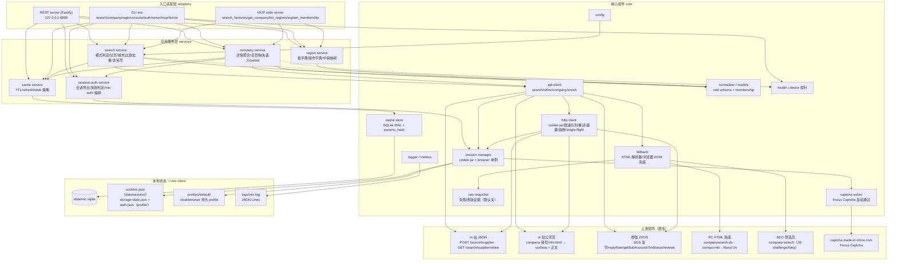

### 2.3 分层依赖规则

| 规则 | 说明 | 违反示例（禁止） |
|---|---|---|
| R1 单向依赖 | adapters → services → core → infrastructure；core 之间按组件依赖，不得反向 | service 里出现上游 URL；adapter 里直接 new 浏览器 |
| R2 上游隔离 | URL、query/body 编码、UA、选择器只允许出现在 `core/api-client` 与 `core/fallback` | CLI 命令拼 `m.made-in-china.com/...` |
| R3 模型边界 | services 出入参必须是 `core/models` 的规范化模型；上游原始字段只在映射层出现 | REST 直接透传 dataList 原始字段 |
| R4 错误边界 | core 抛内部错误类型；仅在服务/适配边界映射为固定错误码（§8.2） | 把网络异常直接 500 透出 |
| R5 副作用集中 | 上游读、缓存写、会话文件写、浏览器启动分别只由 http/api-client、cache store、session manager、browser controller 执行 | 任意模块随意读写 cookie/profile |
| R6 可注入 | 时钟、随机源、队列、浏览器通道、cache store 通过构造注入，便于测试与 mock | 硬编码 `Date.now()` / 全局单例直取 |
| R7 无隐式全局 | 每个进程在组合根一次性装配依赖；不依赖模块加载顺序 | 全局可变单例散落 |

### 2.4 上游能力矩阵（主通道 / 兜底 / 事实）

> 事实来源：[research/upstream-api.md](research/upstream-api.md)、[research/captcha-autosolve.md](research/captcha-autosolve.md)、[research/anonymous-completeness.md](research/anonymous-completeness.md)、[recon/notes.md](../recon/notes.md)。标注「待验证」的是客户端集成层面尚未实测的行为。

| 能力 | 主通道（匿名 JSON/HTTP） | 兜底通道 | 风控/事实要点 | 采用 |
|---|---|---|---|---|
| 供应商列表 | `POST https://m.made-in-china.com/search/supplier`；必带 `X-Requested-With: XMLHttpRequest`；body `word/page/province/catCode/memberLevel/managementCertification/comBusinessType/annualRevenue/rdCapacity`；20/页、`total/totalNum/totalPage` | ① PC `www.../companysearch.do`（30/页，但可能返回精简版 10 行）② 浏览器过 challenge 后访问 | 风控低；高频偶发 302（等 5–10s 重试恢复）；广告条带 `is_ad` 标记（REST/MCP 默认保留并标 `is_ad`；CLI 表格默认隐藏）；按 `id`/`account` 去重 | ✅ 主通道 |
| 过滤字典 | `GET https://m.made-in-china.com/search/supplier/refine?word=`（XHR 头） | SEO 过滤面板 HTML | 无 XHR 头 → 404；无 city/员工数 facet | ✅ 主通道 |
| 公司详情 | `GET https://m.made-in-china.com/company-<account>/info.html`（**移动 UA**）→ 页内 `<script type="text/json" id="ssrData">` + 正文（员工数/地址/认证文本） | ① PC `<host>.en.made-in-china.com/contact-info.html` / About Us（需先暖 cookie）② 浏览器 DOM | 约 13% 随机 Focus Captcha；桌面 UA 会 302 到 PC 迷你站；同 host 先 info 后 contact | ✅ 主通道 |
| SGS 审核章节 | `GET www.../multi-search/sgs/report?comId=<encodeComId>`（9 章节 audit 状态） | About Us 文本 | 数字 comId → HTTP 500；必须 encodeComId | ✅ 增强 |
| 响应率/响应时长 | `GET/POST data.../extend/busiMerge/replyRate`（`date/comId=<encode>/operatorNo=all`） | — | 数字 comId → `data:null`；`date` 取参考日（页面 JS 用 today-2d） | ✅ 增强 |
| 联系人（TM 子账号） | `GET www.../im.do?xcase=getSubAccount&comIdStr=<encode,...>`（可批量） | contact 页 HTML（姓名/部门/职务） | 只给 name/id，无职称/邮箱 | ✅ 增强 |
| 在线状态 | `GET www.../ajaxfunction.do?xcase=getTmStatus&user_ids[]=<encode>_00` | — | 需要子账号 `id`（`<encode>_00`） | ✅ 增强 |
| 评分/评价 | `GET m.../user/review/front/next?receiverComId=<encode>&pageNum=1`（XHR 头） | 详情 ssrData `reviewStatistics` | 数字 id → `{"code":900004}`；评论明细未接入 M1 | ✅ 增强（首期取聚合） |
| 城市级筛选 | **客户端按 `item.city` 过滤**（先按 province 拉取分页） | SEO `company-search/<kw>/C1--CP_<Prov>--CC_<Prov>_<City>/<page>.html`（浏览器） | JSON 无 city 参数；SEO flaky 且口径不同（1299 vs 669） | ✅ 客户端过滤 |
| 纯地区列举 | **地区英文词当 keyword** + `province` 过滤 + 后置校验（hebei/shiJiazhuang/langfang 等） | SEO 地区页（浏览器） | 中文=0；地区词约 1–3/30 噪声；`hebei shijiazhuang` 双词 AND 可用 | ✅ region 模式 |
| 数字 comId → account | `GET m.../company/<数字comId>` → 301 `Location` 解析 account | 搜索反查 account | 客户端 HTTP 管道内解析需实测（V-04） | ✅（待验证） |
| 搜索联想 | `keywordsuggestions.../getEnSupplierSuggest.do`（JSONP） | — | 仅英文；中文空 | ⏸ P2 预留 |
| 产品搜索 | `POST m.../search/product` | — | 36/页；GET HTML 会验证 | ❌ 非目标 |

**增强接口调用顺序与依赖**（详见 §4.2）：`info.html`（串行，得到 `encodeComId`）→ {SGS 章节 ‖ replyRate ‖ reviews} 与 {getSubAccount → getTmStatus} 两组，组内串行、组间有限并发（默认 2）。

### 2.5 数据流与信任边界

三条主路径：

1. **读路径（无挑战）**：调用方 → adapter → service → cache（命中即返回）→（未命中）限速队列 → `api-client` → 上游 JSON → normalizer（schema/映射/会员/warnings）→ cache 写入 → adapter 响应。
2. **风控路径（挑战）**：`http/api-client` 检测 302 captcha / 987B `__tst_status` / 5.6KB「请验证」→ 抛内部 `CAPTCHA_REQUIRED` → session manager 用浏览器自动解 → 导出会话 → 重试原请求一次。
3. **人工路径**：自动解失败/策略要求人工 → `NEED_HUMAN_VERIFICATION` → 用户执行 `mic auth` → 可见浏览器人工处理 → 状态写入 profile 目录（`storage-state.json`/`auth.json`）与 `data/session/cookies.json` → 后续请求自动使用。

信任边界：本机回环（无鉴权）是唯一入口；上游视为**不可信、可变更**；浏览器 profile 与 cookie 是**敏感凭据**，只在受控文件中保存、绝不写日志/响应。

### 2.6 代码结构映射（对齐 08 路线图 W1.x）

```
src/
  adapters/
    rest/            # Fastify server/路由/响应包/错误映射（03）
    cli/             # commander 子命令、输出格式、退出码（04）；含 serve/mcp 入口分发
    mcp/             # stdio MCP server、tools/resources（04）
  services/
    search/          # 搜索用例编排（模式/分页/城市过滤/去重/非穷尽）
    company/         # 详情聚合/会员/缺失语义/partial
    region/          # 地区字典服务
    cache-admin/     # cache stats/refresh/clear
    session-auth/    # 会话有效性/mic auth 编排
  core/
    config/  log/  http/  rate-queue/  single-flight/
    api-client/      # search.ts / company.ts / enrich.ts（仅此处出现上游 URL）
    session/         # cookie-jar.ts / browser.ts / captcha.ts
    fallback/        # html parsers + browser 通道
    models/          # zod schema + TS types（snake_case）
    normalizer/      # 上游字段 → 模型；membership；availability_reason；warnings
    regions/         # 省/市字典（05：32 省含 Qinghai）+ 中英映射
    membership/      # csLevel/memberLevel/memberSince/audited/evidence
    cache/           # sqlite store、params_hash、TTL/stale（DDL 见 05）
    raw-snapshot/    # 失败/改版原始响应（gzip，默认关）
    health/          # /health 与 mic doctor 探针
  data/regions.json  # 地区字典静态数据（随包发布；05 定义结构）
tests/{unit,integration,contract,e2e,fixtures}/
```

> 目录与文件名以本文档为架构基线；W1.x 实现时若调整目录需回写本节（docs-first，[ADR-0006](decisions/0006-docs-first-workflow.md)）。03 §2.2 引用的共享用例函数命名以本文档为基线：`search.findFactories()`、`company.getDetail()`、`regions.list()`、`membership.levels()`、`cache.refresh()/stats()`。

---

## 3. 模块职责

### 3.1 模块职责表

| 模块 | 职责 | 输入 → 输出 | 依赖 | 失败模式（→ 错误码） | 关联 FR |
|---|---|---|---|---|---|
| `adapters/rest` | Fastify HTTP 入口：路由、参数/查询校验、统一响应包、错误→HTTP、`/health`、request_id | HTTP 请求 → 统一响应包 | services、config、log | 参数非法→`INVALID_PARAM`；端口占用/profile 不可用→`CONFIG_ERROR`；未分类→`INTERNAL_ERROR` | FR-09 |
| `adapters/cli` | `mic` 子命令（search/company/regions/cache/auth/serve/mcp/config/doctor/version）；人类/JSON/NDJSON 输出；stdout/stderr 分离；退出码映射 | 命令行参数 → 文本/JSON/进程退出码 | services、core/health、config | 参数→退出码 2（`INVALID_PARAM`）；错误码→退出码（04）；`mic auth` 失败→5 | FR-10/15 |
| `adapters/mcp` | stdio MCP server：4 个 tool 的 Schema 校验、调用 service、错误包装 `isError`；**stdout 只输出协议消息** | MCP 请求 → MCP 响应 | services、log（stderr/文件） | 参数/Schema→tool error；业务错误码→tool error（含 code）；超时/取消 | FR-11 |
| `services/search` | 搜索用例：模式判定（keyword/region/mixed）、中文映射、参数规范化、缓存策略、分页与城市过滤编排、广告过滤/去重、非穷尽标记、single-flight 协调 | SearchQuery → SearchResult（data+meta） | cache service、api-client、normalizer、region service、rate queue | `INVALID_PARAM`；`UPSTREAM_*`；`PARSE_ERROR`；挑战→`NEED_HUMAN_VERIFICATION`；可 stale 回退 | FR-01/02/03/04/08 |
| `services/company` | 详情用例：account/comId 解析、`info.html` 聚合（ssrData+正文）、会员判定编排、增强数据串并行、`availability_reason`、partial 降级 | account/comId → CompanyDetail（data+meta） | api-client、cache、normalizer、membership、session-auth | `NOT_FOUND`；`UPSTREAM_*`；`CAPTCHA_*`/`NEED_HUMAN_VERIFICATION`；增强失败→partial | FR-05/06/08 |
| `services/region` | 省/市字典查询、中→英映射、城市→省推导、合法性校验；非法地区给出可用值 | 中文/英文地区输入 → 规范化地区/字典 | core/regions、normalizer | 非法/无法映射→`INVALID_PARAM`；字典缺失→`CONFIG_ERROR` | FR-07 |
| `services/cache-admin` | `cache stats/refresh/clear` 语义、TTL/条目/命中率展示；refresh 支持 scope（list/detail/regions/all） | scope/key → 统计/操作结果 | cache store | 无法写库→`CONFIG_ERROR`；部分清理失败→warning | FR-08 |
| `services/session-auth` | 会话有效性判定、挑战/人工状态机编排、`mic auth` 流程、storageState/cookie jar 导出与校验 | 会话需求 → 会话可用/需要人工 | session manager、browser、captcha solver | 需人工→`NEED_HUMAN_VERIFICATION`；自动解失败→`CAPTCHA_SOLVE_FAILED`；锁冲突/环境缺失→`CONFIG_ERROR` | FR-12 |
| `core/config` | 加载 `config.json`、合并 env/CLI、校验类型与取值、生成只读配置快照 | 进程参数/环境 → Config | — | 非法/缺失→`CONFIG_ERROR`（启动即失败） | FR-15 |
| `core/log` | JSONL 结构化日志（字段见 §9.4）、request_id、脱敏、按大小轮转；指标计数器/直方图聚合 | 事件 → 日志行/指标快照 | — | 写日志失败降级 stderr，不阻断业务 | FR-14 |
| `core/http` | 上游唯一 HTTP 出口：gzip/超时/重定向控制/cookie jar、XHR 与 UA 头、限速串行队列（1.5–2.5s 抖动）、重试退避、single-flight、熔断、冷却、响应快照采集 | 请求意图 → 原始响应/内部错误 | config、log、session、rate queue | 传输失败→内部 `UpstreamTransportError`；队列饱和→`RateLimitError`；挑战→`CaptchaRequired` | FR-13 |
| `core/rate-queue` | 全局串行队列：请求间隔抖动、排队等待上限、冷却期（风控后暂停）、队列深度指标 | 请求 → 顺序执行 | config、log | 等待超限→`RateLimitError`→`RATE_LIMITED` | FR-13/14 |
| `core/single-flight` | 同缓存键（`params_hash`）的并发请求合并为一次上游调用，共享结果/异常 | key + thunk → 结果 | — | 与上游失败一致透传；不产生新错误码 | FR-08 |
| `core/api-client/search` | 封装 `POST /search/supplier`、`GET /search/supplier/refine`：必带头、参数编码、响应 schema 校验、页号/夹页识别 | 规范化参数 → 原始/校验后 JSON | http、config、snapshot | 结构不符→`UPSTREAM_CHANGED`；JSON 解析失败→`PARSE_ERROR`；5xx/超时→`UPSTREAM_UNAVAILABLE` | FR-01/02/03 |
| `core/api-client/company` | 封装 `company-<account>/info.html`（移动 UA）：取 HTML、抽取 `ssrData`、正文补充解析（员工数/地址/认证文本）、数字 comId 301 resolver | account/comId → 原始详情结构 | http、fallback、snapshot | 挑战→captcha 流程；结构缺失→`UPSTREAM_CHANGED`/`PARSE_ERROR`；404→`NOT_FOUND` | FR-05 |
| `core/api-client/enrich` | 封装 SGS 章节/`replyRate`/`getSubAccount`/`getTmStatus`/`reviews`；`encodeComId` 参数规则；有限并发（≤2） | encodeComId 等 → 增强结构 | http、config | 单接口失败→partial warning（不整体失败）；参数 ID 错误视为内部 bug→warning/`INTERNAL_ERROR` | FR-05/06 |
| `core/session/cookie-jar` | HTTP cookie 存储/序列化/过期判断/挑战 cookie 识别；与 storageState 同步（原子写 0600） | Set-Cookie/导出 → jar | config、log | 写失败→warning；损坏→重新 `mic auth`（`CONFIG_ERROR` 提示） | FR-12 |
| `core/session/browser` | cloakbrowser 持久 context 生命周期：懒启动、单例、跨进程锁、storageState 注入/导出、空闲关闭、崩溃清理 | 打开 URL/导出状态 → 浏览器结果 | cloakbrowser/playwright-core、config、log | 启动失败/无 DISPLAY→`CONFIG_ERROR`；锁冲突→`CONFIG_ERROR`/`NEED_HUMAN_VERIFICATION` | FR-12/15 |
| `core/session/captcha` | Focus Captcha 自动通过：拦截 `/captcha/get`、canvas 解码、Sobel+alpha 边界匹配、humanized 拖拽、读 `/captcha/check`；≤`captcha.max_attempts` 次 | 挑战上下文 → 成功/失败信号 | browser、log | 连续失败→`CAPTCHA_SOLVE_FAILED`；策略关闭/不可用→直接转人工 | FR-12 |
| `core/fallback` | 降级链：PC HTML 解析器（companysearch.do/contact-info/About/SEO）注册表、浏览器 DOM 兜底、降级决策与证据、selector 版本标记 | 失败上下文 → 兜底数据/错误 | http、browser、snapshot、normalizer | 结构不符→`UPSTREAM_CHANGED`；解析崩溃→`PARSE_ERROR`；挑战→captcha/人工 | FR-13 |
| `core/models` + `core/normalizer` | zod schema（请求/上游/对外模型）；上游字段映射；`availability_reason`；warnings 汇总；evidence；`source`/status 派生 | 上游原始 → 规范化模型 + warnings | — | Schema 不符→`UPSTREAM_CHANGED`；模型缺字段→按 05 的 null 语义 + reason | FR-04/05/06 |
| `core/membership` | `membership_tier` 判定（ssrData `memberLevel` > 列表 `csLevel` > `memberType`）、`member_since_year`、`audited` 与 `audit`、`evidence`、`free/unknown` 规则 | 列表/详情/证据 → MembershipInfo | models | 冲突按优先级取值并保留 evidence；无证据→`unknown`（不猜） | FR-06 |
| `core/regions` | 内嵌省/市字典（来源/结构见 05：refine 31 省 + SEO `Qinghai` = 32 省）：英文名/中文名/MIC 代码、城市→省推导、缺失城市降级 | 地区输入 → 规范化地区 | data/regions.json | 未收录/非法→`INVALID_PARAM`（附可用值）；字典版本不符→`CONFIG_ERROR` | FR-07 |
| `core/cache` | SQLite（WAL）缓存：DDL/migrations、`params_hash` 键、TTL/refresh、stale 回退、single-flight 配合、命中统计、raw 快照引用 | 查询/结果 → 缓存条目/统计 | config、log | 写冲突→busy 重试后降级为不缓存 + warning；库损坏→`CONFIG_ERROR` | FR-08 |
| `core/raw-snapshot` | 解析失败/契约可疑时保存 gzip 原始响应（URL 脱敏、大小/保留期限制，默认关闭） | 原始响应 + 上下文 → 快照文件引用 | config、log | 写失败仅 warning；不阻断业务 | FR-13/14 |
| `core/health` | `/health` 与 `mic doctor` 探针：版本、profile 可用、SQLite 可写、队列/熔断状态、上游连通性（缓存探针）、契约探针（`--contract`） | — → 健康快照 | config、cache、session、http | 探针失败只报告，不抛错（doctor 退出码由 04 定义） | FR-14/15 |

### 3.2 模块边界约定

1. **上游字段只在映射层**：`api-client` 负责"取原始"，`normalizer` 负责"变成模型"，`fallback` 解析出的 HTML 字段同样进入 normalizer；services 不感知选择器/URL。
2. **错误只映射一次**：core 抛内部异常类型；service 边界映射为 README 的 11 个错误码；adapter 再映射为 HTTP/退出码/MCP 错误，不重复造码。
3. **warnings 不吞**：任何降级（stale、HTML 兜底、城市过滤、广告过滤、非穷尽、partial 增强）必须产生 warning，由 service 汇总进 `meta.warnings`。
4. **evidence 保留**：会员/认证等判定必须携带 `evidence`（原始字段值/文案/图标 URL），便于人工复核与回归。
5. **缓存只存规范化 payload**：原始响应仅在 `raw_snapshots`（默认关）留档；缓存键统一由 cache service 生成。
6. **副作用集中**：上游请求只经 `core/http`；会话文件只经 session manager；浏览器只经 browser controller；SQLite 只经 cache store。
7. **adapters 薄**：不得在 adapter 中实现重试/限速/会话/降级逻辑；adapter 只做协议转换。

### 3.3 FR 追溯矩阵

| FR | 功能域 | 主要模块 | 本文档 | 下游细节 |
|---|---|---|---|---|
| FR-01 | 搜索模式（关键词/地区/组合） | services/search、region、core/api-client/search | §4.1、§4.6 | 01/03/04 |
| FR-02 | 结构化过滤（省/市/类目/会员/认证/经营/营收/R&D） | services/search、api-client/search、region | §2.4、§4.1 | 03 |
| FR-03 | 分页、总数、非穷尽保护 | services/search、cache、api-client/search | §4.1、§8.5 | 03/05 |
| FR-04 | 结果列表字段与规范化 | normalizer/models、search | §3.1、§2.6 | 05 |
| FR-05 | 公司详情字段与规范化 | services/company、api-client/company、enrich、normalizer | §4.2 | 03/05 |
| FR-06 | 会员等级与认证识别 | core/membership、normalizer | §4.2、§12(D5) | 05/ADR-0005 |
| FR-07 | 地区字典（省/市/中英映射） | core/regions、services/region | §2.4、§4.6 | 05 |
| FR-08 | 缓存（键/TTL/刷新/降级） | cache、cache service、api-client | §4.1、§5.6、§8.4 | 05 |
| FR-09 | REST API 入口 | adapters/rest | §5.2、图-1 | 03 |
| FR-10 | CLI 入口 | adapters/cli | §5.2、图-5 | 04/07 |
| FR-11 | MCP 入口 | adapters/mcp | §5.2 | 04 |
| FR-12 | 会话、风控与验证码 | session manager、captcha、session-auth、browser | §6、§7 | 07 |
| FR-13 | 错误分类、重试与降级 | http、fallback、services、错误映射 | §8 | 03/04 |
| FR-14 | 日志、指标与可观测 | core/log、health | §9.4/§9.5 | 07 |
| FR-15 | 配置与运行环境 | core/config、adapters/cli(serve/doctor) | §5、§9 | 07 |

---

## 4. 关键流程

### 4.1 搜索流程（缓存命中/未命中 + 302 重试，图-2）

**输入**：`keyword? / province? / city? / 过滤参数 / page / page_size / refresh`（规则见 03）。
**前置校验**：`keyword` 与地区至少一个；地区先经 region service 规范化（中文→英文、城市→省推导）；无法映射的中文输入本地拒绝（`INVALID_PARAM`），不发起注定 0 结果的上游请求。

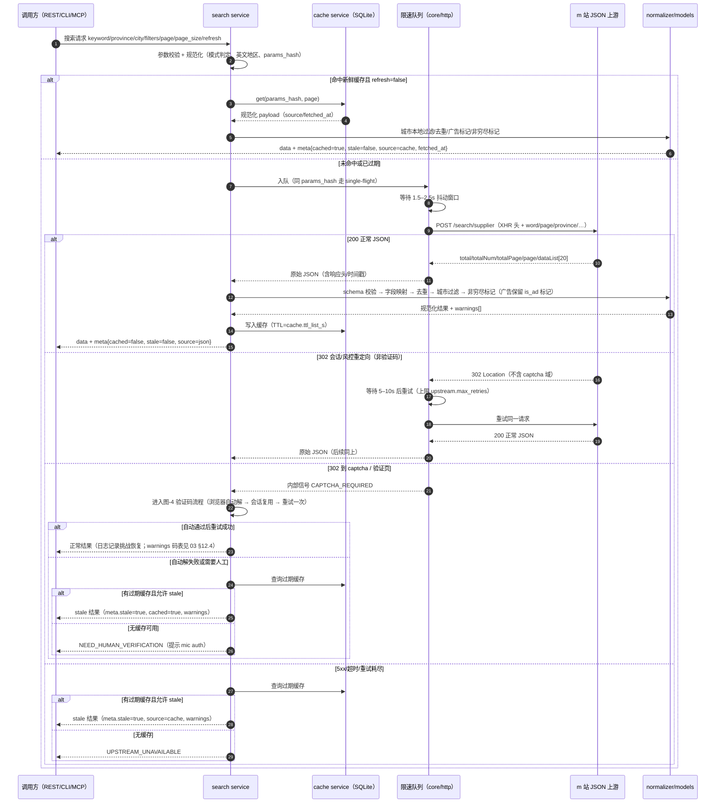

**流程规则**：

1. **模式判定**：`keyword` 非空且无地区 → `keyword`；`keyword` 空且地区存在 → `region`（内部 `word=<地区英文词>`，附加 `province` 过滤）；两者都有 → `mixed`（`word=keyword`，附加地区过滤）。
2. **参数规范化**：keyword 去首尾空白；缓存键用小写/英文地区/过滤参数排序；发送时按上游要求编码（`word` 原样或规范化后发送，大小写敏感性待验证 V-08）。
3. **分页**：上游 `page` 从 1 起、每页 20；客户端 `page` 1..100、`page_size` 默认 20、范围 1..100（>20 需多上游页拼接/裁剪，窗口与 `pagination` 字段见 03 §1.7）。`page > total_page` 时按上游行为夹到末页并置 `page_clamped=true`（warning `PAGE_CLAMPED`）；客户端不得把末页重复当新结果。
4. **本地过滤**：`city` 与 `audited` 均为客户端本地过滤（03 §7.6）：`keyword+city`（mixed）→ 按 province 逐页拉取后按 `item.city` 过滤（warning `CITY_FILTERED_LOCALLY` / `CLIENT_SIDE_FILTER`，记录 `scanned_pages/matched`）；纯 `city`（region）→ 用城市英文词作 keyword + province 过滤 + 后置校验（见 §4.6）。扫描预算 `search.scan_max_pages`（默认 10 页 ≈ 200 条，03 §7.6）；预算用尽仍未到末页 → `NON_EXHAUSTIVE` + `total_is_lower_bound=true`。
5. **广告/去重**：列表数据保留 `is_ad` 标记（`showAd`/`ad`/`deliveryType=ads` 识别，03 §7.12-8）；**REST/MCP 默认保留**（`include_ads=true`、条目带 `is_ad`），**CLI 表格默认隐藏**（`--include-ads` 显示）；`--exclude-ads` / `include_ads=false` 时 core 过滤并给 `ADS_FILTERED`（04 R6）。跨页去重按 `account`（缺省回退 `company_id`，03 §1.7）执行，warning `DUPLICATES_REMOVED`。（2026-11-15 评审已收敛 V-15）
6. **非穷尽保护**：`total >= 2000` 或 `totalNum == "2,000+"` → `total=2000`、`total_capped=true`、`total_display="2,000+"`、warning `NON_EXHAUSTIVE`（03 §1.7 / OQ-04）；不承诺全量，提示用地区/更细过滤拆分查询。
7. **302 重试**：仅对「非 captcha 的会话/边缘重定向」重试，等待 5–10s（research 观察）、上限 `upstream.max_retries`（默认 2，即最多 3 次尝试）；captcha 302 走 §4.3，不混入普通重试。
8. **缓存写入**：成功（含 partial 列表分页）写规范化 payload；过期后上游失败且 `cache.allow_stale=true` → 返回 stale；`refresh=true` 跳过新鲜缓存读取（仍可写入新结果）。
9. **时延预期**：缓存命中毫秒级；单页 JSON 查询受串行限速约束（≈1.5–2.5s + 网络）；城市/大词多页扫描时延随页数增长（NFR-01 基线与 03 的超时/上限需一致）。

### 4.2 公司详情流程（ssrData + 正文补充 + 增强串并行，图-3）

**输入**：`account`（`mainUserAccount`）或数字 `comId`（`encodeComId` 只用于增强接口，不能直接解析为 account）。
**解析规则**（03 §8.2）：`account` 直接构造 `company-<account>/info.html`；数字 `comId` 用 `m.../company/<comId>` 的 301 `Location` 反查 account（客户端管道内实测=待验证 V-04；失败 `NOT_FOUND`/reason=`COM_ID_UNRESOLVED`）；`encodeComId` **只查本地索引**（列表/详情缓存，05 定义），命中→对应 account，未命中 `NOT_FOUND`/reason=`ENCODE_COM_ID_NOT_INDEXED`（提示先 `search`）；不向上游反查（research 未发现端点，待验证）。

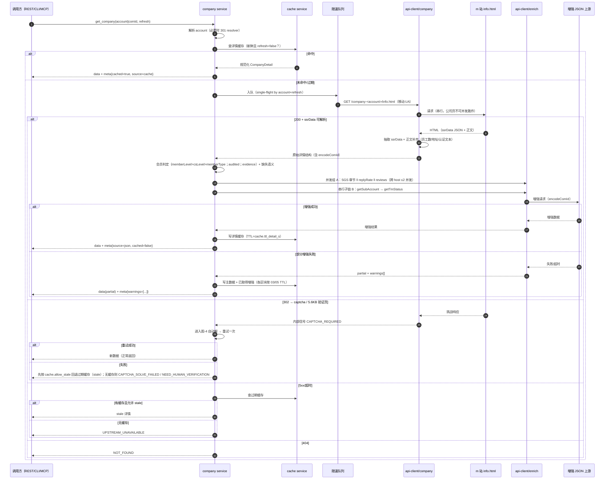

**流程规则**：

1. **一次主请求**：`info.html`（移动 UA）是详情主数据源，串行、单次；ssrData 缺失/不可解析→按 §4.5 降级（过期缓存优先 → HTML 兜底（默认关）→ 浏览器 DOM → 错误）。
2. **字段优先级**：会员相关：ssrData `memberLevel` + `memberSince` > 列表 `csLevel`（若缓存有列表行）> `memberType`；`audited`：`sgsMember`/`auditType`/`showAuditLogo` 交叉验证；`free` 仅在页面完整加载且确认无徽章/无 AS/无 member-since 时给出，否则 `unknown`（ADR-0005）。
3. **正文补充**：员工数/地址/管理认证文本从同一次 `info.html` 正文解析（research 已实测可解析）；不额外请求 PC 页。联系人姓名/部门/职务属可选增强（`contact.html` 会再触发一次公司页请求，首期默认不抓，用 `getSubAccount` 名单代替；如需升级见 §11）。
4. **增强串并行**：组 A（SGS 章节、`replyRate`、`reviews`）允许**跨 host** 有限并发（`rate.enrichment_parallelism` 默认 2，03 §1.9；同 host 请求仍串行）；组 B（`getSubAccount` → `getTmStatus`，同为 www host）依赖子账号 id，串行。所有增强失败只减少字段（`availability_reason=fetch_blocked` 或 warning `ENRICHMENT_PARTIAL`），不使详情整体失败（partial）。
5. **partial 缓存**：主数据与各增强区块分别按 03 §1.8 / 05 §7.3 的 TTL 缓存（两者口径已统一：03 §1.8 = 05 §7.3；2026-11-15 评审）；缺区块的 partial 结果可返回，后续按区块 TTL 补齐；`refresh=true` 强制重取主数据与请求的增强。
6. **幂等与重试**：详情为只读 GET，可安全重试；但公司页风控敏感，重试次数与并发严格受 §7/§8 约束。
7. **`availability_reason`**：字段缺失按下述语义填充：供应商未填→`not_provided_by_supplier`；平台不公开（电话/邮箱等）→`not_public_by_platform`；无评论→`no_reviews`；挑战/失败→`fetch_blocked`；需登录才可能有（首期未验证且不主动取）→`needs_login`。枚举与字段细节见 05。

### 4.3 验证码触发 → 自动通过 → 会话复用（图-4）

**触发**：公司页随机（≈13%）、空 `word`（客户端应前置避免）、连续高频、SEO 页、JS challenge 兜底时。

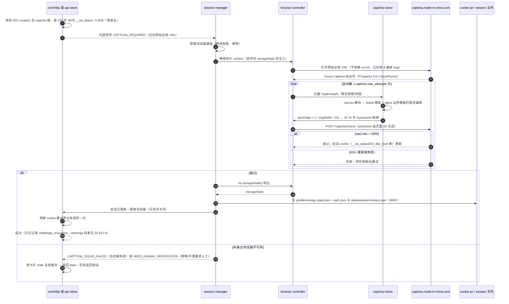

**规则**：

1. **检测先于解析**：识别信号见 §8.5；识别到挑战后不得把挑战页当业务数据解析。
2. **浏览器只做这一件事**：打开原 URL、自动解验证码、导出会话；不在浏览器里做批量抓取（SEO 兜底除外，见 §4.5）。
3. **自动解参数**（来自 [research/captcha-autosolve.md](research/captcha-autosolve.md)）：`/captcha/get` 图片 310×155、拼图 47×155；`moveLeftDistance=310*domX/img_width`（`imgWidth≈280`）；拖拽分 24 步带纵向抖动、总时长 600ms+；失败自动刷新重试 ≤5 次；实测新 profile 2/2 次第 1 尝试通过，通过后连续 12 页 HTTP 无验证码。
4. **不要伪造 check**：保持真实拖拽（算法要求与合规要求）；不直接构造 `pointJson` 绕过交互。
5. **恢复后只重试一次**：会话更新后重试原请求一次；再次挑战 → 转人工/冷却，避免"挑战-重试"循环放大风控。
6. **冷却**：同一冷却窗口内连续挑战 → `risk.cooldown_ms` 暂停上游请求（默认 120s），期间只服务缓存；冷却后恢复并适当放大间隔。
7. **headless 说明**：自动解在 headless 模式下的成功率**未验证**（research 使用可见/默认模式；headless 本身更易触发挑战）。默认 `browser.headless=false`；无显示环境请用 `mic auth` 或接受 `NEED_HUMAN_VERIFICATION`（V-01）。

### 4.4 人工兜底 `mic auth`（图-5）

**触发**：`NEED_HUMAN_VERIFICATION`（自动解失败、连续挑战、无 DISPLAY/headless 不可用、首次使用建议预热会话）；或用户希望可选登录以便差分复核（OQ-01）。

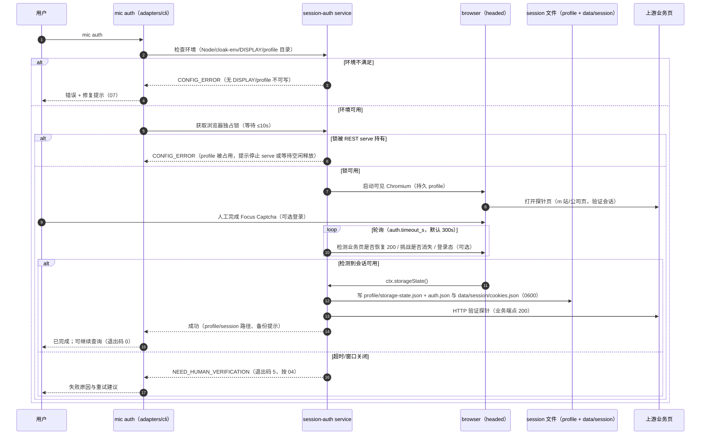

**规则**：

1. **只有 `mic auth` 弹可见浏览器**：REST/MCP 不主动打开交互窗口，只返回 `NEED_HUMAN_VERIFICATION` 并在 `details` 中给出下一步（`mic auth`）。
2. **独占 profile**：浏览器锁保证同一时刻只有一个进程持有 profile；REST serve 懒启动的浏览器空闲 `browser.idle_timeout_s`（默认 120s）后自动关闭并释放锁，便于用户随时 `mic auth`；拿不到锁时等待受 `session.lock_timeout_s`（默认 10s）约束，`mic auth` 可用 `--timeout` 放宽，失败 `CONFIG_ERROR`（`details.reason=profile_locked`，04 A4）。
3. **成功判据**：原挑战消失且业务页 200；可选附带登录态检测（`head.do?xcase=getHead` / `login/status/check`，仅用于诊断，匿名模式不要求登录）。
4. **超时**：`auth.timeout_s`（默认 300s）内未完成 → 失败退出，不写入半成品会话；profile 保留供下次重试。
5. **不变量**：`mic auth` 成功必须产出**可被 HTTP 快速通道复用的 cookie jar**；只写 storageState 不更新 jar 视为失败。
6. **可选登录**：登录仅解锁买家侧功能（站内信/询盘），不改变供应商公开字段（research 结论；登录差分待验证 OQ-01）；不得因未登录而报告字段"需登录"。

### 4.5 上游改版/解析失败降级链（图-6）

**原则**：JSON 优先；JSON 结构不符/不可用 → HTML 兜底 → 浏览器 DOM 兜底（仅 JS challenge 或需要浏览器执行的页面）→ 结构化错误。每次降级都必须留下 warnings 与原始快照引用（如开启），并保证 `source` 正确。

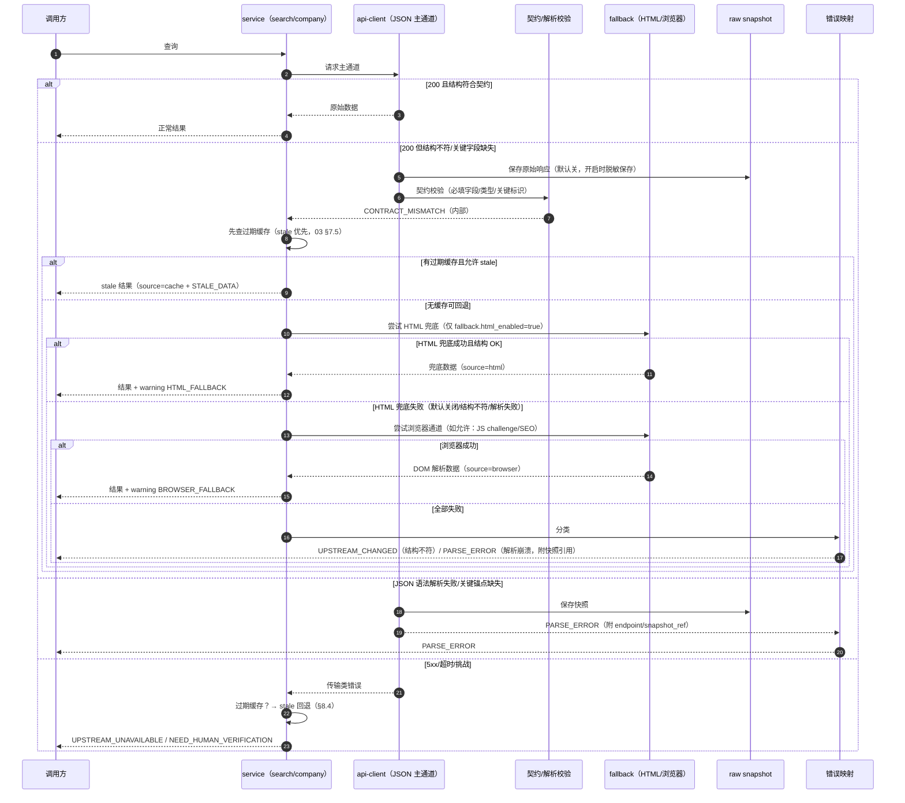

**降级顺序与适用能力**（首期默认 `fallback.html_enabled=false`，HTML/浏览器兜底需显式开启，03 §7.5）：

| 能力 | 第 1 级（主） | 第 2 级（HTML） | 第 3 级（浏览器） | 最终错误 |
|---|---|---|---|---|
| 搜索列表 | m JSON `POST /search/supplier` | PC `companysearch.do`（30/页，行数可能少于 30） | challenge 时浏览器过验证后取 HTML | `UPSTREAM_CHANGED`/`PARSE_ERROR`/`UPSTREAM_UNAVAILABLE` |
| 过滤字典 | m JSON `/search/supplier/refine` | SEO 过滤面板 | 浏览器 | 降级为内置静态字典 + warning（不致命） |
| 公司详情 | m `company-<account>/info.html` | PC `contact-info.html` / About Us（先暖 cookie） | 浏览器 DOM（同页/深页） | 同上（若有缓存可 stale） |
| 增强数据 | 各增强 JSON | About Us 文本 | — | partial warnings（不阻塞详情） |
| 城市筛选 | 客户端按 `item.city` | —（SEO 城市页仅可选校验，默认关） | SEO 城市页（显式开启时） | 客户端过滤结果 + 覆盖度 warning |

**规则**：

1. **契约校验**：search JSON 必检 `total/totalPage/page/dataList` 及条目关键字段（`id/name/mainUserAccount/csLevel 可用性`）；公司页必检 `ssrData` 存在且 `companyInfo.content` 可读。字段"缺失"与"供应商未填"要区分（后者属正常 null，不触发降级）。
2. **降级不掩盖**：`meta.source` 反映最终来源；warning 码必须取 03 §12.4（如 `HTML_FALLBACK`、`BROWSER_FALLBACK`、`STALE_DATA`），不得自造同义码。
3. **原始快照**：仅在 `raw_snapshot.enabled=true` 时保存失败/可疑原始响应；路径/大小/保留期见 05；日志与错误只引用 `snapshot_ref`，不直接输出大段 HTML/cookie。
4. **降级缓存**：HTML/浏览器兜底结果同样写缓存（`source` 记录在缓存条目）；TTL 按 03/05 对应资源 TTL；若来源 HTML 且契约可疑，应缩短 TTL（具体数值以 05 为准）。
5. **不无限降级**：单次请求的最长链路为「JSON → 过期缓存（stale）→ HTML → 浏览器」；每一级最多一次，浏览器失败后立即返回错误，不循环重试。
6. **`UPSTREAM_CHANGED` vs `PARSE_ERROR`**：整体结构/关键契约不符 → `UPSTREAM_CHANGED`；解析过程崩溃（JSON decode、选择器/正则异常、ssrData 缺失且无降级路径）→ `PARSE_ERROR`；两者都附 `endpoint`、`source`、`snapshot_ref`（如有）、`contract_diff`（如有）。

### 4.6 地区模式与城市本地过滤（图-7）

> 对应 FR-01/07、[ADR-0003](decisions/0003-city-client-side-filter.md)、[ADR-0004](decisions/0004-region-keyword-mode.md)。

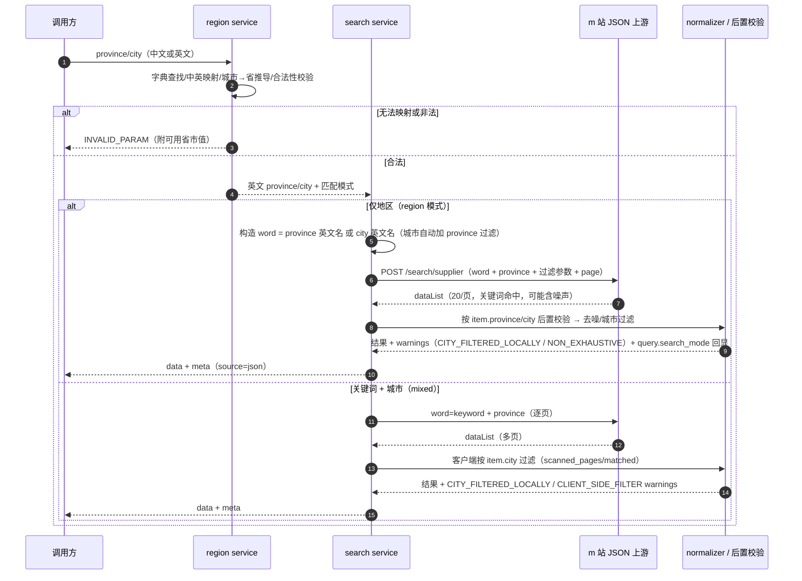

**规则**：

1. **地区模式构造**：省 → `word=<Province 英文名>`；市 → `word=<City 英文名>` + 自动推导 `province=<Province>`；大小写按字典标准（实测 `hebei`/`shijiazhuang`/`langfang` 可用，`hebei shijiazhuang` 双词 AND 也可用）。
2. **后置校验**：地区词是关键词命中而非地区筛选（`langfang` 实测 27/30 为目标城市），必须按 `province/city` 字段后置校验去噪，不能把"关键词命中"当"地区过滤"。
3. **中文输入**：地区中文名由字典映射为英文；字典覆盖不到的地区 → `INVALID_PARAM`（ADR-0004）。含 CJK 的关键词按 03 §7.3：能解析为地区名则转地区模式；否则 `INVALID_PARAM`（reason `NON_ENGLISH_KEYWORD`，不静默返回空结果）。**已收敛：以 03 为契约源，04 R3 已对齐（中文关键词无法映射 → `INVALID_PARAM`/`NON_ENGLISH_KEYWORD`）。**
4. **城市+关键词成本**：mixed 模式需按省扫描分页再过滤；架构以 `search.scan_max_pages`（默认 10 页 ≈ 200 条，03 §7.6）、缓存、`scanned_pages` warnings 控制；预算用尽 → `NON_EXHAUSTIVE` + `total_is_lower_bound=true`。可选优化「keyword + city 英文词组合搜索」是否可收窄结果**待验证**（V-06），验证前不作为默认路径。
5. **非穷尽**：地区词查询同样受 `total` 2000 封顶影响；返回 `total_capped=true` 与 warning `NON_EXHAUSTIVE`（本地过滤时 `total_is_lower_bound=true`），不承诺完整城市列表。
6. **与 SEO 页的关系**：SEO 城市页仅在 `fallback.seo_enabled=true` 且需要交叉校验时由浏览器访问；其结果与 JSON 口径不同，**不得混用 total/计数**（ADR-0003）。

---

## 5. 运行时与部署

### 5.1 运行环境要求

| 项 | 要求 | 说明/校验 |
|---|---|---|
| 操作系统 | NixOS（当前开发机）或兼容 Linux/macOS | Windows 未验证（待验证 V-13） |
| Node | **Node 22**（`~/cloak-env` FHS 内 22.x） | `~/cloak-env/bin/cloak-run node -v` |
| 浏览器运行时 | **cloakbrowser 0.6.5 + playwright-core 1.65.0 + stealth Chromium 146**（锁定版本） | 升级需回归 Focus Captcha 算法（V-11） |
| 启动包装 | `~/cloak-env/bin/cloak-run node <entry>` | 保证浏览器兜底在 FHS 内可用；三个入口统一使用 |
| 图形会话 | `mic auth` 与自动解验证码需要 `DISPLAY`（headed） | `echo $DISPLAY`；无显示时走人工/接受 `NEED_HUMAN_VERIFICATION`（V-01） |
| 网络 | 可访问 `m.made-in-china.com`、`www.made-in-china.com`、`captcha.made-in-china.com`、`data.made-in-china.com` 等 | 07 §1；无代理默认；代理支持待验证 |
| 磁盘 | ≥500MB（依赖 + SQLite + 可选快照） | 07 §1 |
| 时区/时间格式 | `Asia/Shanghai`；`fetched_at` 用 ISO8601（`+08:00`） | 03 定义字段格式 |
| 运行身份 | 单用户、单机；无系统服务依赖 | 可选 systemd --user / nohup（07 §4） |

### 5.2 进程模型与入口

三个入口共用同一 `mic` 二进制与 core，区别只在**生命周期与 I/O 协议**：

| 入口 | 命令（实现后可用） | 形态/生命周期 | 并发模型 | 浏览器 | I/O / 典型场景 |
|---|---|---|---|---|---|
| REST | `mic serve`（默认 `127.0.0.1:8899`） | 长驻；单实例（实例锁） | 上游全局串行队列；请求可并发但排队 | 懒启动；空闲自动关闭并释放锁 | HTTP 响应；本机脚本/其他程序 |
| CLI | `mic search / company / regions / membership / cache / config / doctor / version` | 一次性进程 | 进程内串行 | 仅 `mic auth`（及极少数 doctor 探针）使用 | stdout 数据、stderr 日志；人工/脚本 |
| MCP | `mic mcp`（stdio） | 随 MCP 客户端生命周期；子进程 | **单一 in-flight**（stdout 协议顺序） | 懒启动；与 CLI/REST 共享浏览器锁 | JSON-RPC over stdio；Claude Code 等 Agent |
| 认证 | `mic auth` | 一次性交互进程 | 独占浏览器 | **headed**、独占 profile 锁 | 人工过验证码/可选登录；固化会话 |
| 自检 | `mic doctor [--contract]` | 一次性 | 串行探测 | 默认不启动浏览器 | 文本/JSON；排障与环境自检 |

说明：

- `mic serve`/`mic mcp` 只是同一 CLI 二进制中的**长生命周期子入口**；不单独发布多个可执行文件（07 §4）。
- REST 与 MCP 进程都**不主动打开交互式窗口**；需要人工验证时返回 `NEED_HUMAN_VERIFICATION`，由用户执行 `mic auth`（§4.4）。
- MCP 的 `stdout` 只能输出协议消息，日志必须写 stderr/文件（§9.4）。

### 5.3 目录与文件布局

所有运行状态放在仓库外 `~/.mic-client/`（[ADR-0007](decisions/0007-local-runtime-and-secrets.md)、07 §2）；目录/文件路径可用 `--config`、`--profile`、`MIC_*` 覆盖（测试用临时目录）。

| 路径 | 内容 | 权限 | 说明 |
|---|---|---|---|
| `~/.mic-client/config.json` | 配置文件（JSON；可选） | `0600` | 无密钥；仅路径/限速/TTL 等（§9.2） |
| `~/.mic-client/profiles/default/` | cloakbrowser 持久 profile + `storage-state.json` + `auth.json`（04 A1） | `0700`（storageState/auth.json 为 `0600`） | **敏感**；不进仓库、不写日志、不输出完整路径 |
| `~/.mic-client/data/mic.sqlite`（+`-wal`/`-shm`） | SQLite 缓存/缓存元数据/统计 | `0600` | WAL 模式；05 定义 DDL |
| `~/.mic-client/data/session/cookies.json` | HTTP cookie jar（派生快速通道） | `0600` | 由浏览器导出同步；§6.3 |
| `~/.mic-client/profiles/default/storage-state.json` | Playwright `storageState`（浏览器会话快照） | `0600` | `mic auth`/自动解通过后导出；§6.3（04 A1） |
| `~/.mic-client/profiles/default/auth.json` | 会话元数据（`last_auth_at`/`last_check_at`/`login`/`cookie_names[]`） | `0600` | 不含 cookie 值；用于失效判定与诊断（04 A1） |
| `~/.mic-client/data/raw/` | 原始响应快照（gzip，排障） | `0700` | **默认关闭**；开启时按保留期清理（§8.6） |
| `~/.mic-client/data/locks/` | `instance.lock`、`browser.lock`、`session.lock` | `0700` | 跨进程互斥；含 pid/时间戳（§5.4/§6.5） |
| `~/.mic-client/logs/mic.log` | 结构化日志（JSON Lines，可轮转） | `0600`（目录 `0700`） | §9.4；排障用，含脱敏约束 |
| `~/.mic-client/profiles-backup-*.tgz` | 用户主动备份 | 用户管理 | 含敏感凭据，建议加密保存（07 §5） |

> `.gitignore` 已覆盖 `profile*/data/*.sqlite/raw/` 等；**任何情况下不得提交** `~/.mic-client` 内容到仓库。
> 会话文件位置约定：`storage-state.json` 与 `auth.json` 放在 `profile_dir` 下（04 A1）；HTTP cookie jar 放 `data/session/cookies.json`（02）；三者均视为敏感数据（0600）。

### 5.4 进程生命周期与单实例（图-8）

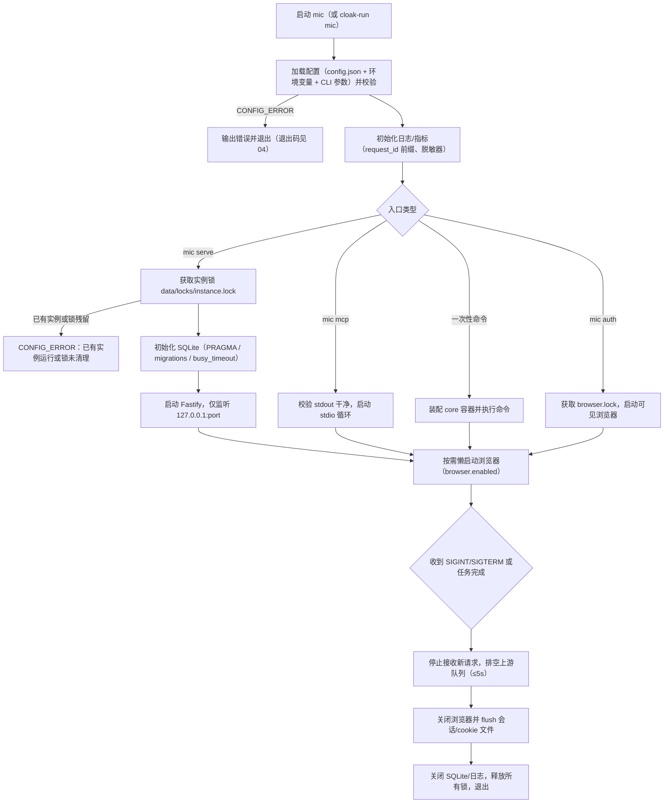

**规则**：

1. **REST 单实例**：`mic serve` 使用 `instance.lock`（pid + 启动时间）；检测到已有存活实例 → `CONFIG_ERROR`（不自动抢占）。pid 已死的残留锁自动清理（stale lock）。
2. **浏览器独占**：任何需要浏览器的操作先取 `browser.lock`（跨进程）；`mic auth` 等待 ≤`session.lock_timeout_s`（默认 10s），仍被占用 → `CONFIG_ERROR` 并提示停止 serve/等待空闲释放。
3. **会话写独占**：`session.lock` 保护 `data/session/cookies.json` 与 `profile_dir/storage-state.json`/`auth.json` 的读-改-写（§6.5）。
4. **不自动后台化**：前台运行为默认；后台由用户用 systemd --user / nohup（07 §4）。架构不负责 daemon 化、不写 pid 守护。
5. **优雅关闭**：停止接单 → 排空队列（上限 5s）→ 关闭浏览器（若有）→ flush 会话/缓存 → 释放锁 → 退出；`SIGKILL` 后由 WAL 与 stale lock 恢复。
6. **崩溃恢复**：锁文件带 pid；启动时清理死 pid 锁；SQLite WAL 自动恢复；会话文件原子写保证不出现半写文件。
7. **MCP 生命周期**：由 MCP 客户端拉起/终止；终止时同样走优雅关闭；**stdout 只输出协议**。

### 5.5 部署拓扑（图-9）

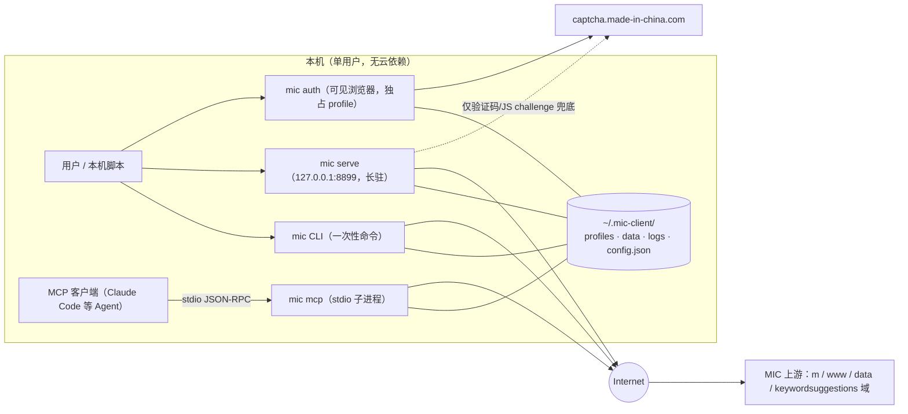

**部署约束**：单机单用户、无容器/无反向代理/无公网入口；同一用户同一时间建议只跑一个 `mic serve`；多个 CLI 进程可共存但共享限速语义是"进程内串行"，**不要用并行脚本轰炸上游**（§10.3）。

### 5.6 多进程共享资源与一致性

| 资源 | 共享方式 | 冲突处理 | 一致性要求 |
|---|---|---|---|
| SQLite 缓存 | WAL + `busy_timeout`（默认 5000ms）；多进程可读、写按事务串行 | busy 重试后降级为"本次不写缓存"+warning；库损坏→`CONFIG_ERROR` | 单写者模型（ADR-0007）：不做长事务；迁移只在启动期、持实例/迁移锁执行 |
| 会话文件 | `session.lock` 互斥 + 原子写（tmp+rename） | 锁超时→读取上一份有效文件/等待；损坏→丢弃并提示 `mic auth` | 版本号/mtime 检查；任何写入后 bump 版本；读者按需重读 |
| 浏览器 profile | `browser.lock` 独占 | 等锁超时→`CONFIG_ERROR`（提示原因与下一步） | 同一 profile 同一时刻只有一个 owner；不并发操作 context |
| REST 实例锁 | `instance.lock` | 已存在存活实例→`CONFIG_ERROR` | 单实例；CLI/MCP 不取实例锁 |
| 配置文件 | 启动时读入内存，只读 | 运行期修改不生效，需重启 | 不热加载（v0.1） |
| 日志文件 | 多进程追加写 JSONL | 行级原子（单行一次写）；轮转由持锁方执行 | 不要求严格排序；`request_id` 关联 |
| 指标 | 进程内聚合 + `/health` 快照 | 不做跨进程聚合（多进程各自统计） | 以单进程视图为准；全局视图靠日志/`mic cache stats` |

**一致性不变量**：任何进程被单独重启/杀掉后，其余进程仍可工作；所有跨进程协调只经文件锁与 SQLite，不依赖共享内存/网络 IPC。

### 5.7 启动/关闭顺序与版本升级

- **启动顺序**：配置 → 日志/指标 → （serve）实例锁 → SQLite 打开/迁移 → 适配器启动 → 会话懒加载 → 浏览器懒启动。
- **关闭顺序**：停止接单 → 排空队列 → 关浏览器 → flush 会话/缓存 → 关 SQLite/日志 → 释放锁。
- **版本**：二进制版本来自包版本；`mic version` 与 `/health.version` 一致；MCP server info 同源。
- **升级**：依赖锁定（cloakbrowser/playwright 版本尤其重要）；SQLite 迁移由 `schema_version` 驱动（05）；升级前建议备份 `data/` 与 `profiles/`（07 §5）；**不支持降级**，降级需删库重建（缓存可重建，登录态丢失）。
- **契约探针**：`mic doctor --contract` 检查上游关键字段（search/detail），失败即报 `UPSTREAM_CHANGED`（07 §6）；用于升级/例行巡检。

---

## 6. 会话与 Cookie 管理

### 6.1 两层会话模型

| 层 | 载体 | 内容 | 生命周期 | 使用者 | 敏感性 |
|---|---|---|---|---|---|
| 浏览器持久会话（**可信源**） | `~/.mic-client/profiles/default/` + `storageState` 导出 | 上游 cookie（`__tst_status`、`EO_Bot_Ssid`、`pid`/`JSESSIONID` 等）、localStorage、挑战通过状态、可选登录态 | 长（天/周，受上游失效控制，V-05） | 浏览器通道（验证码、JS challenge、HTML/SEO 兜底、`mic auth`） | 高 |
| HTTP cookie jar（**派生快速通道**） | 内存 + `data/session/cookies.json` | 从浏览器导出并持久化的 cookie 集合 | 跟随上游过期；进程重启后载入 | `core/http`（m 站 JSON、PC HTML、增强接口） | 高 |
| 会话元数据 | `profile_dir/auth.json`（04 A1） | `last_auth_at`/`last_check_at`/`login`/`cookie_names[]`/版本号 | 随会话更新 | 失效判定、诊断、`mic doctor` | 中 |

**核心原则**：**浏览器 profile 是会话之根，cookie jar 是派生**。浏览器侧发生验证码/挑战/登录变化后，必须导出并同步到 jar；jar 不单独维护"长期可信"结论。

### 6.2 会话生命周期状态机（图-10）

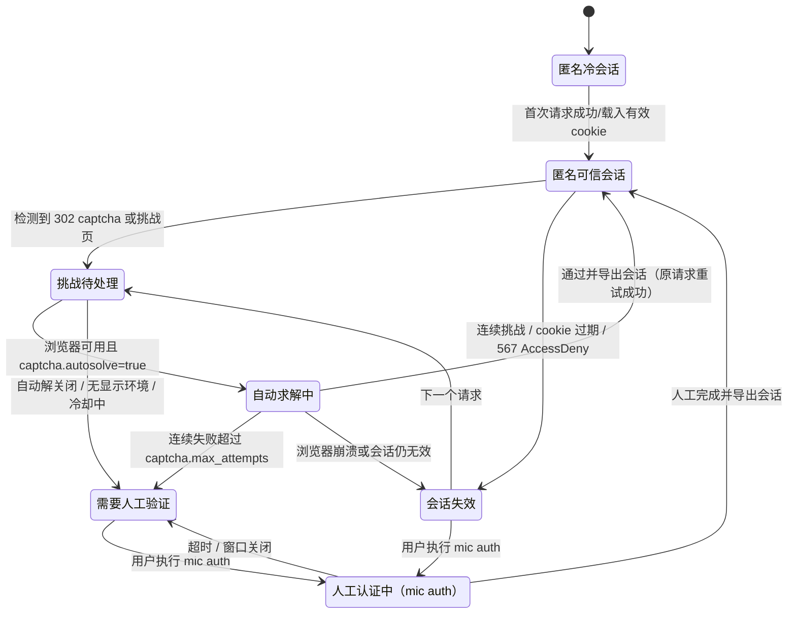

**状态语义**：

- 只有 `Trusted` 状态允许"看起来无需处理"地继续发请求；`Challenge/Solving` 期间**不阻塞缓存读取**（可返回 stale）。
- `Human/Expired` 对外表现为 `NEED_HUMAN_VERIFICATION`（无缓存时）或 stale（有缓存且允许）。
- 状态转换必须写日志（`session.*` 事件）与会话元数据，便于 `mic doctor` 与排障。

### 6.3 导出/注入与文件读写

**导出（浏览器 → jar）触发点**：

1. Focus Captcha 自动通过、业务页恢复后（§4.3）；
2. `mic auth` 人工完成并通过探针后（§4.4）；
3. 浏览器成功通过 EdgeOne JS challenge 后（若走了浏览器兜底）；
4. 可选登录后（用户主动 `mic auth` 时）。

**注入（jar/storageState → 浏览器）**：

- 浏览器启动时，若 `profile_dir/storage-state.json` 存在且 `auth.json` 判定有效 → 注入 context；否则使用空 profile（全新会话，可能触发验证码）。
- 若仅 jar 存在而 storageState 缺失，则以 jar 作为初始 cookies 注入（保守策略：只注入与上游域匹配的 cookie）。

**写入规范**：

- 先取 `session.lock` → 序列化到同目录临时文件（`0600`）→ `fsync` → `rename` 原子替换；
- 保留"上一次有效版本"用于异常回滚（如 `*.json.bak`，权限 `0600`；不长期保留多版本）；
- 写入后更新 `auth.json` 的 `last_check_at`、`version`、来源；
- 读取方按 mtime/版本号检测变化，避免进程内缓存长期陈旧。

**默认不导出的内容**：日志、错误详情、MCP tool 返回值中一律不含 cookie 值；只允许出现域/数量/会话状态等非敏感信息。

### 6.4 失效检测信号

| 信号 | 检测方式 | 含义 | 处理 |
|---|---|---|---|
| Focus Captcha 重定向 | `302 Location` 含 `captcha.made-in-china.com` | 会话/信任度触发 | §4.3 自动解 → 重试一次 → 人工 |
| Focus Captcha 页（伪装 200） | 200 且 `5.6–5.9KB`、含「请验证」或「Focus Captcha」 | 挑战页 | 同上 |
| EdgeOne JS challenge | 200 且 `< 3000B`、含 `__tst_status` | 需执行 JS 写入 cookie | 浏览器执行/换会话重试；失败 `UPSTREAM_UNAVAILABLE`/转人工 |
| AccessDeny | HTTP `567` | 边缘拒绝（会话/风控） | 冷却 + 重试/换会话 → 人工 |
| 挑战循环 | 同一请求连续 302/挑战 ≥阈值 | 会话不可信或风控升级 | 冷却（`risk.cooldown_ms`）+ 转人工，停止自动重试 |
| cookie 过期 | jar 内 cookie 全部过期 / 请求仍然 200 但 302 到挑战 | 会话衰减 | 重新 `mic auth`；期间 stale 可服务 |
| 登录态探针（仅诊断） | `head.do?xcase=getHead` / `login/status/check` | 匿名模式正常返回未登录 | 不作为主链路判定；仅 `mic doctor`/`mic auth` 使用 |

**原则**：挑战检测必须**先于解析**；识别到挑战后不得把挑战页当业务数据解析；连续挑战必须降级而不是加大重试。

### 6.5 并发安全与单例

| 范围 | 单例/锁 | 说明 |
|---|---|---|
| 进程内 | `SessionManager` 单例；`BrowserController` 单例（单 context）；`CacheStore` 单连接；全局限速队列；single-flight 注册表 | 由组合根装配，禁止模块自建实例 |
| 浏览器 | `browser.lock`（跨进程） | 同一时刻只有一个 owner；REST 空闲 `browser.idle_timeout_s` 后释放；`mic auth` 等锁 ≤10s |
| 会话文件 | `session.lock`（跨进程） | 导出/注入临界区；读方可无锁读（文件原子替换保证一致性） |
| SQLite | WAL + `busy_timeout` | 单写者语义：短事务、busy 重试、失败降级为不缓存 |
| REST | `instance.lock` | 单实例 |
| 锁顺序 | `instance.lock` → `browser.lock` → `session.lock` → SQLite 事务 | 禁止反向获取，避免死锁；持浏览器锁时不得长等 SQLite |

**请求隔离**：`core/http` 为每个请求使用会话快照（cookie 列表拷贝），避免请求进行中 jar 被其他请求/导出修改导致不一致。

### 6.6 会话安全要求

1. **权限**：profile 目录 `0700`、session/config/SQLite/log `0600`；启动时检查并在可修复范围内自动修正（受限环境只告警）。
2. **脱敏**：cookie/`Set-Cookie`/`Authorization` 永不写日志、永不进错误 details、永不进 MCP 响应（§10.2）。
3. **轮换**：用户可删除 `data/session/cookies.json` 与 `profiles/default/`（含 storageState/auth.json）后重新 `mic auth`（等价"退出登录/重置会话"）；CLI 提供对应命令（04）。
4. **备份**：备份 `profiles/`、`data/`、`config.json` 即含敏感凭据，需加密保存且不外发（07 §5）。
5. **清除**：删除 `~/.mic-client` 即清除全部本地数据；`mic cache clear` 只清缓存不动会话（04/07 定义）。
6. **最小留存**：会话文件只在本地；不做遥测/不上传；过期文件由 `mic doctor`/手动清理提示。

---

## 7. 验证码与风控

### 7.1 总策略

**JSON 优先（尽量不触发）→ 挑战检测 → 自动通过 → 会话复用 → 人工兜底 → 冷却/熔断防放大**。

- 主链路（搜索/详情/增强）走 JSON：风控轻、基本无验证码（research 实测）；
- 浏览器只在验证码/JS challenge/HTML 兜底时出现（[ADR-0002](decisions/0002-browser-fallback-and-captcha.md)）；
- 任何一次挑战恢复后都要同步会话并只重试一次；
- 自动解失败或环境不满足 → `NEED_HUMAN_VERIFICATION`（`mic auth`）；
- 限速/缓存/single-flight/冷却/熔断保证"不因重试与并发放大风控"。

### 7.2 触发场景与处理

| 场景 | 端点 | 概率/条件 | 现象 | 默认处理 |
|---|---|---|---|---|
| JSON 搜索/refine | `POST /search/supplier`、`GET .../refine` | 低；高频偶发 | 302（多为边缘会话，非 captcha）；持续重试可恢复 | 5–10s 重试 ≤2；captcha 302 → §4.3 |
| 空关键词/异常参数 | `companysearch.do` 等 | 高（空 `word` 触发 Focus Captcha） | 302 captcha | 客户端**前置校验**避免；误触发→自动解/人工 |
| 公司页 info/contact | `company-<account>/info.html`、`contact.html` | **约 13%**（15 次公司页请求 2 次）随机；与公司/等级无关 | 302 captcha 或 5.6KB「请验证」 | §4.3 自动解 → 重试一次 → stale/人工；公司页**串行** |
| PC SEO `company-search` | 城市/员工数筛选页 | 高（200/302/JS challenge 混合，匿名 flaky） | 302、987B challenge、567 | 仅兜底；重试 2–3 次（3–5s）；失败放弃，不阻塞主结果 |
| PC `companysearch.do` | 关键词/省 HTML 兜底 | 低（本次匿名 200 稳定，偶发 challenge） | challenge/精简版 10 行 | 先暖首页 cookie；行数按实际 `list-node` 计数 |
| 公司站深页/About/contact-info | `<host>.en...` | 中（暖 cookie 后稳定） | challenge/302 | 同 host 先首页暖 cookie；失败走降级链 |
| 连续高频/并发 | 任意 | 高 | 302/挑战率上升 | 冷却 + 放大间隔 + 严格串行（§7.5） |
| 中文关键词 | 搜索 | 不触发验证码 | `total=0` | 03 §7.3：本地拒绝（`INVALID_PARAM`/`NON_ENGLISH_KEYWORD`）或映射为地区模式，不发起注定 0 结果的请求（04 R3 已对齐 03） |
| 产品搜索 GET HTML | `m.../search/product?word=` | 高 | 303/验证页 | 非目标；如实现必须用 POST JSON（P2） |

### 7.3 Focus Captcha 自动通过

> 事实与算法依据：[research/captcha-autosolve.md](research/captcha-autosolve.md)；实现参考 `recon/scripts/captcha-autosolve.mjs`（移植到 `core/session/captcha.ts`）。

**结构与协议（已逆向）**：

| 项 | 事实 |
|---|---|
| 触发重定向 | `https://captcha.made-in-china.com/verification.html?srcUrl=<urlencoded>`；`srcUrl` 有 `&` 截断 bug，**客户端自行记住原 URL**，不要依赖回跳 |
| 验证码实现 | vemic **FCaptcha 3.0.2**，`blockPuzzle` 滑动拼图（AJ-Captcha 风格） |
| 取图 | `POST https://captcha.made-in-china.com/captcha/get`，header `captchaId`，body `{captchaType:"blockPuzzle", clientUid, version, ts}`；返回 `secretKey/originalImageUrl/jigsawImageUrl/token` |
| 图片尺寸 | 背景 310×155、拼图 47×155（RGBA、透明背景） |
| 校验 | `POST /captcha/check`；`pointJson` 为页面 JS 用 `secretKey` AES 加密的 `{x, y:5}`；`x = 310 * 拖动距离 / 图片显示宽度`；`repCode=0000` 通过、`6111` 失败 |
| 通过标志 | 会话 cookie（`__tst_status`/`EO_Bot_Ssid` 等）更新，业务页恢复 |

**自动通过流水线（图-4 的展开）**：

1. 浏览器导航到**原始业务 URL**（记住的 URL）；
2. 拦截 `/captcha/get` 响应，取背景/拼图图片 URL；
3. 页面内 canvas 解码两张图：背景求 Sobel 梯度图，拼图取 `alpha>128` 的 mask 及其边界像素集；
4. 对候选偏移搜索最大化 `mean(edge(boundary + (dx,dy)))` 的 `(dx,dy)`（实测 `dy=0`，`dx` 任意）；
5. 换算 `domDelta = x * imgWidth / 310`（`imgWidth≈280`），用 Playwright mouse 分 **24 步**、带纵向抖动、总时长 **600ms+** 拖动；
6. 读取 `/captcha/check` 响应：`0000` 成功；否则等控件刷新后重试，**≤ `captcha.max_attempts`（默认 5）**；
7. 成功后导出 `storageState` 并同步 jar，业务页继续/原请求重试一次。

**约束**：

- **保持真实拖拽**，不伪造 `pointJson`/绕过交互（算法可移植、合规可控）；
- 自动解成功率依赖上游实现（升级即可能失效，V-11）；失败必须转人工，不无限重试；
- 每次自动解都是浏览器操作，必须持浏览器锁并串行执行；
- headless 成功率**未验证**（V-01），默认 headed；无显示环境走人工。

### 7.4 浏览器通道使用规则

**允许**：Focus Captcha 自动解；EdgeOne JS challenge 通过；`mic auth` 人工处理；显式开启的 HTML/DOM 兜底（PC 公司页/SEO 页）；可选的 SEO 城市页交叉校验。

**禁止**：主链路用浏览器取搜索/详情；浏览器内批量抓取/翻页；并发打开多个 context；用浏览器绕过登录墙、限速或做写操作。

**资源管理**：单 context、懒启动、空闲关闭（`browser.idle_timeout_s`）；崩溃后由 session manager 清理并重建；浏览器启动失败 → `CONFIG_ERROR`（含 headless/显示/版本诊断）。

### 7.5 限速、队列与熔断（图-11）

**队列与限速**：

- 全局上游队列默认 `rate.upstream_max_concurrency=1`（单并发）；相邻请求间隔为 `uniform(upstream.rate_min_ms, upstream.rate_max_ms)`，默认 **1500–2500ms**（03 §1.9）；
- 单请求超时 `upstream.timeout_ms`（默认 15s）、连接超时 `upstream.connect_timeout_ms`（默认 5s）；
- **REST 侧等待**：预计等待超过 `rest.queue_max_wait_ms`（默认 5000ms，03 §1.9）→ 立即返回 `RATE_LIMITED`（429 + `Retry-After`，details 含 `queue`/`queue_depth`/`retry_after_seconds`）；队列容量 `upstream.queue_max`（默认 100，05 建议）满同样快速失败；
- **single-flight**：进程内同 `params_hash`（搜索）/同 `account`（详情）的并发请求合并为一次上游调用；跨进程不实现（v0.1）；
- **缓存优先**：新鲜缓存直接返回，不入队；
- **重试**：传输类最多 `upstream.max_retries`（默认 2，即 3 次尝试）；302 会话等待 5–10s；5xx/超时指数退避（2s→5s，加 ≤500ms 抖动），且仍受队列间隔约束；契约/参数类错误不重试（§8.3）；
- **冷却**：连续挑战/风控信号 → 暂停上游 `risk.cooldown_ms`（默认 120s），期间只服务缓存，冷却后恢复（与熔断冷却相互独立）；
- **熔断**（本地保护，03 §1.9）：同一上游端点连续失败 ≥ `upstream.circuit_threshold`（默认 5）→ 打开熔断 `upstream.circuit_open_ms`（默认 30s），期间请求快速失败 **503 `UPSTREAM_UNAVAILABLE`**（`details.circuit_open=true`、`retry_after_seconds`）；冷却后半开探测，成功恢复。

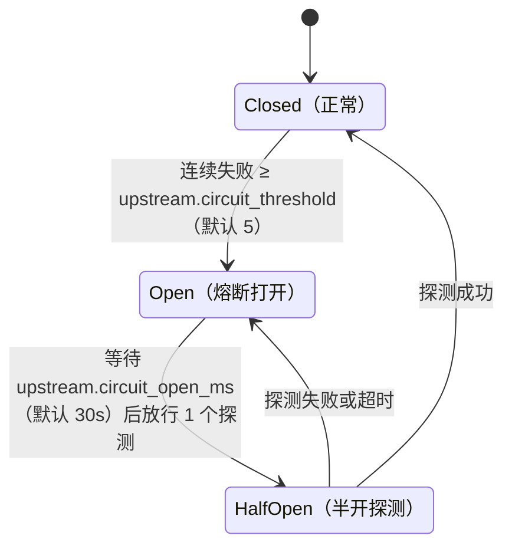

> 熔断期间 REST 返回 503 `UPSTREAM_UNAVAILABLE`（03 §1.9），不是 429；429 只用于队列/限速保护。

**风控自保护**（v0.1 规则，不做学习型自适应）：

- 挑战恢复后，若短时间内再次挑战 → 进入冷却而不是立刻再解；
- 自动解连续失败 ≥3 次/10 分钟 → 停止自动解，直接转人工（`NEED_HUMAN_VERIFICATION`），并记录指标；
- 禁止在冷却期间用浏览器批量绕过；冷却结束后从缓存命中优先恢复。

### 7.6 人工兜底契约

返回 `NEED_HUMAN_VERIFICATION`（409）的典型情形：

- 自动解验证码重试耗尽 / 验证码算法失效（可先返回 `CAPTCHA_SOLVE_FAILED`，由 03 定义区分优先级）；
- 无图形会话（无 `DISPLAY`）或 `browser.headless=false` 且无法启动可见浏览器；
- 浏览器锁长期被占用且无法等待；
- 连续挑战/冷却后仍无缓存可服务；
- 需要登录态才能继续的动作（首期为非目标，不触发）。

**约定**：

- REST：409 + `details` 含 `reason`（如 `captcha_failed`/`no_display`/`session_expired`/`challenge_persistent`）、`hint`（建议 `mic auth`）、`request_id`、`endpoint`；具体字段由 03 定义。
- CLI：退出码 5（04 映射），stderr 输出原因与下一步。
- MCP：`isError=true`，错误内容含 code/message/hint（不含敏感信息）。
- 用户执行 `mic auth` 后，原查询可幂等重试（只读）。

### 7.7 风控观测与基线

- 指标：`captcha_triggered_total`、`captcha_solved_total/failed_total`、`challenge_recovered_total`、`cooldown_activations_total`、`retry_total{reason}`、`rate_limited_total`、`circuit_state`（§9.5）。
- 基线：research 实测「15 次公司页请求 → 2 次 Focus Captcha；会话通过后连续 12 页 HTTP 无验证码」；M1–M4 用真实抓取观测触发率，不因客户端行为显著抬高（06 性能与稳定性用例）。
- 异常即降级：触发率/失败率异常升高时，降低并发（本身就是串行）、放大间隔、依赖缓存并提示用户 `mic auth`。

---

## 8. 错误、重试与降级矩阵

### 8.1 错误分类原则

| 类别 | 例子 | 是否重试 | 是否降级 | 对外 |
|---|---|---|---|---|
| 调用方错误 | 参数缺失/非法、中文无法映射、page 越界 | 否 | 否 | `INVALID_PARAM` |
| 资源不存在 | 公司不存在、301 无法解析 account | 否 | 否 | `NOT_FOUND` |
| 上游契约/解析 | 结构不符、字段缺失、JSON/DOM 解析崩溃 | 否（可先降级） | JSON→HTML→浏览器 | `UPSTREAM_CHANGED` / `PARSE_ERROR` |
| 上游传输/风控 | 5xx、超时、连续 302、挑战无法恢复 | 有限次 | stale/HTML/浏览器 | `UPSTREAM_UNAVAILABLE` / `NEED_HUMAN_VERIFICATION` / `CAPTCHA_SOLVE_FAILED` |
| 本地保护 | 队列饱和/等待超限、熔断、冷却 | 队列/冷却可等待后重试；熔断等冷却结束 | 否（可 stale） | `RATE_LIMITED`（队列）/ `UPSTREAM_UNAVAILABLE`（熔断） |
| 配置/环境 | 配置非法、profile/data 不可写、端口占用、锁冲突 | 否 | 否 | `CONFIG_ERROR` |
| 未分类 | 未捕获异常 | 否 | 否 | `INTERNAL_ERROR`（带 request_id） |

### 8.2 错误码与产生边界（与 docs/README §3.5 完全一致）

| code | HTTP | 含义 | 产生层 | 内部/对外 | 典型触发 |
|---|---|---|---|---|---|
| `INVALID_PARAM` | 400 | 参数缺失/非法（如 keyword 与 region 都为空、省名非法） | adapters/services、region | 对外 | 参数校验失败；地区/关键词中文无法映射；page/page_size 越界；互斥参数冲突 |
| `NOT_FOUND` | 404 | 公司/资源不存在（或 301 无法解析） | company/resolver | 对外 | account/comId 不存在；numeric 301 无法解析；encodeComId 未在本地索引（先 search） |
| `UPSTREAM_CHANGED` | 502 | 上游返回结构与契约不符（字段缺失/改版） | api-client/fallback | 对外 | JSON 结构不符且无 stale/兜底可用；关键字段缺失 |
| `UPSTREAM_UNAVAILABLE` | 503 | 上游 5xx/超时/连续 302，重试耗尽 | http/service | 对外 | 5xx/超时/重试耗尽；挑战无法恢复且无缓存；JS challenge 失败；熔断打开（`details.circuit_open=true`） |
| `RATE_LIMITED` | 429 | 本地上游请求队列/限速保护触发 | rate-queue/http | 对外 | 队列饱和/等待超时（`rest.queue_max_wait_ms`）；冷却期限速保护 |
| `CAPTCHA_REQUIRED` | 409 | 需要验证码（可自动解，**内部用**） | http/api-client | 内部信号 | 检测到 captcha 302 / 挑战页；**不直接对外** |
| `CAPTCHA_SOLVE_FAILED` | 502 | 自动解验证码失败 | session/captcha | 对外 | 自动解重试耗尽；算法失效；浏览器异常 |
| `NEED_HUMAN_VERIFICATION` | 409 | 需要人工过验证/登录（`mic auth`） | session-auth | 对外 | 自动解失败/策略要求人工；无 DISPLAY；持续挑战；会话长时间无效 |
| `PARSE_ERROR` | 502 | 页面/JSON 解析失败（附原始快照引用） | api-client/fallback | 对外 | JSON decode 失败；ssrData 缺失且无兜底；DOM/选择器崩溃 |
| `CONFIG_ERROR` | 500 | 配置/环境错误（如浏览器 profile 缺失） | config/browser/adapters | 对外 | 配置非法；路径不可写；端口占用；锁冲突；浏览器启动失败 |
| `INTERNAL_ERROR` | 500 | 未分类内部错误 | 全局兜底 | 对外 | 未捕获异常（记录 request_id，不泄露内部细节） |

> `CAPTCHA_REQUIRED` 仅作内部信号（README 标注"内部用"）；正常路径不对外。若内部流程未注册导致透出，按 bug 处理并映射为 `NEED_HUMAN_VERIFICATION`（03 可细化）。

### 8.3 重试与降级矩阵

| # | 场景 | 检测/信号 | 内部动作 | 尝试/等待 | 降级 | 最终结果 |
|---|---|---|---|---|---|---|
| 1 | 参数非法/地区或关键词中文无法映射 | 本地校验 | 直接拒绝 | — | — | `INVALID_PARAM`（`details.reason` 见 03 §12.2） |
| 2 | account/comId 不存在 | 上游 404 / 301 无法解析 | 不重试 | — | — | `NOT_FOUND` |
| 3 | JSON 搜索 200 但契约不符 | 必填字段/类型校验失败 | 存快照（若开）→ 先 stale → HTML 兜底（默认关） | 各级 1 次 | stale → HTML（若启用）→ 浏览器（若允许） | 任一级成功：对应 source + warning；否则 `UPSTREAM_CHANGED` |
| 4 | JSON 语法/解析崩溃 | decode 异常、关键锚点缺失 | 存快照 | — | 可走 #3 兜底 | `PARSE_ERROR`（附 `snapshot_ref`） |
| 5 | JSON/HTML 传输 5xx、超时 | 状态码/异常 | 指数退避重试 | 最多 `upstream.max_retries`（默认 2） | 过期缓存 stale | 有缓存：`stale`；否则 `UPSTREAM_UNAVAILABLE` |
| 6 | 302 非 captcha（边缘会话/限流） | Location 不含 captcha 域 | 等待 5–10s 重试 | ≤2 次 | 依旧失败→传输类处理 | 成功则正常；否则 `UPSTREAM_UNAVAILABLE`/stale |
| 7 | 302/挑战页 → Focus Captcha | Location 含 captcha 域；或 5.6KB 验证页 | 图-4 自动解 → 导出会话 → 重试原请求 1 次 | 自动解 ≤`captcha.max_attempts`（5） | 过期缓存 stale | 成功：正常（warnings 记录恢复）；失败：`CAPTCHA_SOLVE_FAILED`/`NEED_HUMAN_VERIFICATION` |
| 8 | EdgeOne JS challenge（987B `__tst_status`） | 长度+特征匹配 | 浏览器执行 JS 后重试；或换会话 | 1–2 次 | 浏览器 DOM 兜底 | 成功继续；失败 `NEED_HUMAN_VERIFICATION`/`UPSTREAM_UNAVAILABLE` |
| 9 | 567 AccessDeny | 状态码 | 冷却+重试/换会话 | 冷却（`risk.cooldown_ms`） | stale | `NEED_HUMAN_VERIFICATION`（无缓存时） |
| 10 | refine 字典失败 | 非关键依赖 | 重试 1 次 | 1 次 | 内置静态字典 | 搜索继续 + warning（不致命） |
| 11 | 公司页 Focus Captcha（≈13%） | 同 #7 | 自动解 → 重试一次 | 同上 | stale 详情 | 成功/降级见 #7 |
| 12 | 公司页 5xx/超时 | 状态码/异常 | 退避重试 | ≤2 | stale 详情 | 有缓存 stale；否则 `UPSTREAM_UNAVAILABLE` |
| 13 | 公司页 404 | 状态码 | 不重试 | — | — | `NOT_FOUND` |
| 14 | ssrData 缺失/正文解析失败 | 解析判定 | 先 stale（允许时）→ HTML 兜底（默认关）→ 浏览器 DOM | 1 条链 | 过期缓存 stale | 兜底成功 `source=html/browser`；否则 `PARSE_ERROR`/`UPSTREAM_CHANGED` |
| 15 | 增强接口失败（SGS/replyRate/contacts/在线/reviews） | 单接口错误 | 单接口重试 1 次后跳过 | 1 次 | partial + `availability_reason=fetch_blocked`/warnings | 详情 `status=partial`，主请求成功 |
| 16 | SEO 页兜底 flaky（仅显式开启） | 302/challenge/超时 | 重试 2–3 次（3–5s） | 2–3 次 | 放弃兜底 | 主结果不受影响；warning |
| 17 | 队列等待超时/容量满 | 本地队列 | 立即拒绝 | — | — | `RATE_LIMITED`（429 + Retry-After） |
| 18 | 熔断打开 | 本地状态 | 立即快速失败 | — | — | `UPSTREAM_UNAVAILABLE`（503；`details.circuit_open=true`、`retry_after_seconds`） |
| 19 | 冷却期（挑战风暴） | 本地状态 | 只服务缓存 | — | stale | 有缓存 stale；否则 `NEED_HUMAN_VERIFICATION`（挑战类）/ `UPSTREAM_UNAVAILABLE`（网络类） |
| 20 | 浏览器锁冲突/启动失败/无 DISPLAY | 本地锁/环境 | 等锁（`session.lock_timeout_s` 默认 10s；`mic auth` 可用 `--timeout`）；失败即报 | — | — | `CONFIG_ERROR`（`details.reason=profile_locked`；`mic auth` 无显示可 `NEED_HUMAN_VERIFICATION`） |
| 21 | 未捕获异常 | 全局兜底 | 记录 request_id 与堆栈（脱敏） | — | — | `INTERNAL_ERROR` |

**重试预算（单次 API 请求）**：传输类最多 3 次尝试；自动解验证码最多 5 次浏览器尝试；降级链最多 1 条（JSON → stale → HTML → Browser，每级最多一次）；增强接口各自最多 2 次尝试。超过预算即进入错误/降级，不得叠加放大。

> HTML 兜底默认关闭（`fallback.html_enabled=false`，03 §7.5）；stale 优先于 HTML 兜底；未启用 HTML 时链路为 JSON → stale → 错误。

**幂等性**：全部上游操作只读（`POST /search/supplier` 为只读查询），重试安全；本客户端无写操作，无需补偿。

**取消**：REST 客户端断开 → 未开始执行的排队任务取消（避免无效上游请求）；已在途请求允许完成并写缓存。MCP 取消按 04 定义传播。

### 8.4 状态语义 `success | partial | stale`

> 状态枚举来自固定契约（docs/README §3.2）。REST 响应包不出现 `status` 字段：派生规则见 03 §1.6（`success` / `partial`（含 `ENRICHMENT_PARTIAL` 等）/ `stale`（`meta.stale=true`））；CLI/MCP 可直接输出状态（04 定义）。

| 状态 | 定义 | 触发 | REST 表达（03 细化） | CLI/MCP（04 细化） | 缓存 |
|---|---|---|---|---|---|
| `success` | 请求的数据全部取得；允许供应商未填字段的合法 `null`+reason | 正常 JSON/HTML 路径 | HTTP 200，`ok=true`，`meta.stale=false`；warnings 可为空 | 退出码 0 / 非 error | 正常 TTL |
| `partial` | 主体数据可用，部分增强/可选字段失败 | 详情主数据成功但 SGS/响应率/联系人等失败；列表部分页失败 | HTTP 200，`ok=true`，warnings 列明失败项 | 退出码 0 + warnings；MCP 非 error | 主数据与各增强区块分别按 03/05 TTL 缓存 |
| `stale` | 上游失败，返回过期缓存 | 传输/挑战失败且有过期缓存且 `cache.allow_stale=true` | HTTP 200，`ok=true`，`meta.stale=true`、`cached=true`、`fetched_at`=原抓取时间、warnings 含 `STALE_DATA` | 退出码 0 + stale 标记 | 沿用旧条目，不刷新 fetched_at |
| `error` | 无法取得数据且无可用缓存 | 见 §8.2 | HTTP 4xx/5xx，`ok=false`，`error.code` | 退出码/ MCP error 按 04 | 不写缓存 |

**source 语义**：`source` 为最终来源通道（`json|html|browser|cache`）；缓存命中时 `cached=true`，`source=cache`；纯本地端点（health/version/membership levels/cache stats）按 03 §1.8 也使用 `source=cache`（OQ-03-03 待 Lead 决策，实现按 03）。

**关键不变量**：**能用缓存就不用错误**（有缓存+允许 stale → stale；无缓存才报错）；**partial 不是错误**（HTTP 200 / 非 MCP error）；**错误必须可行动**（提示 `mic auth`/重试/看快照）。

### 8.5 挑战/改版/边界识别规则（原始信号）

| 信号 | 匹配方式 | 归类 | 处置 |
|---|---|---|---|
| `302` 且 `Location` 含 `captcha.made-in-china.com` | Location 字符串 | Focus Captcha | §4.3 |
| `200` 且响应体 `< 3000B` 且含 `__tst_status` | 长度 + 特征 | EdgeOne JS challenge | 浏览器执行 JS/换会话后重试 |
| `200` 且响应体 `5.6–5.9KB` 且含「请验证」/「Focus Captcha」 | 长度 + 特征 | Focus Captcha 页（伪装 200） | §4.3 |
| `567` | 状态码 | AccessDeny（边缘拒绝） | 冷却 + 换会话/人工 |
| `404`（`/search/supplier/refine` 等） | 状态码 | 多为缺 `X-Requested-With` 客户端 bug | 修复请求头；不重试（内部 bug 记录） |
| `500`（`sgs/report` 且 comId 为数字） | 状态码 + 参数类型 | 内部 ID 类型错误 | 改用 `encodeComId`；跳过增强 + warning |
| `{"code":900004}`（reviews 等） | JSON 内容 | ID 类型/参数错误 | 同上报错处理，不重试 |
| `301`（`m.../company/<数字comId>`） | 状态码 + Location | account 反查重定向 | 解析 Location → 继续；无法解析→`NOT_FOUND` |
| `totalNum == "2,000+"` 或 `total >= 2000` | JSON 字段 | 覆盖封顶 | `total_capped=true`、`total_display="2,000+"`（03 §1.7）+ warning `NON_EXHAUSTIVE` |
| 本地扫描预算用尽（city/audited） | `scan_max_pages` 用尽且未到末页 | 非穷尽 | `NON_EXHAUSTIVE` + `total_is_lower_bound=true` |
| 返回 `page` ≠ 请求 `page` | JSON 字段 | 页号被夹到末页 | 置 `page_clamped=true`（warning `PAGE_CLAMPED`），按 03 §1.7 返回末页/空页，避免重复计结果 |
| `dataList` 为空且 `total > 0` | JSON 字段 | 上游异常/过滤过窄 | 停止翻页 + warning（不无限翻页） |
| 条目 `showAd`/`ad`/`deliveryType=ads` | JSON 字段 | 广告位 | 过滤（自然结果）+ warning 计数 |
| `dataFromCorrect/correctKey` | JSON 字段 | 关键词纠错提示 | 透出 warning（提示调用方可能被纠错） |
| SSO/登录重定向（非匿名场景） | Location 含 `login.made-in-china.com` | 需登录（首期非目标） | 不访问；`NEED_HUMAN_VERIFICATION`/不实现对应能力 |

### 8.6 原始快照与证据

- **何时保存**（仅 `raw_snapshot.enabled=true`）：`PARSE_ERROR`、`UPSTREAM_CHANGED`、契约可疑、`mic doctor --contract` 失败。
- **保存内容**：脱敏 URL（只留 host/path）、状态码、少量响应头（不含 `Set-Cookie`/`Authorization`）、响应体（gzip）、时间戳、`request_id`、端点 ID、解析失败摘要。
- **位置/命名**：`~/.mic-client/data/raw/YYYYMMDD/<request_id>-<endpoint>.json.gz`（05 定义最终格式）。
- **限额**：单文件默认 ≤2MB；保留期 `raw_snapshot.retention_days`（默认 7 天）；总量上限由 05/07 定义；超限淘汰最旧。
- **使用**：错误 `details.snapshot_ref` 只给本地路径；错误响应/日志不得内联大段 HTML/cookie；排障时人工查看。
- **隐私**：快照可能含业务数据，属本地敏感数据；权限 `0700/0600`；不自动上传、不进入仓库。

### 8.7 重试与风控的边界

- 重试只针对**可安全重复的只读请求**；不重试 4xx 与契约错误。
- 重试必须经过限速队列（重试也占一个 1.5–2.5s 间隔），不允许"立即连发"。
- **挑战不可通过重试解决**：挑战必须走自动解/人工路径；连续挑战触发冷却与熔断。
- **禁止跨会话重试风暴**：同一查询失败后不自动切换多个 profile/IP 重试（本机单用户无代理池）。

---

## 9. 配置、日志与指标

### 9.1 配置来源与优先级

1. **优先级**：**CLI 参数 > 环境变量 > 配置文件 > 内置默认值**（07 §3；[ADR-0007](decisions/0007-local-runtime-and-secrets.md)）。
2. **配置文件**：`~/.mic-client/config.json`（JSON）；`--config <path>` 或 `MIC_CONFIG` 可覆盖路径（04 §2.4）；`mic config path` 查看、`mic config show` 查看生效值（04）。
3. **环境变量**：统一 `MIC_` 前缀；点号键转大写下划线（`rest.port` → `MIC_REST_PORT`），路径键已是扁平名（`profile_dir` → `MIC_PROFILE_DIR`）。
4. **快照只读**：启动时合并/校验后生成只读快照；运行期不热加载（v0.1），修改配置需重启进程。
5. **未知/废弃键**：未知键 → warning `CONFIG_UNKNOWN_KEY`（04 §2.4，前向兼容）；已废弃键 → warning；类型/取值非法 → `CONFIG_ERROR` 启动失败。
6. **密钥边界**：配置不存放 cookie/token/密码（本客户端无上游 key）；profile/data 路径可配置但需可写。

### 9.2 配置项基线（架构完整表）

> 07 §3 列出运维高频项；本表是**完整基线**。键名与 07 一致；新增键沿用相同命名风格。所有键均可通过对应 `MIC_*` 环境变量覆盖；07 未收录的键由本文档定义，07 更新时同步（避免两处漂移）。

| 分组 | 键 | 类型 | 默认值 | 说明/取值 |
|---|---|---|---|---|
| 路径 | `profile_dir` | string | `~/.mic-client/profiles/default` | 浏览器持久 profile；`--profile` 可覆盖 |
| 路径 | `data_dir` | string | `~/.mic-client/data` | SQLite/session/raw/locks 的根；测试可指向临时目录 |
| 路径 | `log_dir` | string | `~/.mic-client/logs` | 日志目录 |
| 日志 | `log_level` | enum | `info` | `debug｜info｜warn｜error` |
| REST | `rest.host` | string | `127.0.0.1` | **仅回环**；非回环 → `CONFIG_ERROR`（§10.1） |
| REST | `rest.port` | int | `8899` | 1–65535；`mic serve --port` 可覆盖 |
| REST | `rest.queue_max_wait_ms` | int | `5000` | REST 侧预计排队等待上限，超时→429（03 §1.9） |
| REST | `rest.cors_origin` | string/null | `null` | CORS 白名单；默认关闭（03 §1.2） |
| 上游 | `upstream.timeout_ms` | int | `15000` | 单请求超时；`--timeout` 可覆盖 |
| 上游 | `upstream.connect_timeout_ms` | int | `5000` | 连接超时 |
| 上游 | `upstream.rate_min_ms` | int | `1500` | 请求间隔下限（抖动）；建议 ≥1500（合规） |
| 上游 | `upstream.rate_max_ms` | int | `2500` | 请求间隔上限；必须 ≥ min |
| 上游 | `upstream.max_retries` | int | `2` | 传输类重试次数（总尝试 = n+1） |
| 上游 | `upstream.retry_delay_ms` | int | `5000` | 302/会话类重试基础等待（实测 5–10s） |
| 上游 | `rate.upstream_max_concurrency` | int | `1` | 上游队列并发（03 §1.9；提高会增加风控风险，不建议） |
| 上游 | `rate.enrichment_parallelism` | int | `2` | 增强接口跨 host 并发（仅 m/www/data 不同 host，03 §1.9） |
| 上游 | `upstream.queue_max` | int | `100` | 队列容量；满→`RATE_LIMITED`（05 §7.6 建议值） |
| 上游 | `upstream.circuit_threshold` | int | `5` | 同一端点连续失败打开熔断阈值（03 §1.9） |
| 上游 | `upstream.circuit_open_ms` | int | `30000` | 熔断打开时长（03 §1.9：30s） |
| 上游 | `upstream.ua_override` | string/null | `null` | 排障用 UA 覆盖（默认按端点自动选择） |
| 风控 | `risk.cooldown_ms` | int | `120000` | 连续挑战后的上游冷却时长 |
| 缓存 | `cache.enabled` | bool | `true` | 关闭后所有查询直连上游（仅测试/排障） |
| 缓存 | `cache.ttl_list_s` | int | `21600` | 列表 6h；`--refresh` 跳过新鲜缓存 |
| 缓存 | `cache.ttl_detail_s` | int | `86400` | 详情 24h |
| 缓存 | `cache.ttl_regions_s` | int | `2592000` | 地区字典 30d |
| 缓存 | `cache.ttl_empty_list_s` | int | `3600` | 空结果列表 TTL（05 §7.3；避免反复请求 0 结果） |
| 缓存 | `cache.ttl_search_index_s` | int | `21600` | 搜索派生索引 6h（03 §1.8 = 05 §7.3） |
| 缓存 | `cache.ttl_audit_s` | int | `604800` | 审核章节 7d（03 §1.8 = 05 §7.3） |
| 缓存 | `cache.ttl_contacts_s` | int | `86400` | TM 联系人 24h（03 §1.8 = 05 §7.3） |
| 缓存 | `cache.ttl_reviews_s` | int | `43200` | 评价 12h（03 §1.8 = 05 §7.3） |
| 缓存 | `cache.ttl_response_s` | int | `21600` | 响应率/响应时长 6h（03 §1.8 = 05 §7.3） |
| 缓存 | `cache.ttl_tm_status_s` | int | `300` | TM 在线状态 5min（05 §7.3） |
| 缓存 | `cache.purge_grace_s` | int | `604800` | 过期缓存保留宽限期（供 stale，05 §7.3） |
| 缓存 | `cache.allow_stale` | bool | `true` | 上游失败时允许过期缓存回退 |
| 缓存 | `cache.db_busy_timeout_ms` | int | `5000` | SQLite busy 等待 |
| 验证码 | `captcha.autosolve` | bool | `true` | 自动解开关；关闭→挑战直接转人工 |
| 验证码 | `captcha.max_attempts` | int | `5` | 自动解最大尝试次数 |
| 验证码 | `captcha.solve_timeout_s` | int | `30` | 单次自动解超时 |
| 会话 | `auth.timeout_s` | int | `300` | `mic auth` 人工等待上限 |
| 会话 | `session.lock_timeout_s` | int | `10` | 浏览器/会话锁等待上限 |
| 浏览器 | `browser.enabled` | bool | `true` | 关闭后无浏览器兜底（挑战只能人工/报错） |
| 浏览器 | `browser.headless` | bool | `false` | 默认可见；headless 自动解成功率未验证（V-01） |
| 浏览器 | `browser.idle_timeout_s` | int | `120` | 空闲后关闭浏览器并释放锁 |
| 浏览器 | `browser.launch_timeout_s` | int | `60` | 浏览器启动超时 |
| 降级 | `fallback.html_enabled` | bool | `false` | JSON 失败时允许 PC HTML 兜底（首期默认关闭，03 §7.5；显式开启） |
| 降级 | `fallback.seo_enabled` | bool | `false` | SEO 城市页交叉校验（浏览器，默认关） |
| 搜索 | `search.scan_max_pages` | int | `10` | city/audited 本地过滤扫描预算（默认 10 页 ≈ 200 条，03 §7.6）；用尽→`NON_EXHAUSTIVE` |
| 搜索 | `search.page_size_max` | int | `100` | 对外 page_size 上限（>20 需多页聚合，03 定义窗口） |
| 快照 | `raw_snapshot.enabled` | bool | `false` | 原始快照开关（排障/契约分析） |
| 快照 | `raw_snapshot.retention_days` | int | `7` | 快照保留期 |
| 快照 | `raw_snapshot.max_bytes_per_file` | int | `2097152` | 单快照大小上限（2MB） |

### 9.3 配置校验规则

- 类型/枚举/范围校验在启动时完成，失败 → `CONFIG_ERROR`（附键名与期望值）。
- `rest.host` 必须是回环地址（`127.0.0.1`/`localhost`/`::1`）；否则拒绝启动（§10.1）。
- `rest.port` 1–65535；`rest.queue_max_wait_ms` > 0。
- `profile_dir`/`data_dir`/`log_dir` 必须可创建/可写；权限不符合时告警并尝试修正（受限环境只告警）。
- `upstream.timeout_ms` 1000–120000（04）；`upstream.rate_min_ms ≤ upstream.rate_max_ms`，范围 500–10000（04；小于 1500 告警，仅测试应降低）。
- `rate.upstream_max_concurrency` 固定 1（提高需 ADR）；`rate.enrichment_parallelism` 1–2。
- `captcha.max_attempts` ≥1；`upstream.max_retries` 0–3。
- `mic doctor` 校验生效配置并与 07 的环境检查一致。

### 9.4 结构化日志

- **格式**：JSON Lines；进程同时写 `logs/mic.log`；CLI 的日志走 stderr（stdout 只放数据）；MCP 只走 stderr/文件。
- **字段**（07 §8 的超集）：

| 字段 | 类型 | 说明 |
|---|---|---|
| `ts` | string | ISO8601（`+08:00`） |
| `level` | enum | `debug｜info｜warn｜error` |
| `request_id` | string | 请求/命令/tool 调用关联 id（`req_`/`cli_`/`mcp_` 前缀，03/04 细化） |
| `caller` | enum | `rest｜cli｜mcp｜internal` |
| `module` | string | `http｜api.search｜api.company｜api.enrich｜session｜captcha｜cache｜fallback｜normalizer｜config｜server` |
| `event` | string | 见下方事件表 |
| `source` | enum | `json｜html｜browser｜cache`（与响应 meta 一致） |
| `status` | enum | `success｜partial｜stale`（业务结果） |
| `endpoint` | string | 端点/能力 ID（如 `mobile-supplier-search`；03 §1.10 必需） |
| `params_hash` | string | 缓存键哈希（03 §1.10 必需；无查询性质时为空） |
| `upstream_calls` | int | 本次请求实际上游调用数（03 §1.10 必需） |
| `upstream_host` | string | 脱敏 host（不含 query 中的敏感值） |
| `http_status` | int | 上游状态码（如有） |
| `retry_count` | int | 本次请求已重试次数 |
| `duration_ms` | int | 本事件耗时 |
| `cache_hit` | bool | 是否缓存命中 |
| `cached` / `stale` | bool | 同响应 meta |
| `captcha_triggered` | bool | 是否检测到挑战 |
| `captcha_attempt` | int | 自动解尝试次数（如有） |
| `session_state` | string | §6.2 状态名 |
| `pages_scanned` | int | 城市/地区过滤扫描页数（如有） |
| `error_code` | string | 固定错误码（如有） |
| `warnings` | string[] | warning code 列表 |
| `msg` | string | 简短人类可读描述（含必要上下文，不含敏感值） |

- **事件**（`event` 建议集合）：`config.loaded`、`server.started/stopped`、`http.request`、`http.retry`、`http.challenge_detected`、`captcha.triggered/solved/failed`、`session.exported/invalid/refreshed`、`cache.hit/miss/write/stale_served`、`fallback.used`、`contract.suspect`、`auth.started/completed/timeout`、`doctor.check`、`mcp.tool_call`、`cli.command`。
- **轮转**：按大小轮转（默认单文件 10MB、保留 5 个）；由写日志进程执行（多进程时用文件锁协调，允许近似）。
- **脱敏红线**：禁止记录 cookie/`Set-Cookie`/`Authorization`/完整 HTML/完整 profile 路径（03 §1.10）；URL 中若含业务敏感参数按 05 规则处理；错误堆栈可记录但不得含凭据。

### 9.5 指标与 `/health`

**进程内指标（v0.1，不做外部导出）**：

| 指标 | 类型 | 标签/说明 |
|---|---|---|
| `upstream_requests_total` | counter | `endpoint,result`（success/retry/fail） |
| `upstream_retries_total` | counter | `reason`（302/5xx/timeout/challenge） |
| `upstream_latency_ms` | histogram | `endpoint` |
| `request_latency_ms` | histogram | `caller,route,mode`（keyword/region/mixed，缓存/未缓存） |
| `cache_hits_total` / `cache_misses_total` | counter | `kind`（list/detail/regions） |
| `cache_stale_served_total` | counter | — |
| `captcha_triggered_total` / `captcha_solved_total` / `captcha_failed_total` | counter | — |
| `rate_limited_total` | counter | `reason`（queue/cooldown；熔断快速失败计入 `errors_total{code=UPSTREAM_UNAVAILABLE}`） |
| `fallback_used_total` | counter | `from,to`（json→html、html→browser） |
| `errors_total` | counter | `code` |
| `queue_depth` | gauge | 当前排队数 |
| `circuit_state` | gauge | closed/open/half_open |
| `session_age_s` / `session_state` | gauge/label | 会话新鲜度 |

- **`/health`**（03 定义精确 Schema；`deep=true` 执行 DB/profile/上游探针并返回 `data.status: ok|degraded`，HTTP 仍 200）应包含：`ok`、`version`、`uptime_s`、`db_writable`、`profile_ready`、`browser_ready`、`session_state`、`queue_depth`、`circuit_state`、`last_upstream_probe`（cached/时间/结果）、`cache_summary`（条目数/命中率近似）。
- **`mic doctor`**：环境（Node/cloak-env/版本/显示）→ 路径权限 → SQLite 可写 → 会话可用性 → 网络连通 → 上游契约探针（`--contract`）；输出建议与修复指引（07 §6）。
- **不做**：不上传指标、无遥测；`/metrics`（Prometheus）为未来扩展（§11.7）。

### 9.6 request_id 与追踪

- REST 请求生成 `req_` 前缀 id；调用方可带 `X-Request-Id`（合法则沿用，03 §1.10），响应在 `meta.request_id` 与响应头回显；CLI 命令生成 `cli_`；MCP tool 调用生成 `mcp_`。
- `request_id` 出现在：响应 `meta.request_id`、错误 `details`、日志字段、`mic doctor` 输出；用于把一次调用跨模块串起来。
- 不把 `request_id` 当作安全凭据；不包含用户/机器敏感信息。

---

## 10. 安全与合规设计

### 10.1 本地监听与无鉴权边界

1. **仅回环**：REST 默认 `127.0.0.1:8899`；启动时校验 `rest.host` 为回环地址，**非回环直接拒绝启动**（`CONFIG_ERROR`）。文档明确禁止绑定 `0.0.0.0`/局域网/公网（07 §9、[ADR-0007](decisions/0007-local-runtime-and-secrets.md)）。
2. **无鉴权是设计选择**：单机单用户、本地回环；不引入 Token/会话鉴权（复杂度与收益不匹配）。
3. **风险声明**：同机其他进程/用户可能访问该回环端口（本机信任边界内）；不在响应中放敏感凭据，接口只读，限制超时与并发，降低被滥用影响。
4. **加固项**：`Host` 头只接受 `127.0.0.1`/`localhost`/`::1`（否则 400 `INVALID_PARAM`，`details.reason="HOST_NOT_ALLOWED"`，防 DNS rebinding）；默认不返回 CORS 头（`rest.cors_origin` 白名单显式开启）；请求体 ≤64KiB、请求行+查询串 ≤8KiB；无 TLS（仅回环）（03 §1.2）。
5. **不暴露**：不提供远程访问、不做端口转发、不监听 Unix socket 以外的其他网络接口（v0.1）。

### 10.2 凭据与隐私保护

- profile 目录 `0700`；`config.json`/session/SQLite/日志 `0600`；创建时设置 umask 并在启动时校验。
- cookie/storageState 属**敏感凭据**：不写日志、不进错误 details、不进 MCP 响应、不进仓库；`mic doctor` 只报告"会话存在/状态"；日志不记录完整 profile 路径（03 §1.10）。
- 错误消息与日志中的 URL 需脱敏（去掉 query 中的敏感参数，若未来引入）；HTML 正文不直接输出。
- 备份 `profiles/`、`data/` 视为含密钥的备份：建议加密保存、不共享（07 §5）。
- 会话重置/清除路径：删除 `data/session/cookies.json` 与 `profiles/default/`（含 storageState/auth.json；或 CLI 等价命令）后重新 `mic auth`；删除 `~/.mic-client` 清除全部数据。

### 10.3 上游访问礼仪

1. **串行 + 抖动**：1.5–2.5s/请求、单进程串行、缓存优先、single-flight；禁止并发/多进程批量抓取。
2. **只读**：不发送询盘、不做登录后写操作、不点赞/收藏；`POST /search/supplier` 仅用于只读查询。
3. **不绕过访问控制**：不绕过登录墙、不伪造第三方身份、不做灰产打码；验证码自动解只用于**用户本机的会话信任建立**，且保留人工兜底与限速。
4. **停止信号**：遇到持续挑战/567/429 时冷却并降低频率；用户可随时停止进程。
5. **非目标**：不做全量/商业化采集、不转售/再分发数据、不做压力测试；使用者需自行遵守目标站点服务条款与当地法律（NFR-06）。
6. **UA 说明**：公司页使用移动 UA 是为了获取移动站公开页面（上游行为要求，桌面 UA 会 302 到 PC 站）；不用于伪装第三方身份。

### 10.4 字段与数据边界

| 字段/能力 | 上游可得性 | 客户端处理 |
|---|---|---|
| 电话/邮箱/WhatsApp/Skype/微信 | **平台不公开**（非登录墙；research 20 页 0 命中） | 不建模为"登录可得"；恒 `null` + `availability_reason=not_public_by_platform`；提示通过站内询盘/聊天联系 |
| 审核报告全文/PDF/明细 | 不公开（report.html 301→About） | 只保留机构/报告编号/核验链接/已审章节数（增强 JSON） |
| 评论明细/评论数 | 明细接口未逆向（待验证） | 首期只取聚合评分；明细不做/待定 |
| 营业执照详情/注册号/图片 | 买家侧不可得（仅"verified business licenses"文案） | 不建模注册号/执照图；只保留 `verified_business_license` 语义（若 05 定义） |
| 站内信/询盘篮/收藏/账号私有数据 | 需登录、买家私有 | 不访问、不建模、不抓取 |
| 登录后额外公司字段 | 未验证（OQ-01） | 不假设存在；不设计"登录解锁"；`mic auth` 可选登录仅用于买家侧能力/差分复核 |
| 供应商自填简介中的联系方式 | 理论可能存在，样本 0 命中 | 不作结构化字段；如未来支持需显式标注来源为"自填文本"（未实现） |

### 10.5 数据留存与清理

| 数据 | 默认留存 | 清理方式 |
|---|---|---|
| 缓存（列表/详情/地区/partial） | 按 TTL（6h/24h/30d/1h）；stale 保留到被覆盖/清理 | `mic cache clear --scope ...`（04/07） |
| 原始快照 | 默认关闭；开启后 7 天 | 保留期自动淘汰 + `mic cache clear --scope raw` |
| 日志 | 大小轮转，保留 5 个文件 | 删除 `logs/` 或轮转淘汰 |
| 会话（profile/session） | 直到失效或用户重置 | 删除 `profiles/default/` 与 `data/session/cookies.json` 后 `mic auth`；删除 `~/.mic-client` |
| 配置 | 用户维护 | 手动删除 `config.json` |

- **无遥测**：不向任何第三方上传数据；所有数据留在本机。
- **备份**：用户自行备份/加密；仓库与文档中不得出现真实 profile/cookie。

### 10.6 合规风险与用户责任

- 上游服务条款可能限制自动化访问；本工具定位为**本机个人检索辅助**，不做批量/商业采集；是否合规由使用者结合当地法律与站点条款确认（非法律意见）。
- 验证码自动通过的边界：仅在本机会话内绕过**人机验证**以恢复用户原本要访问的公开页面，保留人工兜底，不用于攻击/撞库/绕过登录。
- 数据使用：不转售、不再分发；引用上游数据时保留来源 URL/证据（05 evidence）。
- 风险升级：如上游明确禁止/风控升级，应停止使用自动解并退回人工模式（`captcha.autosolve=false`）。

### 10.7 安全红线清单（评审必查）

- [ ] 不在回环地址之外监听；不以任何方式暴露公网/局域网。
- [ ] 不在日志/错误/响应/MCP 中输出 cookie/storageState/HTML 详情。
- [ ] 不把 profile/data 提交仓库；备份提醒加密。
- [ ] 不绕过登录墙/付费墙；不建模非公开字段为"登录可得"。
- [ ] 不并发轰炸/批量抓取；重试与降级受队列/熔断/冷却约束。
- [ ] 不做上游写操作；不实现询盘/交易/收藏。
- [ ] 错误只引用固定错误码，details 不含敏感数据。
- [ ] 关闭自动解时（`captcha.autosolve=false`）行为仍然完整（直接人工）。

---

## 11. 扩展点

### 11.1 多平台适配（未来 Alibaba 等，OQ-08）

- 抽象 `PlatformAdapter`（概念接口）：能力描述（搜索/详情/增强/地区）、上游端点与参数编码、normalizer 版本、会员/字段映射、风控特性。
- 保持 core services/adapters 不变；新平台只新增 provider 实现 + golden fixtures + 契约测试。
- 对外契约（错误码、响应包、枚举）不变；如需 `platform` 字段，先在 03 增补（不破坏现有字段）。
- 需新增 ADR（平台边界与字段映射），并更新 02/03/05。

### 11.2 新增上游接口/能力

1. 在 `core/api-client` 增加该能力的封装（URL/参数/头/响应 schema）；
2. 用 `recon/artifacts/api/` 或新抓样例做 golden fixture + 契约测试；
3. 在 service 中定义降级优先级与 warnings；可选能力不应使主请求失败（partial）；
4. 更新本文 §2.4、03（如需暴露）、05（字段映射）、06（用例）；
5. 若涉及新错误/状态，先改固定契约（docs/README）再实现（[ADR-0006](decisions/0006-docs-first-workflow.md)）。

### 11.3 新增 CLI 子命令 / MCP tool

1. 先在 service 层实现用例并加测试（core 不感知入口）；
2. adapter 增加命令/tool（参数 Schema、输出格式、错误映射、退出码）；
3. 更新 04（命令/tool 契约）与 07（如涉及运维步骤）；
4. 加三入口一致性用例（同查询同字段）；
5. 只读默认；分页/超时/并发上限与 REST 一致。

### 11.4 新缓存实体/迁移

- 由 05 定义 DDL 与 `schema_version`；迁移在启动期持锁执行；失败回滚并 `CONFIG_ERROR`。
- 任何缓存键/TTL/字段变更需同步 05 并评估跨版本兼容；不兼容时提示用户清理缓存（不静默删除）。

### 11.5 远程/多用户（显式排除，另立 ADR）

需要时新增：鉴权（至少 Token）、TLS、按用户隔离 profile/缓存、每用户限速、审计。当前架构以"本地单用户"为前提，任何远程化都需新 ADR 与安全评审（OQ-07）。

### 11.6 后台预取/任务队列（未来）

- 可选为热门查询预取缓存，但必须复用同一限速队列与缓存策略，且不得在用户未使用时高频访问。
- 需要新增调度器/任务持久化，属架构级变更（新 ADR），M1–M4 不实现。

### 11.7 可观测升级

- 未来可增加 Prometheus/OpenTelemetry 导出或 `/metrics`；当前以 `/health` + JSONL 日志为准（§9.5）。
- MCP/Agent 场景可增加 tool 调用观测，但不采集用户查询内容（隐私）。

### 11.8 更多增强字段（评论明细、联系人页面等）

- 评论明细/联系人姓名职称等需先补 research（接口逆向/匿名边界）并评估风控成本，再按 §11.2 流程接入；默认不扩大浏览器使用范围。

---

## 12. ADR 索引

已采纳决策（[docs/decisions/](decisions/README.md)，Lead 维护）：

| ADR | 标题 | 状态 | 与本文关系 |
|---|---|---|---|
| [0001](decisions/0001-json-first-upstream.md) | 上游数据获取采用 JSON 优先、HTML/浏览器兜底 | Accepted | §1.5-D1、§2.4、§4.1/§4.2/§4.5 |
| [0002](decisions/0002-browser-fallback-and-captcha.md) | 浏览器仅用于兜底；Focus Captcha 自动通过 + 人工 `mic auth` 兜底 | Accepted | §1.5-D2、§6、§7 |
| [0003](decisions/0003-city-client-side-filter.md) | 城市筛选在客户端按 `city` 字段过滤 | Accepted | §1.5-D3、§4.6 |
| [0004](decisions/0004-region-keyword-mode.md) | 地区词当 keyword 实现纯地区列举 | Accepted | §1.5-D4、§4.6 |
| [0005](decisions/0005-membership-tier-enum.md) | 会员等级枚举与 KA/SKA 边界 | Accepted | §1.5-D5、§3.1（membership）、§4.2 |
| [0006](decisions/0006-docs-first-workflow.md) | 文档先行（docs-first）工作流 | Accepted | 全文；实现与本文冲突时先改文档/补 ADR |
| [0007](decisions/0007-local-runtime-and-secrets.md) | 本地单进程运行时、数据/profile 目录与密钥边界 | Accepted | §1.5-D8/D9、§5、§6、§10 |

**后续候选 ADR**（实现/评审时如确认，由 Lead 在 `docs/decisions/` 编号，本表为占位，不预先占用编号）：

| 候选主题 | 说明 | 关联章节 |
|---|---|---|
| 会话双层存储格式与失效判定 | `cookies.json`+`storageState`+`auth.json` 的格式/版本/原子写细节 | §6 |
| 配置文件格式与优先级落地 | `config.json` 结构、未知键策略、与 04 `mic config` 对齐 | §9 |
| 增强接口并发策略 | 公司页串行 + 增强 ≤2 的默认值与风控依据 | §4.2/§7 |
| 可观测方案升级 | 指标导出/日志轮转的演进 | §9.5 |

---

## 附录 A 上游事实清单（与 research 对照）

| # | 事实 | 取值/结论 | 出处 |
|---|---|---|---|
| A1 | 供应商搜索 | `POST https://m.made-in-china.com/search/supplier`；必须 `X-Requested-With: XMLHttpRequest`；`word` 必填 | upstream-api §3.1 |
| A2 | 搜索分页/总数 | 20/页；`total/totalNum/totalPage`；`total>2000` 封顶 `"2,000+"`、`totalPage=100`；`page` 超末页被夹取 | upstream-api §3.1、notes §5.6 |
| A3 | 搜索过滤参数 | `province`（英文省名，非法/中文→total=0）、`catCode`、`memberLevel`（50/30/`0,1,3`）、`managementCertification`、`comBusinessType`、`annualRevenue`、`rdCapacity` | upstream-api §3.1/§3.2 |
| A4 | JSON 无 city | `city/cityName/comCity` 被忽略；列表条目自带 `city/province` | upstream-api §3.9 |
| A5 | 中文关键词 | 中文关键词=0（河北/玻璃 均 0）；空 word 触发 Focus Captcha；`word=*` 空结果 | upstream-api §4.3、notes §2 |
| A6 | 地区词 | `hebei`=1101、`shijiazhuang`=1666、`langfang`=278、`hebei shijiazhuang`=421；需后置校验去噪 | upstream-api §4.3、notes §5.4 |
| A7 | 公司详情 | `GET m.../company-<account>/info.html`（移动 UA）→ `<script type="text/json" id="ssrData">`；字段 `memberLevel/memberSince/sgsMember/establishment/mainProducts/businessTypes/reviewStatistics/companySymbol` 等 | upstream-api §3.4 |
| A8 | 公司页风控 | 15 次公司页请求 2 次 Focus Captcha（≈13%，随机）；contact 页同样会出 | upstream-api §3.4/§6 |
| A9 | 数字 comId | `m.../company/<数字comId>` → 301 → `/company-<账号>/`（Location 可反查 account） | upstream-api §3.4、`headers/mobile-company-numeric-301.txt` |
| A10 | 增强接口 ID | SGS/replyRate/contacts/reviews 必须 `encodeComId`；数字 comId → SGS 500、reviews `900004` | upstream-api §3.5 |
| A11 | SGS 章节 | `www.../multi-search/sgs/report?comId=<encode>` 返回 9 章节 audit 状态 | upstream-api §3.5a |
| A12 | 响应率 | `data.../extend/busiMerge/replyRate`（`date/comId/operatorNo`）→ `l30BusiIntimeReplyRatio`、`l30BusiReplyDurAvg`、`l30BusiReplyDurAvgRange` | upstream-api §3.5b |
| A13 | 联系人/在线 | `im.do?xcase=getSubAccount`（可批量）、`ajaxfunction.do?xcase=getTmStatus`（`user_ids[]=<encode>_00`） | upstream-api §3.5c/d |
| A14 | 评分评价 | `m.../user/review/front/next?receiverComId=<encode>`；xingchenglass 样例有评论 | upstream-api §3.5e |
| A15 | SEO 筛选页 | `company-search/<kw>/C1--CP_<Prov>--CC_<Prov>_<City>/<N>.html`；30/页；匿名 flaky（200/302/JS challenge） | upstream-api §3.9 |
| A16 | SEO vs JSON 口径 | glass+Hebei：SEO 1299 vs JSON 669，**不可混用** | upstream-api §3.9 |
| A17 | 挑战特征 | 302→`captcha.made-in-china.com`；987B `__tst_status` JS challenge；567 AccessDeny；Focus Captcha 伪装 200 约 5.6–5.9KB | upstream-api §6、anonymous-completeness §4.4 |
| A18 | Focus Captcha | vemic FCaptcha 3.0.2 blockPuzzle；`/captcha/get`、`/captcha/check`；图片 310×155/47×155；`0000` 成功、`6111` 失败 | captcha-autosolve §1 |
| A19 | 自动解实测 | 新 profile 2/2 第 1 次通过；通过后连续 12 页 HTTP 无验证码 | captcha-autosolve §3、notes §5.5 |
| A20 | 匿名边界 | 电话/邮箱/WhatsApp 不公开（非登录墙）；审核报告全文不公开；联系人姓名/部门/职务匿名可见 | anonymous-completeness §0/§2 |
| A21 | 会员等级 | 列表 `csLevel` 50=Diamond、30=Gold（实测 430/88 条）；详情 `memberLevel/memberSince`；Audited 独立 | notes §3、membership-tiers §4 |
| A22 | 广告位 | 列表前几条可能是广告（`showAd`/`ad`/`deliveryType=ads`），客户端标 `is_ad`；默认保留并标 `is_ad`（REST/MCP）；CLI 表格默认隐藏（04） | upstream-api §5 |

## 附录 B 与固定契约一致性检查

| 契约项（docs/README §3.5） | 本文对应 | 状态 |
|---|---|---|
| 错误码 11 个（含 HTTP 状态） | §8.2 全量引用、无新增 | ✅ |
| 统一响应包字段（`ok/data/meta.request_id/cached/stale/fetched_at/source/warnings`） | §4.1/§4.2/§8.4/§9.5；细节在 03 | ✅ |
| 状态枚举 `success｜partial｜stale` | §8.4 | ✅ |
| 来源枚举 `json｜html｜browser｜cache` | §2.4/§8.4 | ✅ |
| `membership_tier = diamond｜gold｜free｜unknown` | §4.2/§12（ADR-0005） | ✅ |
| `availability_reason` 5 值 | §4.2、§10.4 | ✅ |
| 字段命名 `snake_case`；上游原名仅映射层 | §3.2、§5/§9 表格 | ✅ |
| FR-01…FR-15 / NFR-01…06 编号 | §1.4、§3.3 | ✅ |
| 仅本地回环 / 无鉴权说明 | §10.1 | ✅ |
| 不为非公开字段建模"登录可得" | §10.4 | ✅ |
| 文档不写实现代码 | 本文仅含图/表/目录/命令描述 | ✅ |

## 附录 C 待验证清单

> **M0 评审结论（2026-11-15）**：V-14 / V-15 已收敛（见 [docs/review-report.md](review-report.md)）；V-01…V-13 为 M1+ 待实测项，不阻塞文档基线。

| ID | 事项 | 影响 | 建议验证 | 归属 |
|---|---|---|---|---|
| V-01 | headless 模式下 Focus Captcha 自动解成功率/触发率 | `browser.headless` 默认策略与 REST 无人值守能力 | 新 profile headless/headed 对照实测 | M1/M3 |
| V-02 | 登录态是否改变公司公开字段（电话/邮箱/审核报告） | 字段预期、`mic auth` 价值（OQ-01） | `mic auth` 后同 URL 匿名 vs 登录差分 | M3 |
| V-03 | 评论明细接口/评论总数 | reviews 深度 | 逆向 `/company-review/` 前端数据源 | M2+（可选） |
| V-04 | 数字 comId 301 resolver 在客户端 HTTP 管道的稳定性 | 详情 lookup/404 语义 | 集成测试 + 多公司样本 | M2 |
| V-05 | 匿名会话 cookie 的实际有效期/失效规律 | `mic auth` 频率、会话策略 | 长跑观测 `auth.json` 与挑战率 | M1–M3 |
| V-06 | `keyword + city 英文词` 组合搜索是否可收窄（如 `glass langfang`） | mixed 模式性能/扫描页数 | A/B 实测对比 total/相关性 | M1 |
| V-07 | 城市字典全量来源与缺失城市降级 | 地区模式质量（OQ-03） | refine/SEO 链接生成 + 抽样校验 | M1 |
| V-08 | keyword 符号/特殊字符边界（大小写与空格已由 03 §7.3 定：缓存键小写、发送保留大小写、上游大小写不敏感） | 缓存键与参数校验 | 对照请求（已实测：`glass hebei`/`hebei glass` 词序无关） | M1 |
| V-09 | `serve` + CLI 多进程共享 SQLite/session 的稳定性 | 运行时并发模型 | 并发集成测试 | M1/M3 |
| V-10 | SEO 页与 JSON `total` 口径差异原因 | 能否交叉校验/参考 | 深挖关键词目录 vs 搜索匹配 | 非阻塞 |
| V-11 | cloakbrowser/FCaptcha 升级对自动解的影响 | 自动解可用性（OQ-06） | 版本升级回归 + 人工兜底演练 | 持续 |
| V-12 | 上游服务条款对自动化访问的具体限制 | 合规边界 | 用户/法务确认 | M0 后 |
| V-13 | macOS/Windows 兼容性（当前 NixOS 实测） | 运行环境支持范围 | 另机验证 `cloak-run` 与路径 | M3+ |
| V-14 | ~~03 §1.8 与 05 §7.3 的增强 TTL 数值口径差异~~ **已解决（2026-11-15 评审）**：统一 audit 7d / response 6h / contacts 24h / reviews 12h，03 与 05 已一致 | — | — | ✅ |
| V-15 | ~~03 与 04/08 契约差异（中文关键词/广告默认/city warning/封顶字段名）~~ **已解决（2026-11-15 评审）**：以 03 v0.2.1 为契约源；04 已对齐；01/06 canonical warning 已同步；08 改用 `total_capped` | — | — | ✅ |

## 附录 D 变更记录

| 版本 | 日期 | 变更 | 作者 |
|---|---|---|---|
| 0.1 | 2026-11-15 | 初稿：设计目标/约束、总体架构、模块职责、6 类关键流程（11 图）、运行时/进程/目录、会话与 Cookie、验证码与风控、错误与降级矩阵、配置/日志/指标、安全合规、扩展点、ADR 索引、上游事实与待验证清单 | arch-writer |

