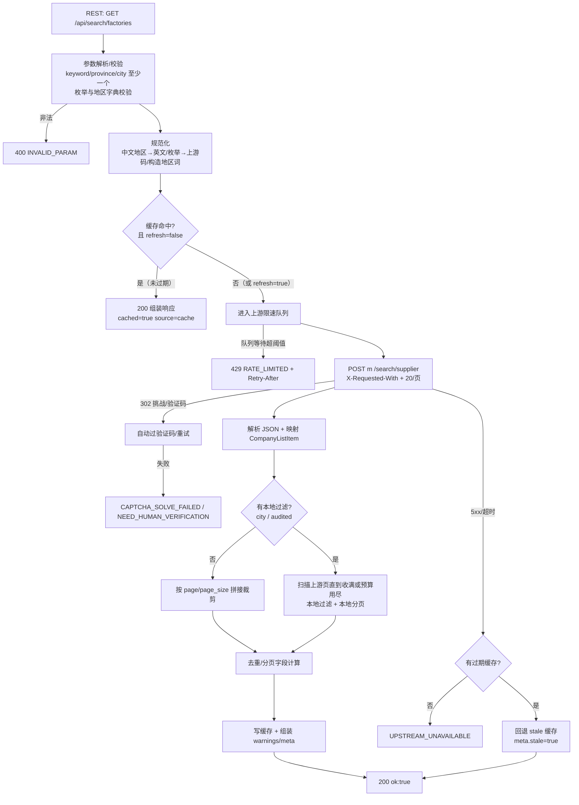
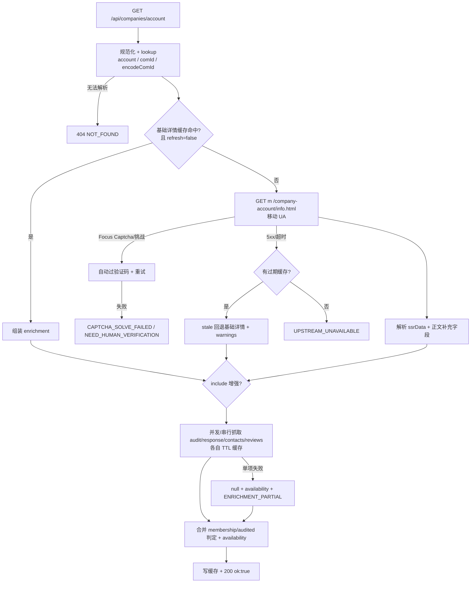

# REST API 详细设计

> 版本：0.2.1 ｜ 状态：Approved（M0 评审通过） ｜ 负责人：api-writer ｜ 最后更新：2026-11-15 ｜ 关联：[docs/README.md](README.md)（固定契约 §3.5）、[01-requirements.md](01-requirements.md)（FR/NFR/AC）、[02-architecture.md](02-architecture.md)（core 模块）、[04-cli-mcp.md](04-cli-mcp.md)（CLI/MCP 字段对齐）、[05-data-and-cache.md](05-data-and-cache.md)（内部模型与 SQLite）、[research/upstream-api.md](research/upstream-api.md)、[research/membership-tiers.md](research/membership-tiers.md)、[research/anonymous-completeness.md](research/anonymous-completeness.md)、[ADR 索引](decisions/README.md)

---

## 0. 本文件定位与快速索引

本文是 **MIC 本地客户端的 REST 接口契约源**：路径/参数/响应 Schema/错误码/warnings 以本文为准，02（架构）、04（CLI/MCP）、05（数据模型）、06（测试）引用本文，不得另造同义字段或错误码。

- 定位：**只监听 `127.0.0.1:8787` 的本地无鉴权服务**；三入口（REST/CLI/MCP）共享 core，同一查询在三入口必须返回**同名字段、同语义**（FR-09）。
- 数据来源：m 站匿名 JSON 优先（ADR-0001）；HTML/浏览器仅兜底；**不建模平台不公开的字段**（电话/邮箱等恒 `null`，见 §8.6）。
- 上游事实全部来自 `docs/research/upstream-api.md` 与 `recon/artifacts/api/`；本文中「待验证」= 尚未实测，不得作为实现依据。

**端点总览（详见 §2）**

| # | Method & Path | 用途 | 主 FR | 对应入口 |
|---|---|---|---|---|
| 1 | `GET /health` | 存活/深度健康检查 | FR-14, NFR-03 | — |
| 2 | `GET /api/version` | 版本与上游契约信息 | FR-15 | `mic version` |
| 3 | `GET /api/regions` | 省/市字典（中英映射） | FR-07 | `mic regions`；MCP `list_regions` |
| 4 | `GET /api/search/factories` | 工厂搜索（关键词/地区/组合、过滤、分页） | FR-01/02/03/04/08/09 | `mic search`；MCP `search_factories` |
| 5 | `GET /api/companies/{account}` | 公司详情 + 增强字段 | FR-05/06/08/09 | `mic company`；MCP `get_company` |
| 6 | `GET /api/membership/levels` | 会员等级说明（静态） | FR-06 | `mic membership`/MCP `explain_membership` |
| 7 | `POST /api/cache/refresh` | 缓存失效 / 同步刷新 | FR-08/09 | `mic cache refresh` |
| 8 | `GET /api/cache/stats` | 缓存统计 | FR-08/14 | `mic cache stats` |

**三步上手**

```bash
# 1) 启动（实现后可用；启动方式见 02/07）
curl -s http://127.0.0.1:8787/health

# 2) 关键词 + 省搜索
curl -sG 'http://127.0.0.1:8787/api/search/factories' \
  --data-urlencode 'keyword=glass' --data-urlencode 'province=Hebei'

# 3) 公司详情（account = 迷你站子域名/mainUserAccount）
curl -s 'http://127.0.0.1:8787/api/companies/xingchenglass'
```

> 说明：本仓库当前处于 M0 文档阶段，以上命令在实现 M1–M3 后可用；示例响应中的业务数据截取/改写自 `recon/artifacts/api/` 的 2026-11-15 匿名样例，仅作契约示意。

---

## 1. 通用约定

### 1.1 Base URL 与监听边界

| 项 | 值 |
|---|---|
| Base URL | `http://127.0.0.1:8787` |
| 监听地址 | **仅回环** `127.0.0.1`（不监听 `0.0.0.0`/`::`）；端口默认 `8787`，可配置（`MIC_REST_PORT`/配置文件，见 02/07 配置表） |
| 协议 | HTTP/1.1（本地回环无 TLS；如需跨机访问由运维层反代并自行加认证，超出本项目边界） |
| 路径前缀 | `/health` 与 `/api/*`；本版本 API 版本 = `v1`（见 `GET /api/version`） |
| 并发模型 | 单进程；REST/CLI/MCP 可同时运行但共享 core 与 SQLite（05 定义并发约束） |

### 1.2 无鉴权与本地安全边界（NFR-03）

- **无鉴权**：设计前提是「本机单用户」；能访问 `127.0.0.1:8787` 的本机进程被视为可信。文档不得表述为「公网可用」。
- **Host 校验**：请求 `Host` 必须是 `127.0.0.1:8787`、`localhost:8787`、`[::1]:8787` 之一（带/不带端口按实际监听端口匹配）；否则返回 `400 INVALID_PARAM`，`details.reason="HOST_NOT_ALLOWED"`（防 DNS rebinding）。
- **CORS**：默认**不返回** `Access-Control-Allow-*` 头（浏览器跨源读取被阻断）；只有配置 `rest.cors_origin` 白名单时才回显该来源（默认关闭）。
- **不泄露凭证**：响应与 `error.details` 不得包含上游 cookie、`Authorization`、profile 路径中的用户敏感信息；日志按 02/07 脱敏。
- **请求限额**：请求体 ≤ 64 KiB（超限 `400 INVALID_PARAM`，`details.reason="PAYLOAD_TOO_LARGE"`）；请求行+查询串 ≤ 8 KiB（超限 `400 INVALID_PARAM`，`details.reason="REQUEST_URI_TOO_LONG"`）；`include`/`scope` 等枚举串长度受限（见各端点）。
- **无 SSRF 面**：REST 不接受任意 URL 作为参数（account 仅接受受限字符集，见 §8.2）。
- **只读语义**：除 `POST /api/cache/refresh`（本地缓存维护）外，所有端点只读；不提供登录、下单、询盘等写操作。

### 1.3 协议与编码

| 项 | 约定 |
|---|---|
| 请求 Content-Type | `POST` 必须 `application/json; charset=utf-8`；其他类型 → `400 INVALID_PARAM`（`details.reason="UNSUPPORTED_MEDIA_TYPE"`） |
| 响应 Content-Type | `application/json; charset=utf-8`；`GET /health` 同为 JSON |
| 字符集 | UTF-8；中文查询参数必须 percent-encode（curl 用 `--data-urlencode`） |
| 响应压缩 | 可选：`Accept-Encoding: gzip` 且响应 > 1 KiB 时可 gzip；调用方不得依赖压缩 |
| JSON 约定 | 严格 JSON（RFC 8259），无注释、无尾逗号、HTTP 响应体不得是 JSONP；`application/json` 错误体与成功体同一 envelope |
| 未知字段 | 调用方**必须忽略**响应中未知字段（§13）；服务端默认忽略未知查询参数（静默；`rest.strict_params=true` 时 `400 INVALID_PARAM`，`details.reason="UNKNOWN_QUERY_PARAM"`） |
| 数字 ID | `company_id` 等上游数字 ID 一律用 **string** 返回（避免 JS 精度问题）；上游原始字段名只在 §15 映射表出现 |

### 1.4 时间与日期格式

| 类型 | 格式 | 示例 | 说明 |
|---|---|---|---|
| 时间戳 | ISO 8601 带时区：`YYYY-MM-DDTHH:MM:SS+08:00` | `2026-11-15T23:10:00+08:00` | 固定 `Asia/Shanghai`（+08:00），不使用 `Z` |
| 日期 | `YYYY-MM-DD` | `2015-10-30` | 上游 `establishment` 等纯日期字段原样；无时区语义 |
| 年份 | 整数 | `2025` | `membership.since_year`（上游 `memberSince`） |
| 上游 `YYYYMMDD` | 仅内部请求参数 | `20261113` | 如 `replyRate` 的 `date=today-2d`，**不对外暴露** |

`meta.fetched_at` 的语义：本次响应**主数据**快照的抓取/生成时间；缓存命中时 = 缓存条目写入时间；新鲜抓取时 = 上游响应完成时间；纯本地端点（§1.8） = 本地数据生成时间。

### 1.5 字段命名、类型与 null 语义

- 命名：全部 `snake_case`（契约 §3.5）；上游驼峰字段（`csLevel`/`mainUserAccount`）只出现在 §15 映射表。
- 类型：`boolean` 不使用字符串；`integer` 不使用 `"20"`；可空字段用 `null`，**不用空字符串/0 表示缺失**。
- 数组：结构上应为数组但无数据时返回 `[]`（返回 `null` 仅当字段整体不可得，且需在 Schema 中声明可空）。
- 缺失原因：`null` 的**可解释缺失**在 `CompanyDetail.availability` 中给出 `{field, reason}`；`reason` 枚举固定为：
  `not_provided_by_supplier | not_public_by_platform | no_reviews | fetch_blocked | needs_login`
  （契约 §3.5；`needs_login` 在当前匿名首期不用于供应商公开字段——电话/邮箱是平台不公开，用 `not_public_by_platform`，见 §8.6）
- 单位：员工数 = 人（整数）；平均响应时长 = 小时（浮点）；评分 = 0–5（浮点）；比例 = 0–1（浮点）；原始区间文案（如 `≤8.54h`）另存字符串字段。
- 金额/价格：本 REST v1 不返回交易/价格数据（搜索列表中的产品价格为上游字符串，不在首期字段内，见 §13 开放问题）。

**固定枚举（全库一致，不得新增同义值）**

| 枚举 | 取值 | 使用位置 | 出处 |
|---|---|---|---|
| `membership.tier` | `diamond` \| `gold` \| `free` \| `unknown` | 列表/详情 | 契约 + research/membership-tiers.md §4.3 |
| `membership.confidence` | `high` \| `medium` \| `low` | 列表/详情 | research/membership-tiers.md §4.3 |
| `source` / `detail_source` / `*.source` | `json` \| `html` \| `browser` \| `cache` | meta 与增强对象 | 契约 §3.5 |
| `availability[].reason` | 见上 5 值 | 详情 | 契约 §3.5 |
| `search_mode` | `keyword` \| `region` \| `mixed` | 搜索 | ADR-0004 |
| `audited` | `true` \| `false` \| `null` | 列表/详情 | research/anonymous-completeness.md §3.4 |
| `business_type`（过滤参数） | `manufacturer` \| `trading_company` \| `group_corporation` \| `other` | 搜索 | 上游 `comBusinessType` 1/2/4/8 |
| `annual_revenue`（过滤参数） | `under_1m_usd` \| `1m_2_5m_usd` \| `2_5m_5m_usd` \| `5m_10m_usd` \| `10m_50m_usd` \| `50m_100m_usd` \| `over_100m_usd` | 搜索 | 上游 `annualRevenue` 1–7 |
| `rd_capacity`（过滤参数） | `oem` \| `odm` \| `quick_response` \| `fast_delivery` \| `small_amount_payment` | 搜索 | 上游 `rdCapacity` 4/5/01/02/03 |
| `include` | `none` \| `all` \| `audit` \| `response` \| `contacts` \| `reviews`（逗号组合） | 详情 | 本文 §8.3 |
| `scope`（缓存刷新） | `search` \| `company` \| `regions` \| `all` | §9 | 本文 §9.2 |

### 1.6 统一响应包（严格按 docs/README §3.5）

**成功**（HTTP 200；`partial`/`stale` 也是 200，只是 `meta` 有标记）：

```json
{
  "ok": true,
  "data": {},
  "meta": {
    "request_id": "req_m3x9q1k2c8",
    "cached": false,
    "stale": false,
    "fetched_at": "2026-11-15T23:10:00+08:00",
    "source": "json",
    "warnings": []
  }
}
```

**失败**（HTTP 4xx/5xx；`data` 字段不存在）：

```json
{
  "ok": false,
  "error": {
    "code": "INVALID_PARAM",
    "message": "both keyword and region are empty",
    "details": {
      "param": "keyword",
      "reason": "MISSING_REQUIRED_COMBO"
    }
  },
  "meta": {
    "request_id": "req_m3x9q1k2c8",
    "cached": false,
    "stale": false,
    "fetched_at": "2026-11-15T23:10:00+08:00",
    "source": "cache",
    "warnings": []
  }
}
```

**`meta` 字段语义**

| 字段 | 类型 | 必填 | 语义 |
|---|---|---|---|
| `request_id` | string | ✅ | 本次请求 ID，`req_` 前缀 + base36；同响应头 `X-Request-Id`（§1.10） |
| `cached` | boolean | ✅ | 主数据是否来自本地缓存（未发生主数据的上游抓取） |
| `stale` | boolean | ✅ | 是否「上游失败 → 回退过期缓存」；`true` 时 `source="cache"` 且 `warnings` 必含 `STALE_DATA` |
| `fetched_at` | string | ✅ | 主数据快照时间（§1.4） |
| `source` | enum | ✅ | 主数据通道：`json`\|`html`\|`browser`\|`cache`；纯本地端点约定见 §1.8 |
| `warnings` | array | ✅ | `[{code,message,details}]`，可为空；码表见 §12.4；警告**不影响** HTTP 状态 |

**派生状态（不新增 envelope 字段）**：契约 §3.2 的 `success | partial | stale` 由 envelope 派生，供 02/04/06 引用：

| 派生状态 | 判定条件 |
|---|---|
| `success` | `ok:true` 且 `meta.stale=false` 且 `meta.warnings` 不含 partial 类警告 |
| `partial` | `ok:true` 且 `meta.warnings` 含 `ENRICHMENT_PARTIAL` / `NON_EXHAUSTIVE` / `CLIENT_SIDE_FILTER` / `CITY_FILTERED_LOCALLY` / `DUPLICATES_REMOVED` 之一 |
| `stale` | `ok:true` 且 `meta.stale=true` |

**错误对象**（`error` 字段，详见 §12）：

| 字段 | 类型 | 必填 | 说明 |
|---|---|---|---|
| `code` | string | ✅ | §12 的 11 个错误码之一（`CAPTCHA_REQUIRED` 仅内部，不对外返回） |
| `message` | string | ✅ | 简短英文描述（可能随文案调整，调用方用 `code` 判定） |
| `details` | object \| null | ✅（可为 `null`） | 错误相关的结构化信息；不同 code 的字段见 §12 |

### 1.7 分页模型

**`pagination` 对象字段**

| 字段 | 类型 | 必填 | 说明 | 示例 |
|---|---|---|---|---|
| `page` | integer | ✅ | 回显请求页（1-based） | `1` |
| `page_size` | integer | ✅ | 回显请求页大小 | `20` |
| `total` | integer | ✅ | 当前口径下结果数；上游 `total` > 2000 时封顶为 `2000`（下界）；本地过滤时为本页扫描到的匹配数（见 §7.6） | `669` |
| `total_page` | integer | ✅ | `ceil(total/page_size)`；`total_capped=true` 时按 2000 计算可达页数 | `34` |
| `has_more` | boolean | ✅ | 是否还有后续页（`page < total_page`；本地过滤另有规则见 §7.6） | `true` |
| `total_capped` | boolean | ✅ | 上游 `total` 是否触发 **"2,000+" 封顶** | `false` |
| `total_display` | string | ✅ | 人类可读总数：未封顶为千分位字符串；封顶恒为 `"2,000+"` | `"669"` |
| `page_clamped` | boolean | ✅ | 请求 `page > total_page`，已按上游行为**夹到末页**返回 | `false` |
| `total_is_lower_bound` | boolean | ✅ | `total` 是否为下界（本地过滤扫描预算未穷尽时 `true`；普通分页恒 `false`） | `false` |

**规则**

1. `page` 从 1 开始；合法范围 `1..100`（上游 JSON 搜索最大可见 `totalPage=100`；`page>100` → `400 INVALID_PARAM`，`details.reason="OUT_OF_RANGE"`）。
2. `page_size` 默认 **20**，合法范围 `1..100`。**上游每页固定 20 条**（实测传 `pageSize=100` 仍只返回 20 条、`totalPage` 却按 100 计算），因此：
   - `page_size=20`：1 次上游请求，与上游页 1:1；
   - `page_size` 为 20 的倍数：`N=page_size/20` 个连续上游页拼接；
   - `page_size` 为其它值（如 30）：拉取覆盖窗口 `[(page-1)*page_size, page*page_size)` 的上游页后裁剪；
   - 发生拼接/裁剪时 `meta.warnings` 含 `PAGE_SIZE_NOT_NATIVE`（`details.upstream_page_size=20`）。
   - **性能基线**：NFR-01 的「JSON 列表 p95 < 3s」以 `page_size=20` 为基线；`page_size>20` 是尽力而为（上游请求数 ≈ `ceil((page_size+19)/20)`，受 §1.9 限速约束）。
3. `total`：以**上游服务端过滤后**的 `total` 为准；`total > 2000` 时上游只给 `"2,000+"`，故服务端置 `total=2000`、`total_capped=true`、`total_display="2,000+"`（对应 FR-03「非穷尽保护」）。
4. `page > total_page`：与上游一致，**夹到末页**返回（`page_clamped=true`；`items` 为末页内容），避免调用方翻页逻辑与上游分叉。**本地过滤模式（§7.6）例外**：只有确认扫描到上游末页时才夹取；扫描预算内未确认末页时 `page_clamped=false`，用 `has_more=true` + `NON_EXHAUSTIVE` 表达不确定性。
5. `items.length` 不保证等于 `page_size`：末页、本地过滤、去重都可能更少；调用方用 `items.length` + `has_more` 判断终止（不要用「返回不足一页即结束」的假设）。
6. 跨页去重：同一响应内（拼接窗口/本地扫描）按 `account`（缺省回退 `company_id`）去重，去重发生时 `warning DUPLICATES_REMOVED`。
7. `page_size` 不参与上游缓存键（上游页恒 20），但参与**响应裁剪缓存/本地派生索引**的键（05 定义）；同一查询换 `page_size` 可能复用上游页缓存，不额外消耗上游请求。

**与上游页码换算（实现参考）**

```
upstream_first = floor(((page - 1) * page_size) / 20) + 1
upstream_last  = floor((page * page_size - 1) / 20) + 1
fetch upstream_first..upstream_last（含首尾），拼接后跳过 ((page-1)*page_size) mod 20 条，取 page_size 条
```
- `page_size=20` 时：`upstream_first = upstream_last = page`（1:1）。
- 请求页超出上游末页时，上游会把末页内容重复返回；实现必须按 `pagination.total_page` 截断，避免重复条目。

### 1.8 缓存语义（FR-08）

**meta 四个字段的取值表**

| 场景 | `cached` | `stale` | `source` | `warnings` |
|---|---|---|---|---|
| 上游 JSON 新鲜抓取 | `false` | `false` | `json` | 视情 |
| 上游 HTML 兜底新鲜抓取 | `false` | `false` | `html` | 可能含 `HTML_FALLBACK`（§12.4） |
| 浏览器兜底新鲜抓取 | `false` | `false` | `browser` | 可能含 `BROWSER_FALLBACK` |
| 命中未过期缓存 | `true` | `false` | `cache` | 视情 |
| 上游失败 → 过期缓存回退 | `true` | `true` | `cache` | 必含 `STALE_DATA` |
| 纯本地端点（`/health`、`/api/version`、`/api/membership/levels`、`/api/cache/stats`） | `false` | `false` | `cache` | 见 §12.4 开放问题 OQ-03-03 |
| `/api/regions`（本地物化字典） | `true` | `false` | `cache` | — |

> 说明：契约 `source` 枚举只有 `json|html|browser|cache`，没有「local」值；纯本地端点统一用 `cache` 表示「非上游实时数据」（OQ-03-03 提交 Lead 决策；在此之前按上表实现）。

**默认 TTL（可配置，配置项见 02/07；05 定义缓存键与表）**

| 资源 | 默认 TTL | 说明 |
|---|---|---|
| 搜索上游页（`search_page`） | 6h | 键含规范化上游参数（word/province/过滤码/page） |
| 搜索本地派生索引（city/audited 扫描结果，若有） | 6h | 键含本地过滤条件；05 定义落库方式 |
| 公司详情基础（`company_detail`） | 24h | account 为主键 |
| 审核章节（`audit`） | 7d | 低变更 |
| 响应率（`response`） | 6h | 上游 30 天滑动窗口，按天更新 |
| 联系人（`contacts`） | 24h | TM 子账号名单 |
| 评价（`reviews`） | 12h | 最新评价与聚合评分 |
| 地区字典（`regions`） | 30d | 本地物化数据 |
| 会员等级说明（`membership_levels`） | 30d | 静态资料 |

**其他缓存规则**

1. `refresh=true`（所有 GET 端点支持，见各端点参数表）：**跳过读缓存**，强制上游抓取，成功后回写缓存；`cached=false`。
2. **stale-while-error**：主数据上游失败且存在过期缓存 → 返回 `200` + `stale=true` + `source="cache"` + `fetched_at`=旧快照时间 + `warning STALE_DATA`；无过期缓存 → 返回 §12 的对应上游错误。
3. **single-flight**：同一缓存键的并发请求合并为一次上游抓取（NFR-02）；等待方复用结果但各自持有独立 `request_id`，响应 `meta` 按各自请求计算。
4. 缓存命中不占 §1.9 的上游限速队列；缓存不可用（`cache.enabled=false`）→ 全部请求视为 miss（`cached=false`，`/api/cache/stats` 返回 `enabled=false`）。
5. `POST /api/cache/refresh`（§9）用于批量失效/同步刷新；`refresh=true` 只影响当前请求涉及的主数据与已请求增强。
6. 缓存写入失败不改变本次响应（记日志 + `warning CACHE_WRITE_FAILED` 可选，默认仅日志；见 02/07）。

### 1.9 限流与并发（NFR-02）

- **上游队列**：全局单并发（默认 `rate.upstream_max_concurrency=1`）+ 请求间隔 1.5–2.5s 随机抖动（research 实测建议）；增强接口允许配置跨 host 并发（`rate.enrichment_parallelism`，默认 2，仅不同 host：`m.` / `www.` / `data.`）。
- **REST 侧等待**：需要上游抓取的请求进入 FIFO 队列；当预计等待超过 `rest.queue_max_wait_ms`（默认 5000）时，立即返回 `429 RATE_LIMITED`：
  - 响应头 `Retry-After: <秒>`（整数，≥1）；
  - `error.details.retry_after_seconds`、`details.queue_depth`、`details.queue="upstream"`。
- **不占队列的端点**：`GET /health`、`GET /api/version`、`GET /api/membership/levels`、`GET /api/cache/stats`、`GET /api/regions`（字典读取，无上游请求、无 429）。
- **single-flight**：见 §1.8-3；**熔断**：同一上游端点连续失败 ≥5 次 → 冷却 30s，期间快速失败 `503 UPSTREAM_UNAVAILABLE`（`details.circuit_open=true`、`details.retry_after_seconds`），冷却后半开重试（02 定义状态机）。
- 调用方必须尊重 `Retry-After`；客户端库建议指数退避（1s→2s→4s，最多 3 次）。

### 1.10 request_id 与日志

- 请求可带 `X-Request-Id` 头（可选）：格式 `^[A-Za-z0-9._-]{1,64}$`；合法则沿用，非法则忽略并生成新值。
- 生成格式：`req_` + base36(毫秒时间) + 4 位随机 base36，如 `req_m3x9q1k2c8`；同一响应在 `meta.request_id` 与响应头 `X-Request-Id` 返回。
- 日志（结构化 JSON，02/07 定义字段）：至少 `ts`、`level`、`request_id`、`endpoint`、`params_hash`、`cache_hit`、`upstream_calls`、`duration_ms`、`status`；**不得**记录 cookie/`Authorization`/完整 profile 路径。

### 1.11 健康检查

- `GET /health`：**存活检查**，不访问上游、不阻塞队列，正常恒 `200 ok:true`；返回进程/会话/缓存状态（§3）。
- `GET /health?deep=true`：**深度检查**（readiness 诊断），额外执行：DB 可写探测、浏览器 profile/storageState 是否存在且未过期、一次轻量上游探测（默认 `GET www.made-in-china.com/head.do?xcase=getHead` 的等价匿名接口，02 定义具体探针与超时）；结果置 `data.status: "ok"|"degraded"`。
- 深度检查**不返回非 2xx**（服务本身仍可用，上游故障由 §12 上游错误码表达）；监控按 `data.status` 判定（OQ-03-04 记录了「是否应返回 503」的开放问题）。

### 1.12 通用错误处理规则

| 场景 | HTTP | code | `details.reason` |
|---|---|---|---|
| 未知路由 | 404 | `NOT_FOUND` | `ROUTE_NOT_FOUND` |
| 已知路径但方法不支持 | 404 | `NOT_FOUND` | `METHOD_NOT_ALLOWED`（`details.allowed_methods` 列出） |
| 查询参数非法/缺失 | 400 | `INVALID_PARAM` | 见 §12.2 |
| 请求体非法 JSON | 400 | `INVALID_PARAM` | `INVALID_JSON` |
| 请求体 Content-Type 错误 | 400 | `INVALID_PARAM` | `UNSUPPORTED_MEDIA_TYPE` |
| 配置/环境错误（如需要浏览器但 profile 缺失） | 500 | `CONFIG_ERROR` | 见 §12 |
| 未分类异常 | 500 | `INTERNAL_ERROR` | — |

- 错误响应与成功响应使用同一 envelope（`ok:false` + `error` + `meta`）；`meta.fetched_at` = 错误发生时间；`meta.source`：未尝试上游的本地错误取 `"cache"`，尝试上游后失败取实际尝试通道（`json`/`html`/`browser`）——与 §1.8 表同源（OQ-03-03）。
- **`CAPTCHA_REQUIRED` 不对外返回**（契约标注「内部用」）：REST 对外只出现 `CAPTCHA_SOLVE_FAILED`（502，可重试）或 `NEED_HUMAN_VERIFICATION`（409，需 `mic auth`）。

### 1.13 版本化

- 路径固定 `/api/...`（v1），版本号由 `GET /api/version` 的 `api_version` 给出；破坏性变更走 `/api/v2`（§13）。
- 上游契约以 `GET /api/version` 的 `upstream_contract` 日期标识（如 `2026-11-15`），与 `docs/research/upstream-api.md` 的调研日期对应。

---

## 2. 端点总览

### 2.1 端点表（含 FR 与缓存）

| # | Method & Path | 用途 | 请求参数 | 成功响应 `data` | FR | 是否访问上游 | 缓存 |
|---|---|---|---|---|---|---|---|
| 1 | `GET /health` | 存活/深度健康 | `deep?` | `HealthResult` | FR-14/NFR-03 | deep=true 时浅探 | 无（`source=cache` 约定） |
| 2 | `GET /api/version` | 版本信息 | — | `VersionResult` | FR-15 | 否 | 静态 |
| 3 | `GET /api/regions` | 省/市字典 | `province?` | `ProvincesResult` / `ProvinceDetailResult` | FR-07 | 否（本地物化字典） | 30d |
| 4 | `GET /api/search/factories` | 工厂搜索 | 见 §7.2 | `SearchResult` | FR-01/02/03/04/08/09 | 是 | 6h |
| 5 | `GET /api/companies/{account}` | 公司详情 | `include?` `refresh?` | `CompanyDetail` | FR-05/06/08/09 | 是 | 24h（增强各自 TTL） |
| 6 | `GET /api/membership/levels` | 会员等级说明 | — | `MembershipLevelsResult` | FR-06 | 否 | 30d |
| 7 | `POST /api/cache/refresh` | 缓存失效/同步刷新 | JSON body | `RefreshResult` | FR-08/09 | `wait=true` 时是 | 写缓存 |
| 8 | `GET /api/cache/stats` | 缓存统计 | — | `CacheStats` | FR-08/14 | 否 | 无 |

### 2.2 与 CLI/MCP 的对应（供 04 对齐）

| REST | CLI（04 定义，命名以 04 为准） | MCP tool | 共享 core 函数（02 定义） |
|---|---|---|---|
| `GET /api/search/factories` | `mic search` | `search_factories` | `core.search.findFactories()` |
| `GET /api/companies/{account}` | `mic company` | `get_company` | `core.company.getDetail()` |
| `GET /api/regions` | `mic regions` | `list_regions` | `core.regions.list()` |
| `GET /api/membership/levels` | `mic membership`（或 04 的等价命令） | `explain_membership` | `core.membership.levels()` |
| `POST /api/cache/refresh` / `GET /api/cache/stats` | `mic cache refresh` / `mic cache stats` | （MCP 不暴露或可选） | `core.cache.*` |

一致性要求（FR-09）：同一查询在 REST/CLI `--json`/MCP 返回的 `data` 结构必须相同；04 不得新增/改名 REST 已有字段（04 可额外包装 CLI 展示字段，但 `--json` 必须直接输出本契约 Schema）。

---

## 3. `GET /health`

- 用途：存活检查（默认）/ 深度健康检查（`deep=true`）；供运维、`mic doctor`、MCP 客户端探活使用（FR-14、NFR-03）。
- 鉴权：无。缓存：不适用（`source="cache"` 约定，`cached=false`）。
- 参数：

| 参数 | 位置 | 类型 | 必填 | 默认 | 取值/校验 | 说明 |
|---|---|---|---|---|---|---|
| `deep` | query | boolean（字符串 `true`/`false`） | 否 | `false` | 严格 `true`/`false`，否则 `400 INVALID_PARAM`（`INVALID_ENUM`） | `true` 时执行 DB/profile/上游探测，可能增加 1–3s 时延 |

**请求示例**

```bash
curl -s 'http://127.0.0.1:8787/health'
curl -s 'http://127.0.0.1:8787/health?deep=true'
```

**成功响应（`deep=false`）**

```json
{
  "ok": true,
  "data": {
    "status": "ok",
    "version": "0.1.0",
    "api_version": "v1",
    "uptime_seconds": 3721,
    "started_at": "2026-11-15T22:00:00+08:00",
    "session": {
      "mode": "anonymous",
      "storage_state_present": true,
      "storage_state_age_seconds": 540,
      "last_verified_at": null,
      "challenge_suspected": false
    },
    "cache": {
      "enabled": true,
      "ok": true,
      "path": "/home/songqian/.mic-client/data/mic.sqlite",
      "entries": 1284,
      "size_bytes": 5242880,
      "stale_entries": 12
    },
    "upstream": {
      "probed": false,
      "reachable": null,
      "latency_ms": null,
      "last_ok_at": "2026-11-15T22:55:12+08:00"
    }
  },
  "meta": {
    "request_id": "req_m3x9q1k2c8",
    "cached": false,
    "stale": false,
    "fetched_at": "2026-11-15T23:10:00+08:00",
    "source": "cache",
    "warnings": []
  }
}
```

**成功响应（`deep=true`，上游不可达 → `status=degraded`，HTTP 仍 200）**

```json
{
  "ok": true,
  "data": {
    "status": "degraded",
    "version": "0.1.0",
    "api_version": "v1",
    "uptime_seconds": 3721,
    "started_at": "2026-11-15T22:00:00+08:00",
    "session": {
      "mode": "anonymous",
      "storage_state_present": true,
      "storage_state_age_seconds": 540,
      "last_verified_at": null,
      "challenge_suspected": false
    },
    "cache": {
      "enabled": true,
      "ok": true,
      "path": "/home/songqian/.mic-client/data/mic.sqlite",
      "entries": 1284,
      "size_bytes": 5242880,
      "stale_entries": 12
    },
    "upstream": {
      "probed": true,
      "reachable": false,
      "latency_ms": null,
      "last_ok_at": "2026-11-15T22:55:12+08:00"
    }
  },
  "meta": {
    "request_id": "req_m3x9q1k2d1",
    "cached": false,
    "stale": false,
    "fetched_at": "2026-11-15T23:12:30+08:00",
    "source": "cache",
    "warnings": []
  }
}
```

**字段说明**

| 字段 | 类型 | 必填 | 说明 |
|---|---|---|---|
| `status` | enum `ok`\|`degraded` | ✅ | `degraded` = 深度检查发现上游/会话/缓存异常（仍可服务缓存） |
| `version` | string | ✅ | 服务版本（semver，与 `/api/version` 的 `version` 一致） |
| `api_version` | string | ✅ | REST 契约版本，当前 `v1` |
| `uptime_seconds` | integer | ✅ | 进程运行秒数 |
| `started_at` | string | ✅ | 进程启动时间（ISO8601 +08:00） |
| `session.mode` | enum `anonymous`\|`logged_in`\|`unknown` | ✅ | 会话登录态（首期匿名，`mic auth` 后可能 `logged_in`） |
| `session.storage_state_present` | boolean | ✅ | 是否存在可复用 storageState |
| `session.storage_state_age_seconds` | integer\|null | ✅ | storageState 最近写入距今秒数；不存在为 `null` |
| `session.last_verified_at` | string\|null | ✅ | 最近一次通过验证码/挑战的时间 |
| `session.challenge_suspected` | boolean | ✅ | 是否近期触发过挑战（风控信号） |
| `cache.enabled` | boolean | ✅ | 缓存开关（配置） |
| `cache.ok` | boolean | ✅ | SQLite 可用性（deep 时做读写探测） |
| `cache.path` | string | ✅ | 数据库文件绝对路径 |
| `cache.entries` | integer | ✅ | 缓存条目总数（各表求和；05 定义口径） |
| `cache.size_bytes` | integer | ✅ | 文件大小（含 WAL 时按 05 口径） |
| `cache.stale_entries` | integer | ✅ | 已过期但保留的条目数 |
| `upstream.probed` | boolean | ✅ | 本次是否执行上游探测 |
| `upstream.reachable` | boolean\|null | ✅ | 探测结果（未探测为 `null`） |
| `upstream.latency_ms` | integer\|null | ✅ | 探测往返毫秒 |
| `upstream.last_ok_at` | string\|null | ✅ | 最近一次成功上游响应时间 |

**错误码**：`INVALID_PARAM`（`deep` 非布尔）、`CONFIG_ERROR`（DB 打开失败等致命配置问题）、`INTERNAL_ERROR`。

**缓存行为**：不读写业务缓存；`meta.source="cache"` 为 §1.8 约定（无上游实时数据）。

---

## 4. `GET /api/version`

- 用途：返回服务版本、构建信息与上游契约版本（FR-15）；供客户端/Agent 做兼容性判断。
- 参数：无。缓存：静态（进程内常量）。鉴权：无。

**请求示例**

```bash
curl -s 'http://127.0.0.1:8787/api/version'
```

**成功响应**

```json
{
  "ok": true,
  "data": {
    "name": "mic-client",
    "version": "0.1.0",
    "api_version": "v1",
    "build": {
      "commit": "3f9c2ab",
      "built_at": "2026-11-15T21:40:00+08:00"
    },
    "node_version": "v22.11.0",
    "upstream_contract": {
      "version": "2026-11-15",
      "researched_at": "2026-11-15T22:50:00+08:00",
      "notes": "m-site anonymous JSON endpoints (search/refine/company ssrData/enrichment)"
    }
  },
  "meta": {
    "request_id": "req_m3x9q1k2e3",
    "cached": false,
    "stale": false,
    "fetched_at": "2026-11-15T23:10:00+08:00",
    "source": "cache",
    "warnings": []
  }
}
```

**字段说明**

| 字段 | 类型 | 必填 | 说明 |
|---|---|---|---|
| `name` | string | ✅ | 固定 `mic-client` |
| `version` | string | ✅ | 服务 semver |
| `api_version` | string | ✅ | REST 版本 `v1` |
| `build.commit` | string\|null | ✅ | 构建 commit（无 git 信息时 `null`） |
| `build.built_at` | string\|null | ✅ | 构建时间 |
| `node_version` | string | ✅ | Node 运行时版本 |
| `upstream_contract.version` | string | ✅ | 上游契约日期（= research 调研日期） |
| `upstream_contract.researched_at` | string | ✅ | 调研完成时间 |
| `upstream_contract.notes` | string | ✅ | 简短说明 |

**错误码**：`INTERNAL_ERROR`（极少）。**缓存行为**：进程内静态，不占缓存表。

---

## 5. `GET /api/regions`

- 用途：返回省/市字典（中英映射、上游英文规范名、字典覆盖度标记），供调用方构造 `province`/`city` 参数与展示中文名（FR-07）。
- 参数：

| 参数 | 位置 | 类型 | 必填 | 默认 | 取值/校验 | 说明 |
|---|---|---|---|---|---|---|
| `province` | query | string | 否 | — | 英文省名（`name` 或 `api_value`）/中文省名（大小写不敏感）；未收录 → `400 INVALID_PARAM`（`UNKNOWN_PROVINCE`） | 给出则返回该省 + 城市列表 |
| `refresh` | query | boolean | 否 | `false` | `true`/`false` | 保留字段：`true` 时回填/校验本地字典（不直接访问上游；见 §5 缓存行为） |

- 数据来源（05 定义完整字典与生成流程；字段 `name` 为展示名、`api_value` 为上游 `province` 参数值，三项特殊值二者不同，见 05 §5.2）：
  - 省：上游 refine `province` facet 31 项 + SEO 过滤面板 `CP_` 的 32 项（多 `Qinghai`，实测 `province=Qinghai` 合法）→ 客户端字典 32 项；`source` 标注来源，`verified_at` 为字典生成时间。
  - 市：首期**已核验**仅河北 10 城（SEO facet → `CC_Hebei_<City>` 链接，附 count 提示）；其余省份城市字典按 05 的生成策略补全并标 `verified=false`/`cities_complete=false`。
- 缓存：本地物化字典（30d），`meta.cached=true`、`source="cache"`；不访问上游。

**请求示例**

```bash
# 全部省份（32 项）
curl -s 'http://127.0.0.1:8787/api/regions'
# 单个省 + 城市（中文名可用）
curl -sG 'http://127.0.0.1:8787/api/regions' --data-urlencode 'province=河北'
```

**成功响应（无 `province` 参数）** —— 省份列表按字典顺序（完整 32 项，示例即完整值）：

```json
{
  "ok": true,
  "data": {
    "count": 32,
    "provinces": [
      { "name": "Guangdong", "name_zh": "广东", "api_value": "Guangdong", "city_count": null, "cities_complete": false, "source": "refine", "verified_at": "2026-11-15T22:47:00+08:00" },
      { "name": "Shandong", "name_zh": "山东", "api_value": "Shandong", "city_count": null, "cities_complete": false, "source": "refine", "verified_at": "2026-11-15T22:47:00+08:00" },
      { "name": "Zhejiang", "name_zh": "浙江", "api_value": "Zhejiang", "city_count": null, "cities_complete": false, "source": "refine", "verified_at": "2026-11-15T22:47:00+08:00" },
      { "name": "Jiangsu", "name_zh": "江苏", "api_value": "Jiangsu", "city_count": null, "cities_complete": false, "source": "refine", "verified_at": "2026-11-15T22:47:00+08:00" },
      { "name": "Hebei", "name_zh": "河北", "api_value": "Hebei", "city_count": 10, "cities_complete": true, "source": "seo_facet", "verified_at": "2026-11-15T22:47:00+08:00" },
      { "name": "Fujian", "name_zh": "福建", "api_value": "Fujian", "city_count": null, "cities_complete": false, "source": "refine", "verified_at": "2026-11-15T22:47:00+08:00" },
      { "name": "Henan", "name_zh": "河南", "api_value": "Henan", "city_count": null, "cities_complete": false, "source": "refine", "verified_at": "2026-11-15T22:47:00+08:00" },
      { "name": "Shanghai", "name_zh": "上海", "api_value": "Shanghai", "city_count": null, "cities_complete": false, "source": "refine", "verified_at": "2026-11-15T22:47:00+08:00" },
      { "name": "Anhui", "name_zh": "安徽", "api_value": "Anhui", "city_count": null, "cities_complete": false, "source": "refine", "verified_at": "2026-11-15T22:47:00+08:00" },
      { "name": "Tianjin", "name_zh": "天津", "api_value": "Tianjin", "city_count": null, "cities_complete": false, "source": "refine", "verified_at": "2026-11-15T22:47:00+08:00" },
      { "name": "Hunan", "name_zh": "湖南", "api_value": "Hunan", "city_count": null, "cities_complete": false, "source": "refine", "verified_at": "2026-11-15T22:47:00+08:00" },
      { "name": "Jiangxi", "name_zh": "江西", "api_value": "Jiangxi", "city_count": null, "cities_complete": false, "source": "refine", "verified_at": "2026-11-15T22:47:00+08:00" },
      { "name": "Hubei", "name_zh": "湖北", "api_value": "Hubei", "city_count": null, "cities_complete": false, "source": "refine", "verified_at": "2026-11-15T22:47:00+08:00" },
      { "name": "Beijing", "name_zh": "北京", "api_value": "Beijing", "city_count": null, "cities_complete": false, "source": "refine", "verified_at": "2026-11-15T22:47:00+08:00" },
      { "name": "Liaoning", "name_zh": "辽宁", "api_value": "Liaoning", "city_count": null, "cities_complete": false, "source": "refine", "verified_at": "2026-11-15T22:47:00+08:00" },
      { "name": "Sichuan", "name_zh": "四川", "api_value": "Sichuan", "city_count": null, "cities_complete": false, "source": "refine", "verified_at": "2026-11-15T22:47:00+08:00" },
      { "name": "Chongqing", "name_zh": "重庆", "api_value": "Chongqing", "city_count": null, "cities_complete": false, "source": "refine", "verified_at": "2026-11-15T22:47:00+08:00" },
      { "name": "Shaanxi", "name_zh": "陕西", "api_value": "Shaanxi", "city_count": null, "cities_complete": false, "source": "refine", "verified_at": "2026-11-15T22:47:00+08:00" },
      { "name": "Guangxi", "name_zh": "广西", "api_value": "Guangxi", "city_count": null, "cities_complete": false, "source": "refine", "verified_at": "2026-11-15T22:47:00+08:00" },
      { "name": "Shanxi", "name_zh": "山西", "api_value": "Shanxi", "city_count": null, "cities_complete": false, "source": "refine", "verified_at": "2026-11-15T22:47:00+08:00" },
      { "name": "Hainan", "name_zh": "海南", "api_value": "Hainan", "city_count": null, "cities_complete": false, "source": "refine", "verified_at": "2026-11-15T22:47:00+08:00" },
      { "name": "Yunnan", "name_zh": "云南", "api_value": "Yunnan", "city_count": null, "cities_complete": false, "source": "refine", "verified_at": "2026-11-15T22:47:00+08:00" },
      { "name": "Gansu", "name_zh": "甘肃", "api_value": "Gansu", "city_count": null, "cities_complete": false, "source": "refine", "verified_at": "2026-11-15T22:47:00+08:00" },
      { "name": "Hongkong S.A.R.", "name_zh": "香港", "api_value": "Hongkong", "city_count": null, "cities_complete": false, "source": "refine", "verified_at": "2026-11-15T22:47:00+08:00" },
      { "name": "Inner Mongolia", "name_zh": "内蒙古", "api_value": "InnerMongolia", "city_count": null, "cities_complete": false, "source": "refine", "verified_at": "2026-11-15T22:47:00+08:00" },
      { "name": "Jilin", "name_zh": "吉林", "api_value": "Jilin", "city_count": null, "cities_complete": false, "source": "refine", "verified_at": "2026-11-15T22:47:00+08:00" },
      { "name": "Guizhou", "name_zh": "贵州", "api_value": "Guizhou", "city_count": null, "cities_complete": false, "source": "refine", "verified_at": "2026-11-15T22:47:00+08:00" },
      { "name": "Heilongjiang", "name_zh": "黑龙江", "api_value": "Heilongjiang", "city_count": null, "cities_complete": false, "source": "refine", "verified_at": "2026-11-15T22:47:00+08:00" },
      { "name": "Xinjiang", "name_zh": "新疆", "api_value": "Xinjiang", "city_count": null, "cities_complete": false, "source": "refine", "verified_at": "2026-11-15T22:47:00+08:00" },
      { "name": "Ningxia", "name_zh": "宁夏", "api_value": "Ningxia", "city_count": null, "cities_complete": false, "source": "refine", "verified_at": "2026-11-15T22:47:00+08:00" },
      { "name": "Taiwan, China", "name_zh": "台湾", "api_value": "Taiwan", "city_count": null, "cities_complete": false, "source": "refine", "verified_at": "2026-11-15T22:47:00+08:00" },
      { "name": "Qinghai", "name_zh": "青海", "api_value": "Qinghai", "city_count": null, "cities_complete": false, "source": "seo_facet", "verified_at": "2026-11-15T22:47:00+08:00" }
    ]
  },
  "meta": {
    "request_id": "req_m3x9q1k2f5",
    "cached": true,
    "stale": false,
    "fetched_at": "2026-11-15T22:47:00+08:00",
    "source": "cache",
    "warnings": []
  }
}
```

**成功响应（`province=Hebei`）**

```json
{
  "ok": true,
  "data": {
    "province": {
      "name": "Hebei",
      "name_zh": "河北",
      "api_value": "Hebei",
      "city_count": 10,
      "cities_complete": true,
      "source": "seo_facet",
      "verified_at": "2026-11-15T22:47:00+08:00"
    },
    "cities": [
      { "name": "Shijiazhuang", "name_zh": "石家庄", "province": "Hebei", "source": "seo_facet", "verified": true, "count_hint": 215 },
      { "name": "Hengshui", "name_zh": "衡水", "province": "Hebei", "source": "seo_facet", "verified": true, "count_hint": 138 },
      { "name": "Cangzhou", "name_zh": "沧州", "province": "Hebei", "source": "seo_facet", "verified": true, "count_hint": 98 },
      { "name": "Xingtai", "name_zh": "邢台", "province": "Hebei", "source": "seo_facet", "verified": true, "count_hint": 71 },
      { "name": "Baoding", "name_zh": "保定", "province": "Hebei", "source": "seo_facet", "verified": true, "count_hint": 55 },
      { "name": "Langfang", "name_zh": "廊坊", "province": "Hebei", "source": "seo_facet", "verified": true, "count_hint": 45 },
      { "name": "Handan", "name_zh": "邯郸", "province": "Hebei", "source": "seo_facet", "verified": true, "count_hint": 19 },
      { "name": "Tangshan", "name_zh": "唐山", "province": "Hebei", "source": "seo_facet", "verified": true, "count_hint": 14 },
      { "name": "Qinhuangdao", "name_zh": "秦皇岛", "province": "Hebei", "source": "seo_facet", "verified": true, "count_hint": 13 },
      { "name": "Zhangjiakou", "name_zh": "张家口", "province": "Hebei", "source": "seo_facet", "verified": true, "count_hint": 1 }
    ]
  },
  "meta": {
    "request_id": "req_m3x9q1k2g7",
    "cached": true,
    "stale": false,
    "fetched_at": "2026-11-15T22:47:00+08:00",
    "source": "cache",
    "warnings": []
  }
}
```

> `count_hint` 为 2026-11-15 `glass` 关键词下 SEO facet 的 count，仅作参考（SEO 与 JSON 口径不同：`glass+Hebei` SEO=1299 vs JSON=669，**不可混用**，见 research/upstream-api.md §3.9）；城市列表只来自 SEO 链接（移动 JSON refine 无城市 facet）。

**字段说明**

| 字段 | 类型 | 必填 | 说明 |
|---|---|---|---|
| `count` | integer | ✅（无 `province` 时） | 省份数量（当前 32） |
| `provinces[].name` | string | ✅ | 上游英文省名（`province` 参数规范值） |
| `provinces[].name_zh` | string | ✅ | 中文名（展示/中文输入映射） |
| `provinces[].api_value` | string | ✅ | 发往上游 `province` 参数的规范值；特殊三项与 `name` 不同（`Inner Mongolia`→`InnerMongolia`、`Hongkong S.A.R.`→`Hongkong`、`Taiwan, China`→`Taiwan`，05 §5.2；待实测补全） |
| `provinces[].city_count` | integer\|null | ✅ | 已收录城市数；未知为 `null` |
| `provinces[].cities_complete` | boolean | ✅ | 城市字典是否完整（`false` 时城市参数按「透传 + 本地过滤 + warning」处理，见 §7.3） |
| `provinces[].source` | enum `refine`\|`seo_facet`\|`static` | ✅ | 字典来源 |
| `provinces[].verified_at` | string | ✅ | 字典生成/校验时间 |
| `province` | object | ✅（带 `province` 时） | 与 `provinces[]` 同结构（含 `api_value`） |
| `cities[].name` | string | ✅ | 上游英文城市名（规范值） |
| `cities[].name_zh` | string | ✅ | 中文名 |
| `cities[].province` | string | ✅ | 所属省英文名 |
| `cities[].source` | enum | ✅ | 来源 |
| `cities[].verified` | boolean | ✅ | 是否实测核验（河北 10 城 `true`） |
| `cities[].count_hint` | integer\|null | ✅ | 参考结果数（SEO 口径，可能为 `null`） |

**错误码**：`INVALID_PARAM`（`UNKNOWN_PROVINCE`：`province` 不在字典；`details.allowed_provinces` 给出可用英文省名数组）、`302 风控`不适用（本端点不访问上游）。**缓存行为**：读本地物化字典；`refresh=true` 仅触发本地字典校验/回填（不入上游队列），响应头不变。

---

## 6. `GET /api/membership/levels`

- 用途：返回会员等级定义、与上游字段的映射、认证（AS）与大客户分层的边界说明（FR-06；澄清 KA/SKA 非 MIC 体系）。静态数据，来源 [research/membership-tiers.md](research/membership-tiers.md)。
- 参数：无。缓存：静态（30d，进程内物化）。鉴权：无。

**请求示例**

```bash
curl -s 'http://127.0.0.1:8787/api/membership/levels'
```

**成功响应**

```json
{
  "ok": true,
  "data": {
    "tiers": [
      {
        "tier": "diamond",
        "name_zh": "钻石会员",
        "name_en": "Diamond Member",
        "rank": 3,
        "price_cny_per_year": 59800,
        "raw_cs_level": 50,
        "badge": "icon-diamond / diamond_32.png",
        "evidence_hint": "json:csLevel=50 或 json:memberLevel=diamond",
        "confidence": "high"
      },
      {
        "tier": "gold",
        "name_zh": "金牌会员",
        "name_en": "Gold Member",
        "rank": 2,
        "price_cny_per_year": 31100,
        "raw_cs_level": 30,
        "badge": "icon-gold / gold_32.png",
        "evidence_hint": "json:csLevel=30 或 json:memberLevel=gold",
        "confidence": "high"
      },
      {
        "tier": "free",
        "name_zh": "免费会员",
        "name_en": "Free Member (no badge)",
        "rank": 1,
        "price_cny_per_year": 0,
        "raw_cs_level": null,
        "badge": null,
        "evidence_hint": "页面完整加载且无会员徽章/无 AS/无 member-since（需详情确认，列表侧不猜 free）",
        "confidence": "medium"
      },
      {
        "tier": "unknown",
        "name_zh": "未知",
        "name_en": "Unknown",
        "rank": 0,
        "price_cny_per_year": null,
        "raw_cs_level": null,
        "badge": null,
        "evidence_hint": "无可靠证据（新版列表页/结构变化/风控），不猜测",
        "confidence": "low"
      }
    ],
    "audit": {
      "independent_of_tier": true,
      "name_zh": "认证供应商",
      "name_en": "Audited Supplier",
      "upstream_flags": ["sgsMember", "auditType", "showAuditLogo", "auditReportLogo.logoText"],
      "agencies": ["SGS", "Bureau Veritas", "TÜV Rheinland", "CCIC", "CTI"],
      "note": "AS 与会员等级正交；列表 auditType/showAuditLogo、详情 sgsMember/auditReportLogo 判定"
    },
    "big_customer_programs": [
      { "code": "youxiang", "name_zh": "优享", "public_badge": false, "note": "大客户分层；公网无独立徽章，客户端不抓取" },
      { "code": "zunxiang", "name_zh": "尊享", "public_badge": false, "note": "官方承认、未纳入正式会员级别" },
      { "code": "mka", "name_zh": "MKA", "public_badge": false, "note": "面向行业龙头供应商的大客户会员" }
    ],
    "not_mic_tiers": [
      { "code": "ka", "name": "KA", "reason": "阿里巴巴国际站客户分层（Key Account），公网无 MIC 标识，禁止映射进 membership.tier" },
      { "code": "ska", "name": "SKA", "reason": "阿里国际站 Super Key Account，同上" },
      { "code": "gska", "name": "GSKA", "reason": "阿里国际站 Group Super Key Account，同上" }
    ],
    "raw_field_mapping": {
      "csLevel": { "50": "diamond", "30": "gold" },
      "memberLevel": { "diamond": "diamond", "gold": "gold" }
    }
  },
  "meta": {
    "request_id": "req_m3x9q1k2h9",
    "cached": true,
    "stale": false,
    "fetched_at": "2026-11-15T22:00:00+08:00",
    "source": "cache",
    "warnings": []
  }
}
```

**字段说明**

| 字段 | 类型 | 必填 | 说明 |
|---|---|---|---|
| `tiers[]` | array | ✅ | 固定 4 项，顺序 diamond→gold→free→unknown |
| `tiers[].tier` | enum | ✅ | `diamond`\|`gold`\|`free`\|`unknown` |
| `tiers[].name_zh` / `name_en` | string | ✅ | 中/英文名 |
| `tiers[].rank` | integer | ✅ | 排序权重（3 最高） |
| `tiers[].price_cny_per_year` | integer\|null | ✅ | 官方年费（元/年）；`unknown` 为 `null`。来源：官方帮助页（research/membership-tiers.md §1.1） |
| `tiers[].raw_cs_level` | integer\|null | ✅ | 上游 `csLevel` 码；免费/未知为 `null` |
| `tiers[].badge` | string\|null | ✅ | 徽章特征（选择器/图片名，供人工核对） |
| `tiers[].evidence_hint` | string | ✅ | 判定证据格式提示 |
| `tiers[].confidence` | enum | ✅ | `high`\|`medium`\|`low`（判定可信度） |
| `audit` | object | ✅ | 认证供应商说明（与 tier 正交） |
| `big_customer_programs[]` | array | ✅ | 优享/尊享/MKA（公网不可识别，客户端不抓取） |
| `not_mic_tiers[]` | array | ✅ | KA/SKA/GSKA 澄清（禁止进入 tier） |
| `raw_field_mapping` | object | ✅ | 上游字段→tier 的映射表 |

**错误码**：`INTERNAL_ERROR`（极少）。**缓存行为**：静态物化数据，不访问上游、不入上游队列。

---

## 7. `GET /api/search/factories`

### 7.1 用途与范围

按「关键词 / 地区 / 组合」搜索供应商工厂，返回规范化的 `CompanyListItem` 列表中一条分页（FR-01/FR-02/FR-03/FR-04），带缓存与降级语义（FR-08/FR-13）。**首期不做**：产品搜索、员工数过滤（上游 JSON 不支持）、SEO 城市页直连（仅作为可选兜底，见 ADR-0003）。

数据通道（ADR-0001）：
- 主：`POST https://m.made-in-china.com/search/supplier`（`X-Requested-With: XMLHttpRequest`，表单体；20 条/页，`total/totalNum/totalPage`；匿名、低风控）；
- 兜底：www `companysearch.do` HTML（30 条/页，仅当 JSON 结构变更时，02 定义降级策略）；
- 城市/认证（AS）过滤：**客户端本地过滤**（上游 JSON 无 city 参数；`memberLevel="0,1,3"` 只表示 AS-only 档，不能代表全部 AS，见 §7.3-5）。

### 7.2 请求参数

| 参数 | 位置 | 类型 | 必填 | 默认 | 取值 / 枚举 | 校验与说明 | 示例 |
|---|---|---|---|---|---|---|---|
| `keyword` | query | string | 条件必填* | — | 英文关键词（允许字母/数字/空格/`-`/`'`，长度 1–100） | 与 `province`/`city` **至少一个**；中文关键词：能解析为地区名则转为地区模式，否则 `400 INVALID_PARAM`（`NON_ENGLISH_KEYWORD`，上游英文站不索引中文，实测中文=0） | `glass` |
| `province` | query | string | 否 | — | 32 个英文省名（字典见 `/api/regions`）或中文省名 | 大小写不敏感；中文/别名映射为英文规范名；未收录 → `400 INVALID_PARAM`（`UNKNOWN_PROVINCE`，`details.allowed_provinces`） | `Hebei` / `河北` |
| `city` | query | string | 否 | — | 城市英文名或中文名；字典覆盖度见 `cities_complete` | 可单独给（自动推导省份）；与 `province` 冲突 → warning `CITY_PROVINCE_MISMATCH`（以城市字典所属省为准，`details` 记录原值）；省份城市字典不完整时**透传**该值（+`CITY_NOT_IN_DICTIONARY`） | `Langfang` / `廊坊` |
| `category_code` | query | string | 否 | — | 上游类目代码，`^[0-9]{6,12}$`（如 `1500000000` = Construction & Decoration） | 上游 `catCode` 直传（默认不校验类目字典、静默）；`rest.strict_params=true` 时不在字典 → `400 INVALID_PARAM`（`CATEGORY_CODE_UNVERIFIED`） | `1500000000` |
| `membership_tier` | query | enum | 否 | — | **仅** `diamond` \| `gold` | 映射上游 `memberLevel=50/30`；`free`/`unknown` → `400 INVALID_PARAM`（`UNSUPPORTED_MEMBERSHIP_FILTER`，见 §7.3-5）；其它值 → `INVALID_ENUM` | `diamond` |
| `audited` | query | boolean | 否 | — | `true` \| `false` | **本地过滤**（AS 与会员等级正交；语义与分页影响见 §7.6）；非布尔 → `INVALID_ENUM` | `true` |
| `management_certification` | query | string | 否 | — | 上游认证代码（如 `-5`）或字典中的认证名称（如 `ISO9001:2015`） | 由 core 用 refine 认证字典（44 项）映射；无法识别 → warning `UNKNOWN_CERTIFICATION` 并**忽略该过滤**（`details.raw` 保留原值）；与 `audited` 不同：这是管理体系认证 | `-5` |
| `business_type` | query | enum | 否 | — | `manufacturer` \| `trading_company` \| `group_corporation` \| `other` | 映射上游 `comBusinessType` 1/2/4/8 | `manufacturer` |
| `annual_revenue` | query | enum | 否 | — | `under_1m_usd` \| `1m_2_5m_usd` \| `2_5m_5m_usd` \| `5m_10m_usd` \| `10m_50m_usd` \| `50m_100m_usd` \| `over_100m_usd` | 映射上游 `annualRevenue` 1–7 | `10m_50m_usd` |
| `rd_capacity` | query | enum | 否 | — | `oem` \| `odm` \| `quick_response` \| `fast_delivery` \| `small_amount_payment` | 映射上游 `rdCapacity` 4/5/01/02/03；多值组合**待验证**，v1 只接受单值 | `oem` |
| `page` | query | integer | 否 | `1` | `1..100` | 越界 → `OUT_OF_RANGE`；`page > total_page` → 夹末页（`page_clamped=true`） | `2` |
| `page_size` | query | integer | 否 | `20` | `1..100` | 上游固定 20/页，非 20 时拼接/裁剪并 `warning PAGE_SIZE_NOT_NATIVE`（§1.7） | `40` |
| `refresh` | query | boolean | 否 | `false` | `true` \| `false` | `true` 跳过读缓存强制抓取（仍回写） | `false` |
| `include_ads` | query | boolean | 否 | `true` | `true` \| `false` | 默认**保留**广告位条目（`is_ad=true`，与上游分页 1:1）；`false` 时过滤广告位并 `warning ADS_FILTERED`（`details.count`），`items` 顺序重排（05 §4.1） | `false` |

> `*` 条件必填：`keyword` 与 `province`/`city` 至少给一个，否则 `400 INVALID_PARAM`，`details.reason="MISSING_REQUIRED_COMBO"`。
> 未知查询参数：默认**静默忽略**（不报错，保持向前兼容）；`rest.strict_params=true` 时返回 `400 INVALID_PARAM`（`details.reason="UNKNOWN_QUERY_PARAM"`）。
> **不支持**的参数（首期）：`employees`/`employee_range`、`city_code`、`province_code`、`product` 等 → 按未知参数忽略 + warning（员工数不支持的原因见 §7.12-6）。

### 7.3 参数规范化与映射

1. **关键词**：`trim` + 连续空白折叠为单空格；缓存键用小写；发往上游时保留原大小写（上游大小写行为未系统验证，标「待验证」；客户端原样发送）。含 CJK 字符时：
   - 先尝试地区字典匹配（省/市中文名或常见别名）：命中且未给 `province`/`city` → 转为**地区模式**（`keyword=null`；`province`/`city` 置为映射值；规范化结果回显于 `query`；不额外发 warning）
   - 命中但显式地区参数冲突 → `400 INVALID_PARAM`（`NON_ENGLISH_KEYWORD`，`details.hint` 提示去掉中文关键词或改用英文）；
   - 未命中（如 `玻璃`、`河北玻璃`）→ `400 INVALID_PARAM`（`NON_ENGLISH_KEYWORD`）。**依据**：上游英文站对中文关键词返回 0（`河北`/`玻璃`/`河北 glass` 均 `total=0`，见 research/upstream-api.md §4.3），静默返回空结果会误导调用方。
2. **省份**：大小写不敏感；接受英文规范名、中文名、别名（如 `Hong Kong`→`Hongkong S.A.R.`、`Nei Mongol`→`Inner Mongolia`）；输出 `query.province` 为英文展示名、`query.province_zh` 为中文名。**发往上游的 `province` 参数必须用地区字典的 `api_value`**：三项特殊值 `name_en ≠ api_value`（`Inner Mongolia`→`InnerMongolia`、`Hongkong S.A.R.`→`Hongkong`、`Taiwan, China`→`Taiwan`，05 §5.2；api_value 待实测补全）。
3. **城市**：同上；在城市字典命中的省：
   - 若给了 `province` 且城市按字典不属于该省 → warning `CITY_PROVINCE_MISMATCH`（以城市字典所属省为准覆盖 `province`，`details` 记录原值）；
   - 若未给 `province` → 由城市字典推导省（静默，回显 `query.province`）；
   - 若该省 `cities_complete=false` 且城市未命中 → **透传**城市原值（用作地区词 + 本地过滤），`warning CITY_NOT_IN_DICTIONARY`；若 `cities_complete=true` 且未命中 → `UNKNOWN_CITY`（`details.allowed_cities`）。
4. **过滤枚举 → 上游码**（映射表见 §15.B）：`membership_tier`→`memberLevel`；`business_type`→`comBusinessType`；`annual_revenue`→`annualRevenue`；`rd_capacity`→`rdCapacity`；`management_certification`→`managementCertification`；`category_code`→`catCode`。多个结构化过滤与 `word`/`province` **AND 组合**（实测 5 条件组合 `total=45`，research §3.1）。
5. **`membership_tier` 只支持 diamond/gold**：
   - 上游 `memberLevel` 可取 `50`(Diamond)、`30`(Gold)、`"0,1,3"`(Audited Supplier)；`"0,1,3"` 是 refine 中 **Member Type** 的独立档（AS-only 口径），**不代表全部认证供应商**（钻石/金牌会员普遍也带 AS，实测 `province=Hebei&memberLevel=50` 有 522 条，其中绝大多数 audited），所以不能用它表达 `audited=true`；
   - `free`/`unknown` 在上游无可靠过滤参数，且列表侧无法区分 free 与 unknown（`csLevel` 缺失时只能判 `unknown`，research/anonymous-completeness.md §6.2-4）→ 返回 `UNSUPPORTED_MEMBERSHIP_FILTER`，提示调用方改用 `diamond`/`gold` 或去掉该过滤。
6. **`audited` 用本地过滤**（原因同上）：在上游结果上按 `CompanyListItem.audited` 判定，配合 §7.6 扫描机制；会产生 `CLIENT_SIDE_FILTER`/`NON_EXHAUSTIVE` 等 warnings，`total` 语义见 §7.6。
7. **地区模式关键词**（ADR-0004）：`keyword_effective` 构造规则：
   - 仅 `province` → `word=<Province 英文名>`（如 `hebei`），并传 `province=<Province>`；
   - 仅 `city` → `word=<City 英文名>`（如 `langfang`），并传 `province=<推导省>`；
   - `province`+`city` → `word=<City 英文名>`，传 `province=<Province>`；
   - 结果在客户端按 `item.city`（有 city 时）后置校验，去噪（实测 `langfang` 首位 27/30 命中、其余为噪声，recon/notes.md §5.4；research/upstream-api.md §4.3）。

### 7.4 搜索模式

| 输入组合 | `search_mode` | `keyword_effective`（上游 `word`） | 上游 `province` | 本地过滤 | `region_validated` | 典型 warnings |
|---|---|---|---|---|---|---|
| 仅 `keyword` | `keyword` | keyword | — | — | `false` | — |
| 仅 `province` | `region` | province 英文名 | province | — | `true`（服务端严格过滤） | —（由 `query.search_mode=region` 回显） |
| 仅 `city` | `region` | city 英文名 | 推导省（可能缺失） | city | `true` | `CITY_FILTERED_LOCALLY`（省由 `query.province` 回显） |
| `province`+`city` | `region` | city 英文名 | province | city | `true` | `CITY_FILTERED_LOCALLY` |
| `keyword`+`province` | `mixed` | keyword | province | — | `true` | — |
| `keyword`+`city` | `mixed` | keyword | 推导省 | city | `true` | `CITY_FILTERED_LOCALLY` |
| `keyword`+`province`+`city` | `mixed` | keyword | province | city | `true` | `CITY_FILTERED_LOCALLY` |

- `region_validated`：地区条件是否以「严格过滤」方式生效（上游 `province` 过滤 和/或 本地 city 后置校验）；`keyword` 模式恒 `false`。
- 地区模式由 `query.search_mode=region`（及 `query.region_validated`）标识，**不新造 warning**（warnings 只用 README canonical 清单）；城市过滤时 `meta.warnings` 含 `CITY_FILTERED_LOCALLY`，非穷尽时另含 `NON_EXHAUSTIVE`。地区模式/城市过滤的结果**不是**严格的地区枚举（`word` 是关键词匹配），叠加 `total` 2000 封顶 → 结果**非穷尽**。
- 中英文口径差异：SEO 页与 JSON 搜索的 `total` 不同（`glass+Hebei`：SEO=1299、JSON=669），本 API **只使用 JSON 口径**，不混用（research §3.9）。

**Mermaid：搜索请求管线**



### 7.5 请求执行步骤（实现契约）

1. **参数解析与校验**（§7.2/§7.3）：任一校验失败立即 `400 INVALID_PARAM`，不触碰上游与缓存。
2. **缓存查询**：键 = 规范化上游参数（`word`、`province`、过滤码、上游 `page`），按 §1.8 TTL；`refresh=true` 跳过命中判断。
3. **上游抓取**：经 §1.9 队列；请求头 `X-Requested-With: XMLHttpRequest`、表单体；移动 UA。每次只请求一个上游页（20 条），按需翻页。
4. **挑战处理**：检测 302→`captcha.made-in-china.com`、Focus Captcha 页、EdgeOne `__tst_status` 挑战 → 触发 §1.6/ADR-0002 的自动过验证码流程；自动解失败按 §12 返回。
5. **映射**：上游 `dataList[]` → `CompanyListItem`（§15.A），字段缺失为 `null`（区分「上游没给」与「值为空串」，后者按 `null` 处理，如 `comTurnOver=""`）。
6. **广告位**：默认 `include_ads=true`，`ad/showAd/advertise=true` 的条目**保留**并置 `is_ad=true`（与上游分页 1:1）；`include_ads=false` 时在响应层过滤广告条目并 `warning ADS_FILTERED`（`details.count`），`items` 顺序重排（缓存仍保存含广告的原始页，05 §4.1）。CLI 人类可读输出可默认隐藏广告（04）。分页/去重见 §1.7。
7. **本地过滤**（如有 `city`/`audited`）：执行 §7.6 扫描算法。
8. **分页字段计算**（§1.7），组装 `warnings` 与 `meta`，写缓存，返回 200。

> 失败兜底顺序（FR-13）：JSON 新鲜 → 过期 JSON 缓存（stale）→ HTML 兜底（仅在配置启用且 JSON 解析失败时，`source="html"`、`warning HTML_FALLBACK`）→ 错误。首期默认**不启用** HTML 兜底（`fallback.html_enabled=false`，02/07 配置）。

### 7.6 本地过滤（`city` / `audited`）与前缀扫描算法

> 依据 ADR-0003（城市客户端过滤）。上游 JSON 每条自带 `city`/`province` 与认证标记，因此本地过滤可行；但「过滤后分页」必须由客户端重新计算，故采用**带预算的扫描 + 本地分页**。

**算法（伪代码级契约，实现细节 02/05）**

```
inputs: 规范化上游参数 U（word/province/过滤码）、本地谓词 P（city 精确匹配 and/or audited==X）、
        page、page_size、scan_budget=min(配置 scan_max_pages=10, 上游 total_page)、refresh
matched = []                       # 已扫描且通过 P 的条目（去重后）
upstream_page = 1
need = page * page_size            # 要返回第 page 页，需要至少 need 条匹配
scanned_to_end = false
while upstream_page <= scan_budget:
    page_data = fetch_upstream(U, upstream_page)      # 缓存优先；refresh 时强制抓取
    matched += [item for item in map(page_data.items) if P(item) and not duplicate]
    if upstream_page >= page_data.total_page:
        scanned_to_end = true      # 上游已到末页（或 2000 封顶末页）
        break
    if len(matched) >= need:
        break                      # 当前页已满足；total 仍为下界（更后面的页可能还有匹配）
    upstream_page += 1
stop_reason = "upstream_end" if scanned_to_end
              else "page_satisfied" if len(matched) >= need
              else "scan_budget_exhausted"
```

**分页语义（本地过滤时）**

| 字段 | 规则 |
|---|---|
| `total` | = 已扫描到的匹配数 `len(matched)`；`scanned_to_end=false` 时为**下界**，否则为**精确值** |
| `total_is_lower_bound` | `= !scanned_to_end`（早停或预算用尽即 `true`） |
| `total_page` | `ceil(total/page_size)`（`total` 为下界时，`total_page` 同为下界） |
| `has_more` | `page < total_page` **或** `total_is_lower_bound`——二者其一即 `true` |
| `page_clamped` | **仅当** `scanned_to_end=true` 且 `page > total_page` 时置 `true` 并按末页窗口返回；未确认末页时保持 `false`（由 `has_more`/`NON_EXHAUSTIVE` 表达不确定性） |
| `items` | `matched[(page-1)*page_size : page*page_size]`；匹配不足时可为空数组（配合 `has_more=true` 与 `NON_EXHAUSTIVE`） |
| `total_capped` | 沿用上游 2000 封顶状态 |

**必带 warnings**

| warning | 触发 | `details` 示例 |
|---|---|---|
| `CITY_FILTERED_LOCALLY` | 使用 `city` 过滤 | `{"city":"Langfang","matched":18,"scanned_pages":3,"scan_budget":10,"upstream_total":669}` |
| `CLIENT_SIDE_FILTER` | 使用 `audited` 过滤（或任一非上游过滤） | `{"filters":["audited"],"matched":20,"scanned_pages":2}` |
| `NON_EXHAUSTIVE` | 本地过滤且 `total_is_lower_bound=true`（早停/预算用尽），或 `total_capped=true` | `{"reason":"page_satisfied","scanned_pages":2,"matched":27,"scan_budget":10,"upstream_total":245,"upstream_total_page":13}` |
| `CITY_NOT_IN_DICTIONARY` | 城市字典不完整时透传 | `{"city":"Somewhere","province":"Guangdong"}` |
| `CITY_PROVINCE_MISMATCH` | 请求城市与省的字典归属不一致（以城市为准） | `{"city":"Langfang","province":"Shandong","effective_province":"Hebei"}` |
| `CITY_FILTER_EMPTY` | 城市过滤后 0 条 | `{"city":"Langfang","province_total":669}` |
| `CITY_FILTER_TRUNCATED` | 城市过滤受扫描预算限制而截断 | `{"city":"Langfang","scan_budget":10,"scanned_pages":10}` |
| `REGION_DICTIONARY_INCOMPLETE` | 该省城市字典覆盖不完整（仅提示） | `{"province":"Guangdong","cities_complete":false}` |
| `ADS_FILTERED` | `include_ads=false` 且过滤了广告位 | `{"count":3}` |
| `DUPLICATES_REMOVED` | 拼接/扫描去重 | `{"count":2}` |

**空结果与截断语义**

- 城市过滤后 `matched=0`：`total=0`、`total_page=1`、`items=[]`、`has_more` 按扫描状态（若未扫到上游末页则 `true`），必带 `CITY_FILTER_EMPTY`（`details.city/province_total`）；仍是 `200 ok:true`（不是错误）。
- 扫描预算用尽（`stop_reason="scan_budget_exhausted"`）且使用 city 过滤：额外 `CITY_FILTER_TRUNCATED`（`details.city/scan_budget/scanned_pages`），并同时保留 `NON_EXHAUSTIVE`（通用非穷尽计数）。
- `include_ads=false` 过滤广告导致当前页条目减少属预期行为，不产生 `NON_EXHAUSTIVE`（`ADS_FILTERED` 已说明）。

**性能提示**：本地过滤每次请求都可能触发多页上游抓取（受 `scan_max_pages` 限制，默认 10 页 ≈ 200 条）；建议调用方：
1. 尽量同时传 `province`（上游严格过滤可把结果收敛到几百条，如 `glass+Hebei=669`）；
2. 优先用缓存（二次查询命中派生索引后为毫秒级）；
3. `page_size` 用默认 20，翻页时复用已扫描页缓存。

### 7.7 响应示例（关键词模式：`keyword=glass&province=Hebei`）

```json
{
  "ok": true,
  "data": {
    "query": {
      "keyword": "glass",
      "keyword_effective": "glass",
      "province": "Hebei",
      "province_zh": "河北",
      "city": null,
      "city_zh": null,
      "search_mode": "keyword",
      "region_validated": true,
      "filters": {
        "category_code": null,
        "membership_tier": null,
        "audited": null,
        "management_certification": null,
        "business_type": null,
        "annual_revenue": null,
        "rd_capacity": null
      },
      "page": 1,
      "page_size": 20,
      "refresh": false,
      "include_ads": true
    },
    "pagination": {
      "page": 1,
      "page_size": 20,
      "total": 669,
      "total_page": 34,
      "has_more": true,
      "total_capped": false,
      "total_display": "669",
      "page_clamped": false,
      "total_is_lower_bound": false
    },
    "items": [
      {
        "account": "xingchenglass",
        "company_id": "1800987236",
        "encode_com_id": "UCJfyzwThnqK",
        "company_name": "Hebei Xingchen Glass Technology Co., Ltd.",
        "province": "Hebei",
        "city": "Langfang",
        "country": "China",
        "main_products": ["Glass Cup", "French Press", "Coffee Pot", "Glass Jar", "Teapot", "Syphon Coffee Maker", "Glass Cooking Pot", "Glass Pitcher", "Glass Straw", "Glass Teacup"],
        "business_types": ["Manufacturer/Factory"],
        "membership": {
          "tier": "diamond",
          "raw_cs_level": 50,
          "raw_member_level": null,
          "since_year": null,
          "evidence": ["json:csLevel=50"],
          "confidence": "high"
        },
        "audited": true,
        "capability_stars": 2,
        "system_certifications": ["ISO 9001", "BSCI"],
        "employees": null,
        "turnover": null,
        "plant_area": null,
        "company_url": "https://m.made-in-china.com/company-xingchenglass/",
        "company_info_url": "https://m.made-in-china.com/company-xingchenglass/info.html",
        "detail_source": "json",
        "is_ad": false
      },
      {
        "account": "hnfinsulation",
        "company_id": "1751577742",
        "encode_com_id": "KSATXIcBfkpv",
        "company_name": "CenerTech Insulation Engineering Co., Ltd.",
        "province": "Hebei",
        "city": "Tangshan",
        "country": "China",
        "main_products": ["Foam glass", "Glass wool", "Rock wool"],
        "business_types": ["Manufacturer/Factory & Trading Company"],
        "membership": {
          "tier": "gold",
          "raw_cs_level": 30,
          "raw_member_level": null,
          "since_year": null,
          "evidence": ["json:csLevel=30"],
          "confidence": "high"
        },
        "audited": true,
        "capability_stars": 2,
        "system_certifications": ["ISO9001:2015", "ISO14001", "Others"],
        "employees": null,
        "turnover": null,
        "plant_area": null,
        "company_url": "https://m.made-in-china.com/company-hnfinsulation/",
        "company_info_url": "https://m.made-in-china.com/company-hnfinsulation/info.html",
        "detail_source": "json",
        "is_ad": false
      }
    ]
  },
  "meta": {
    "request_id": "req_m3x9q1k2j1",
    "cached": false,
    "stale": false,
    "fetched_at": "2026-11-15T23:15:42+08:00",
    "source": "json",
    "warnings": []
  }
}
```

> 示例说明：`total=669` 来自 research 实测（`glass&province=Hebei`，research/upstream-api.md §3.1）；两条公司的字段来自 `recon/artifacts/api/mobile-search/` 与 `mobile-company/` 的匿名样例（`is_ad` 等字段按契约补齐）。示例中 `province=Hebei` 时 `region_validated=true`（上游省过滤严格生效）。

### 7.8 响应示例（地区模式 + 城市本地过滤：`province=河北&city=廊坊`）

```json
{
  "ok": true,
  "data": {
    "query": {
      "keyword": null,
      "keyword_effective": "langfang",
      "province": "Hebei",
      "province_zh": "河北",
      "city": "Langfang",
      "city_zh": "廊坊",
      "search_mode": "region",
      "region_validated": true,
      "filters": {
        "category_code": null,
        "membership_tier": null,
        "audited": null,
        "management_certification": null,
        "business_type": null,
        "annual_revenue": null,
        "rd_capacity": null
      },
      "page": 1,
      "page_size": 20,
      "refresh": false,
      "include_ads": true
    },
    "pagination": {
      "page": 1,
      "page_size": 20,
      "total": 27,
      "total_page": 2,
      "has_more": true,
      "total_capped": false,
      "total_display": "27",
      "page_clamped": false,
      "total_is_lower_bound": true
    },
    "items": [
      {
        "account": "xingchenglass",
        "company_id": "1800987236",
        "encode_com_id": "UCJfyzwThnqK",
        "company_name": "Hebei Xingchen Glass Technology Co., Ltd.",
        "province": "Hebei",
        "city": "Langfang",
        "country": "China",
        "main_products": ["Glass Cup", "French Press", "Coffee Pot"],
        "business_types": ["Manufacturer/Factory"],
        "membership": {
          "tier": "diamond",
          "raw_cs_level": 50,
          "raw_member_level": null,
          "since_year": null,
          "evidence": ["json:csLevel=50"],
          "confidence": "high"
        },
        "audited": true,
        "capability_stars": 2,
        "system_certifications": ["ISO 9001", "BSCI"],
        "employees": null,
        "turnover": null,
        "plant_area": null,
        "company_url": "https://m.made-in-china.com/company-xingchenglass/",
        "company_info_url": "https://m.made-in-china.com/company-xingchenglass/info.html",
        "detail_source": "json",
        "is_ad": false
      }
    ]
  },
  "meta": {
    "request_id": "req_m3x9q1k2j2",
    "cached": false,
    "stale": false,
    "fetched_at": "2026-11-15T23:16:10+08:00",
    "source": "json",
    "warnings": [
      {
        "code": "CITY_FILTERED_LOCALLY",
        "message": "city filter applied client-side after scanning upstream pages",
        "details": { "city": "Langfang", "matched": 27, "scanned_pages": 2, "scan_budget": 10, "upstream_total": 245 }
      },
      {
        "code": "NON_EXHAUSTIVE",
        "message": "scan stopped after satisfying the requested page; total is a lower bound",
        "details": { "reason": "page_satisfied", "scanned_pages": 2, "matched": 27, "scan_budget": 10, "upstream_total": 245, "upstream_total_page": 13 }
      }
    ]
  }
}
```

> 示例说明：地区词 `langfang` 单独搜索上游 `total=278`，叠加 `province=Hebei` 过滤后为 `245`（research/upstream-api.md §4.3），首位 27/30 命中 Langfang（recon/notes.md §5.4）；`27` 是「已扫描 2 页内匹配数」，在满足第 1 页 20 条后早停，因此 `total_is_lower_bound=true`、`has_more=true`，并伴 `NON_EXHAUSTIVE`（`reason="page_satisfied"`）。真实值随扫描预算与上游结果变化，调用方不得把 `total` 当作精确集合大小；`items` 示例省略为 1 条（真实分页最多 `page_size` 条）。

### 7.9 字段说明

**`data.query`**（规范化回显，便于调试与缓存复核）

| 字段 | 类型 | 必填 | 说明 |
|---|---|---|---|
| `keyword` | string\|null | ✅ | 调用方规范化后的关键词（地区模式为 `null`） |
| `keyword_effective` | string | ✅ | 实际发往上游的 `word`（地区模式为地区英文词） |
| `province` / `province_zh` | string\|null | ✅ | 规范化省英文名/中文名 |
| `city` / `city_zh` | string\|null | ✅ | 规范化城市英文名/中文名 |
| `search_mode` | enum | ✅ | `keyword`\|`region`\|`mixed` |
| `region_validated` | boolean | ✅ | 地区条件是否严格生效（§7.4） |
| `filters.*` | 见 §7.2 | ✅ | 回显过滤值（未使用为 `null`）；`audited` 为 `boolean\|null` |
| `page` / `page_size` / `refresh` | integer/integer/boolean | ✅ | 回显 |
| `include_ads` | boolean | ✅ | 回显（默认 `true`） |

**`data.pagination`**：字段与规则见 §1.7。

**`data.items[]`**：`CompanyListItem`，完整 Schema 见 §11.5；关键字段说明：

| 字段 | 类型 | 可空 | 来源 | 说明 |
|---|---|---|---|---|
| `account` | string | 否 | 上游 `mainUserAccount` | 公司主键（迷你站子域名） |
| `company_id` | string | 否 | 上游 `id` | 数字 comId（字符串化） |
| `encode_com_id` | string | 是 | 上游 `encodeComId` | 增强接口必填 ID |
| `company_name` | string | 否 | 上游 `name` | 公司名 |
| `province` / `city` / `country` | string | 是 | 上游 `province`/`city`/`country` | 英文规范名；用于城市过滤与展示 |
| `main_products` | string[] | 否 | 上游 `mainProduct` 逗号分隔 → 数组（trim） | 缺失为 `[]` |
| `business_types` | string[] | 否 | 上游 `businessTypeList` | 原样英文（如 `Manufacturer/Factory`） |
| `membership` | object | 否 | `csLevel`/`memberType`/徽章 | `MembershipInfo`（§11.4） |
| `audited` | boolean\|null | 是 | `auditType`/`showAuditLogo` | AS 认证（与 tier 正交）；上游矛盾/缺失时为 `null` |
| `capability_stars` | integer\|null | 是 | `companySymbol.stars` | 0–5；无指数为 `null`（上游 0 与缺失需按 05 规则区分） |
| `system_certifications` | string[] | 否 | `systemCertificationList` | 管理体系认证（如 `ISO 9001`） |
| `employees` | integer\|null | 是 | 列表 `comEmployee`（多为 null）；详情补全 | 列表侧通常 `null` |
| `turnover` | string\|null | 是 | 列表 `comTurnOver`（空串按 `null`） | 营收原始文案 |
| `plant_area` | string\|null | 是 | 列表 `comPlantArea`（空串按 `null`） | 厂区原始文案 |
| `company_url` | string\|null | 是 | 上游 `companyUrl` | m 站公司首页 |
| `company_info_url` | string\|null | 是 | 上游 `companyInfoUrl` | m 站公司信息页 |
| `detail_source` | enum | 否 | 派生 | 本条数据来源通道（§1.8） |
| `is_ad` | boolean | 否 | 上游 `ad`/`showAd`/`advertise` | 是否广告位条目（默认保留，调用方可过滤） |

### 7.10 错误码

| code | HTTP | 触发条件（本端点） | 调用方处理 |
|---|---|---|---|
| `INVALID_PARAM` | 400 | keyword/region 组合缺失；省/市非法；枚举非法；page/page_size 越界；中文关键词；仅传 free/unknown 的 membership_tier；page>100；`refresh` 非布尔；未知路由参数（不报错，仅 warning） | 修正参数后重试；按 `details.reason` 分支处理 |
| `NOT_FOUND` | 404 | 未知路由/方法（`ROUTE_NOT_FOUND`/`METHOD_NOT_ALLOWED`） | 检查路径/方法 |
| `RATE_LIMITED` | 429 | 上游队列预计等待超过 `rest.queue_max_wait_ms` | 按 `Retry-After` 等待后重试；降低并发 |
| `NEED_HUMAN_VERIFICATION` | 409 | 自动过验证码连续失败，需要 `mic auth` | 提示用户运行 `mic auth`，稍后重试 |
| `CAPTCHA_SOLVE_FAILED` | 502 | 自动过验证码单次失败（未升级人工） | 可重试（指数退避） |
| `UPSTREAM_UNAVAILABLE` | 503 | 上游 5xx/超时/连续 302，重试耗尽且无过期缓存 | 稍后重试；可降级提示 |
| `UPSTREAM_CHANGED` | 502 | 上游 JSON 结构/必需字段与契约不符 | 不可重试；等待客户端升级；上报日志 `request_id` |
| `PARSE_ERROR` | 502 | JSON/HTML 解析失败（附快照引用） | 不可重试；上报 |
| `CONFIG_ERROR` | 500 | 需要浏览器/会话而配置缺失（如 profile 不存在） | 按 02/07 修复环境 |
| `INTERNAL_ERROR` | 500 | 未分类异常 | 上报 `request_id` |

> `CAPTCHA_REQUIRED` 为本端点内部状态，**不会出现在 REST 响应**（§1.12）。

### 7.11 缓存行为

- 键：规范化上游参数（`word` 小写、`province` 英文规范名、过滤码、上游 `page`）；`page_size` 只参与派生索引/裁剪缓存键（§1.7-7）。
- TTL：上游页 6h；本地派生索引 6h；`refresh=true` 跳过读缓存并回写。
- 过期回退：上游失败且存在过期页缓存 → `stale=true` + `warning STALE_DATA`（本地过滤仍可基于过期页做，结果 `stale=true`）。
- single-flight：同键并发只发一次上游请求（§1.9）。
- 缓存命中时 `meta.cached=true`、`source="cache"`；由缓存拼接/过滤的响应仍可能带 `total_is_lower_bound` 等 warnings。

### 7.12 边界与限制（必须写进 04/06 的说明）

1. **中文关键词 = 0**：本 API 直接拦截（`NON_ENGLISH_KEYWORD`），不返回静默空结果；中文地区名会被映射为英文后走地区模式。
2. **`word` 必填**：纯地区列举用地区英文词当 keyword（ADR-0004），不是真正的地区枚举；结果含关键词噪声，已用 `province` 过滤 + `city` 后置校验去噪。
3. **`total` 2000 封顶**：`total>2000` 时 `total=2000`、`total_display="2,000+"`；深分页最多 100 页（上游限制）。
4. **`page` 夹取**：`page>total_page` 返回末页（`page_clamped=true`），调用方勿假设「空页=结束」。
5. **城市过滤非穷尽**：扫描预算 `scan_max_pages`（默认 10 页）用尽时 `NON_EXHAUSTIVE`；需要完整城市清单时建议提高预算（02/07 配置）或先用 `province` 收敛。
6. **员工数过滤不支持**：上游 JSON 无员工数参数（仅 SEO 页 `NE_`，flaky）；首期 Out（research §3.9 / §8-2）。
7. **SEO/JSON 口径不可混用**：本端点只用 JSON 口径（`glass+Hebei=669`），SEO 城市页仅作可选校验（ADR-0003）。
8. **广告位**：默认保留并标 `is_ad`（`include_ads=true`，保持与上游分页一致）；`include_ads=false` 时过滤并给 `ADS_FILTERED`；广告可能跨页重复，已按 `account` 去重。

---

## 8. `GET /api/companies/{account}`

### 8.1 用途与范围

按公司唯一标识返回**详情**（FR-05）与**会员/认证识别结果**（FR-06）：列表字段（可复用搜索缓存）+ `info.html` 的 `ssrData` + 正文补充字段（员工数/地址等）+ 可选增强（审核章节/响应率/联系人/评价）。字段缺失语义见 §8.6。**不做**：登录后私有数据、审核报告全文/PDF、电话/邮箱（平台不公开）。

主数据通道（ADR-0001）：`GET https://m.made-in-china.com/company-<account>/info.html`（移动 UA），页内 `<script type="text/json" id="ssrData">`；风险：约 13% 概率 Focus Captcha（随机，与公司无关），需自动过验证码/重试。

### 8.2 `{account}` 规则与 lookup

路径参数 `account` 接受三种输入形态，按以下**固定顺序**解析（找不到即 `404 NOT_FOUND`）：

| 输入形态 | 示例 | 解析规则 | 是否访问上游 | 未找到时 |
|---|---|---|---|---|
| `account`（mainUserAccount） | `xingchenglass` | 规范化：trim → 小写比较；去掉 `company-` 前缀、URL 协议/host（接受 `https://m.made-in-china.com/company-xingchenglass/info.html`、`https://xingchenglass.en.made-in-china.com/` 等形态，提取主机首段/路径段） | 是：`GET /company-<account>/info.html` | `404 NOT_FOUND`，`details.reason="ACCOUNT_NOT_FOUND"` |
| 数字 `comId` | `1800987236` | `^\d+$`：`GET https://m.made-in-china.com/company/<comId>` → **301** `Location: /company-<account>/`，从 `Location` 提取 account（research §3.4） | 是（一次 301 请求） | `404 NOT_FOUND`，`details.reason="COM_ID_UNRESOLVED"`（301 缺失/无法解析） |
| `encodeComId` | `UCJfyzwThnqK` | **只查本地索引**（companies/search 缓存与 company 索引表，05 定义），命中→对应 account；不访问上游 | 否 | `404 NOT_FOUND`，`details.reason="ENCODE_COM_ID_NOT_INDEXED"`，`details.hint` 提示先 `search` 或改用 account/comId |

- 规范化后的 account 必须匹配 `^[a-z0-9][a-z0-9._-]{0,62}$`，否则 `400 INVALID_PARAM`（`INVALID_ACCOUNT`）；**不得**包含 `/`、`:`、`%`（防 SSRF/路径穿越）。
- 响应中的 `data.account` 使用**上游规范大小写**（来自 `ssrData.logUsername`/列表 `mainUserAccount`）。
- `encodeComId` 不可直接从上游反查 account（research 未发现可匿名反查的端点，标「待验证」；如后续发现可加，属兼容新增）。

### 8.3 查询参数

| 参数 | 位置 | 类型 | 必填 | 默认 | 取值/校验 | 说明 |
|---|---|---|---|---|---|---|
| `include` | query | string | 否 | `audit,response` | `none` \| `all` \| 逗号组合：`audit,response,contacts,reviews` | 控制增强字段抓取；`none` 不能与其他值组合（`400 INVALID_PARAM`，`INVALID_INCLUDE`）；`all` 等价四项全开；重复项去重 |
| `refresh` | query | boolean | 否 | `false` | `true`/`false` | 跳过基础详情与已请求增强的读缓存，强制重取并回写 |

- 默认 `include=audit,response`：覆盖「认证章节 + 响应率」两个核心增强；`contacts`/`reviews` 需显式请求（风控与性能考虑，见 §8.8）。
- 计算成本（上游请求数）：基础 1 次（info.html）；+`audit` 1 次（www sgs/report）；+`response` 1 次（data replyRate）；+`contacts` 1 次（www im.do）；+`reviews` 1 次（m reviews）。不同 host 的增强允许受控并发（§1.9），NFR-01 详情 p95<5s 以「缓存命中或基础+默认增强」为基线。

### 8.4 请求管线与上游调用

**Mermaid：详情请求管线**



**上游调用表**

| 用途 | 上游接口 | 关键参数/头 | 产出字段 | 默认 TTL | 风控 |
|---|---|---|---|---|---|
| 基础详情 | `GET m.made-in-china.com/company-<account>/info.html` | 移动 UA | `ssrData`：`memberLevel`/`memberSince`/`sgsMember`/`auditReportLogo`/`mainProducts`/`businessTypes`/`establishment`/`reviewStatistics`/`companySymbol`/`rd`；正文：员工数/地址/认证文本 | 24h | 中（~13% Focus Captcha） |
| 审核章节 | `GET www.made-in-china.com/multi-search/sgs/report?comId=<encodeComId>` | `comId` 必须 encodeComId（数字→500） | `audit.sections[]`（9 章节 `{name,audited}`） | 7d | 低 |
| 响应率 | `GET data.made-in-china.com/extend/busiMerge/replyRate?date=YYYYMMDD&comId=<encodeComId>&operatorNo=all` | `date`=今天-2 天（Asia/Shanghai） | `response.*`（30 天窗口指标） | 6h | 低 |
| 联系人 | `GET www.made-in-china.com/im.do?xcase=getSubAccount&comIdStr=<encodeComId>` | 单个 encodeComId | `contacts.persons[]`（TM 子账号名） | 24h | 低 |
| 评价 | `GET m.made-in-china.com/user/review/front/next?pageNum=1&sortType=1&foldFlag=false&reviewType=0&receiverComId=<encodeComId>&prodId=` | `X-Requested-With: XMLHttpRequest`；`receiverComId` 必须 encodeComId | `reviews.items[]`、`reviews.review_count` | 12h | 低 |

- `encodeComId` 来源优先级：`ssrData.companyInfo.content.comId`（实测为加密 ID，如 `UCJfyzwThnqK`）→ 本地索引（列表缓存）。
- **审核机构/报告编号/核验链接**（`audit.agency`/`report_no`/`verify_url`/`verified_items_count`）：来源于 PC 公司站 About Us（HTML 兜底通道，匿名可见，research/anonymous-completeness.md §3.2），**首期不默认抓取**（`enrich.about_us=false`），字段恒 `null`（标「待验证」；启用后需额外 1 次 HTML 请求，02 定义）。`audit.sections` 来自 JSON，与 About 文本是两套来源，不互相替代。
- **联系人姓名/部门/职位**：`getSubAccount` 只给名字与 TM id；部门/职位只在公司站 contact/About HTML 中出现（匿名可见，选择器待验证）→ 首期 `persons[].title/department` 恒 `null`，`availability` 可标注；不设计「登录解锁」。
- **电话/邮箱/WhatsApp/Skype/微信**：平台不公开（20 页 × 多通道 0 命中，非登录墙）→ `channels` 恒 `null` + `reason="not_public_by_platform"`（research/anonymous-completeness.md §2.2、§6.1）。**禁止**在文档/实现中写成「登录后可见」。

### 8.5 响应示例（`include=all`，基础+四项增强）

```json
{
  "ok": true,
  "data": {
    "account": "xingchenglass",
    "company_id": "1800987236",
    "encode_com_id": "UCJfyzwThnqK",
    "company_name": "Hebei Xingchen Glass Technology Co., Ltd.",
    "province": "Hebei",
    "city": "Langfang",
    "country": "China",
    "address": "100 meters north of the intersection of Xinsheng Road and West Outer Ring Road, Xinzhang Office, Bazhou City, Langfang City, Hebei Province",
    "established_at": "2015-10-30",
    "main_products": ["Glass Cup", "French Press", "Coffee Pot", "Glass Jar", "Teapot", "Syphon Coffee Maker", "Glass Cooking Pot", "Glass Pitcher", "Glass Straw", "Glass Teacup"],
    "business_types": ["Manufacturer/Factory & Trading Company"],
    "membership": {
      "tier": "diamond",
      "raw_cs_level": 50,
      "raw_member_level": "diamond",
      "since_year": 2025,
      "evidence": ["json:csLevel=50", "json:memberLevel=diamond", "html:badge=Diamond Member"],
      "confidence": "high"
    },
    "audited": true,
    "capability_stars": 2,
    "system_certifications": ["ISO 9001", "BSCI"],
    "employees": 21,
    "turnover": null,
    "plant_area": null,
    "company_url": "https://m.made-in-china.com/company-xingchenglass/",
    "company_info_url": "https://m.made-in-china.com/company-xingchenglass/info.html",
    "detail_source": "json",
    "include": ["audit", "response", "contacts", "reviews"],
    "enrichment": {
      "audit": {
        "audited": true,
        "sections": [
          { "name": "General Information", "audited": true },
          { "name": "Export Trade Capacity", "audited": true },
          { "name": "Manufacturing Capacity", "audited": false },
          { "name": "Service Capacity", "audited": true },
          { "name": "Quality Control Capacity", "audited": false },
          { "name": "R&D Capacity", "audited": true },
          { "name": "Financial Capacity", "audited": false },
          { "name": "Sustainable Development Capacity", "audited": false },
          { "name": "Photos", "audited": true }
        ],
        "audited_section_count": 5,
        "agency": null,
        "report_no": null,
        "verify_url": null,
        "verified_items_count": null,
        "source": "json",
        "fetched_at": "2026-11-15T23:16:40+08:00"
      },
      "response": {
        "avg_response_hours": 8.54,
        "timely_reply_ratio": 0.7949,
        "top_avg_response_hours": null,
        "top_timely_reply_ratio": null,
        "range_display": "≤8.54h",
        "window_days": 30,
        "as_of": "2026-11-13",
        "source": "json",
        "fetched_at": "2026-11-15T23:16:41+08:00"
      },
      "contacts": {
        "persons": [
          { "name": "cindy", "id": "UCJfyzwThnqK_00", "title": null, "department": null, "online": null, "chat_available": true }
        ],
        "primary": null,
        "channels": {
          "phone": null,
          "email": null,
          "whatsapp": null,
          "skype": null,
          "wechat": null,
          "reason": "not_public_by_platform"
        },
        "inquiry_url": null,
        "source": "json",
        "fetched_at": "2026-11-15T23:16:41+08:00"
      },
      "reviews": {
        "rating_value": 4.9,
        "rating_display": "4.9/5",
        "review_count": 24,
        "items": [
          {
            "review_id": "FJZxrWmMYnqc",
            "rating": 5,
            "title": "Glass Seasoning Storage Jar with Screw Lids and Spoons",
            "content": "",
            "sender_name": "A***r",
            "sender_country": "Spain",
            "created_at": "2026-08-28",
            "product_title": "Glass Seasoning Storage Jar with Screw Lids and Spoons",
            "product_url": "https://m.made-in-china.com/product/Glass-Seasoning-Storage-Jar-with-Screw-Lids-and-Spoons-2229409395.html"
          },
          {
            "review_id": "hmsnBRwoCJeV",
            "rating": 5,
            "title": "Wholesale 12oz 16oz 400ml 500ml Sublimation Clear Coffee Mug",
            "content": "",
            "sender_name": "C***d",
            "sender_country": "Canada",
            "created_at": "2026-08-10",
            "product_title": "Wholesale 12oz 16oz 400ml 500ml Sublimation Clear Coffee Mug Borosilicate Beer Glass Cup with Bamboo Lid and Straw",
            "product_url": "https://m.made-in-china.com/product/Wholesale-12oz-16oz-400ml-500ml-Sublimation-Clear-Coffee-Mug-Borosilicate-Beer-Glass-Cup-with-Bamboo-Lid-and-Straw-2208019055.html"
          }
        ],
        "source": "json",
        "fetched_at": "2026-11-15T23:16:42+08:00"
      }
    },
    "availability": [
      { "field": "turnover", "reason": "not_provided_by_supplier" },
      { "field": "plant_area", "reason": "not_provided_by_supplier" },
      { "field": "enrichment.contacts.primary", "reason": "not_provided_by_supplier" }
    ]
  },
  "meta": {
    "request_id": "req_m3x9q1k2k4",
    "cached": false,
    "stale": false,
    "fetched_at": "2026-11-15T23:16:40+08:00",
    "source": "json",
    "warnings": []
  }
}
```

> 示例说明：基础字段来自 `recon/artifacts/api/mobile-company/xingchenglass-info-ssrData.json` 与 anon-auditor 的匿名核验（员工数 21、地址、CTI 8 items verified）；`audit.sections` 结构取自 `company-json/sgs-audit-report-sections-salienceglass.json`（xingchen 的章节明细未单独留档，标注为示意）；`response` 数值来自 anon-auditor 对 xingchen `replyRate` 的实测（`≤8.54h`、`0.7949`）；`reviews` 来自 `company-reviews-xingchenglass.json`；`persons` 名单来自 `getSubAccount`（示例 1 人）。`audit.agency/report_no` 等为 `null` 是首期设计（PC About Us 兜底通道未启用）。

### 8.6 字段说明与 null/availability 语义

**基础字段**：与 `CompanyListItem` 同名同义（§7.9、§11.5），差异/新增如下：

| 字段 | 类型 | 可空 | 来源 | 说明 |
|---|---|---|---|---|
| `address` | string | 是 | `info.html` 正文 `Address`（或列表缓存） | 完整地址（英文，匿名可见） |
| `established_at` | string（`YYYY-MM-DD`） | 是 | `ssrData.companyInfo.content.establishment` | 成立日期；缺失 `null` + `not_provided_by_supplier` |
| `business_types` | string[] | 否 | `ssrData.businessTypes`（详情优先）→ 列表 `businessTypeList` | 详情值可能为 `Manufacturer/Factory & Trading Company`（合并式） |
| `system_certifications` | string[] | 否 | 详情 HTML `Management System Certification` → 列表 `systemCertificationList` | 合并去重；两者格式不同（`ISO9001:2015` vs `ISO 9001`），以详情优先并保留原始字符串 |
| `employees` | integer\|null | 是 | `info.html` 正文 `Number of Employees`（正则解析） | 列表侧通常 `null`；解析不到 → `null` + `not_provided_by_supplier` |
| `membership` | object | 否 | `csLevel` + `memberLevel` + 徽章 | `tier`/`raw_*`/`since_year`/`evidence`/`confidence`（§11.4） |
| `include` | string[] | 否 | 回显请求的增强集合（排序固定 `audit,response,contacts,reviews`） | `none` 时为 `[]` |
| `enrichment` | object | 否 | 四类增强；未请求/失败为对应 key 的 `null` | `{audit,response,contacts,reviews}` 全部为 `null` 或对象 |
| `availability` | array | 否 | 派生 | `[{field,reason}]`：**已尝试解析且确认缺失**的字段；原因枚举见 §1.5 |

**null 语义（重要）**

1. `null` = 值不可得/不适用；**不区分**「供应商没填」与「平台不公开」时看 `availability`（有 `reason` 项）或 `channels.reason`。
2. 未请求的增强：`enrichment.<key>=null`，**不**进入 `availability`（可用 `include` 回显判断）。
3. 请求了但抓取失败：`enrichment.<key>=null`，`availability` 含 `{field:"enrichment.<key>", reason:"fetch_blocked"}`，`meta.warnings` 含 `ENRICHMENT_PARTIAL`。
4. 供应商未填字段（如 `turnover`/`plant_area`）：`null` + `not_provided_by_supplier`。
5. 无评论 → `reviews.rating_value=null` + `availability {field:"reviews", reason:"no_reviews"}`。
6. 电话/邮箱等：恒 `null` + `channels.reason="not_public_by_platform"`；**不标 `needs_login`**。
7. 挑战/超时导致基础详情整体不可得：返回错误（§12）或有过期缓存时 `stale=true` 回退。

### 8.7 错误码

| code | HTTP | 触发条件（本端点） | 调用方处理 |
|---|---|---|---|
| `INVALID_PARAM` | 400 | account 形态非法（`INVALID_ACCOUNT`）；`include` 非法（`INVALID_INCLUDE`）；`refresh` 非布尔 | 修正参数 |
| `NOT_FOUND` | 404 | account/comId 上游不存在（`ACCOUNT_NOT_FOUND`/`COM_ID_UNRESOLVED`）；encodeComId 未索引（`ENCODE_COM_ID_NOT_INDEXED`）；未知路由 | 换 account/comId；encodeComId 先 search |
| `NEED_HUMAN_VERIFICATION` | 409 | 公司页连续 Focus Captcha，自动解失败，需要 `mic auth` | 运行 `mic auth` 后重试 |
| `CAPTCHA_SOLVE_FAILED` | 502 | 自动过验证码失败（单次） | 可重试 |
| `UPSTREAM_UNAVAILABLE` | 503 | 公司页 5xx/超时，重试耗尽且无过期缓存 | 稍后重试 |
| `UPSTREAM_CHANGED` | 502 | `ssrData` 结构/必需字段与契约不符（如 `companyInfo.content` 缺失） | 不可重试；等待升级 |
| `PARSE_ERROR` | 502 | `ssrData` JSON 解析失败或正文解析异常（附快照引用） | 不可重试；上报 |
| `CONFIG_ERROR` | 500 | 需要浏览器但 profile/storageState 缺失或损坏 | 按 02/07 修复 |
| `RATE_LIMITED` | 429 | 上游队列等待超阈值（`Retry-After`） | 等待后重试 |
| `INTERNAL_ERROR` | 500 | 未分类异常 | 上报 `request_id` |

### 8.8 缓存与降级语义

- 基础详情：`account` 为键，TTL 24h；`refresh=true` 强制重取。
- 增强：各自键 + TTL（§8.4 表）；`refresh=true` 时对**请求的**增强同样强制重取；未请求的增强不动。
- 部分失败：增强失败**不阻塞**基础详情 → `200 ok:true` + `ENRICHMENT_PARTIAL` warning；基础详情失败才走错误/过期回退。
- stale：基础详情失败且有 24h 过期缓存 → `stale=true` + `STALE_DATA`；此时增强仍可尝试（结果可能混合，`meta.fetched_at` 取基础详情快照时间）。
- `source`：`meta.source` = 基础详情通道；每个增强对象自带 `source`/`fetched_at`，便于区分。
- 认证/会员判定：`tier` 以详情 `memberLevel` 优先、`csLevel` 兜底；冲突时取详情并保留双证据（research/membership-tiers.md §4.2、05 §4.5）；`free` 仅在「页面完整加载 + 无会员徽章 + 无 AS + 无 member-since」时给出（置信度 medium），否则 `unknown`。
- **会员证据冲突**（`MEMBER_EVIDENCE_CONFLICT`）：列表 `csLevel` 与详情 `memberLevel` 不一致时以详情为准，`membership.evidence` 保留双证据并 `warning MEMBER_EVIDENCE_CONFLICT`（`details.list/detail`）。
- **地址校验**（`ADDRESS_MISMATCH`）：详情 `address` 解析出的城市/省与列表缓存 `city`/`province` 不一致 → `warning ADDRESS_MISMATCH`（`details.address/city`），**不覆盖**列表值（05 §4.2-4）。

---

## 9. `POST /api/cache/refresh`

### 9.1 用途

缓存维护入口（FR-08）：按 `scope` 失效本地缓存；`wait=true` 时同步重新抓取并返回刷新结果。**唯一的写语义端点**（只写本地缓存，不写上游）。

### 9.2 请求体

`Content-Type: application/json; charset=utf-8`；请求体上限 64 KiB。

| 字段 | 类型 | 必填 | 默认 | 取值/校验 | 说明 |
|---|---|---|---|---|---|
| `scope` | enum | ✅ | — | `search` \| `company` \| `regions` \| `all` | 刷新范围 |
| `target` | object\|null | 条件必填 | `null` | 见下 | `scope=search/company` 必填；`scope=regions` 可选；`scope=all` 必须为 `null` |
| `wait` | boolean | 否 | `false` | `true`/`false` | `false`：仅失效，立即返回；`true`：失效后同步重取（可能较慢，受 §1.9 限速约束） |

**`target` 结构**

| scope | target 字段 | 说明 |
|---|---|---|
| `search` | 与 §7.2 同名参数（`keyword`/`province`/`city`/过滤参数/`page_size`；可选 `page` 仅 `wait=true` 时生效，默认 1） | 失效该规范化查询的**全部上游页缓存与本地派生索引**；`wait=true` 时重取一页并放在 `data.result` |
| `company` | `account` \| `com_id` \| `encode_com_id`（三选一，规则同 §8.2；也接受 `include` 数组） | 失效基础详情 + 请求的增强（未传 `include` 则失效全部增强）；`wait=true` 时重取并放 `data.result` |
| `regions` | `province?`（英文/中文） | 失效地区字典缓存；`wait=true` 时重取 `GET /api/regions` 的 data |
| `all` | `null` | 失效全部缓存表（`search_pages/search_indexes/companies/company_details/regions/enrichment`），不涉及配置/session/profile |

### 9.3 响应示例（`wait=false`，默认）

```json
{
  "ok": true,
  "data": {
    "scope": "search",
    "wait": false,
    "enabled": true,
    "target": {
      "keyword": "glass",
      "province": "Hebei",
      "city": null,
      "page_size": 20
    },
    "invalidated": {
      "search_pages": 34,
      "search_indexes": 1,
      "companies": 0,
      "company_details": 0,
      "enrichment": 0,
      "regions": 0,
      "total": 35
    },
    "result": null
  },
  "meta": {
    "request_id": "req_m3x9q1k2m8",
    "cached": false,
    "stale": false,
    "fetched_at": "2026-11-15T23:18:00+08:00",
    "source": "cache",
    "warnings": []
  }
}
```

### 9.4 响应示例（`wait=true`，`scope=company`）

```json
{
  "ok": true,
  "data": {
    "scope": "company",
    "wait": true,
    "enabled": true,
    "target": {
      "account": "xingchenglass",
      "include": ["audit", "response"]
    },
    "invalidated": {
      "search_pages": 0,
      "search_indexes": 0,
      "companies": 0,
      "company_details": 1,
      "enrichment": 2,
      "regions": 0,
      "total": 3
    },
    "result": {
      "account": "xingchenglass",
      "company_id": "1800987236",
      "encode_com_id": "UCJfyzwThnqK",
      "company_name": "Hebei Xingchen Glass Technology Co., Ltd.",
      "province": "Hebei",
      "city": "Langfang",
      "country": "China",
      "address": "100 meters north of the intersection of Xinsheng Road and West Outer Ring Road, Xinzhang Office, Bazhou City, Langfang City, Hebei Province",
      "established_at": "2015-10-30",
      "main_products": ["Glass Cup", "French Press", "Coffee Pot"],
      "business_types": ["Manufacturer/Factory & Trading Company"],
      "membership": {
        "tier": "diamond",
        "raw_cs_level": 50,
        "raw_member_level": "diamond",
        "since_year": 2025,
        "evidence": ["json:csLevel=50", "json:memberLevel=diamond"],
        "confidence": "high"
      },
      "audited": true,
      "capability_stars": 2,
      "system_certifications": ["ISO 9001", "BSCI"],
      "employees": 21,
      "turnover": null,
      "plant_area": null,
      "company_url": "https://m.made-in-china.com/company-xingchenglass/",
      "company_info_url": "https://m.made-in-china.com/company-xingchenglass/info.html",
      "detail_source": "json",
      "include": ["audit", "response"],
      "enrichment": {
        "audit": null,
        "response": null,
        "contacts": null,
        "reviews": null
      },
      "availability": [
        { "field": "turnover", "reason": "not_provided_by_supplier" },
        { "field": "plant_area", "reason": "not_provided_by_supplier" },
        { "field": "enrichment.audit", "reason": "fetch_blocked" },
        { "field": "enrichment.response", "reason": "fetch_blocked" }
      ]
    }
  },
  "meta": {
    "request_id": "req_m3x9q1k2n1",
    "cached": false,
    "stale": false,
    "fetched_at": "2026-11-15T23:18:20+08:00",
    "source": "json",
    "warnings": [
      {
        "code": "ENRICHMENT_PARTIAL",
        "message": "some enrichments failed during refresh",
        "details": { "failed": ["audit", "response"] }
      }
    ]
  }
}
```

> 上面的 `result` 用**截断示例**演示「wait=true 返回与 GET 同构的 data」；真实响应应包含完整字段。示例中增强全部失败以演示 `ENRICHMENT_PARTIAL` 语义（实际失败与否取决于当时上游）。

### 9.5 语义与错误

- `wait=false`：只做本地失效，**不访问上游**、不占 §1.9 队列；返回 `invalidated` 计数（按 05 定义的表/键统计）。
- `wait=true`：先失效（即使后续抓取失败，失效**已生效**——明确副作用），再按对应 GET 端点逻辑重取：成功 → `data.result`；失败 → 返回该 GET 端点的错误码（如 `503 UPSTREAM_UNAVAILABLE`），调用方需知失效已发生。可能耗时较长（受队列与限速），调用方应设置足够超时。
- `scope=all`：禁止带 `target`（`INVALID_PARAM`，`INVALID_TARGET`）。
- `cache.enabled=false`：`data.enabled=false`、`invalidated` 全 0，不报错（`wait=true` 时忽略 wait、`result=null`）。
- 错误码：`INVALID_PARAM`（scope/target 非法、`INVALID_JSON`、`UNSUPPORTED_MEDIA_TYPE`）、`RATE_LIMITED`（wait=true 且队列满）、`UPSTREAM_UNAVAILABLE`/`UPSTREAM_CHANGED`/`PARSE_ERROR`/`CAPTCHA_SOLVE_FAILED`/`NEED_HUMAN_VERIFICATION`（wait=true 抓取失败）、`CONFIG_ERROR`（缓存初始化失败）、`INTERNAL_ERROR`。

---

## 10. `GET /api/cache/stats`

### 10.1 用途

返回缓存规模、命中统计与 TTL 配置快照（FR-08/FR-14），供运维/`mic cache stats` 使用。无参数、不访问上游。

### 10.2 请求示例

```bash
curl -s 'http://127.0.0.1:8787/api/cache/stats'
```

### 10.3 成功响应

```json
{
  "ok": true,
  "data": {
    "enabled": true,
    "db": {
      "path": "/home/songqian/.mic-client/data/mic.sqlite",
      "schema_version": 1,
      "size_bytes": 10485760,
      "wal_size_bytes": 0,
      "ok": true
    },
    "entries": {
      "search_pages": 800,
      "search_indexes": 12,
      "companies": 430,
      "company_details": 120,
      "enrichment": 260,
      "regions": 32,
      "total": 1654
    },
    "stale_entries": 14,
    "hit_stats": {
      "scope": "process_lifetime",
      "hits": 1200,
      "misses": 320,
      "hit_rate": 0.7895
    },
    "ttl_seconds": {
      "search_page": 21600,
      "search_index": 21600,
      "company_detail": 86400,
      "audit": 604800,
      "response": 21600,
      "contacts": 86400,
      "reviews": 43200,
      "regions": 2592000,
      "membership_levels": 2592000
    },
    "last_refresh_at": "2026-11-15T23:18:20+08:00",
    "last_vacuum_at": null
  },
  "meta": {
    "request_id": "req_m3x9q1k2p3",
    "cached": false,
    "stale": false,
    "fetched_at": "2026-11-15T23:19:00+08:00",
    "source": "cache",
    "warnings": []
  }
}
```

### 10.4 字段说明

| 字段 | 类型 | 必填 | 说明 |
|---|---|---|---|
| `enabled` | boolean | ✅ | 缓存开关；`false` 时其余统计全 0/`null` |
| `db.path` | string | ✅ | SQLite 文件路径 |
| `db.schema_version` | integer | ✅ | 05 定义的 schema/migration 版本（当前 `1` = `migrations/0001_init.sql`，与 `PRAGMA user_version` 同步；05 §6.1/§6.5） |
| `db.size_bytes` / `db.wal_size_bytes` | integer | ✅ | 文件大小（WAL 单独统计） |
| `db.ok` | boolean | ✅ | 数据库可用性 |
| `entries.*` | integer | ✅ | 各表条目数（`0` 表示该表未启用或无数据） |
| `stale_entries` | integer | ✅ | 过期未清理条目数 |
| `hit_stats.scope` | string | ✅ | `process_lifetime`（进程生命周期统计，重启清零） |
| `hit_stats.hits` / `misses` | integer | ✅ | 命中/未命中计数（含 GET 与 MCP/CLI 共享的 core 请求） |
| `hit_stats.hit_rate` | number | ✅ | `hits/(hits+misses)`，无请求时为 0 |
| `ttl_seconds.*` | integer | ✅ | 生效 TTL 快照（配置覆盖后的值） |
| `last_refresh_at` | string\|null | ✅ | 最近一次 `POST /api/cache/refresh` 时间 |
| `last_vacuum_at` | string\|null | ✅ | 最近一次清理/VACUUM 时间（05 定义触发策略） |

**错误码**：`CONFIG_ERROR`（缓存层初始化失败）、`INTERNAL_ERROR`。**缓存行为**：只读统计，不访问上游、自带 `meta.source="cache"` 约定。

---

## 11. 数据 Schema

### 11.1 约定

- 以下为 **JSON Schema draft-07**（机器可校验）；`type` 数组形式 `["string","null"]` 表示可空字段。
- **不设置** `additionalProperties: false`：服务端可能新增字段，调用方必须忽略未知字段（§13 兼容性）。
- 所有字段名 `snake_case`；上游原字段名只出现在 §15.A 映射表。
- 「必填」= 响应中该 key 必定存在（值可为 `null`）；不代表业务上一定有值。
- 枚举扩展策略：调用方遇到未知枚举值应降级为 `unknown`/忽略该值，不得崩溃（§13）。

### 11.2 `Meta`

```json
{
  "$schema": "http://json-schema.org/draft-07/schema#",
  "title": "Meta",
  "type": "object",
  "required": ["request_id", "cached", "stale", "fetched_at", "source", "warnings"],
  "properties": {
    "request_id": { "type": "string", "pattern": "^req_[a-z0-9]+$", "description": "请求 ID（同响应头 X-Request-Id）" },
    "cached": { "type": "boolean", "description": "主数据是否来自本地缓存" },
    "stale": { "type": "boolean", "description": "上游失败时是否回退过期缓存" },
    "fetched_at": { "type": "string", "format": "date-time", "description": "主数据快照时间（ISO8601 +08:00）" },
    "source": { "type": "string", "enum": ["json", "html", "browser", "cache"], "description": "主数据来源通道" },
    "warnings": {
      "type": "array",
      "description": "非致命警告（详见 §12.4）",
      "items": {
        "type": "object",
        "required": ["code", "message", "details"],
        "properties": {
          "code": { "type": "string", "description": "warning 码（§12.4）" },
          "message": { "type": "string", "description": "英文可读描述" },
          "details": { "type": ["object", "null"], "description": "结构化细节（不同 code 不同字段）" }
        }
      }
    }
  }
}
```

| 字段 | 类型 | 必填 | 枚举/取值 | 示例 | 来源 |
|---|---|---|---|---|---|
| `request_id` | string | ✅ | `^req_[a-z0-9]+$` | `req_m3x9q1k2c8` | 生成/回显（§1.10） |
| `cached` | boolean | ✅ | — | `false` | 缓存层 |
| `stale` | boolean | ✅ | — | `false` | 缓存层 |
| `fetched_at` | string(date-time) | ✅ | ISO8601 +08:00 | `2026-11-15T23:10:00+08:00` | 缓存/抓取时间 |
| `source` | string | ✅ | `json`\|`html`\|`browser`\|`cache` | `json` | 主数据通道 |
| `warnings[]` | array | ✅ | 见 §12.4 | `[{"code":"PAGE_SIZE_NOT_NATIVE",...}]` | 派生 |
| `warnings[].code` | string | ✅ | §12.4 码表 | `CITY_FILTERED_LOCALLY` | 派生 |
| `warnings[].message` | string | ✅ | — | `city filter applied client-side` | 派生 |
| `warnings[].details` | object\|null | ✅ | — | `{"scanned_pages":3}` | 派生 |

### 11.3 `Pagination`

```json
{
  "$schema": "http://json-schema.org/draft-07/schema#",
  "title": "Pagination",
  "type": "object",
  "required": ["page", "page_size", "total", "total_page", "has_more", "total_capped", "total_display", "page_clamped", "total_is_lower_bound"],
  "properties": {
    "page": { "type": "integer", "minimum": 1, "maximum": 100 },
    "page_size": { "type": "integer", "minimum": 1, "maximum": 100 },
    "total": { "type": "integer", "minimum": 0, "description": "结果数；2000 封顶时=2000（下界）；本地过滤时为已扫描匹配数" },
    "total_page": { "type": "integer", "minimum": 1 },
    "has_more": { "type": "boolean" },
    "total_capped": { "type": "boolean", "description": "是否触发上游 2,000+ 封顶" },
    "total_display": { "type": "string", "description": "人类可读总数；封顶时为 2,000+" },
    "page_clamped": { "type": "boolean", "description": "请求页超出末页并被夹取" },
    "total_is_lower_bound": { "type": "boolean", "description": "total 是否为下界（本地过滤扫描未穷尽）" }
  }
}
```

| 字段 | 类型 | 必填 | 枚举/取值 | 示例 | 来源 |
|---|---|---|---|---|---|
| `page` | integer | ✅ | 1–100 | `2` | 请求回显 |
| `page_size` | integer | ✅ | 1–100 | `20` | 请求回显 |
| `total` | integer | ✅ | ≥0 | `669` | 上游 `total` / 本地匹配数 |
| `total_page` | integer | ✅ | ≥1 | `34` | 派生 `ceil(total/page_size)` |
| `has_more` | boolean | ✅ | — | `true` | 派生 |
| `total_capped` | boolean | ✅ | — | `false` | 上游 `total>2000` |
| `total_display` | string | ✅ | 千分位串或 `"2,000+"` | `"669"` | 派生 |
| `page_clamped` | boolean | ✅ | — | `false` | 派生 |
| `total_is_lower_bound` | boolean | ✅ | — | `false` | 派生（§7.6） |

### 11.4 `MembershipInfo`

```json
{
  "$schema": "http://json-schema.org/draft-07/schema#",
  "title": "MembershipInfo",
  "type": "object",
  "required": ["tier", "raw_cs_level", "raw_member_level", "since_year", "evidence", "confidence"],
  "properties": {
    "tier": { "type": "string", "enum": ["diamond", "gold", "free", "unknown"] },
    "raw_cs_level": { "type": ["integer", "null"], "description": "上游 csLevel 原始码（50/30/其他/缺失）" },
    "raw_member_level": { "type": ["string", "null"], "enum": ["diamond", "gold", null], "description": "上游详情 memberLevel 原始值" },
    "since_year": { "type": ["integer", "null"], "minimum": 1999, "maximum": 2100, "description": "会员起始年（memberSince），不是成立年" },
    "evidence": { "type": "array", "items": { "type": "string" }, "description": "判定证据，如 json:csLevel=50" },
    "confidence": { "type": "string", "enum": ["high", "medium", "low"] }
  }
}
```

| 字段 | 类型 | 必填 | 枚举/取值 | 示例 | 来源 |
|---|---|---|---|---|---|
| `tier` | string | ✅ | `diamond`\|`gold`\|`free`\|`unknown` | `diamond` | 判定（列表 `csLevel` / 详情 `memberLevel`） |
| `raw_cs_level` | integer\|null | ✅ | 实测 50/30；其他值保留 | `50` | 上游 `csLevel` |
| `raw_member_level` | string\|null | ✅ | `diamond`\|`gold`\|`null` | `diamond` | 上游 `companyInfo.content.memberLevel` |
| `since_year` | integer\|null | ✅ | 1999–2100 | `2025` | 上游 `memberSince`（仅详情） |
| `evidence` | string[] | ✅ | 元素格式 `<source>:<field>=<value>` 或 `<source>:<page_type>` | `["json:csLevel=50","html:badge=Diamond Member"]` | 判定过程 |
| `confidence` | string | ✅ | `high`\|`medium`\|`low` | `high` | 判定规则（research/membership-tiers.md §4） |

> 注意：`membership` **不包含** `audited`/`capability_stars`（它们是与等级正交的顶层字段 `audited`/`capability_stars`），避免同义双写。

### 11.5 `CompanyListItem`

```json
{
  "$schema": "http://json-schema.org/draft-07/schema#",
  "title": "CompanyListItem",
  "type": "object",
  "required": ["account", "company_id", "encode_com_id", "company_name", "province", "city", "country", "main_products", "business_types", "membership", "audited", "capability_stars", "system_certifications", "employees", "turnover", "plant_area", "company_url", "company_info_url", "detail_source", "is_ad"],
  "properties": {
    "account": { "type": "string", "pattern": "^[A-Za-z0-9][A-Za-z0-9._-]{0,62}$" },
    "company_id": { "type": "string", "pattern": "^[0-9]+$" },
    "encode_com_id": { "type": ["string", "null"] },
    "company_name": { "type": "string" },
    "province": { "type": ["string", "null"] },
    "city": { "type": ["string", "null"] },
    "country": { "type": ["string", "null"] },
    "main_products": { "type": "array", "items": { "type": "string" } },
    "business_types": { "type": "array", "items": { "type": "string" } },
    "membership": {
      "type": "object",
      "required": ["tier", "raw_cs_level", "raw_member_level", "since_year", "evidence", "confidence"],
      "properties": {
        "tier": { "type": "string", "enum": ["diamond", "gold", "free", "unknown"] },
        "raw_cs_level": { "type": ["integer", "null"] },
        "raw_member_level": { "type": ["string", "null"] },
        "since_year": { "type": ["integer", "null"] },
        "evidence": { "type": "array", "items": { "type": "string" } },
        "confidence": { "type": "string", "enum": ["high", "medium", "low"] }
      }
    },
    "audited": { "type": ["boolean", "null"] },
    "capability_stars": { "type": ["integer", "null"], "minimum": 0, "maximum": 5 },
    "system_certifications": { "type": "array", "items": { "type": "string" } },
    "employees": { "type": ["integer", "null"] },
    "turnover": { "type": ["string", "null"] },
    "plant_area": { "type": ["string", "null"] },
    "company_url": { "type": ["string", "null"] },
    "company_info_url": { "type": ["string", "null"] },
    "detail_source": { "type": "string", "enum": ["json", "html", "browser", "cache"] },
    "is_ad": { "type": "boolean", "description": "是否广告位条目（默认保留并标记）" }
  }
}
```

| 字段 | 类型 | 必填 | 枚举/取值 | 示例 | 来源 |
|---|---|---|---|---|---|
| `account` | string | ✅ | `^[A-Za-z0-9][A-Za-z0-9._-]{0,62}$` | `xingchenglass` | 上游 `mainUserAccount` |
| `company_id` | string | ✅ | 数字串 | `"1800987236"` | 上游 `id` |
| `encode_com_id` | string\|null | ✅ | — | `"UCJfyzwThnqK"` | 上游 `encodeComId` |
| `company_name` | string | ✅ | — | `Hebei Xingchen Glass Technology Co., Ltd.` | 上游 `name` |
| `province` | string\|null | ✅ | 英文省名 | `Hebei` | 上游 `province` |
| `city` | string\|null | ✅ | 英文城市名 | `Langfang` | 上游 `city` |
| `country` | string\|null | ✅ | — | `China` | 上游 `country` |
| `main_products` | string[] | ✅ | — | `["Glass Cup","French Press"]` | 上游 `mainProduct`（逗号分割 trim） |
| `business_types` | string[] | ✅ | — | `["Manufacturer/Factory"]` | 上游 `businessTypeList` |
| `membership` | object | ✅ | §11.4 | `{"tier":"diamond",...}` | `csLevel`/`memberType` 判定 |
| `audited` | boolean\|null | ✅ | — | `true` | 上游 `auditType`/`showAuditLogo` |
| `capability_stars` | integer\|null | ✅ | 0–5 | `2` | 上游 `companySymbol.stars` |
| `system_certifications` | string[] | ✅ | — | `["ISO 9001","BSCI"]` | 上游 `systemCertificationList` |
| `employees` | integer\|null | ✅ | — | `null` | 上游 `comEmployee`（列表多为空） |
| `turnover` | string\|null | ✅ | — | `null` | 上游 `comTurnOver`（空串→null） |
| `plant_area` | string\|null | ✅ | — | `null` | 上游 `comPlantArea`（空串→null） |
| `company_url` | string\|null | ✅ | URI | `https://m.made-in-china.com/company-xingchenglass/` | 上游 `companyUrl` |
| `company_info_url` | string\|null | ✅ | URI | `.../info.html` | 上游 `companyInfoUrl` |
| `detail_source` | string | ✅ | `json`\|`html`\|`browser`\|`cache` | `json` | 派生（本条数据来源） |
| `is_ad` | boolean | ✅ | — | `false` | 上游 `ad`/`showAd`/`advertise` |

### 11.6 `AuditInfo`

```json
{
  "$schema": "http://json-schema.org/draft-07/schema#",
  "title": "AuditInfo",
  "type": "object",
  "required": ["audited", "sections", "audited_section_count", "agency", "report_no", "verify_url", "verified_items_count", "source", "fetched_at"],
  "properties": {
    "audited": { "type": "boolean", "description": "是否认证供应商（AS）" },
    "sections": {
      "type": "array",
      "description": "SGS/CTI 审核报告 9 个章节的已审状态",
      "items": {
        "type": "object",
        "required": ["name", "audited"],
        "properties": {
          "name": { "type": "string" },
          "audited": { "type": "boolean" }
        }
      }
    },
    "audited_section_count": { "type": "integer", "minimum": 0, "maximum": 9 },
    "agency": { "type": ["string", "null"], "description": "审核机构（PC About Us 兜底通道，首期 null）" },
    "report_no": { "type": ["string", "null"], "description": "审核报告编号（同上）" },
    "verify_url": { "type": ["string", "null"], "description": "第三方核验链接（同上）" },
    "verified_items_count": { "type": ["integer", "null"], "description": "被第三方核验字段数（同上）" },
    "source": { "type": "string", "enum": ["json", "html", "browser", "cache"] },
    "fetched_at": { "type": "string", "format": "date-time" }
  }
}
```

| 字段 | 类型 | 必填 | 枚举/取值 | 示例 | 来源 |
|---|---|---|---|---|---|
| `audited` | boolean | ✅ | — | `true` | `ssrData.sgsMember` / `auditReportLogo.showAuditLogo` |
| `sections[]` | array | ✅ | 9 章节；`name` 英文 | `[{"name":"General Information","audited":true}]` | `www/multi-search/sgs/report` JSON |
| `sections[].name` | string | ✅ | — | `Photos` | 同上 |
| `sections[].audited` | boolean | ✅ | — | `true` | 同上 |
| `audited_section_count` | integer | ✅ | 0–9 | `5` | 派生 |
| `agency` | string\|null | ✅ | SGS/CTI/BV/TÜV/CCIC | `null` | PC About Us HTML（首期不抓，待验证） |
| `report_no` | string\|null | ✅ | 如 `QIP-ASI256473` | `null` | 同上 |
| `verify_url` | string\|null | ✅ | URI | `null` | 同上 |
| `verified_items_count` | integer\|null | ✅ | ≥0 | `null` | 同上 |
| `source` | string | ✅ | `json`\|`html`\|`browser`\|`cache` | `json` | 派生 |
| `fetched_at` | string(date-time) | ✅ | — | `2026-11-15T23:16:40+08:00` | 抓取时间 |

### 11.7 `ResponseInfo`

```json
{
  "$schema": "http://json-schema.org/draft-07/schema#",
  "title": "ResponseInfo",
  "type": "object",
  "required": ["avg_response_hours", "timely_reply_ratio", "top_avg_response_hours", "top_timely_reply_ratio", "range_display", "window_days", "as_of", "source", "fetched_at"],
  "properties": {
    "avg_response_hours": { "type": ["number", "null"], "minimum": 0, "description": "近 30 天平均回复时长（小时）" },
    "timely_reply_ratio": { "type": ["number", "null"], "minimum": 0, "maximum": 1 },
    "top_avg_response_hours": { "type": ["number", "null"], "minimum": 0 },
    "top_timely_reply_ratio": { "type": ["number", "null"], "minimum": 0, "maximum": 1 },
    "range_display": { "type": ["string", "null"], "description": "上游区间文案，如 ≤8.54h" },
    "window_days": { "type": "integer", "enum": [30] },
    "as_of": { "type": "string", "pattern": "^[0-9]{8}$", "description": "统计参考日 YYYYMMDD（上游 date 参数）" },
    "source": { "type": "string", "enum": ["json", "html", "browser", "cache"] },
    "fetched_at": { "type": "string", "format": "date-time" }
  }
}
```

| 字段 | 类型 | 必填 | 枚举/取值 | 示例 | 来源 |
|---|---|---|---|---|---|
| `avg_response_hours` | number\|null | ✅ | ≥0 | `8.54` | `replyRate.data[0].l30BusiReplyDurAvg` |
| `timely_reply_ratio` | number\|null | ✅ | 0–1 | `0.7949` | `l30BusiIntimeReplyRatio` |
| `top_avg_response_hours` | number\|null | ✅ | ≥0 | `null` | `l30TopReplyDurAvg` |
| `top_timely_reply_ratio` | number\|null | ✅ | 0–1 | `null` | `l30TopIntimeReplyRatio` |
| `range_display` | string\|null | ✅ | — | `≤8.54h` | `l30BusiReplyDurAvgRange` |
| `window_days` | integer | ✅ | `30` | `30` | 固定（近 30 天） |
| `as_of` | string | ✅ | `YYYYMMDD` | `20261113` | 请求的 `date` 参数（今天-2 天） |
| `source` | string | ✅ | 枚举 | `json` | 派生 |
| `fetched_at` | string(date-time) | ✅ | — | `2026-11-15T23:16:41+08:00` | 抓取时间 |

### 11.8 `ContactInfo`

```json
{
  "$schema": "http://json-schema.org/draft-07/schema#",
  "title": "ContactInfo",
  "type": "object",
  "required": ["persons", "primary", "channels", "inquiry_url", "source", "fetched_at"],
  "properties": {
    "persons": {
      "type": "array",
      "items": {
        "type": "object",
        "required": ["name", "id", "title", "department", "online", "chat_available"],
        "properties": {
          "name": { "type": "string" },
          "id": { "type": "string", "description": "上游 TM 子账号 id（encodeComId_NN）" },
          "title": { "type": ["string", "null"] },
          "department": { "type": ["string", "null"] },
          "online": { "type": ["boolean", "null"] },
          "chat_available": { "type": "boolean" }
        }
      }
    },
    "primary": {
      "type": ["object", "null"],
      "required": ["name", "title", "department"],
      "properties": {
        "name": { "type": "string" },
        "title": { "type": ["string", "null"] },
        "department": { "type": ["string", "null"] }
      }
    },
    "channels": {
      "type": "object",
      "required": ["phone", "email", "whatsapp", "skype", "wechat", "reason"],
      "properties": {
        "phone": { "type": "null" },
        "email": { "type": "null" },
        "whatsapp": { "type": "null" },
        "skype": { "type": "null" },
        "wechat": { "type": "null" },
        "reason": { "type": "string", "enum": ["not_public_by_platform"] }
      }
    },
    "inquiry_url": { "type": ["string", "null"] },
    "source": { "type": "string", "enum": ["json", "html", "browser", "cache"] },
    "fetched_at": { "type": "string", "format": "date-time" }
  }
}
```

| 字段 | 类型 | 必填 | 枚举/取值 | 示例 | 来源 |
|---|---|---|---|---|---|
| `persons[]` | array | ✅ | — | `[{"name":"cindy","id":"UCJfyzwThnqK_00"}]` | `www/im.do?xcase=getSubAccount` |
| `persons[].name` | string | ✅ | — | `cindy` | 同上 |
| `persons[].id` | string | ✅ | `<encodeComId>_NN` | `UCJfyzwThnqK_00` | 同上 |
| `persons[].title` | string\|null | ✅ | — | `null` | 公司站 HTML（首期不抓，待验证） |
| `persons[].department` | string\|null | ✅ | — | `null` | 同上 |
| `persons[].online` | boolean\|null | ✅ | — | `null` | `getTmStatus`（首期不额外请求，待验证） |
| `persons[].chat_available` | boolean | ✅ | — | `true` | 派生（有 TM id） |
| `primary` | object\|null | ✅ | 主联系人 | `null` | 公司站 contact HTML（首期不抓，待验证） |
| `channels.phone/email/whatsapp/skype/wechat` | null | ✅ | **恒 `null`** | `null` | 平台不公开（research §2.2） |
| `channels.reason` | string | ✅ | `not_public_by_platform` | `not_public_by_platform` | 同上 |
| `inquiry_url` | string\|null | ✅ | URI | `null` | 列表/详情 HTML（待验证稳定性） |
| `source` | string | ✅ | 枚举 | `json` | 派生 |
| `fetched_at` | string(date-time) | ✅ | — | `2026-11-15T23:16:41+08:00` | 抓取时间 |

> **禁止**把 `channels.*` 设计成「登录后可见」：匿名审计 20 页 × 多通道 0 命中，平台不公开（research/anonymous-completeness.md §2.2、§6.1）。

### 11.9 `ReviewSummary`

```json
{
  "$schema": "http://json-schema.org/draft-07/schema#",
  "title": "ReviewSummary",
  "type": "object",
  "required": ["rating_value", "rating_display", "review_count", "items", "source", "fetched_at"],
  "properties": {
    "rating_value": { "type": ["number", "null"], "minimum": 0, "maximum": 5 },
    "rating_display": { "type": ["string", "null"], "description": "上游评分文案，如 4.9/5" },
    "review_count": { "type": ["integer", "null"], "minimum": 0 },
    "items": {
      "type": "array",
      "maxItems": 10,
      "items": {
        "type": "object",
        "required": ["review_id", "rating", "title", "content", "sender_name", "sender_country", "created_at", "product_title", "product_url"],
        "properties": {
          "review_id": { "type": "string" },
          "rating": { "type": "integer", "minimum": 0, "maximum": 5 },
          "title": { "type": ["string", "null"] },
          "content": { "type": ["string", "null"] },
          "sender_name": { "type": ["string", "null"], "description": "上游打码姓名（如 A***r）" },
          "sender_country": { "type": ["string", "null"] },
          "created_at": { "type": ["string", "null"] },
          "product_title": { "type": ["string", "null"] },
          "product_url": { "type": ["string", "null"] }
        }
      }
    },
    "source": { "type": "string", "enum": ["json", "html", "browser", "cache"] },
    "fetched_at": { "type": "string", "format": "date-time" }
  }
}
```

| 字段 | 类型 | 必填 | 枚举/取值 | 示例 | 来源 |
|---|---|---|---|---|---|
| `rating_value` | number\|null | ✅ | 0–5 | `4.9` | `ssrData.reviewStatistics.rating` 解析 |
| `rating_display` | string\|null | ✅ | — | `4.9/5` | 同上 |
| `review_count` | integer\|null | ✅ | ≥0 | `24` | `user/review/front/next` 的 `content.totalCount` |
| `items[]` | array | ✅ | 最多 10 条（首期） | `[{"review_id":"FJZxrWmMYnqc"}]` | 同上 `reviewSearchItemVOList[]` |
| `items[].review_id` | string | ✅ | — | `FJZxrWmMYnqc` | `reviewId` |
| `items[].rating` | integer | ✅ | 0–5 | `5` | `overallReview`（字符串→整数） |
| `items[].title` | string\|null | ✅ | — | `Glass Seasoning Storage Jar...` | `titleText` |
| `items[].content` | string\|null | ✅ | — | `""` | `reviewContent` |
| `items[].sender_name` | string\|null | ✅ | 打码 | `A***r` | `senderName` |
| `items[].sender_country` | string\|null | ✅ | — | `Spain` | `senderIpCountry` |
| `items[].created_at` | string\|null | ✅ | `YYYY-MM-DD` | `2026-08-28` | `sourceFinishTime`（截日期） |
| `items[].product_title` | string\|null | ✅ | — | `Glass Seasoning Storage Jar...` | `titleText`/关联产品 |
| `items[].product_url` | string\|null | ✅ | URI | `https://m.made-in-china.com/product/...` | `titleUrl` |
| `source` | string | ✅ | 枚举 | `json` | 派生 |
| `fetched_at` | string(date-time) | ✅ | — | `2026-11-15T23:16:42+08:00` | 抓取时间 |

### 11.10 `CompanyDetail`

`CompanyDetail` = `CompanyListItem` 的字段（**除 `is_ad` 外**）+ 下列详情/增强字段；全部字段必填、可空字段用 `null`。

```json
{
  "$schema": "http://json-schema.org/draft-07/schema#",
  "title": "CompanyDetail",
  "type": "object",
  "required": ["account", "company_id", "encode_com_id", "company_name", "province", "city", "country", "address", "established_at", "main_products", "business_types", "membership", "audited", "capability_stars", "system_certifications", "employees", "turnover", "plant_area", "company_url", "company_info_url", "detail_source", "include", "enrichment", "availability"],
  "properties": {
    "account": { "type": "string" },
    "company_id": { "type": "string" },
    "encode_com_id": { "type": ["string", "null"] },
    "company_name": { "type": "string" },
    "province": { "type": ["string", "null"] },
    "city": { "type": ["string", "null"] },
    "country": { "type": ["string", "null"] },
    "address": { "type": ["string", "null"] },
    "established_at": { "type": ["string", "null"], "pattern": "^[0-9]{4}-[0-9]{2}-[0-9]{2}$" },
    "main_products": { "type": "array", "items": { "type": "string" } },
    "business_types": { "type": "array", "items": { "type": "string" } },
    "membership": {
      "type": "object",
      "required": ["tier", "raw_cs_level", "raw_member_level", "since_year", "evidence", "confidence"],
      "properties": {
        "tier": { "type": "string", "enum": ["diamond", "gold", "free", "unknown"] },
        "raw_cs_level": { "type": ["integer", "null"] },
        "raw_member_level": { "type": ["string", "null"] },
        "since_year": { "type": ["integer", "null"] },
        "evidence": { "type": "array", "items": { "type": "string" } },
        "confidence": { "type": "string", "enum": ["high", "medium", "low"] }
      }
    },
    "audited": { "type": ["boolean", "null"] },
    "capability_stars": { "type": ["integer", "null"] },
    "system_certifications": { "type": "array", "items": { "type": "string" } },
    "employees": { "type": ["integer", "null"] },
    "turnover": { "type": ["string", "null"] },
    "plant_area": { "type": ["string", "null"] },
    "company_url": { "type": ["string", "null"] },
    "company_info_url": { "type": ["string", "null"] },
    "detail_source": { "type": "string", "enum": ["json", "html", "browser", "cache"] },
    "include": { "type": "array", "items": { "type": "string", "enum": ["audit", "response", "contacts", "reviews"] } },
    "enrichment": {
      "type": "object",
      "required": ["audit", "response", "contacts", "reviews"],
      "properties": {
        "audit": { "type": ["object", "null"] },
        "response": { "type": ["object", "null"] },
        "contacts": { "type": ["object", "null"] },
        "reviews": { "type": ["object", "null"] }
      }
    },
    "availability": {
      "type": "array",
      "items": {
        "type": "object",
        "required": ["field", "reason"],
        "properties": {
          "field": { "type": "string" },
          "reason": {
            "type": "string",
            "enum": ["not_provided_by_supplier", "not_public_by_platform", "no_reviews", "fetch_blocked", "needs_login"]
          }
        }
      }
    }
  }
}
```

| 字段 | 类型 | 必填 | 枚举/取值 | 示例 | 来源 |
|---|---|---|---|---|---|
| 身份/地区字段 | 同 `CompanyListItem` | ✅ | — | `account: "xingchenglass"` | 列表缓存 / `ssrData` |
| `address` | string\|null | ✅ | — | `100 meters north of ...` | `info.html` 正文 `Address` |
| `established_at` | string\|null | ✅ | `YYYY-MM-DD` | `2015-10-30` | `ssrData.companyInfo.content.establishment` |
| `business_types` | string[] | ✅ | — | `["Manufacturer/Factory & Trading Company"]` | `ssrData.businessTypes`（详情优先） |
| `system_certifications` | string[] | ✅ | — | `["ISO 9001","BSCI"]` | 详情 HTML / 列表 |
| `employees` | integer\|null | ✅ | — | `21` | `info.html` 正文 `Number of Employees` |
| `membership` | object | ✅ | §11.4 | — | `memberLevel`/`memberSince`/`csLevel` |
| `audited` | boolean\|null | ✅ | — | `true` | `ssrData.sgsMember` + `auditReportLogo` |
| `include` | string[] | ✅ | `audit`\|`response`\|`contacts`\|`reviews` | `["audit","response"]` | 请求回显（排序固定） |
| `enrichment.audit` | `AuditInfo`\|null | ✅ | — | 见 §8.5 | `sgs/report` JSON |
| `enrichment.response` | `ResponseInfo`\|null | ✅ | — | 见 §8.5 | `replyRate` JSON |
| `enrichment.contacts` | `ContactInfo`\|null | ✅ | — | 见 §8.5 | `getSubAccount` JSON |
| `enrichment.reviews` | `ReviewSummary`\|null | ✅ | — | 见 §8.5 | `user/review/front/next` JSON |
| `availability` | array | ✅ | reason 5 枚举 | `[{"field":"turnover","reason":"not_provided_by_supplier"}]` | 派生（§8.6） |

### 11.11 `SearchResult`

```json
{
  "$schema": "http://json-schema.org/draft-07/schema#",
  "title": "SearchResult",
  "type": "object",
  "required": ["query", "pagination", "items"],
  "properties": {
    "query": {
      "type": "object",
      "required": ["keyword", "keyword_effective", "province", "province_zh", "city", "city_zh", "search_mode", "region_validated", "filters", "page", "page_size", "refresh", "include_ads"],
      "properties": {
        "keyword": { "type": ["string", "null"] },
        "keyword_effective": { "type": "string" },
        "province": { "type": ["string", "null"] },
        "province_zh": { "type": ["string", "null"] },
        "city": { "type": ["string", "null"] },
        "city_zh": { "type": ["string", "null"] },
        "search_mode": { "type": "string", "enum": ["keyword", "region", "mixed"] },
        "region_validated": { "type": "boolean" },
        "filters": {
          "type": "object",
          "required": ["category_code", "membership_tier", "audited", "management_certification", "business_type", "annual_revenue", "rd_capacity"],
          "properties": {
            "category_code": { "type": ["string", "null"] },
            "membership_tier": { "type": ["string", "null"], "enum": ["diamond", "gold", null] },
            "audited": { "type": ["boolean", "null"] },
            "management_certification": { "type": ["string", "null"] },
            "business_type": { "type": ["string", "null"], "enum": ["manufacturer", "trading_company", "group_corporation", "other", null] },
            "annual_revenue": { "type": ["string", "null"] },
            "rd_capacity": { "type": ["string", "null"] }
          }
        },
        "page": { "type": "integer" },
        "page_size": { "type": "integer" },
        "refresh": { "type": "boolean" },
        "include_ads": { "type": "boolean" }
      }
    },
    "pagination": { "type": "object", "description": "见 §11.3" },
    "items": { "type": "array", "items": { "type": "object", "description": "CompanyListItem（§11.5）" } }
  }
}
```

| 字段 | 类型 | 必填 | 枚举/取值 | 示例 | 来源 |
|---|---|---|---|---|---|
| `query.keyword` | string\|null | ✅ | — | `glass` | 规范化请求 |
| `query.keyword_effective` | string | ✅ | — | `glass` / `langfang` | 实际上游 `word` |
| `query.province` / `province_zh` | string\|null | ✅ | — | `Hebei` / `河北` | 地区字典 |
| `query.city` / `city_zh` | string\|null | ✅ | — | `Langfang` / `廊坊` | 地区字典 |
| `query.search_mode` | string | ✅ | `keyword`\|`region`\|`mixed` | `region` | ADR-0004 |
| `query.region_validated` | boolean | ✅ | — | `true` | 派生（§7.4） |
| `query.filters.*` | 各枚举 | ✅ | 见 §7.2 | `{"membership_tier":"diamond"}` | 请求回显（规范化值） |
| `query.page` / `page_size` / `refresh` / `include_ads` | integer/integer/boolean/boolean | ✅ | — | `1` / `20` / `false` / `true` | 请求回显 |
| `pagination` | object | ✅ | §11.3 | — | 派生 |
| `items[]` | `CompanyListItem[]` | ✅ | §11.5 | — | 上游映射 |

### 11.12 `ErrorObject`

```json
{
  "$schema": "http://json-schema.org/draft-07/schema#",
  "title": "ErrorObject",
  "type": "object",
  "required": ["code", "message", "details"],
  "properties": {
    "code": {
      "type": "string",
      "enum": ["INVALID_PARAM", "NOT_FOUND", "UPSTREAM_CHANGED", "UPSTREAM_UNAVAILABLE", "RATE_LIMITED", "CAPTCHA_REQUIRED", "CAPTCHA_SOLVE_FAILED", "NEED_HUMAN_VERIFICATION", "PARSE_ERROR", "CONFIG_ERROR", "INTERNAL_ERROR"]
    },
    "message": { "type": "string" },
    "details": { "type": ["object", "null"] }
  }
}
```

| 字段 | 类型 | 必填 | 枚举/取值 | 示例 | 来源 |
|---|---|---|---|---|---|
| `code` | string | ✅ | 契约 §3.5 的 11 码（REST 对外不含 `CAPTCHA_REQUIRED`） | `INVALID_PARAM` | §12 |
| `message` | string | ✅ | 英文 | `both keyword and region are empty` | 错误构造 |
| `details` | object\|null | ✅ | 按 code（§12.2） | `{"param":"keyword","reason":"MISSING_REQUIRED_COMBO"}` | 错误构造 |

### 11.13 其余端点数据结构（字段详表见对应端点章节）

```json
{
  "$schema": "http://json-schema.org/draft-07/schema#",
  "title": "AuxiliarySchemas",
  "definitions": {
    "HealthResult": {
      "type": "object",
      "required": ["status", "version", "api_version", "uptime_seconds", "started_at", "session", "cache", "upstream"],
      "properties": {
        "status": { "type": "string", "enum": ["ok", "degraded"] },
        "version": { "type": "string" },
        "api_version": { "type": "string" },
        "uptime_seconds": { "type": "integer", "minimum": 0 },
        "started_at": { "type": "string", "format": "date-time" },
        "session": { "type": "object" },
        "cache": { "type": "object" },
        "upstream": { "type": "object" }
      }
    },
    "VersionResult": {
      "type": "object",
      "required": ["name", "version", "api_version", "build", "node_version", "upstream_contract"],
      "properties": {
        "name": { "type": "string" },
        "version": { "type": "string" },
        "api_version": { "type": "string" },
        "build": { "type": "object" },
        "node_version": { "type": "string" },
        "upstream_contract": { "type": "object" }
      }
    },
    "RegionProvince": {
      "type": "object",
      "required": ["name", "name_zh", "api_value", "city_count", "cities_complete", "source", "verified_at"],
      "properties": {
        "name": { "type": "string" },
        "name_zh": { "type": "string" },
        "api_value": { "type": "string", "description": "上游 province 参数值（特殊三项与 name 不同）" },
        "city_count": { "type": ["integer", "null"] },
        "cities_complete": { "type": "boolean" },
        "source": { "type": "string", "enum": ["refine", "seo_facet", "static"] },
        "verified_at": { "type": "string", "format": "date-time" }
      }
    },
    "RegionCity": {
      "type": "object",
      "required": ["name", "name_zh", "province", "source", "verified", "count_hint"],
      "properties": {
        "name": { "type": "string" },
        "name_zh": { "type": "string" },
        "province": { "type": "string" },
        "source": { "type": "string", "enum": ["refine", "seo_facet", "static"] },
        "verified": { "type": "boolean" },
        "count_hint": { "type": ["integer", "null"] }
      }
    },
    "ProvincesResult": {
      "type": "object",
      "required": ["count", "provinces"],
      "properties": {
        "count": { "type": "integer" },
        "provinces": { "type": "array", "items": { "$ref": "#/definitions/RegionProvince" } }
      }
    },
    "ProvinceDetailResult": {
      "type": "object",
      "required": ["province", "cities"],
      "properties": {
        "province": { "$ref": "#/definitions/RegionProvince" },
        "cities": { "type": "array", "items": { "$ref": "#/definitions/RegionCity" } }
      }
    },
    "MembershipLevelsResult": {
      "type": "object",
      "required": ["tiers", "audit", "big_customer_programs", "not_mic_tiers", "raw_field_mapping"],
      "properties": {
        "tiers": { "type": "array" },
        "audit": { "type": "object" },
        "big_customer_programs": { "type": "array" },
        "not_mic_tiers": { "type": "array" },
        "raw_field_mapping": { "type": "object" }
      }
    },
    "CacheStats": {
      "type": "object",
      "required": ["enabled", "db", "entries", "stale_entries", "hit_stats", "ttl_seconds", "last_refresh_at", "last_vacuum_at"],
      "properties": {
        "enabled": { "type": "boolean" },
        "db": { "type": "object" },
        "entries": { "type": "object" },
        "stale_entries": { "type": "integer" },
        "hit_stats": { "type": "object" },
        "ttl_seconds": { "type": "object" },
        "last_refresh_at": { "type": ["string", "null"] },
        "last_vacuum_at": { "type": ["string", "null"] }
      }
    },
    "CacheRefreshRequest": {
      "type": "object",
      "required": ["scope"],
      "properties": {
        "scope": { "type": "string", "enum": ["search", "company", "regions", "all"] },
        "target": { "type": ["object", "null"] },
        "wait": { "type": "boolean", "default": false }
      }
    },
    "RefreshResult": {
      "type": "object",
      "required": ["scope", "wait", "enabled", "target", "invalidated", "result"],
      "properties": {
        "scope": { "type": "string", "enum": ["search", "company", "regions", "all"] },
        "wait": { "type": "boolean" },
        "enabled": { "type": "boolean" },
        "target": { "type": ["object", "null"] },
        "invalidated": { "type": "object" },
        "result": { "type": ["object", "null"] }
      }
    }
  }
}
```

> `HealthResult`/`VersionResult`/`RegionProvince`/`RegionCity`/`ProvincesResult`/`ProvinceDetailResult`/`MembershipLevelsResult`/`CacheStats`/`CacheRefreshRequest`/`RefreshResult` 的字段说明见 §3/§4/§5/§6/§9/§10 的表；05 需在内部模型/SQLite 侧保持同名字段与语义（§14）。

---

## 12. 错误码全表

> 错误码严格采用 docs/README §3.5 的 11 个；02/04/06 只引用，不另造。HTTP 状态以本表为准。

### 12.1 总表

| # | code | HTTP | 含义 | 典型触发 | 可重试 | 重试建议 |
|---|---|---|---|---|---|---|
| 1 | `INVALID_PARAM` | 400 | 参数缺失/非法 | keyword 与 region 都为空、省名非法、枚举非法、page 越界、中文关键词、非法 include | ❌ | 修正参数后重试 |
| 2 | `NOT_FOUND` | 404 | 公司/资源不存在 | account/comId 不存在、encodeComId 未索引、未知路由 | ❌ | 换标识；encodeComId 先 search |
| 3 | `UPSTREAM_CHANGED` | 502 | 上游结构与契约不符 | JSON 必需字段缺失、ssrData 结构变化 | ❌ | 不可重试；等客户端升级；上报 `request_id` |
| 4 | `UPSTREAM_UNAVAILABLE` | 503 | 上游 5xx/超时/连续 302 重试耗尽 | 上游不可达、熔断打开 | ✅ | 指数退避（1s/2s/4s，≤3 次） |
| 5 | `RATE_LIMITED` | 429 | 本地限速保护触发 | 上游队列预计等待超阈值 | ✅ | 按 `Retry-After` 等待后重试；降并发 |
| 6 | `CAPTCHA_REQUIRED` | 409 | 需要验证码（内部状态） | 内部状态机使用 | — | **不对外返回**（REST 不出现） |
| 7 | `CAPTCHA_SOLVE_FAILED` | 502 | 自动解验证码失败（未升级人工） | 模板匹配失败/验证码改版 | ✅ | 指数退避后重试（≤2 次） |
| 8 | `NEED_HUMAN_VERIFICATION` | 409 | 需要人工过验证/登录 | 自动解连续失败、挑战持续 | ❌（需人工） | 提示运行 `mic auth`，完成后重试 |
| 9 | `PARSE_ERROR` | 502 | 页面/JSON 解析失败 | JSON.parse 失败、正文解析异常 | ❌ | 上报 `request_id` + 快照引用 |
| 10 | `CONFIG_ERROR` | 500 | 配置/环境错误 | profile 缺失、SQLite 打不开、配置非法 | ❌（需修复环境） | `mic doctor` 自检后重试 |
| 11 | `INTERNAL_ERROR` | 500 | 未分类内部错误 | 未捕获异常 | ⚠️ | 可重试一次；持续则上报 |

### 12.2 `details.reason` 枚举

**`INVALID_PARAM.details.reason`**

| reason | 触发点 | `details` 额外字段 |
|---|---|---|
| `MISSING_REQUIRED_COMBO` | 搜索：keyword 与 province/city 都为空 | `param`, `hint` |
| `UNKNOWN_PROVINCE` | `province` 不在字典 | `param`, `value`, `allowed_provinces` |
| `UNKNOWN_CITY` | 城市字典完整但城市未命中 | `param`, `value`, `allowed_cities` |
| `NON_ENGLISH_KEYWORD` | 中文关键词且无法映射为地区名 | `param`, `value`, `hint` |
| `UNSUPPORTED_MEMBERSHIP_FILTER` | `membership_tier=free\|unknown` | `param`, `value`, `allowed` |
| `CATEGORY_CODE_UNVERIFIED` | `category_code` 不在类目字典（仅 `rest.strict_params=true`） | `param`, `value`, `hint` |
| `UNKNOWN_QUERY_PARAM` | 未知查询参数（仅 `rest.strict_params=true`） | `params` |
| `INVALID_ENUM` | 枚举参数取值非法（含布尔参数非 true/false） | `param`, `value`, `allowed` |
| `OUT_OF_RANGE` | 整数越界（page/page_size/page>100 等） | `param`, `value`, `min`, `max` |
| `UNSUPPORTED_FILTER_COMBINATION` | 组合非法（如 `audited=false` 与 `membership_tier` 的保留组合，见 OQ-03-05） | `filters` |
| `INVALID_ACCOUNT` | account 字符集非法 | `param`, `value` |
| `INVALID_INCLUDE` | `include` 非法组合/未知值 | `param`, `value`, `allowed` |
| `INVALID_SCOPE` / `INVALID_TARGET` | `POST /api/cache/refresh` 的 scope/target 非法 | `param`, `value` |
| `INVALID_JSON` | 请求体不是合法 JSON | `hint` |
| `UNSUPPORTED_MEDIA_TYPE` | POST Content-Type 非 JSON | `expected` |
| `HOST_NOT_ALLOWED` | Host 头不在允许列表 | `host`, `allowed` |
| `PAYLOAD_TOO_LARGE` / `REQUEST_URI_TOO_LONG` | 请求体/URI 超限 | `limit` |
| `METHOD_NOT_ALLOWED` | 路径存在但方法不支持（HTTP 404 + `NOT_FOUND`，见 §1.12） | `allowed_methods` |

> 说明：`CITY_PROVINCE_MISMATCH`、`UNKNOWN_CERTIFICATION` 属 **warnings**（§12.4），不作为 error reason；`UNKNOWN_QUERY_PARAM`、`CATEGORY_CODE_UNVERIFIED` 仅在 `rest.strict_params=true` 时作为 `INVALID_PARAM.details.reason`。上表之外的新增细分 reason 必须先在本节登记（README §3.5 要求）。

**`NOT_FOUND.details.reason`**

| reason | 触发点 | 附加字段 |
|---|---|---|
| `ACCOUNT_NOT_FOUND` | 上游无此公司 | `input` |
| `COM_ID_UNRESOLVED` | 数字 comId 的 301 无法解析出 account | `input` |
| `ENCODE_COM_ID_NOT_INDEXED` | encodeComId 不在本地索引 | `input`, `hint` |
| `ROUTE_NOT_FOUND` | 未知路由 | `path` |
| `METHOD_NOT_ALLOWED` | 路径存在但方法不支持 | `path`, `allowed_methods` |

### 12.3 逐码详设（含 body 示例）

#### (1) `INVALID_PARAM` — HTTP 400

触发：参数缺失/非法（见 §12.2 全部 reason）。**不访问上游、不占队列**。
调用方处理：按 `details.reason` 修正请求；不要盲目重试。

```json
{
  "ok": false,
  "error": {
    "code": "INVALID_PARAM",
    "message": "both keyword and region are empty",
    "details": {
      "param": "keyword",
      "reason": "MISSING_REQUIRED_COMBO",
      "hint": "provide keyword, or province/city (region mode)"
    }
  },
  "meta": {
    "request_id": "req_m3x9q1k2q1",
    "cached": false,
    "stale": false,
    "fetched_at": "2026-11-15T23:20:00+08:00",
    "source": "cache",
    "warnings": []
  }
}
```

#### (2) `NOT_FOUND` — HTTP 404

触发：公司/资源不存在，或 301 无法解析；未知路由/方法（§1.12）。
调用方处理：校正标识；`encodeComId` 先用搜索建立索引；不要重试。

```json
{
  "ok": false,
  "error": {
    "code": "NOT_FOUND",
    "message": "company not found by encode com id (not indexed locally)",
    "details": {
      "resource": "company",
      "input": "UCJfyzwThnqK",
      "reason": "ENCODE_COM_ID_NOT_INDEXED",
      "hint": "search the company first, or use mainUserAccount / numeric com id"
    }
  },
  "meta": {
    "request_id": "req_m3x9q1k2q2",
    "cached": false,
    "stale": false,
    "fetched_at": "2026-11-15T23:20:05+08:00",
    "source": "cache",
    "warnings": []
  }
}
```

#### (3) `UPSTREAM_CHANGED` — HTTP 502

触发：上游响应结构与契约不符（必需字段缺失/类型变化/`ssrData` 结构变化/refine 数组结构变化）。属于「上游改版」，调用方不应重试；服务端记录 `snapshot_ref`（原始快照引用，便于 06 回归与修复）。
调用方处理：暂停自动流程，上报 `request_id` 与 `snapshot_ref`；查看 `/api/version` 的 `upstream_contract`。

```json
{
  "ok": false,
  "error": {
    "code": "UPSTREAM_CHANGED",
    "message": "upstream JSON schema mismatch: required fields missing",
    "details": {
      "endpoint": "POST https://m.made-in-china.com/search/supplier",
      "reason": "SCHEMA_MISMATCH",
      "missing_fields": ["dataList", "totalPage"],
      "snapshot_ref": "raw_snapshots/2026-11-15/req_m3x9q1k2q3.json.gz",
      "retryable": false,
      "upstream_contract": "2026-11-15"
    }
  },
  "meta": {
    "request_id": "req_m3x9q1k2q3",
    "cached": false,
    "stale": false,
    "fetched_at": "2026-11-15T23:20:10+08:00",
    "source": "json",
    "warnings": []
  }
}
```

#### (4) `UPSTREAM_UNAVAILABLE` — HTTP 503

触发：上游 5xx/超时/连续 302 重试耗尽且无过期缓存；或熔断打开。
调用方处理：指数退避重试；提示用户稍后再试；若持续触发，检查网络/上游可用性（`mic doctor`）。

```json
{
  "ok": false,
  "error": {
    "code": "UPSTREAM_UNAVAILABLE",
    "message": "upstream unavailable after retries",
    "details": {
      "endpoint": "POST https://m.made-in-china.com/search/supplier",
      "attempts": 3,
      "last_status": 503,
      "last_error": "ETIMEDOUT",
      "circuit_open": false,
      "retryable": true
    }
  },
  "meta": {
    "request_id": "req_m3x9q1k2q4",
    "cached": false,
    "stale": false,
    "fetched_at": "2026-11-15T23:20:20+08:00",
    "source": "json",
    "warnings": []
  }
}
```

#### (5) `RATE_LIMITED` — HTTP 429

触发：上游队列预计等待超过 `rest.queue_max_wait_ms`（§1.9）。响应头必带 `Retry-After`（整数秒）。**不访问上游**。
调用方处理：按 `Retry-After` 等待后重试；降低并发/翻页频率；可优先使用缓存。

```json
{
  "ok": false,
  "error": {
    "code": "RATE_LIMITED",
    "message": "upstream request queue is busy; retry later",
    "details": {
      "queue": "upstream",
      "queue_depth": 9,
      "retry_after_seconds": 3,
      "limit": {
        "max_concurrency": 1,
        "min_interval_ms": 1500,
        "max_wait_ms": 5000
      }
    }
  },
  "meta": {
    "request_id": "req_m3x9q1k2q5",
    "cached": false,
    "stale": false,
    "fetched_at": "2026-11-15T23:20:25+08:00",
    "source": "cache",
    "warnings": []
  }
}
```

响应头示例：

```text
HTTP/1.1 429 Too Many Requests
Content-Type: application/json; charset=utf-8
Retry-After: 3
X-Request-Id: req_m3x9q1k2q5
```

#### (6) `CAPTCHA_REQUIRED` — HTTP 409（内部状态，REST 不返回）

触发：内部状态机标记「需要验证码且自动解尚未执行/被配置为关闭」；作为内部状态码保留（契约一致性），**不出现在 REST 响应体**。对外表现为 `CAPTCHA_SOLVE_FAILED`（502）或 `NEED_HUMAN_VERIFICATION`（409）。若未来对外暴露，body 约定如下：

```json
{
  "ok": false,
  "error": {
    "code": "CAPTCHA_REQUIRED",
    "message": "captcha required (internal state)",
    "details": {
      "stage": "captcha",
      "internal": true
    }
  },
  "meta": {
    "request_id": "req_m3x9q1k2q6",
    "cached": false,
    "stale": false,
    "fetched_at": "2026-11-15T23:20:30+08:00",
    "source": "browser",
    "warnings": []
  }
}
```

#### (7) `CAPTCHA_SOLVE_FAILED` — HTTP 502

触发：自动过 Focus Captcha 失败（单次/未达人工升级阈值，默认阈值 2 次；阈值见 02 配置）。可重试。
调用方处理：指数退避（≥2s）重试 1–2 次；仍失败会升级为 `NEED_HUMAN_VERIFICATION`。

```json
{
  "ok": false,
  "error": {
    "code": "CAPTCHA_SOLVE_FAILED",
    "message": "automatic captcha solving failed",
    "details": {
      "stage": "captcha",
      "attempts": 2,
      "reason": "match_failed",
      "escalate_after": 2,
      "retryable": true
    }
  },
  "meta": {
    "request_id": "req_m3x9q1k2q7",
    "cached": false,
    "stale": false,
    "fetched_at": "2026-11-15T23:20:35+08:00",
    "source": "browser",
    "warnings": []
  }
}
```

#### (8) `NEED_HUMAN_VERIFICATION` — HTTP 409

触发：自动过验证码连续失败（默认 ≥2 次）或连续挑战/需要登录，必须人工介入。
调用方处理：提示用户运行 `mic auth`（弹出可见浏览器人工过验证并固化会话），完成后再重试；**不要**在无人工介入时循环重试。

```json
{
  "ok": false,
  "error": {
    "code": "NEED_HUMAN_VERIFICATION",
    "message": "human verification required; run `mic auth` to refresh the session",
    "details": {
      "stage": "captcha",
      "attempts": 3,
      "reason": "auto_solve_exhausted",
      "action": "mic auth",
      "session_state": "challenge",
      "retry_after": "after human verification"
    }
  },
  "meta": {
    "request_id": "req_m3x9q1k2q8",
    "cached": false,
    "stale": false,
    "fetched_at": "2026-11-15T23:20:40+08:00",
    "source": "browser",
    "warnings": []
  }
}
```

#### (9) `PARSE_ERROR` — HTTP 502

触发：页内 `ssrData` JSON.parse 失败、`info.html` 正文结构不可解析、上游 JSON 非预期格式。附原始快照引用（契约要求）。
调用方处理：不可重试；上报 `request_id` + `snapshot_ref`；服务端应修复解析器。

```json
{
  "ok": false,
  "error": {
    "code": "PARSE_ERROR",
    "message": "failed to parse upstream payload",
    "details": {
      "endpoint": "GET https://m.made-in-china.com/company-xingchenglass/info.html",
      "parser": "ssrData",
      "reason": "JSON_PARSE_ERROR",
      "snapshot_ref": "raw_snapshots/2026-11-15/req_m3x9q1k2q9.html.gz",
      "retryable": false
    }
  },
  "meta": {
    "request_id": "req_m3x9q1k2q9",
    "cached": false,
    "stale": false,
    "fetched_at": "2026-11-15T23:20:45+08:00",
    "source": "json",
    "warnings": []
  }
}
```

#### (10) `CONFIG_ERROR` — HTTP 500

触发：配置/环境错误（浏览器 profile 缺失或损坏、storageState 不可用、SQLite 初始化失败、配置项非法）。调用方处理：运行 `mic doctor` 自检、按 02/07 修复环境；修复前不要重试。

```json
{
  "ok": false,
  "error": {
    "code": "CONFIG_ERROR",
    "message": "browser profile is missing but captcha solving requires it",
    "details": {
      "setting": "profile.path",
      "reason": "PROFILE_NOT_FOUND",
      "hint": "run `mic doctor` and `mic auth` to initialize the profile"
    }
  },
  "meta": {
    "request_id": "req_m3x9q1k2r1",
    "cached": false,
    "stale": false,
    "fetched_at": "2026-11-15T23:20:50+08:00",
    "source": "browser",
    "warnings": []
  }
}
```

#### (11) `INTERNAL_ERROR` — HTTP 500

触发：未分类内部异常。调用方处理：重试一次；持续失败则上报 `request_id`（服务端日志含堆栈，但不外泄敏感信息）。

```json
{
  "ok": false,
  "error": {
    "code": "INTERNAL_ERROR",
    "message": "unexpected internal error",
    "details": {
      "error_id": "err_7f3a91"
    }
  },
  "meta": {
    "request_id": "req_m3x9q1k2r2",
    "cached": false,
    "stale": false,
    "fetched_at": "2026-11-15T23:20:55+08:00",
    "source": "cache",
    "warnings": []
  }
}
```

### 12.4 warnings 码表（`meta.warnings[].code`）

> 本表是 docs/README §3.5「警告码」在 REST 的落地：**warnings 只允许使用本表 code**（01/04/05/06 引用同一清单，禁止另造）。warnings 不改变 HTTP 状态与 `ok`；调用方必须忽略未知 code（§13）。`PAGE_LIMIT_REACHED` 仅 CLI 产生，REST 不产生。

| code | 含义 | REST 产生位置 | `details` 关键字段 | 调用方建议 |
|---|---|---|---|---|
| `TOTAL_CAPPED` | 上游 `total` 超过 2000 显示 "2,000+"，已封顶 | search | `total`, `total_display`（`"2,000+"`） | 视为下界；用更细过滤收敛 |
| `NON_EXHAUSTIVE` | 结果非穷尽（早停 `page_satisfied`/预算用尽 `scan_budget_exhausted`/上游封顶） | search | `reason`, `scanned_pages`, `matched`, `scan_budget`, `upstream_total`, `upstream_total_page` | 提高预算/收敛条件；勿断言“没有更多” |
| `PAGE_CLAMPED` | 请求页码超过末页，按末页窗口返回 | search | `requested_page`, `effective_page` | 停止翻页或修正 page |
| `PAGE_SIZE_NOT_NATIVE` | `page_size` 非上游原生 20，发生拼接/裁剪 | search | `upstream_page_size`（恒 20）, `page_size` | 性能敏感场景改用 20 |
| `PAGE_LIMIT_REACHED` | CLI 批量翻页达到上限（`--pages`） | **仅 CLI（04）** | `limit` | CLI 提示改用更细条件/提高上限 |
| `CLIENT_SIDE_FILTER` | 客户端本地过滤生效（如 `audited` 等非上游过滤） | search | `filters`, `matched`, `scanned_pages` | 注意非穷尽语义（§7.6） |
| `CITY_FILTERED_LOCALLY` | 城市过滤在客户端按 `item.city` 执行 | search | `city`, `matched`, `scanned_pages`, `scan_budget`, `upstream_total` | 注意非穷尽；可加大 scan 预算 |
| `CITY_FILTER_EMPTY` | 城市过滤后 0 条结果 | search | `city`, `province_total` | 检查城市名/改用省级查询 |
| `CITY_FILTER_TRUNCATED` | 城市过滤受扫描预算限制而截断 | search | `city`, `scan_budget`, `scanned_pages` | 提高预算或先用 province 收敛 |
| `CITY_NOT_IN_DICTIONARY` | 城市不在字典，降级为精确字符串匹配 | search/regions | `city` | 建议改用英文规范名 |
| `CITY_PROVINCE_MISMATCH` | 请求/列表中的城市与省份不一致（以城市字典为准） | search | `city`, `province`, `effective_province` | 核对省/市组合 |
| `ADDRESS_MISMATCH` | 详情地址与列表城市不一致（不覆盖列表值） | companies | `address`, `city` | 以列表值为主；人工复核 |
| `REGION_DICTIONARY_INCOMPLETE` | 该省城市字典覆盖不完整 | regions/search | `province`, `cities_complete:false` | 只依赖已核验城市 |
| `STALE_DATA` | 上游失败回退过期缓存（`meta.stale=true`） | 所有访问上游端点 | `original_fetched_at`, `reason` | 提示数据可能过期；稍后 `refresh=true` 重试 |
| `ENRICHMENT_PARTIAL` | 增强数据（审核/响应率/联系人/评分）部分失败 | companies | `failed:["audit",...]` | 使用可用部分；可 `refresh=true` 重试 |
| `DUPLICATES_REMOVED` | 去重清理（跨页重复/拼接窗口重复） | search | `count` | — |
| `ADS_FILTERED` | 广告位结果被过滤（`include_ads=false`） | search | `count` | 需要自然结果时保持默认过滤 |
| `HTML_FALLBACK` | 本次数据来自 HTML 兜底通道 | search/companies | `url`, `reason` | 关注上游改版信号 |
| `BROWSER_FALLBACK` | 本次数据来自浏览器兜底 | companies | `reason`, `url` | 同上 |
| `CACHE_WRITE_FAILED` | 缓存写入失败（不影响本次返回） | 所有 | `table`, `error` | 检查磁盘/权限（02/07） |
| `MEMBER_EVIDENCE_CONFLICT` | 会员等级证据冲突，按优先级取值 | companies（列表/详情冲突） | `list`, `detail` | 以详情为准（§8.8） |
| `UNKNOWN_CERTIFICATION` | 未识别的认证名（过滤被忽略、保留 raw 值） | search | `raw` | 改用上游认证代码（如 `-5`） |

> **跨文档同步提示（OQ-03-13）**：03 已按 README canonical 对齐；旧稿中的同义码需同步替换——`CACHE_STALE`/`STALE_CACHE` → `STALE_DATA`；`PARTIAL_ENRICH` → `ENRICHMENT_PARTIAL`；`CITY_FILTER_APPLIED` → `CITY_FILTERED_LOCALLY`；`DICTIONARY_INCOMPLETE`/`REGIONS_STALE` → `REGION_DICTIONARY_INCOMPLETE`（地区字典降级）；`CITY_UNVERIFIED` → `CITY_NOT_IN_DICTIONARY`；`PARAM_NORMALIZED`/`UPSTREAM_PROBE_FAILED`/`CATEGORY_CODE_NOT_VERIFIED` 无 canonical 对应，应移除（规范化见 `query` 回显；探测失败见 `/health.status`）。该同步由 Lead 统一发起（03 不产生非 canonical 码）。

### 12.5 调用方重试策略（建议）

1. 只对可重试错误（`UPSTREAM_UNAVAILABLE`、`CAPTCHA_SOLVE_FAILED`、`INTERNAL_ERROR`、`RATE_LIMITED`）重试；`INVALID_PARAM`/`NOT_FOUND`/`UPSTREAM_CHANGED`/`PARSE_ERROR`/`CONFIG_ERROR`/`NEED_HUMAN_VERIFICATION` 不要无脑重试。
2. 429：严格按 `Retry-After`；其它可重试错误用指数退避 + 抖动（1s→2s→4s，最多 3 次）。
3. 搜索/详情是**幂等只读**操作，可安全重试；`POST /api/cache/refresh` 的 `wait=false` 幂等（失效而已），`wait=true` 重复执行会重复抓取（有缓存/限速保护，但不便宜）。
4. 记录 `request_id`（响应头 `X-Request-Id`）用于与服务端日志对账。
5. `NEED_HUMAN_VERIFICATION` 必须走人工路径（`mic auth`），Agent/脚本应把它当终止状态并提示用户。

---

## 13. 兼容性与版本化

### 13.1 版本策略

| 变更类型 | 示例 | 兼容性规则 |
|---|---|---|
| 新增端点 | `/api/filters`（未来） | 兼容（minor） |
| 新增响应字段 | 列表项新增 `logo_url` | 兼容（minor）；调用方忽略未知字段 |
| 新增 warning code / error reason | 新增 warning `FOO` | 兼容；调用方忽略未知 code |
| 新增/扩展枚举值 | 未来可能新增 tier（当前不做） | 兼容处理：调用方遇到未知枚举按语义降级（tier→`unknown`） |
| 字段改名 | `detail_source`→`source` | 破坏：先新增新字段并保留旧字段（标 Deprecated），≥1 个 minor 版本后移除（或走 v2） |
| 字段类型/语义变更 | `total` 从整数变字符串 | 破坏：只能走 `/api/v2` |
| 移除端点/参数 | 删除 `refresh` | 破坏：走 `/api/v2` |
| 错误码语义变更 | `NOT_FOUND` 含义变化 | 破坏：走 `/api/v2` |

- 当前 `api_version="v1"`；破坏性变更发布 `/api/v2` 并与 v1 并行一段时间（由 08 路线图决策具体期限）。
- 调用方可在启动时读取 `GET /api/version` 校验 `api_version` 与 `version`。

### 13.2 未知字段/未知枚举

- 响应可能新增字段：调用方**必须忽略**未知字段（反序列化时 `unknown` 保留或丢弃均可，但不得报错）。
- 未知枚举值：`membership_tier` 未来若扩展 → 调用方按 `unknown` 处理；其它枚举按 `null`/原样透传处理，不得崩溃。
- 未知 warning/error `reason`：展示原始字符串，不中断流程。
- 服务端对未知查询参数：默认静默忽略（不报错）；`rest.strict_params=true` 时返回 `400 INVALID_PARAM`（`details.reason="UNKNOWN_QUERY_PARAM"`）。

### 13.3 弃用流程

1. 文档标注：03 表格中标记「Deprecated」，并写清替代字段/行为与计划移除版本；
2. 响应保留字段（值仍正确）≥1 个 minor 版本；
3. 移除仅发生在 `/api/v2` 或经 Lead 批准的 major 变更；
4. 变更记录写入 §15.E 与 docs/README §5。

### 13.4 上游契约兼容

- 上游是未公开接口，可能无通知变更（ADR-0001 负面项）；服务端应对「必需字段缺失/类型变化」返回 `UPSTREAM_CHANGED`（502），对「可解析但结构局部变化」尽量降级并给 warning。
- `GET /api/version.upstream_contract.version` 标识当前实现所依据的调研快照日期（当前 `2026-11-15`）；上游变更后需更新 03/research 并升版本。
- 06 用 `recon/artifacts/api/` 的 golden fixtures 做契约测试（09/06 定义具体基线）。

### 13.5 分页/缓存语义稳定性

- `page`/`page_size`/`total`/`total_page`/`has_more`/`total_capped`/`total_display`/`page_clamped`/`total_is_lower_bound` 的语义在 v1 内保持不变。
- `CITY_FILTERED_LOCALLY`/`NON_EXHAUSTIVE` 的「非穷尽」语义说明不得删除（FR-03 非穷尽保护）。
- 缓存 TTL 数值可调（配置），但 `cached/stale/fetched_at/source` 语义不变。

---

## 14. 与其他文档的一致性

### 14.1 FR/NFR 映射（与 01 对齐）

| 本文位置 | FR/NFR |
|---|---|
| §7 搜索（模式/过滤/分页/列表字段） | FR-01、FR-02、FR-03、FR-04、FR-08、FR-09 |
| §8 详情 + 会员/认证 | FR-05、FR-06、FR-08、FR-09 |
| §5 地区字典 | FR-07 |
| §1.8/§9/§10 缓存 | FR-08 |
| §1.9 限流、§12 错误/重试、§1.11 健康 | FR-12、FR-13、FR-14 |
| §1.1/§1.2/§1.3 本地边界与配置 | FR-15、NFR-03 |
| §1.7 分页性能基线、§8.3 增强成本 | NFR-01、NFR-02 |
| §13 兼容性、§15 映射/golden | NFR-04、NFR-05 |

### 14.2 与 05 数据模型的一致性（字段为准）

- **字段命名源**：REST 与内部模型统一 `snake_case`（契约 §3.5）；本文 §11 的字段名是 REST 契约，05 的内部模型/SQLite 列名必须与之一致（或提供明确的映射且不影响 REST 输出）。
- 05 负责：缓存表结构/键/TTL 实现、地区字典生成与存储、`availability_reason` 落库、原始快照表；03 负责：对外结构/语义/错误/warnings。**05 若调整字段名，必须同步 03**（03 是 REST 对外契约源）。
- 共享实体清单：`CompanyListItem`、`CompanyDetail`、`MembershipInfo`、`AuditInfo`、`ResponseInfo`、`ContactInfo`、`ReviewSummary`、`SearchResult`、`Pagination`、`Meta`、`RegionProvince`、`RegionCity`、`CacheStats`。

### 14.3 与 04 CLI/MCP 的一致性

- 03/04 共用：search 参数名（`keyword/province/city/category_code/membership_tier/audited/management_certification/business_type/annual_revenue/rd_capacity/page/page_size/refresh`）、`include`、`CompanyListItem`/`CompanyDetail` 字段、错误码、warnings。
- 04 的 CLI `--json` 与 MCP tool 输出**直接使用**本文 §11 Schema；退出码/MCP 错误包装由 04 定义，但必须能映射回 §12 错误码。
- 04 不得新增 tier 值 `audited`（audited 是独立布尔参数/字段）；不得自造分页字段。
- 广告位：REST 默认 `include_ads=true` 保留（`is_ad=true`），CLI 表格可默认隐藏；`include_ads=false` 时 REST 过滤 + `ADS_FILTERED`，CLI/MCP 需可传参。
- warnings 只使用 §12.4 清单（= README §3.5 canonical）；04/01/06 旧稿中的 `CACHE_STALE`/`PARAM_NORMALIZED` 需按 OQ-03-13 同步。
- 入口层行为差异（允许）：MCP 对未知参数按 `isError+INVALID_PARAM` 严格处理（04 OQ-04-14），REST 默认静默忽略（`rest.strict_params=true` 才 400）；两者只影响入参校验，不改变数据契约。

### 14.4 与 02 架构的一致性

- 02 的 core 模块（http/search/company/enrich/regions/membership/cache/session/captcha）必须满足本文语义：限速队列（§1.9）、single-flight（§1.8）、stale 回退（§1.8）、挑战升级（§12.3-7/8）、配置项（§1.9/§8.3 提到的默认值）。
- 本文不定义内部模块实现；实现细节（并发、重试次数、熔断）以 02 为准，但**对外可见行为**以本文为准。

### 14.5 与 06 测试的一致性

- 06 的用例必须覆盖：§12 全部错误码 + §12.4 全部 warnings、§1.7 分页边界（page 夹取/2000 封顶/page_size 拼接）、§7.6 本地过滤扫描、§8.6 null/availability 语义、§9 刷新语义、§8.2 lookup 三分支。
- golden fixtures 直接使用 `recon/artifacts/api/`（2026-11-15 匿名样例）；回归基线：`glass+Hebei JSON total=669`、`xingchenglass csLevel=50/memberLevel=diamond/memberSince=2025`、`hnfinsulation=gold/2019-12-20`、`glass+Hebei+memberLevel=50=522`、`五条件组合=45`、`glass=2000(100 页)`。

### 14.6 安全与合规检查（评审用）

- [x] 仅 `127.0.0.1` 监听、无鉴权说明（§1.1/§1.2）
- [x] 不建模平台不公开字段（电话/邮箱等 `not_public_by_platform`，§8.6/§11.8）
- [x] 不设计「登录解锁公司字段」假设（登录只用于买家侧动作/兜底）
- [x] 限速/缓存/非穷尽说明（§1.7/§1.8/§1.9/§7.12）
- [x] 错误码/warnings 与契约一致（§12）
- [x] 与 research 事实一致（引用具体章节）

---

## 15. 附录

### 15.A 上游字段映射简表（引用 05 数据文档）

**列表项（`POST m /search/supplier` → `CompanyListItem`）**

| 客户端字段 | 上游字段 | 上游类型/示例 | 转换规则 | 匿名可得 |
|---|---|---|---|---|
| `account` | `mainUserAccount` | `xingchenglass` | 原样 | ✅ |
| `company_id` | `id` | `1800987236` | 数字→string | ✅ |
| `encode_com_id` | `encodeComId` | `UCJfyzwThnqK` | 原样 | ✅ |
| `company_name` | `name` | `Hebei Xingchen Glass...` | 原样 | ✅ |
| `province`/`city`/`country` | `province`/`city`/`country` | `Hebei`/`Langfang`/`China` | 原样；省需经地区字典 `api_value` 映射（特殊三项 name≠api_value，05 §5.2） | ✅ |
| `main_products` | `mainProduct` | `"Glass Cup, French Press"` | 按 `,` 分割 + trim | ✅ |
| `business_types` | `businessTypeList` | `["Manufacturer/Factory"]` | 原样 | ✅ |
| `membership.tier` | `csLevel`（50/30）→ `memberType`（10/1）兜底 | `50` | 50→diamond、30→gold、空→unknown（详情可细化 free） | ✅ |
| `membership.raw_cs_level` | `csLevel` | `50` | 原样 | ✅ |
| `membership.raw_member_level` | （详情）`memberLevel` | `diamond` | 原样（仅详情） | ✅ |
| `membership.since_year` | （详情）`memberSince` | `"2025"` | string→int | ✅ |
| `audited` | `auditType`/`showAuditLogo` | `1`/`true` | `auditType==1` 或 `showAuditLogo==true` → true；明确 false → false；缺失 → null | ✅ |
| `capability_stars` | `companySymbol.stars` | `"2"` | string→int；0/缺失按 05 规则 | ✅ |
| `system_certifications` | `systemCertificationList` | `["ISO 9001","BSCI"]` | 原样（详情 HTML 优先） | ✅ |
| `employees` | `comEmployee` | `null` | 空→null；详情补全 | ✅ |
| `turnover` | `comTurnOver` | `""` | 空串→null | ✅ |
| `plant_area` | `comPlantArea` | `""` | 空串→null | ✅ |
| `company_url` | `companyUrl` | `https://m.../company-xingchenglass/` | 原样 | ✅ |
| `company_info_url` | `companyInfoUrl` | `.../info.html` | 原样 | ✅ |
| `is_ad` | `ad`/`showAd`/`advertise` | `true` | 任一 true → true | ✅ |
| `detail_source` | — | — | 派生（json/cache…） | — |

**详情与增强（`GET m /company-<account>/info.html` + 增强 JSON → `CompanyDetail`）**

| 客户端字段 | 上游来源 | 上游字段/选择器 | 转换规则 | 匿名可得 |
|---|---|---|---|---|
| `membership.raw_member_level` | ssrData | `companyInfo.content.memberLevel` | 原样 | ✅ |
| `membership.since_year` | ssrData | `memberSince` | string→int | ✅ |
| `audited` | ssrData | `sgsMember`、`auditReportLogo.showAuditLogo` | 布尔判定 | ✅ |
| `established_at` | ssrData | `establishment` | `YYYY-MM-DD` 原样 | ✅ |
| `main_products` | ssrData | `mainProducts[]` | trim | ✅ |
| `business_types` | ssrData | `businessTypes[]` | 原样 | ✅ |
| `address` | info.html 正文 | `Address:` 信息块 | 正则/结构化解析（待验证选择器） | ✅ |
| `employees` | info.html 正文 | `Number of Employees:` | 数字解析 | ✅ |
| `system_certifications` | info.html 正文 | `Management System Certification:` | 文本拆分（详情优先） | ✅ |
| `enrichment.audit.sections` | `www/multi-search/sgs/report` | `data[{content,audit}]` | 映射 name/audited | ✅ |
| `enrichment.audit.agency/report_no/verify_url/verified_items_count` | PC About Us HTML | `.sgs-serail-wrap`/`.about-tip`/`.sr-as-status` | 首期不抓（`null`，待验证） | ✅（启用后） |
| `enrichment.response.*` | `data.made-in-china.com/extend/busiMerge/replyRate` | `l30BusiReplyDurAvg` 等 | 映射数值/区间 | ✅ |
| `enrichment.contacts.persons[]` | `www/im.do?xcase=getSubAccount` | `{encodeComId:[{name,id}]}` | 映射 name/id | ✅ |
| `enrichment.contacts.persons[].title/department` | 公司站 contact/About HTML | `.contact-customer-info`/`.info-item` | 首期不抓（`null`，待验证） | ✅（启用后） |
| `enrichment.contacts.channels.*` | — | — | 恒 `null` + `not_public_by_platform` | ❌ 平台不公开 |
| `enrichment.reviews.*` | `m /user/review/front/next` | `reviewSearchItemVOList[]`、`totalCount` | 映射 items/评分 | ✅ |
| `rating`/`review_count` | ssrData `reviewStatistics.rating` + review API `totalCount` | `"4.9/5"` | 拆数值/展示 | ✅ |

> 完整字段规范、SQLite 列、地区字典见 05；本表只列 REST 字段的来源映射，避免与 05 的完整映射表冲突（05 更细）。

### 15.B 枚举码映射表

| 客户端枚举 | 值 → 上游参数 | 上游参数名 | 证据 |
|---|---|---|---|
| `membership_tier` | `diamond`→`50`；`gold`→`30` | `memberLevel` | research §3.1；`csLevel` 映射 |
| `business_type` | `manufacturer`→`1`；`trading_company`→`2`；`group_corporation`→`4`；`other`→`8` | `comBusinessType` | research §3.1 |
| `annual_revenue` | `under_1m_usd`→`1`；`1m_2_5m_usd`→`2`；`2_5m_5m_usd`→`3`；`5m_10m_usd`→`4`；`10m_50m_usd`→`5`；`50m_100m_usd`→`6`；`over_100m_usd`→`7` | `annualRevenue` | research §3.1 |
| `rd_capacity` | `oem`→`4`；`odm`→`5`；`quick_response`→`01`；`fast_delivery`→`02`；`small_amount_payment`→`03` | `rdCapacity` | research §3.1 |
| `management_certification` | 直传代码（如 `-5`）或名称（如 `ISO9001:2015`→`-5`；`ISO 14001`→`6`；`ISO 9001`→`10`；`Others`→`-4`；`ISO 9000`→`9`；`BSCI`→`20`） | `managementCertification` | research §3.1；完整 44 项见 `recon/artifacts/api/filters/facet-dictionaries.json` |
| `include` | —（本地开关） | — | 本文 §8.3 |
| `search_mode` | —（派生） | — | ADR-0004 |
| `source`/`detail_source` | —（派生） | — | 契约 §3.5 |

### 15.C 调用示例集（curl，≥8 个）

> 假设服务已在 `127.0.0.1:8787` 运行。中文参数一律用 `--data-urlencode`；`-i` 用于查看状态码/响应头。

**C1. 健康检查（存活 + 深度）**

```bash
curl -s 'http://127.0.0.1:8787/health'
curl -s 'http://127.0.0.1:8787/health?deep=true'
```

**C2. 版本信息**

```bash
curl -s 'http://127.0.0.1:8787/api/version'
```

**C3. 省份字典 / 河北省城市（中文输入）**

```bash
curl -s 'http://127.0.0.1:8787/api/regions'
curl -sG 'http://127.0.0.1:8787/api/regions' --data-urlencode 'province=河北'
```

**C4. 关键词 + 省搜索（等价响应示例见 §7.7）**

```bash
curl -sG 'http://127.0.0.1:8787/api/search/factories' \
  --data-urlencode 'keyword=glass' \
  --data-urlencode 'province=Hebei' \
  --data-urlencode 'page=1' \
  --data-urlencode 'page_size=20'
```

**C5. 关键词 + 会员等级 + 认证供应商过滤（服务端 memberLevel + 本地 audited）**

```bash
curl -sG 'http://127.0.0.1:8787/api/search/factories' \
  --data-urlencode 'keyword=glass' \
  --data-urlencode 'province=Hebei' \
  --data-urlencode 'membership_tier=diamond' \
  --data-urlencode 'audited=true' \
  --data-urlencode 'page=1'
```

**C6. 纯地区模式（仅省）**

```bash
curl -sG 'http://127.0.0.1:8787/api/search/factories' \
  --data-urlencode 'province=河北'
# 响应 query.search_mode=region（地区模式不新造 warning）
```

**C7. 地区模式（省+市；仅传市时自动推导省；响应示例见 §7.8）**

```bash
# 省 + 市（与 §7.8 示例一致；warnings: CITY_FILTERED_LOCALLY（+ NON_EXHAUSTIVE））
curl -sG 'http://127.0.0.1:8787/api/search/factories' \
  --data-urlencode 'province=河北' \
  --data-urlencode 'city=廊坊' \
  --data-urlencode 'page=1'

# 仅传市：由城市字典推导省（回显 query.province；不产生额外 warning）
curl -sG 'http://127.0.0.1:8787/api/search/factories' \
  --data-urlencode 'city=廊坊' \
  --data-urlencode 'page=1'
```

**C8. 关键词 + 城市 + 翻页（组合模式）**

```bash
curl -sG 'http://127.0.0.1:8787/api/search/factories' \
  --data-urlencode 'keyword=glass' \
  --data-urlencode 'city=Langfang' \
  --data-urlencode 'page=2' \
  --data-urlencode 'page_size=20'
```

**C9. 大页（page_size=40 → 上游 20/页拼接）**

```bash
curl -sG 'http://127.0.0.1:8787/api/search/factories' \
  --data-urlencode 'keyword=glass' \
  --data-urlencode 'province=Hebei' \
  --data-urlencode 'page=1' \
  --data-urlencode 'page_size=40'
# warnings: PAGE_SIZE_NOT_NATIVE
```

**C10. 参数错误：中文关键词被拒绝（INVALID_PARAM）**

```bash
curl -si 'http://127.0.0.1:8787/api/search/factories' \
  --data-urlencode 'keyword=玻璃' | head -20
# HTTP/1.1 400 Bad Request
# error.code=INVALID_PARAM, details.reason=NON_ENGLISH_KEYWORD
```

**C11. 参数错误：free/unknown 会员过滤被拒绝（INVALID_PARAM）**

```bash
curl -siG 'http://127.0.0.1:8787/api/search/factories' \
  --data-urlencode 'keyword=glass' \
  --data-urlencode 'membership_tier=free'
# 400 INVALID_PARAM details.reason=UNSUPPORTED_MEMBERSHIP_FILTER
```

**C12. 公司详情（默认 include=audit,response）**

```bash
curl -s 'http://127.0.0.1:8787/api/companies/xingchenglass'
```

**C13. 公司详情（全部增强，响应示例见 §8.5）**

```bash
curl -sG 'http://127.0.0.1:8787/api/companies/xingchenglass' \
  --data-urlencode 'include=all'
```

**C14. 公司详情（数字 comId；301 反查 account）**

```bash
curl -s 'http://127.0.0.1:8787/api/companies/1800987236'
```

**C15. 刷新缓存（仅失效）**

```bash
curl -s -X POST 'http://127.0.0.1:8787/api/cache/refresh' \
  -H 'Content-Type: application/json' \
  -d '{"scope":"search","target":{"keyword":"glass","province":"Hebei"},"wait":false}'
```

**C16. 刷新缓存（同步重取公司详情，响应示例见 §9.4）**

```bash
curl -s -X POST 'http://127.0.0.1:8787/api/cache/refresh' \
  -H 'Content-Type: application/json' \
  -d '{"scope":"company","target":{"account":"xingchenglass","include":["audit","response"]},"wait":true}'
```

**C17. 缓存统计**

```bash
curl -s 'http://127.0.0.1:8787/api/cache/stats'
```

**C18. 429：观察 Retry-After（高频/并发时触发）**

```bash
# 并发 8 个搜索请求，部分会得到 429
for i in $(seq 1 8); do
  curl -s -o /dev/null -D - -G 'http://127.0.0.1:8787/api/search/factories' \
    --data-urlencode 'keyword=glass' --data-urlencode 'province=Hebei' &
done
wait
# 期望其中部分响应：HTTP/1.1 429 Too Many Requests + Retry-After: <秒>
# body: error.code=RATE_LIMITED, details.retry_after_seconds
```

**C19. NEED_HUMAN_VERIFICATION：需要人工过验证（公司页偶发 ~13% Focus Captcha）**

```bash
curl -si 'http://127.0.0.1:8787/api/companies/xingchenglass' | head -30
# 可能出现 HTTP/1.1 409 Conflict
# error.code=NEED_HUMAN_VERIFICATION, details.action="mic auth"
#
# 处理：在另一终端执行人工过验证并固化会话（实现后可用）
#   mic auth
# 然后重试上一条 curl。
```

**C20. 广告位过滤（`include_ads=false` → `ADS_FILTERED`）**

```bash
curl -sG 'http://127.0.0.1:8787/api/search/factories' \
  --data-urlencode 'keyword=glass' \
  --data-urlencode 'province=Hebei' \
  --data-urlencode 'include_ads=false'
# 响应过滤 is_ad=true 的条目，meta.warnings 含 ADS_FILTERED（details.count）
```

### 15.D 开放问题（OQ-03-*）

| 编号 | 问题 | 影响 | 建议 | 决策人 |
|---|---|---|---|---|
| OQ-03-01 | `total>2000` 封顶时是否允许「更细过滤后继续深翻」由客户端自动组合？ | 非穷尽语义、复杂度 | 首期不做；文档标注非穷尽（§7.12） | lead |
| OQ-03-02 | 省份字典 31（refine）还是 32（+Qinghai，SEO facet）？ | 字典完整性、跨文档一致 | **已与 05 §5.2 对齐**：字典收录 32 项（含 Qinghai），并区分 `name` 与 `api_value`（三项特殊值）；关闭 | lead（已解决） |
| OQ-03-03 | 契约 `source` 枚举无「local」，纯本地端点（health/version/stats/membership/regions）用 `cache` 表达是否有歧义？ | 语义一致性 | 保持 `cache` 约定（§1.8）并记录；若扩枚举需改契约（禁止擅自） | lead |
| OQ-03-04 | `/health?deep=true` 上游失败时是否应返回 503（readiness 语义）？ | 监控/编排行为 | 当前设计返回 200+`degraded`；若接入反向代理健康检查再议 | lead |
| OQ-03-05 | `audited` 与 `membership_tier` 组合过滤、以及 `audited=false` 的语义（排除 AS）是否要在 v1 支持？ | 过滤语义、扫描成本 | v1 支持 `audited=true/false` 本地过滤；组合无需特别限制，需在 06 加用例 | lead |
| OQ-03-06 | 是否需要 `GET /api/filters`（类目/认证/经营模式/营收字典）以替代 `category_code`/`management_certification` 的裸传？ | 可用性、类目字典来源 | 首期不提供；`category_code` 默认裸传（`rest.strict_params=true` 才校验）；类目/认证字典来自 refine 缓存（05 §4.8）；M2 视需要新增（兼容新增） | lead |
| OQ-03-07 | `encodeComId` 反查 account 的上游通道是否存在？ | 详情 lookup 体验 | research 未发现匿名反查端点（待验证）；当前仅本地索引 | api-mapper/lead |
| OQ-03-08 | 审核机构/报告编号/核验链接（PC About Us HTML）是否纳入首期 `audit` 增强？ | 详情完整度 vs 成本/风控 | 首期不抓（`null` + 待验证）；若用户强需求再加配置开关 | lead |
| OQ-03-09 | 联系人部门/职位、`primary` 是否启用公司站 HTML 解析？ | 字段完整度 | 待验证选择器稳定性；首期 `null` | lead |
| OQ-03-10 | 广告位条目是否默认过滤？ | 结果纯净度 vs 分页一致性 | **已定**：REST 暴露 `include_ads`（默认 `true`=保留，`false`=过滤 + `ADS_FILTERED`）；04 CLI 表格默认隐藏、JSON 保留（04 R6 对齐）；05 §4.1/§9.4-12 的「内部默认过滤」需在 REST 调用路径传 `include_ads=true`（OQ-03-13 同步） | lead（03 已定） |
| OQ-03-11 | `/api/version` 是否纳入首期（任务书标「可选」）？ | 兼容性自检便利 | 建议纳入（实现成本低），04 `mic version` 对齐 | lead |
| OQ-03-12 | 详情增强默认集合（`audit,response`）是否符合产品预期（联系人/评价是否应默认）？ | 时延 vs 完整度（NFR-01） | 默认 2 项；04/MCP 可按需传 `include=all` | lead + 01 作者 |
| OQ-03-13 | 跨文档 canonical 同步：README §3.5 警告码/分页契约与 01/04/06（`CACHE_STALE`/`PARAM_NORMALIZED`）、05（`STALE_CACHE`/`CITY_FILTER_APPLIED`/`PARTIAL_ENRICH`、`page_size` 1–20、`include_ads` 内部默认 false）存在旧名/旧默认 | 三入口一致性、评测一致性 | 03 已按 README canonical 对齐（§12.4）；建议 Lead 发起一次同步修订：01/04/06 换码，05 对齐 `include_ads`/`page_size` 口径 | lead |
| OQ-03-14 | 三项特殊省 `api_value`（`InnerMongolia`/`Hongkong`/`Taiwan`）与 PC `comProvince` 值未逐项实测 | 省过滤准确性（尤其特殊地区） | 05 §5.2 已列；实现前用 1 次 `POST /search/supplier` 逐项验证（`province=<api_value>` 非 0/合法即可） | 实现时验证 |

### 15.E 变更记录

| 日期 | 版本 | 变更 | 作者 |
|---|---|---|---|
| 2026-11-15 | 0.1 | 初稿：通用约定、8 端点、11 个核心 Schema、错误码/warnings 全表、兼容性、附录（映射/curl/OQ） | api-writer |
| 2026-11-15 | 0.2 | 对齐 docs/README §3.5 固定契约：warnings 全表改为 canonical 22 码（STALE_DATA/REGION_DICTIONARY_INCOMPLETE/ADS_FILTERED/CITY_FILTER_EMPTY 等；移除 PARAM_NORMALIZED/UPSTREAM_PROBE_FAILED 等）；新增 `include_ads` 参数（默认 true）与 `ADS_FILTERED`；`/api/regions` 增加 `api_value`（对齐 05 §5.2）；补齐 ADDRESS_MISMATCH/MEMBER_EVIDENCE_CONFLICT；新增 OQ-03-13/14 | api-writer |
| 2026-11-15 | 0.2.1 | 按 04/05 反馈修正：示例库名统一 `mic.sqlite`、`schema_version=1`（对齐 05 §6.1/07）；移除非 canonical 的 `REGION_KEYWORD_MODE`（地区模式改用 `query.search_mode=region` 回显，§7.4/§7.8/§15.C） | api-writer |

### 15.F 自检（对照 docs/README §4 评审清单）

- [x] 与 `docs/research/` 事实一致（端点/参数/限制/匿名边界均带引用章节）
- [x] 与 01 的 FR/NFR 双向可追溯（§2.1、§14.1）
- [x] 错误码/状态枚举/字段名全库一致（§12 只用契约 11 码；tier/source/availability_reason 用契约枚举；warnings 只用 README canonical 22 码，§12.4）
- [x] 每个接口有请求/响应示例与错误场景（§3–§10 + §12.3 + §15.C）
- [x] 例外面定义（缓存过期/验证码/302/上游改版/字段缺失：§1.8、§7.6、§8.6、§12）
- [x] 安全与合规（仅 127.0.0.1、无鉴权说明、限速、不公开字段不建模为登录可得：§1.1/§1.2/§7.12/§8.6/§14.6）
- [x] 无 TODO 残留；未验证项均标「待验证」并进入 §15.D 开放问题
