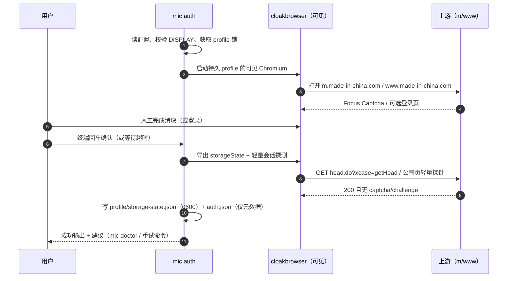
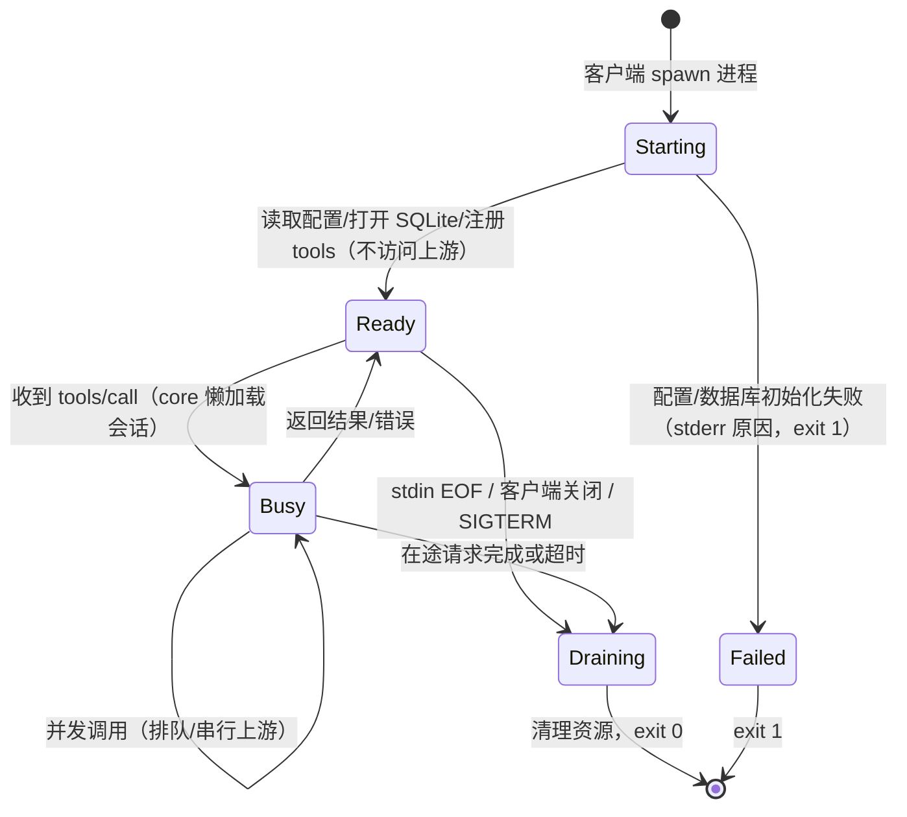
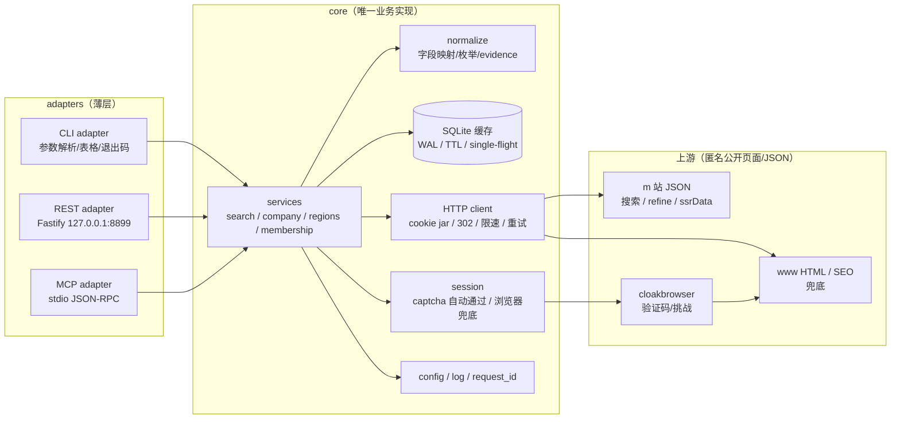

# 04 CLI 与 MCP 接口设计

> 版本：0.1 ｜ 状态：Approved（M0 评审通过） ｜ 负责人：iface-writer ｜ 最后更新：2026-11-15
> 关联：[docs/README.md](README.md)（固定契约）｜[01 需求](01-requirements.md)｜[02 架构](02-architecture.md)｜[03 REST API](03-rest-api.md)｜[05 数据与缓存](05-data-and-cache.md)｜[07 运维](07-operations.md)｜[research/upstream-api.md](research/upstream-api.md)｜[research/captcha-autosolve.md](research/captcha-autosolve.md)｜[decisions/0005](decisions/0005-membership-tier-enum.md)｜[decisions/0007](decisions/0007-local-runtime-and-secrets.md)

> 说明：本文描述**目标形态（M0 设计基线）**；M0 阶段尚无 `mic` 可执行文件，命令与配置以「实现后可用」为准（与 [07 运维](07-operations.md) 口径一致）。
> 约定：**上游事实**只引用 [research/](research/) 与 `recon/artifacts/` 的实测结论；未实测的写成 `待验证`，并进入「开放问题」（§5.6）。
> 范围：只覆盖 CLI（`mic`）与 MCP（stdio）两个入口，以及它们与 REST 共用 core 的一致性要求；REST 端点、数据 Schema、SQLite 缓存分别以 03 / 05 为准。本文**不写实现代码**，示例中的 `src/`、`dist/` 路径仅用于说明约定。

---

## 0. 导读

### 0.1 本文回答的问题

| # | 问题 | 章节 |
|---|---|---|
| 1 | `mic` 有哪些全局选项、配置优先级、环境变量？ | §2.1–§2.4 |
| 2 | 每个子命令的语法、参数、输出、退出码、错误场景？ | §2.6–§2.8 |
| 3 | stdout/stderr、表格、`--json`、NDJSON 分别怎么输出？ | §2.5 |
| 4 | MCP server 怎么启动、生命周期/并发/超时/取消/错误格式？ | §3.1–§3.2 |
| 5 | 4 个 MCP tool 的完整定义（含 JSON Schema）与示例？ | §3.3–§3.4 |
| 6 | MCP Resources / Prompts 提供什么？Claude Code 怎么配置？ | §3.5–§3.7 |
| 7 | MCP/CLI 的安全限制（只读、本地、上限、脱敏）？ | §3.8、§2.10 |
| 8 | CLI/MCP 与 REST 如何共用 core，三入口字段一致性如何保证？ | §4 |
| 9 | 速查表、错误码→退出码→MCP 错误映射？ | §5.1–§5.3 |

### 0.2 事实来源与状态

| 事实 | 来源 | 状态 |
|---|---|---|
| 上游能力、参数、限制（`word` 必填、20/页、total 封顶、无 city 参数、302/验证码、中文关键词=0） | [research/upstream-api.md](research/upstream-api.md)、[recon/notes.md](../recon/notes.md) | ✅ 2026-11-15 实测 |
| Focus Captcha 自动通过 + `mic auth` 人工兜底 | [research/captcha-autosolve.md](research/captcha-autosolve.md)、[ADR-0002](decisions/0002-browser-fallback-and-captcha.md) | ✅ 实测 2/2 |
| 会员等级枚举与 `audited` 语义 | [research/membership-tiers.md](research/membership-tiers.md)、[ADR-0005](decisions/0005-membership-tier-enum.md) | ✅ 官方+实测 |
| 本地运行/目录/无鉴权边界 | [ADR-0007](decisions/0007-local-runtime-and-secrets.md)、[07 运维](07-operations.md) | ✅ 已定 |
| 响应包、错误码、状态枚举、FR/NFR 编号、**warnings 码表** | [docs/README.md](README.md) §3.5；REST 落地见 03 §12.4 | ✅ 固定契约（canonical 22 码） |
| MCP 协议版本、SDK structuredContent 支持、`page_size>20` 拼接成本 | — | ⚠️ 待验证（§5.6） |

### 0.3 与 03/05 的分工

- **03 定义**：REST 路径/参数、`data` 的 JSON Schema（`SearchResult`/`CompanyDetail`/`ErrorObject`/`Meta`）、分页语义、缓存语义、HTTP 状态码。
- **05 定义**：字段映射、SQLite、TTL、地区字典、`availability_reason` 的逐字段适用性。
- **04 定义（本文）**：入口层差异——命令/参数命名、退出码、表格与流式格式、MCP tool 的 `inputSchema`/错误语义、三入口一致性验收点。
- 冲突处理：字段名/语义以 **03 + 05** 为准，入口层以本文为准；若三处不一致，先在本文「变更记录」登记并按 03 修订（ADR-0006 文档先行）。

---

## 1. 设计目标与总则

### 1.1 目标

1. **人类可用**：`mic` 一条命令完成「按省市/关键词搜工厂 → 看列表 → 看公司详情」，输出可读、可复制、可脚本化（FR-10）。
2. **Agent 可用**：`mic mcp` 提供 stdio MCP server，Claude Code 等客户端可直接调用搜索/详情/地区/会员解释（FR-11）。
3. **三入口同源**：CLI/MCP/REST 共用同一 core 与同一套规范化模型，同一查询在三个入口返回**字段一致**的数据（FR-09/10/11、NFR-04）。
4. **可诊断**：所有失败都有固定错误码、可操作提示（`mic auth`/`mic doctor`）、稳定退出码；错误信息不含 cookie/敏感路径（FR-13/14、NFR-03）。
5. **只读**：CLI/MCP 不提供任何写上游的操作；本地仅 `mic cache`（清缓存）、`mic auth`（固化会话）会写本地状态。

### 1.2 设计原则

| # | 原则 | 落地 |
|---|---|---|
| P1 | **JSON 优先** | 主链路走 m 站匿名 JSON；浏览器仅用于验证码/挑战/兜底；CLI/MCP 输出 `source` 字段如实标注 `json/html/browser/cache` |
| P2 | **单一内核** | adapter 只做「解析参数 → 调 core → 格式化输出」，不复制业务规则 |
| P3 | **机器可解析** | `--json` 输出 = REST 响应包；MCP 成功结果正文也是同一响应包 JSON；表格只是人类视图 |
| P4 | **默认安全** | 只读、本地、串行限速、分页/超时/结果大小有硬上限；错误脱敏 |
| P5 | **无隐式网络** | 除 `search/company/regions/cache refresh/doctor --deep` 外不发上游请求；`explain_membership` 纯静态 |
| P6 | **默认不带副作用** | `--no-cache` 不读不写；`--refresh` 只跳过读缓存；写缓存永远在成功取数之后 |
| P7 | **失败可操作** | 每个错误码带 `hint`（如 `NEED_HUMAN_VERIFICATION → 运行 mic auth`）；MCP `isError` 正文含同一 `hint` |
| P8 | **契约稳定** | 新增字段/选项向后兼容；破坏性变更升 major 并补 ADR；错误码不新增（只用 README §3.5 的 11 个，协议层错误除外） |

### 1.3 三入口职责矩阵

| 能力 | REST（03） | CLI（本文） | MCP（本文） |
|---|---|---|---|
| 搜索工厂 | `GET /api/search/factories` | `mic search` | `search_factories` |
| 公司详情 | `GET /api/companies/{account}` | `mic company` | `get_company` |
| 地区字典 | `GET /api/regions` | `mic regions` | `list_regions` |
| 会员解释 | `GET /api/membership/levels` | （静态说明 + `mic company` 输出的 `membership`/`audit`） | `explain_membership` |
| 缓存运维 | `GET /api/cache/stats`、`POST /api/cache/refresh` | `mic cache stats/clear/refresh` | —（不暴露缓存管理） |
| 启动本地服务 | —（服务本体） | `mic serve` | — |
| 会话/验证码 | —（由 core 处理） | `mic auth` | —（返回 `NEED_HUMAN_VERIFICATION` 提示） |
| 环境自检 | `GET /health`（轻量） | `mic doctor` | —（客户端侧运行 `mic doctor`） |
| 版本/配置 | `GET /api/version`（可选） | `mic version`、`mic config show/path` | `initialize` 的 `serverInfo` 含版本 |

> 说明：MCP 不提供缓存运维/服务启动类工具，避免 Agent 拥有删除缓存、启动进程等多余权限（安全最小化，§3.8）。

### 1.4 归一化模型与枚举（三入口共用的输出契约摘要）

> 完整 Schema 在 [03 REST API §11](03-rest-api.md)；05 负责字段来源与映射。本节只列三入口**必须一致**的字段子集/枚举，供 CC-01…CC-08 核对。04 **不新增/不改名** 03 已定义的 `data` 字段。

**统一响应包**（严格按 [docs/README](README.md) §3.5，不新增 envelope 字段）：

```json
{
  "ok": true,
  "data": {},
  "meta": {
    "request_id": "req_m3x9q1k2c8",
    "cached": false,
    "stale": false,
    "fetched_at": "2026-11-15T22:59:00+08:00",
    "source": "json",
    "warnings": []
  }
}
```

失败时为 `{"ok": false, "error": {"code": "...", "message": "...", "details": {...}|null}, "meta": {...}}`（`data` 不出现）；`warnings` 元素固定 `{code,message,details}`。`request_id` 格式 `^req_[a-z0-9]+$`（03 §1.10）。

**固定枚举（与 03 §1.5 一致，不另造）**

| 枚举 | 取值 | 说明 |
|---|---|---|
| `membership.tier` | `diamond｜gold｜free｜unknown` | KA/SKA 不进入；`unknown` 表示无法判定，不猜 |
| `membership.confidence` | `high｜medium｜low` | 判定可信度 |
| `audited` | `true｜false｜null` | 认证供应商（AS）独立布尔；`null`=未取到 |
| `source` / `detail_source` | `json｜html｜browser｜cache` | 数据来源通道 |
| `search_mode` | `keyword｜region｜mixed` | ADR-0004；03 §7.4 |
| `status`（派生） | `success｜partial｜stale` | 不新增 `meta.status`：由 `meta.stale` 与 partial 类 warnings 派生（03 §1.6） |
| `availability[].reason` | `not_provided_by_supplier｜not_public_by_platform｜no_reviews｜fetch_blocked｜needs_login` | 只用于字段缺失原因 |
| `membership_tier` 过滤入参 | `diamond｜gold` | 映射上游 `memberLevel=50/30`；`free/unknown` → `INVALID_PARAM`（`UNSUPPORTED_MEMBERSHIP_FILTER`）。**不接受 `audited` 作为 tier 值** |
| `business_type` 过滤入参 | `manufacturer｜trading_company｜group_corporation｜other` | 映射 `comBusinessType` 1/2/4/8 |
| `annual_revenue` 过滤入参 | `under_1m_usd｜1m_2_5m_usd｜2_5m_5m_usd｜5m_10m_usd｜10m_50m_usd｜50m_100m_usd｜over_100m_usd` | 映射 `annualRevenue` 1–7 |
| `rd_capacity` 过滤入参 | `oem｜odm｜quick_response｜fast_delivery｜small_amount_payment` | 映射 `rdCapacity` 4/5/01/02/03；v1 只接受单值 |
| `include` | `none｜all｜audit｜response｜contacts｜reviews`（逗号组合） | 详情增强；默认 `audit,response`（03 §8.3） |
| `scope`（缓存） | `search｜company｜regions｜all` | REST 语义；CLI 的 `list/detail` 分别映射 `search/company`（§2.7.4） |

> **warnings 码表（canonical）**：只允许 [docs/README](README.md) §3.5 的 22 个码（REST 落地表 03 §12.4）；04 **不新增 warning code**。`PAGE_LIMIT_REACHED` 仅 CLI 产生（`--pages` 达到上限）；CLI 展示层事件（如表格隐藏广告）不是 warnings，不写入 envelope。

**`SearchResult.data` 摘要**（= 03 §11.11）：`{query, pagination, items[]}`

| 字段 | 类型 | 说明 |
|---|---|---|
| `query.keyword` | string|null | 用户关键词（地区模式为 `null`） |
| `query.keyword_effective` | string | 实际发往上游的 `word`（地区模式为地区英文词） |
| `query.province` / `province_zh` | string|null | 规范省英文名/中文名 |
| `query.city` / `city_zh` | string|null | 规范城市英文名/中文名 |
| `query.search_mode` | enum | `keyword｜region｜mixed` |
| `query.region_validated` | boolean | 地区条件是否严格生效（`keyword` 模式恒 `false`；03 §7.4） |
| `query.filters` | object | `{category_code, membership_tier, audited, management_certification, business_type, annual_revenue, rd_capacity}`（未使用为 `null`；`audited` 为 `boolean｜null`） |
| `query.page` / `page_size` / `refresh` | int/int/bool | 请求回显 |
| `query.include_ads` | boolean | 回显（默认 `true`=保留广告位；`false`=过滤广告 + `ADS_FILTERED`，03 §7.2/§7.9） |
| `pagination` | object | 03 §11.3：`page/page_size/total/total_page/has_more/total_capped/total_display/page_clamped/total_is_lower_bound`；本地过滤时 `total` 为已扫描匹配数、未穷尽为下界（03 §7.6） |
| `items[]` | `CompanyListItem` | 03 §11.5 |

**`CompanyListItem` 必需字段**（逐字对齐 03 §11.5，全部必填、可为 `null`）：`account`、`company_id`（string）、`encode_com_id`、`company_name`、`province`、`city`、`country`、`main_products[]`、`business_types[]`、`membership{tier, raw_cs_level, raw_member_level, since_year, evidence[], confidence}`、`audited`、`capability_stars`（0–5 int|null）、`system_certifications[]`、`employees`（int|null）、`turnover`、`plant_area`、`company_url`、`company_info_url`、`detail_source`、`is_ad`（boolean）。

> `is_ad=true` 的广告位条目默认保留在 `data.items`（`query.include_ads=true`，与 REST/MCP 一致，CC-01）；`--exclude-ads`/`include_ads=false` 时由 core 过滤并给 `ADS_FILTERED`。CLI **表格**默认隐藏广告（`--include-ads` 显示），JSON/NDJSON 按 `include_ads` 如实返回（§2.7.1-R6）。

**`CompanyDetail.data` 摘要**（= 03 §11.10）：`CompanyListItem` 字段（**除 `is_ad` 外**）+ `address`、`established_at`、`include[]`、`enrichment{audit,response,contacts,reviews}`、`availability:[{field,reason}]`。

- `enrichment.audit` = `AuditInfo`（03 §11.6）：`audited`、`sections[]`、`audited_section_count`、`agency`、`report_no`、`verify_url`、`verified_items_count`、`source`、`fetched_at`。
- `enrichment.response` = `ResponseInfo`（03 §11.7）：`avg_response_hours`、`timely_reply_ratio`、`top_*`、`range_display`、`window_days`、`as_of`、`source`、`fetched_at`。
- `enrichment.contacts` = `ContactInfo`（03 §11.8）：`persons[]{name,id,title,department,online,chat_available}`、`primary`、`channels{phone,email,whatsapp,skype,wechat,reason}`、`inquiry_url`、`source`、`fetched_at`；电话/邮箱等恒 `null` + `reason="not_public_by_platform"`。
- `enrichment.reviews` = `ReviewSummary`（03 §11.9）：`rating_value`、`rating_display`、`review_count`、`items[]`、`source`、`fetched_at`。
- 未请求的增强为 `enrichment.<key>=null`，**不**进入 `availability`；请求失败才进 `availability` 且带 `ENRICHMENT_PARTIAL` warning（03 §8.6）。

### 1.5 兼容性与版本

- 入口契约版本：`cli_version` / `mcp_tools_version` 随包版本；**同一 major 内只增不改**（新增字段忽略、新增可选参数、新增错误 `details` 键均向后兼容）。
- 删除/重命名字段、改变枚举、改变退出码语义 = 破坏性变更 → major 升级 + ADR + 01/03/04 同步。
- MCP tool 的 `inputSchema` 新增可选属性为兼容；把可选属性改为必填、删除 tool = 破坏性变更。

### 1.6 FR/NFR 映射（评审用）

| 本文内容 | FR/NFR |
|---|---|
| `mic search` / `search_factories` 的三种模式、过滤、分页 | FR-01、FR-02、FR-03、FR-04 |
| `mic company` / `get_company` 的详情与增强字段 | FR-05、FR-06 |
| `mic regions` / `list_regions` | FR-07 |
| 缓存相关命令与 `--no-cache`/`--refresh` 语义 | FR-08 |
| `mic serve` + REST 共用 core | FR-09 |
| 全部 CLI 子命令、退出码、输出规范 | FR-10 |
| 全部 MCP tools/Resources、stdio 生命周期 | FR-11 |
| `mic auth`、`NEED_HUMAN_VERIFICATION`、会话固化 | FR-12 |
| 错误码→退出码→MCP 错误映射、重试提示 | FR-13 |
| `--verbose/--quiet`、`mic doctor`、日志字段 | FR-14 |
| 配置优先级、环境变量、profile/data 目录 | FR-15 |
| 只读、本地、脱敏、限速/上限 | NFR-03、NFR-02 |
| 三入口一致性、可测试性 | NFR-04、NFR-05 |
| 访问礼仪（串行、缓存优先、不轰炸） | NFR-06 |

---

## 2. CLI 设计

### 2.1 二进制、入口与启动

| 项 | 约定 |
|---|---|
| 二进制名 | `mic`（npm `bin` 字段；`mic --help` 可用） |
| 包入口 | `dist/cli.js`（TypeScript 构建产物；与 07 §4 一致） |
| 启动方式（唯一推荐） | `~/cloak-env/bin/cloak-run node <repo>/dist/cli.js <command> ...`（保证浏览器兜底可用） |
| 安装后的 `mic` | 一个**薄启动脚本**：解析自身安装路径 → `exec "${CLOAK_RUN:-$HOME/cloak-env/bin/cloak-run}" node "<dist/cli.js>" "$@"` |
| cloak-run 缺失时 | 打印 `warning` 到 stderr，退化为 `node dist/cli.js`（JSON 主链路可用；`mic auth`/验证码兜底 → `CONFIG_ERROR`，退出码 1） |
| Node 版本 | ≥ 22（与 07 §1 一致；Node 20 仅 WARN） |
| 操作系统 | Linux（NixOS 为当前开发环境）/ macOS；Windows 原生 `待验证`（建议 WSL） |
| 工作目录 | 任意；core 以**配置/数据目录**定位状态，不依赖 cwd（便于 Claude Code 在任意项目目录拉起 MCP） |
| 编码 | UTF-8；Windows 终端乱码按 07 排障处理 |
| 显示 | 仅 `mic auth`（`--mode verify/login`）需要图形会话（`DISPLAY`/Wayland）；其他命令可无头运行 |

```bash
# 直接调用（开发/脚本；与 07 §4 一致）
~/cloak-env/bin/cloak-run node /home/songqian/mic-client/dist/cli.js search --keyword glass --province Hebei --json

# 安装后（bin/mic 自动包一层 cloak-run）
mic search --keyword glass --province Hebei --json
mic version
```

> 为什么需要 cloak-run：上游验证码自动通过/挑战兜底依赖 cloakbrowser 的 stealth Chromium 与持久 profile（[captcha-autosolve.md](research/captcha-autosolve.md)）。纯 JSON 命令不启动浏览器，但没有 cloak-run 时不能保证 `mic auth` 可用，`mic doctor` 会给出 WARN/FAIL。

### 2.2 命令行语法约定

```text
mic [GLOBAL OPTIONS] <command> [<subcommand>] [ARGS] [OPTIONS]
```

| 约定 | 说明 |
|---|---|
| 选项风格 | GNU 长选项 `--long-option <value>` / `--long-option=<value>`；常用命令提供短选项（见各命令） |
| 布尔选项 | `--flag` 开启；`--no-flag` 关闭（如 `--no-cache`）；不支持 `--flag=false` |
| 位置参数 | 仅 `mic search [keyword]`、`mic company <account|com_id|encode_com_id>`；与对应选项同时出现且值不同 → `INVALID_PARAM`（退出码 2） |
| `--` 分隔 | `mic search -- --weird-keyword` 中 `--` 之后全部按位置参数处理 |
| 可重复选项 | 过滤类选项均为**单值**（上游对应单参数）；重复给出同一选项 → `INVALID_PARAM`。需要多条件组合时用不同过滤参数（如 `--membership-tier diamond --audited`） |
| 大小写 | 选项名严格小写；枚举值大小写不敏感（归一化为小写）；省/市输入大小写不敏感（归一化为上游英文名） |
| 中文输入 | `--province 河北`、`--city 廊坊` 可识别并归一化为 `Hebei`/`Langfang`；`--keyword` 仅英文（中文关键词上游恒 0，见 §2.7.1） |
| 帮助 | `mic help`、`mic <command> --help`、`mic help <command>`；`--help` 优先级最高（不连接网络，退出码 0） |
| 版本 | `mic --version` 等价 `mic version --short`（只打印版本号一行） |
| 交互 | 仅 `mic auth` 有交互；其余命令不等待 stdin；`mic cache clear` 不用确认（显式 `--scope` 即授权） |
| 信号 | 一次性命令 Ctrl-C → 130；`mic serve`/`mic mcp` 的 SIGINT/SIGTERM → 优雅退出（退出码 0，见 §2.7.6/§2.7.7） |

### 2.3 全局选项

> 全局选项可放在命令前或命令后（`mic --json search ...` 与 `mic search ... --json` 等价，由 adapter 统一预处理）。

| 选项 | 取值 | 默认 | 环境变量 | 说明 |
|---|---|---|---|---|
| `--config <path>` | 文件路径 | `~/.mic-client/config.json` | `MIC_CONFIG` | 配置文件路径；不存在则使用默认值（不报错） |
| `--json` | 布尔 | 关 | `MIC_FORMAT=json` | 等价 `--format json`；输出 REST 响应包 |
| `--format <fmt>` | `table｜json｜ndjson` | `table` | `MIC_FORMAT` | 输出格式；`ndjson` 仅 `mic search` 支持（§2.5.4） |
| `--timeout <duration>` | `500ms`/`15s`/`2m` | 见配置 `upstream.timeout_ms`（15000） | `MIC_UPSTREAM_TIMEOUT_MS` | **单次上游请求**超时；`mic auth` 用 `auth.timeout_s`，此处覆盖才生效 |
| `--no-cache` | 布尔 | 关 | — | 跳过读缓存，且**不写缓存**（纯在线；适合核对最新数据） |
| `--refresh` | 布尔 | 关 | — | 跳过读缓存，成功后**回写缓存**（等价 REST `refresh=true`） |
| `--verbose` | 布尔 | 关 | `MIC_LOG_LEVEL=debug` | 详细日志到 stderr；等价日志级别 `debug` |
| `--quiet` | 布尔 | 关 | `MIC_LOG_LEVEL=error` | 只输出错误；与 `--verbose` 同用 → `INVALID_PARAM`（退出码 2） |
| `--profile <name\|path>` | 名称或目录 | `default` | `MIC_PROFILE_DIR`（目录） | 含 `/` 或 `~` 视为目录；不含则解析为 `<profiles_dir>/<name>`；优先级见 §2.4 |
| `--no-color` | 布尔 | 自动 | `NO_COLOR` | 关闭 ANSI 颜色；非 TTY 默认关闭 |
| `--version` / `-V` | 布尔 | — | — | 打印版本并退出（0） |
| `--help` / `-h` | 布尔 | — | — | 打印帮助并退出（0） |

**全局选项的边界**

- `--json`/`--format` 只影响**输出**，不影响请求参数；`--format json` 与 `--json` 同时出现以最后一个为准。
- `--no-cache` 与 `--refresh` 互斥（同用 → `INVALID_PARAM`）：两者都是「跳过读」，但一个不写、一个写回。
- 全局 `--timeout` 对 `mic auth` 无效（auth 有独立 `--timeout`，见 §2.7.5；命令级选项优先）。
- `--profile` 对不涉及浏览器的命令仍生效：它决定 core 读取哪个会话状态；同一 data 目录的缓存不随 profile 变化（缓存键不含 profile）。

### 2.4 配置、环境变量与优先级

**优先级（高 → 低）**：命令行选项 > 环境变量 > 配置文件 > 内置默认值。与 07 §3 一致。

**配置文件**：`~/.mic-client/config.json`（`mic config path` 可查；`--config` 可覆盖）。JSON（不引入额外解析依赖）；**不存 cookie/密钥**；权限建议 `600`。

```json
{
  "profile_dir": "/home/songqian/.mic-client/profiles/default",
  "data_dir": "/home/songqian/.mic-client/data",
  "log_dir": "/home/songqian/.mic-client/logs",
  "log_level": "info",
  "rest": {
    "host": "127.0.0.1",
    "port": 8899
  },
  "upstream": {
    "timeout_ms": 15000,
    "rate_min_ms": 1500,
    "rate_max_ms": 2500
  },
  "cache": {
    "ttl_list_s": 21600,
    "ttl_detail_s": 86400,
    "ttl_regions_s": 2592000
  },
  "captcha": {
    "autosolve": true,
    "max_attempts": 5
  },
  "auth": {
    "timeout_s": 300
  },
  "raw_snapshot": {
    "enabled": false,
    "retention_days": 7
  }
}
```

| 配置键（点式） | CLI 选项 | 环境变量 | 默认 | 说明 |
|---|---|---|---|---|
| `profile_dir` | `--profile` | `MIC_PROFILE_DIR` | `~/.mic-client/profiles/default` | 浏览器 profile 目录；`--profile <name>` 覆盖为 `<profiles_dir>/<name>` |
| `data_dir` | — | `MIC_DATA_DIR` | `~/.mic-client/data` | SQLite 与原始快照目录 |
| `log_dir` / `log_level` | `--verbose`/`--quiet` | `MIC_LOG_DIR` / `MIC_LOG_LEVEL` | `~/.mic-client/logs` / `info` | 结构化日志文件与级别（debug/info/warn/error） |
| `rest.host` / `rest.port` | `mic serve --host/--port` | `MIC_REST_HOST` / `MIC_REST_PORT` | `127.0.0.1` / `8899` | REST 监听（必须回环，§2.7.6） |
| `upstream.timeout_ms` | `--timeout` | `MIC_UPSTREAM_TIMEOUT_MS` | `15000` | 单请求超时（范围 1000–120000） |
| `upstream.rate_min_ms` / `rate_max_ms` | — | `MIC_RATE_MIN_MS` / `MIC_RATE_MAX_MS` | `1500` / `2500` | 上游请求串行间隔抖动（范围 500–10000，且 min<max） |
| `cache.ttl_list_s` / `ttl_detail_s` / `ttl_regions_s` | — | `MIC_CACHE_TTL_LIST_S` / `MIC_CACHE_TTL_DETAIL_S` / `MIC_CACHE_TTL_REGIONS_S` | `21600` / `86400` / `2592000` | 列表 6h / 详情 24h / 地区 30d（05 定稿） |
| `captcha.autosolve` / `max_attempts` | — | `MIC_CAPTCHA_AUTOSOLVE` / `MIC_CAPTCHA_MAX_ATTEMPTS` | `true` / `5` | 自动通过验证码开关/尝试上限 |
| `auth.timeout_s` | `mic auth --timeout`（优先） | `MIC_AUTH_TIMEOUT_S` | `300` | 人工等待上限 |
| `raw_snapshot.enabled` / `retention_days` | — | `MIC_RAW_SNAPSHOT` / `MIC_RAW_RETENTION_DAYS` | `false` / `7` | 排障快照（排障用，默认关） |

**校验规则**

- 非法 JSON/类型错误/枚举越界 → `CONFIG_ERROR`（退出码 1），错误信息给出文件路径与键名，**不打印文件内容**。
- 未知键：忽略并输出 `CONFIG_UNKNOWN_KEY` warning（前向兼容）；未知键不影响退出码。
- `profile_dir` 不存在：读取类命令 WARN（首次会创建）；`mic auth` 会创建并初始化 profile。
- `data_dir` 不可写 → `CONFIG_ERROR`（退出码 1）；`mic doctor` 会明确报 FAIL。

**完整环境变量表**

| 环境变量 | 等价配置/选项 | 说明 |
|---|---|---|
| `MIC_CONFIG` | `--config` | 配置文件路径 |
| `MIC_FORMAT` | `--format` | `table｜json｜ndjson` |
| `MIC_LOG_LEVEL` | `--verbose/--quiet` | `debug｜info｜warn｜error`；`--verbose` 视为 debug、`--quiet` 视为 error |
| `MIC_PROFILE_DIR` | `--profile` | profile **目录**（与 `--profile <name>` 的名称语义不同，CLI 选项优先） |
| `MIC_DATA_DIR` | `data_dir` | 数据目录 |
| `MIC_LOG_DIR` | `log_dir` | 日志目录 |
| `MIC_UPSTREAM_TIMEOUT_MS` | `--timeout` | 单请求超时（毫秒） |
| `MIC_RATE_MIN_MS` / `MIC_RATE_MAX_MS` | — | 串行限速抖动区间 |
| `MIC_CACHE_TTL_LIST_S` / `MIC_CACHE_TTL_DETAIL_S` / `MIC_CACHE_TTL_REGIONS_S` | — | 缓存 TTL |
| `MIC_CAPTCHA_AUTOSOLVE` / `MIC_CAPTCHA_MAX_ATTEMPTS` | — | 验证码自动通过 |
| `MIC_AUTH_TIMEOUT_S` | `mic auth --timeout` | 人工等待上限（秒） |
| `MIC_RAW_SNAPSHOT` / `MIC_RAW_RETENTION_DAYS` | — | 原始快照 |
| `MIC_REST_HOST` / `MIC_REST_PORT` | `mic serve --host/--port` | REST 监听 |
| `NO_COLOR` | `--no-color` | 关闭颜色（遵循 <https://no-color.org>） |
| `COLUMNS` | — | 表格宽度（`--format table`；缺省探测终端宽度，回退 100） |

> 环境变量优先级说明：`--profile <name>` > `MIC_PROFILE_DIR` > `config.profile_dir` > 默认；`--timeout` > `MIC_UPSTREAM_TIMEOUT_MS` > `config.upstream.timeout_ms`。

### 2.5 输出规范

#### 2.5.1 通道分离（所有命令）

| 通道 | 内容 | 示例 |
|---|---|---|
| `stdout` | **只放结果**：表格/JSON/NDJSON 事件/人类可读结果 | 搜索结果表、`{...}` 响应包、NDJSON 行 |
| `stderr` | 进度、日志、警告、错误提示、缓存命中说明（人类模式） | `warning: ...`、`mic: error: INVALID_PARAM: ...`、`hint: ...` |
| 日志文件 | 结构化 JSON Lines（`~/.mic-client/logs/mic.log`），字段见 07 §8 | `{"ts":"...","level":"info","module":"search",...}` |

- 在 `--format json` 下：**成功与业务失败**的响应包都写 stdout（便于脚本统一解析）；人类提示/堆栈只写 stderr。
- 在 `--format table`/人类模式下：失败时 stdout 为空，错误只写 stderr。
- 在 `--format ndjson` 下：数据事件写 stdout；`warning`/`error` 事件也写在 stdout（流协议的一部分）；人类提示写 stderr。
- 永远不要把日志/进度混进 stdout；`mic mcp` 的 stdout 只允许 JSON-RPC（§3.1）。

#### 2.5.2 `--format json`（= `--json`）

- 输出内容 = REST 响应包，2 空格缩进、UTF-8 原文（不转义非 ASCII）、末尾换行；键顺序固定为 `ok,data,meta`（失败为 `ok,error,meta`）。
- **稳定 Schema**：字段名/类型/枚举以 03/05 为准；`meta` 固定含 `request_id,cached,stale,fetched_at,source,warnings`。
- 不在 stdout 输出「提示文案」；如 `meta.warnings` 需要人类解释，另写 stderr（`--verbose` 时）。
- 空结果：`ok:true`、`data.items: []`、`pagination.total: 0`，退出码 0（**不是** `NOT_FOUND`）。

#### 2.5.3 `--format table`（默认；人类可读）

| 规则 | 约定 |
|---|---|
| 宽度 | 优先 `COLUMNS`/终端探测；默认 100 列，最小 60、最大 160；`--no-color` 不影响宽度 |
| 列宽 | 固定上限：公司名 40 列、地区 18、主营 30、URL 不展示；超出以 `…`（单字符省略号）截断，**保持左侧可见** |
| 中文宽度 | 按显示宽度计算（CJK 记 2 列）；不换行、不拆词 |
| 对齐 | 数字右对齐、文本左对齐；空值显示 `-` |
| 表头 | 首行表头，次行 `-` 分隔；无外框（便于复制/管道） |
| 颜色 | 仅 TTY 且未设 `NO_COLOR`/`--no-color` 时启用；只用于表头加粗、`WARN`/`FAIL` 着色；**颜色不承载语义**（去掉颜色信息不丢失） |
| 分页页脚 | 显示第 `a–b` 条 / 共 `N` 条（第 `p/t` 页，`缓存命中/未命中`，`2,000+` 时标注「非穷尽」） |
| 警告 | 表格后空行 + `warning: <code>: <message>`（stderr 同步可输出） |
| 无结果 | stdout 输出 `(无结果)`；stderr 给出可操作提示（如检查省名/中文关键词） |
| 交互 | 不自动分屏/不要求按任意键 |

表格列裁剪优先级（从高到低保留）：`#`、`公司`、`地区`、`会员`、`认证`、`星级`、`主营`（宽度不足时先裁「主营」，再裁「认证」）。详见 §2.7.1 的列表输出示例。

#### 2.5.4 `--format ndjson`（`mic search --pages` 流式分页）

- 一行一个 JSON 对象，`\n` 分隔、无缩进；每行立即 flush（可被 `jq`/管道实时消费）。
- **仅 `mic search` 支持**；且多页必须用 `--pages`（`--page` 只查单页）。`--format ndjson` + 单页也合法（一行 `start` + 一行 `page` + 一行 `summary`）。
- 行内 `type` 取值固定：

| `type` | 何时输出 | 字段 |
|---|---|---|
| `start` | 开始（第一行） | `type, command, request_id, query`（规范化的查询回显） |
| `page` | 每页成功取数后 | `type, page, pagination, items[], meta{cached,stale,fetched_at,source,warnings,request_id}` |
| `warning` | 非致命提示（如城市过滤条数、page 夹取、中文关键词） | `type, code, message, details`（与 `meta.warnings[]` 同构） |
| `summary` | 全部页结束（最后一行） | `type, pages, items, status(success|partial|stale), request_id, duration_ms` |
| `error` | 致命错误（随后进程退出，不再有 summary） | `type, error{code,message,details}, request_id` |

- 行序：`start` →（`warning` 可在任意页前后）→ `page`* → `summary`；出现 `error` 即终止。
- `--pages` 语法：`1`（单页）、`2-5`（区间，含端点）、`1,3,5`（枚举）、`all`（从 `--page` 或 1 开始**动态**直到 `total_page`；总页数上限 100，即上游可见上限）；`all` 不再有 10 页限制。
- `--concurrency <1-8>`（默认 1，仅 NDJSON 多页）：把页抓取做**流水线并发**。限速器仍保证每个上游请求的**发起间隔**（1.5–2.5s）不变，只重叠网络响应等待；输出仍按页号顺序，`summary` 与 `items` 计数一致。实测 56 页全量：串行 ~311s → `--concurrency 6` ~147s（2.1×）。并发越高越接近限速下限，但收益递减（8 并不比 6 快），建议 4–6。
- `--exclude-ads` 时 NDJSON 按 `include_ads=false` 过滤广告位并发出 `ADS_FILTERED` warning；默认与 REST 一致保留广告（`is_ad=true`）。
- 终止条件（任一）：达到 `--pages` 指定页数；`page > total_page`；`has_more=false`；上游返回重复页/夹取页（连续两页同一 `page`）；触发 `error`。
- 兼容性：不支持 `--format ndjson` 的命令 → `INVALID_PARAM`（退出码 2）。

#### 2.5.5 时长与日期格式

| 类型 | 格式 | 示例 |
|---|---|---|
| `--timeout`/`--older-than` 时长 | `^\d+(ms|s|m|h|d)$` | `500ms`、`15s`、`5m`、`7d` |
| 时间戳（JSON） | ISO 8601 带时区 `+08:00` | `"2026-11-15T22:59:00+08:00"` |
| 日期（`established_at`） | `YYYY-MM-DD`（上游原样，缺失 `null`） | `"2015-10-30"` |
| 年份（`member_since_year`） | 整数 | `2025` |

### 2.6 子命令总览

| 命令 | 用途 | 入口类型 | 需要浏览器 | FR | 里程碑（08） |
|---|---|---|---|---|---|
| [`mic search`](#271-mic-search) | 搜索工厂（关键词/地区/组合 + 过滤 + 分页） | 一次性 | 否（兜底时可能） | FR-01–04、FR-08 | M1 |
| [`mic company`](#272-mic-company) | 公司详情（基础 + 可选增强） | 一次性 | 兜底时可能 | FR-05、FR-06 | M2 |
| [`mic regions`](#273-mic-regions) | 省/市字典 | 一次性 | 否 | FR-07 | M1 |
| [`mic cache`](#274-mic-cache) | `stats` / `clear` / `refresh` | 一次性 | 否 | FR-08 | M1/M2 |
| [`mic auth`](#275-mic-auth) | 可见浏览器人工过验证码/登录并固化会话 | 交互式 | **是** | FR-12 | M3 |
| [`mic serve`](#276-mic-serve) | 前台启动本地 REST 服务（127.0.0.1:8899） | 长驻 | 兜底时可能 | FR-09 | M3 |
| [`mic mcp`](#277-mic-mcp) | 启动 stdio MCP server | 长驻 | 兜底时可能 | FR-11 | M3 |
| [`mic config`](#278-mic-config) | `show` / `path` | 一次性 | 否 | FR-15 | M3 |
| [`mic doctor`](#279-mic-doctor) | 环境/会话/网络/上游/契约自检 | 一次性 | 否 | FR-14 | M3 |
| [`mic version`](#2710-mic-version) | 版本与构建信息 | 一次性 | 否 | — | M1 |
| `mic help [command]` | 帮助（同 `--help`） | 一次性 | 否 | — | M1 |

> 命名冻结：**这 10 个子命令 + `cache` 的 3 个动作、`config` 的 2 个动作**与 07 运维手册一致；新增/改名须同时改 03/07/08 并升版本（§1.5）。

### 2.7 子命令详设

每个命令按固定模板描述：**用途 / 语法 / 参数选项 / 规则 / 示例 / 人类输出 / `--json` 输出 / 退出码 / 错误场景**。
全局选项（§2.3）对所有命令生效，下文参数表不再重复。

#### 2.7.1 `mic search`

**用途**：按关键词、省市或两者组合搜索工厂，返回规范化列表（公司名/地区/会员/认证/主营/星级/广告标记），支持结构化过滤、分页与缓存（FR-01–04、FR-08）。数据契约见 03 §7/§11.11。

**语法**

```bash
mic search [<keyword>] [--keyword <kw>]
           [--province <省>] [--city <市>]
           [--region-mode auto|on|off]
           [--category-code <code>] [--membership-tier diamond|gold]
           [--audited | --no-audited] [--management-certification <code|name>]
           [--business-type <enum>] [--annual-revenue <enum>]
           [--rd-capacity <enum>] [--include-ads | --exclude-ads]
           [--page <n> | --pages <spec>] [--page-size <1-100>] [--concurrency <1-8>]
```

**参数与选项**

| 参数/选项 | 类型 | 默认 | 必填 | 说明与校验 |
|---|---|---|---|---|
| `[keyword]`（位置参数） | string | — | 见规则 R1 | 英文关键词（允许字母/数字/空格/`-`/`'`，长度 1–100）；与 `--keyword` 同时出现且值不同 → `INVALID_PARAM` |
| `--keyword <kw>` | string | null | 见规则 R1 | 英文关键词；中文关键词按 R3 处理（能映射为地区名则转地区模式，否则 `INVALID_PARAM`） |
| `--province <省>` | string | null | 见规则 R1 | 中文或英文省名；字典 32 个省级地区（附录 §5.5），归一化为英文上游值；未知 → `INVALID_PARAM`（`UNKNOWN_PROVINCE`） |
| `--city <市>` | string | null | 否 | 中文或英文城市名；可单独给（自动推导省份）；城市**不能**服务端过滤，客户端过滤（R5）；校验见 03 §7.3 |
| `--region-mode <mode>` | enum | `auto` | 否 | **CLI 入口层校验开关**（非 REST 参数）：`auto`=按 03 §7.4 自动判定（无 keyword 且给地区 → 地区模式）；`on`=必须走地区模式（同时给 keyword → `INVALID_PARAM`）；`off`=必须给 keyword（无 keyword → `INVALID_PARAM`）。输出回显 `query.search_mode` |
| `--category-code <code>` | string | null | 否 | 上游类目代码（数字串 `^[0-9]{6,12}$`，如 `1500000000`）；默认**直传不校验**；仅 `rest.strict_params=true` 时未识别 → `INVALID_PARAM`（`CATEGORY_CODE_UNVERIFIED`，03 §7.2） |
| `--membership-tier <tier>` | enum | null | 否 | 仅 `diamond` / `gold`（→ 上游 `memberLevel=50/30`）；`free`/`unknown` → `INVALID_PARAM`（`UNSUPPORTED_MEMBERSHIP_FILTER`）；`audited` 等其它值 → `INVALID_PARAM`（`INVALID_ENUM`） |
| `--audited` / `--no-audited` | flag | 不设置（null） | 否 | `--audited`=只要认证供应商；`--no-audited`=排除认证供应商；都不给=不过滤；两者同给 → `INVALID_PARAM`。均为**本地过滤**（可能非穷尽）；**不得**用 `memberLevel="0,1,3"` 表达（AS-only 档，会漏掉 diamond/gold 的 AS，03 §7.3-5） |
| `--management-certification <code\|name>` | string | null | 否 | 管理体系认证（→ 上游 `managementCertification`）；支持代码（`-5`）或名称（`ISO9001:2015`，按字典归一化）；**无法识别 → warning `UNKNOWN_CERTIFICATION` 并忽略该过滤**（保留 raw 值，不报错）；与 `audited` 语义不同（03 §7.2） |
| `--business-type <enum>` | enum | null | 否 | `manufacturer`=1、`trading_company`=2、`group_corporation`=4、`other`=8（附录 §5.4）；上游单值参数，重复给出 → `INVALID_PARAM` |
| `--annual-revenue <enum>` | enum | null | 否 | `under_1m_usd`/`1m_2_5m_usd`/`2_5m_5m_usd`/`5m_10m_usd`/`10m_50m_usd`/`50m_100m_usd`/`over_100m_usd`（附录 §5.4） |
| `--rd-capacity <enum>` | enum | null | 否 | `oem`/`odm`/`quick_response`/`fast_delivery`/`small_amount_payment`（附录 §5.4）；v1 单值 |
| `--include-ads` | flag | 表格默认隐藏 | 否 | 查询参数 `include_ads` 默认 `true`（保留广告位，与 REST 一致）；`--include-ads` 让**表格**也显示 `is_ad=true` 条目 |
| `--exclude-ads` | flag | 否 | 否 | 请求 `include_ads=false`：core 过滤广告位并给 `ADS_FILTERED`（`items` 重排）；JSON/NDJSON/表格都不再出现广告位（与 REST 同义）。与 `--include-ads` 同给 → `INVALID_PARAM` |
| `--page <n>` | int | 1 | 否 | 从 1 开始；范围 1–100；> 末页时上游夹取并返回 `page_clamped`（03 §1.7） |
| `--pages <spec>` | string | — | 否 | **仅** `--format ndjson`：`1`/`2-5`/`1,3,5`/`all`（§2.5.4，`all` 动态到末页，≤100）；与 `--page` 同用 → `INVALID_PARAM` |
| `--concurrency <n>` | int | 1 | 否 | **仅** NDJSON 多页：1–8；流水线化页抓取（不改变请求发起间隔与顺序）；>1 且非 ndjson → `INVALID_PARAM`；越界 → `OUT_OF_RANGE` |
| `--page-size <n>` | int | 20 | 否 | 1–100；≠20 时按窗口拼接上游 20 条页并裁剪，`warnings` 含 `PAGE_SIZE_NOT_NATIVE`（03 §1.7） |

**规则**

- **R1 输入组合（FR-01；03 §7.2）**：`keyword` 与 `province`/`city` **至少一个**；都空 → `INVALID_PARAM`（`MISSING_REQUIRED_COMBO`）。`city` 单独给时由城市字典推导省份（静默，回显 `query.province`）；城市与给定省不一致 → warning `CITY_PROVINCE_MISMATCH`（以城市字典所属省为准覆盖，`details` 记录原值，**不报错**）。
- **R2 搜索模式（ADR-0004；03 §7.4）**：有 keyword → `search_mode=keyword`（无地区）/`mixed`（有地区）；无 keyword 且有地区 → `region`，用地区英文词派生 `keyword_effective`（有 city 用 city 英文名，否则 province 英文名），并传 `province` 服务端过滤 + `city` 客户端后置校验。CLI `--region-mode on/off` 只影响入参校验（见上表），不改变 REST 表达。
- **R3 中文关键词（03 §7.3-1）**：
  - 能映射为地区名（如 `河北`/`廊坊`）且未显式给地区：转换为**地区模式**（`keyword=null`、设置 province/city），**不发 warning**（规范化结果通过 `query` 回显）；
  - 映射成功但与显式地区参数冲突：`INVALID_PARAM`（`NON_ENGLISH_KEYWORD`）；
  - 无法映射（如 `玻璃`/`河北玻璃`）：`INVALID_PARAM`（`NON_ENGLISH_KEYWORD`，退出码 2）。**依据**：上游英文站对中文关键词恒 `total=0`，静默空结果会误导调用方（03 §7.12-1）。
- **R4 省/市归一化**：中文/别名（如 `Hong Kong`→`Hongkong S.A.R.`）映射为英文展示名 `name`；**发往上游的 `province` 参数用地区字典 `api_value`**（`Inner Mongolia`→`InnerMongolia`、`Hongkong S.A.R.`→`Hongkong`、`Taiwan, China`→`Taiwan`；03 §7.3）。输出 `query.province_zh/city_zh`（03 §7.9）。
- **R5 城市客户端过滤（ADR-0003；03 §7.6）**：上游 JSON 无 city 参数；core 用 `province` 服务端过滤 + 按 `item.city` 精确匹配（客户端）。城市字典不完整时未命中城市**透传**（`CITY_NOT_IN_DICTIONARY`）且提示 `REGION_DICTIONARY_INCOMPLETE`；字典完整但未命中 → `INVALID_PARAM`（`UNKNOWN_CITY`）。过滤后 0 条 → `CITY_FILTER_EMPTY`（200/退出码 0）；扫描预算用尽 → `CITY_FILTER_TRUNCATED` + `NON_EXHAUSTIVE` + `total_is_lower_bound=true`/`has_more=true`。
- **R6 广告位（03 §7.2/§7.5-6）**：`include_ads` 默认 `true` → 上游 `ad/showAd/advertise=true` 的条目保留并标 `is_ad=true`（与上游分页 1:1）；`--exclude-ads`/`include_ads=false` → core 过滤广告并 `ADS_FILTERED`（`details.count`，`items` 重排）。CLI **表格视图**默认隐藏 `is_ad=true` 条目（仅展示层，`--include-ads` 显示）；JSON/NDJSON 按 `include_ads` 值如实返回。广告可能跨页重复，按 `account` 去重（`DUPLICATES_REMOVED`）。
- **R7 去重（03 §1.7-6）**：同一响应内按 `account`（缺省回退 `company_id`）去重，warning `DUPLICATES_REMOVED`（`details.removed`）。
- **R8 分页（FR-03；03 §1.7/§7.6）**：`page` 1–100；`page_size` 1–100；上游固定 20/页；`total>2000` → `total=2000`、`total_capped=true`、`total_display="2,000+"`；`page>total_page`（未确认末页的本地过滤除外）→ 末页 + `page_clamped=true`（`PAGE_CLAMPED`）。本地过滤时 `total`=已扫描匹配数；`total_is_lower_bound=true`（早停/预算用尽）时 `has_more` 可能为 true，并带 `NON_EXHAUSTIVE`。
- **R9 缓存（FR-08；03 §1.8）**：默认读缓存（列表上游页 6h；派生索引 6h）；命中 `meta.cached=true`、`source="cache"`；`--refresh` 跳过读并回写；`--no-cache` 不读不写；上游失败且有过期缓存 → `ok:true` + `meta.stale=true` + `source="cache"` + warning `STALE_DATA`（退出码 0）。
- **R10 SEO 口径不混用**：只用 m 站 JSON 口径（`glass+Hebei=669`）；若启用 HTML 兜底（`source="html"`），warning `HTML_FALLBACK` 且不得把 SEO total（1299）与 JSON total 直接比较（03 §7.12-7）。
- **R11 限速/并发（NFR-02；03 §1.9）**：上游串行 + 1.5–2.5s 抖动；同参数 single-flight；队列保护 → `RATE_LIMITED`（退出码 6，`details.retry_after_seconds`）。
- **R12 非穷尽**：2000 封顶/扫描预算/地区词噪声都意味着结果非穷尽；CLI 页脚必须标注（03 §7.12）。

**示例（可复制）**

```bash
# 1) 关键词 + 省（JSON 主链路）
mic search --keyword glass --province Hebei --json

# 2) 关键词 + 省 + 城市（城市在本地过滤）
mic search --keyword glass --province Hebei --city Langfang --page 1

# 3) 纯地区模式：只给省市，自动用地区词当 keyword（Langfang）
mic search --province Hebei --city Langfang --page 1

# 4) 过滤组合：钻石会员 + 认证供应商 + ISO9001:2015 + 工厂
mic search --keyword glass --province Hebei --membership-tier diamond \
  --audited --management-certification ISO9001:2015 --business-type manufacturer --page 1

# 5) 排除认证供应商 + 营收档过滤（--no-audited 为本地过滤）
mic search --keyword glass --no-audited --annual-revenue 10m_50m_usd --json

# 6) 表格也显示广告位（仅展示层；JSON/NDJSON 仍按 include_ads 值返回）
mic search --keyword glass --include-ads --page 1

# 6b) 请求层过滤广告位（data.items 不再含广告，附 ADS_FILTERED）
mic search --keyword glass --exclude-ads --json

# 7) NDJSON 流式翻 1–3 页（供 jq 实时消费）
mic search --keyword hebei --province Hebei --pages 1-3 --format ndjson
mic search --province 河北 --pages all --format ndjson --concurrency 6   # 省级关键词全量（河北 1101）

# 7b) 单省/单地区“全量企业”：省份关键词只覆盖资料中提及省名的供应商（河北=1101）。
#     要拿全需按地级市关键词拆分（每个都带 --province 服务端过滤）再并集去重：
node scripts/e2e/enumerate-province.mjs --province Hebei --concurrency 6
# 实测河北 11 城：查询 totals 合计 4403，并集去重 5008 家（非广告 4954）

# 8) 跳过缓存强制刷新
mic search --keyword glass --refresh --json
```

**人类输出示例**（`mic search --keyword glass --page 1`；真实字段取自 `recon/artifacts/api/mobile-search/supplier-search-glass-p1.full.json`）

```text
#  公司                                              地区              会员      认证  星级  主营
-  --------------------------------------------------------------------------------------------------
1  Hangzhou Kongshing Smart Home Co., Ltd.           Zhejiang/Hangzhou diamond   AS    3     Mirror Tempered Glass
2  Tengzhou Lucky Clover Glass Product Co., Ltd.    Shandong/Zaozhuang diamond  AS    2     -
3  Yancheng Dafeng Jinshiyuan Zhongbo Handicraft…   Jiangsu/Yancheng   diamond   AS    0     -
4  Taizhou Zhaosheng Electronics Technology Co., …  Zhejiang/Taizhou   diamond   AS    2     -
5  Tai' an Zhongxin Glass Technology Co., Ltd        Shandong/Tai'an    diamond   AS    0     -
6  RECULLET TECHNOLOGY INC.                          Jiangsu/Changzhou  diamond   AS    2     Float Glass Cullet
7  Danyang Tujia Photoelectric Technology Co., Ltd   Jiangsu/Zhenjiang  diamond   AS    1     -
8  Wuxi Topteam Co., Ltd.                            Jiangsu/Wuxi       diamond   AS    2     Sugarcane Bagasse Tableware
9  Nantong Mevid Life Scientific Co., Ltd.           Jiangsu/Nantong    diamond   AS    1     -
10 Star Cab Glass Limited                            Guangdong/Shenzhen gold      -     1     Cab Glass

显示第 1–10 条（自然结果；已隐藏广告位 10 条，--include-ads 显示）/ 上游共 2,000+ 条（非穷尽，第 1/100 页） ｜ 缓存未命中
warning: TOTAL_CAPPED: 上游 total 超过 2000 封顶，实际覆盖有限（建议用省/市/类目拆分查询）
```

> 说明：`认证` 列的 `AS` = `audited=true`；`-` 表示上游该字段为空。**表格默认隐藏 `is_ad=true` 的条目**（本页前 10 条上游记录为广告位），但 `--json`/NDJSON 会如实返回它们（§2.7.1-R6）。

**`--json` 输出示例**（同一查询；`items` 仅列 2 条：1 条广告 + 1 条自然结果，真实响应 20 条）

```json
{
  "ok": true,
  "data": {
    "query": {
      "keyword": "glass",
      "keyword_effective": "glass",
      "province": null,
      "province_zh": null,
      "city": null,
      "city_zh": null,
      "search_mode": "keyword",
      "region_validated": false,
      "filters": {
        "category_code": null,
        "membership_tier": null,
        "audited": null,
        "management_certification": null,
        "business_type": null,
        "annual_revenue": null,
        "rd_capacity": null
      },
      "page": 1,
      "page_size": 20,
      "refresh": false,
      "include_ads": true
    },
    "pagination": {
      "page": 1,
      "page_size": 20,
      "total": 2000,
      "total_page": 100,
      "has_more": true,
      "total_capped": true,
      "total_display": "2,000+",
      "page_clamped": false,
      "total_is_lower_bound": false
    },
    "items": [
      {
        "account": "salienceglass",
        "company_id": "1752301672",
        "encode_com_id": "bSrtEKgyYcUf",
        "company_name": "Qingdao Salience Industry Co.,Ltd",
        "province": "Shandong",
        "city": "Qingdao",
        "country": "China",
        "main_products": ["Laminated Glass", "Tempered Glass", "Silver Mirror"],
        "business_types": ["Manufacturer/Factory", "Trading Company"],
        "membership": {
          "tier": "diamond",
          "raw_cs_level": 50,
          "raw_member_level": null,
          "since_year": null,
          "evidence": ["json:csLevel=50"],
          "confidence": "high"
        },
        "audited": true,
        "capability_stars": 5,
        "system_certifications": ["ISO 9001", "ISO 9000"],
        "employees": null,
        "turnover": null,
        "plant_area": null,
        "company_url": "https://m.made-in-china.com/company-salienceglass/",
        "company_info_url": "https://m.made-in-china.com/company-salienceglass/info.html",
        "detail_source": "json",
        "is_ad": true
      },
      {
        "account": "gsglassmirror",
        "company_id": "1936521904",
        "encode_com_id": "OFqfYEklHgIa",
        "company_name": "Hangzhou Kongshing Smart Home Co., Ltd.",
        "province": "Zhejiang",
        "city": "Hangzhou",
        "country": "China",
        "main_products": ["Mirror Tempered Glass"],
        "business_types": ["Manufacturer/Factory"],
        "membership": {
          "tier": "diamond",
          "raw_cs_level": 50,
          "raw_member_level": null,
          "since_year": null,
          "evidence": ["json:csLevel=50"],
          "confidence": "high"
        },
        "audited": true,
        "capability_stars": 3,
        "system_certifications": ["ISO 9001", "ISO 50001"],
        "employees": null,
        "turnover": null,
        "plant_area": null,
        "company_url": "https://m.made-in-china.com/company-gsglassmirror/",
        "company_info_url": "https://m.made-in-china.com/company-gsglassmirror/info.html",
        "detail_source": "json",
        "is_ad": false
      }
    ]
  },
  "meta": {
    "request_id": "req_m3x9q1k2c8",
    "cached": false,
    "stale": false,
    "fetched_at": "2026-11-15T23:12:05+08:00",
    "source": "json",
    "warnings": [
      {
        "code": "TOTAL_CAPPED",
        "message": "upstream total is capped at 2000",
        "details": { "total": 2000, "total_display": "2,000+" }
      }
    ]
  }
}
```

**退出码**

| 退出码 | 场景 |
|---|---|
| 0 | 成功（含空结果、stale 回退、partial warnings） |
| 2 | 参数错误（组合缺失、省/市非法、中文关键词、枚举非法、page/page_size 越界、`--pages` 用法错误、`--region-mode` 冲突） |
| 4 | 上游不可用/改版/解析失败（`UPSTREAM_UNAVAILABLE`/`UPSTREAM_CHANGED`/`PARSE_ERROR`/`CAPTCHA_SOLVE_FAILED`） |
| 5 | 需要人工验证（`NEED_HUMAN_VERIFICATION`） |
| 6 | 本地限速/队列保护（`RATE_LIMITED`） |
| 1 | 其他（`CONFIG_ERROR`/`INTERNAL_ERROR`）；SIGINT 为 130 |

**错误场景**

| 场景 | 错误码（details.reason） | 退出码 | 提示 |
|---|---|---|---|
| keyword 与省市都为空 | `INVALID_PARAM`（`MISSING_REQUIRED_COMBO`） | 2 | 给关键词或地区；纯地区用 `--province/--city` |
| 省名非法 | `INVALID_PARAM`（`UNKNOWN_PROVINCE`） | 2 | `mic regions` 查合法英文省名（附录 §5.5） |
| 城市与省份不一致 | —（warning `CITY_PROVINCE_MISMATCH`，以城市字典省为准） | 0 | 核对省/市组合；`details` 记录原值 |
| 城市字典完整但城市未知 | `INVALID_PARAM`（`UNKNOWN_CITY`） | 2 | `mic regions --province` 查已核验城市 |
| 认证名无法识别 | —（warning `UNKNOWN_CERTIFICATION`，过滤被忽略） | 0 | 改用上游认证代码（如 `-5`） |
| `category_code` 未在字典（仅 strict 模式） | `INVALID_PARAM`（`CATEGORY_CODE_UNVERIFIED`） | 2 | 默认模式直传；需要校验时显式开启 strict |
| 中文关键词无法映射地区 | `INVALID_PARAM`（`NON_ENGLISH_KEYWORD`） | 2 | 改英文关键词，或直接给 `--province/--city` |
| `membership_tier=free/unknown` | `INVALID_PARAM`（`UNSUPPORTED_MEMBERSHIP_FILTER`） | 2 | 用 diamond/gold；AS 用 `--audited` |
| `page=999` | —（warning `PAGE_CLAMPED`） | 0 | 上游夹到末页；建议回第 1 页 |
| 公司页/兜底遇验证码且自动解失败 | `NEED_HUMAN_VERIFICATION` | 5 | 运行 `mic auth` 后重试 |
| 上游结构变更 | `UPSTREAM_CHANGED` | 4 | `mic doctor --contract` 定位；不可重试 |
| 上游 5xx/超时重试耗尽 | `UPSTREAM_UNAVAILABLE` | 4 | 稍后重试；检查网络；`mic doctor` |
| 连续请求触发本地队列保护 | `RATE_LIMITED` | 6 | 按 `details.retry_after_seconds` 等待；降低频率 |

#### 2.7.2 `mic company`

**用途**：按公司标识查询详情：基础档案（ssrData + 正文补充）+ 可选增强（审核章节/响应率/联系人/评价），输出会员等级、认证、入驻年、成立时间、主营、员工数、地址、评分/响应率等（FR-05、FR-06）。数据契约见 03 §8/§11.10。

**语法**

```bash
mic company <account|com_id|encode_com_id>
mic company --account <account>
mic company --com-id <digits>
mic company --encode-com-id <code>
           [--include audit,response,contacts,reviews|all|none]
```

**参数与选项**

| 参数/选项 | 类型 | 默认 | 必填 | 说明 |
|---|---|---|---|---|
| `<lookup>`（位置参数） | string | — | 见规则 C1 | 自动判别：纯数字 → `com_id`；含大写字母的 6–32 位字母数字 → `encode_com_id`；其余 → `account` |
| `--account <account>` | string | null | 见 C1 | 迷你站子域名（如 `xingchenglass`）；也接受 `company-` 前缀、`https://<account>.en.made-in-china.com/`、`https://m.made-in-china.com/company-<account>/info.html` 等形态（03 §8.2） |
| `--com-id <digits>` | string | null | 见 C1 | 数字 comId（`^[0-9]+$`，如 `1800987236`）；core 用 m 站 `/company/<数字>` 的 301 反查 account |
| `--encode-com-id <code>` | string | null | 见 C1 | 加密 comId（如 `UCJfyzwThnqK`）；**只能命中本地索引**（搜索/详情缓存），未命中 → `NOT_FOUND`（`ENCODE_COM_ID_NOT_INDEXED`） |
| `--include <list>` | enum list | `audit,response` | 否 | `none`（仅基础详情，`include=[]`）/`all`（四项全开）/逗号组合 `audit,response,contacts,reviews`；`none` 不能与其他值组合；非法 → `INVALID_PARAM`（`INVALID_INCLUDE`） |

> 明确不支持：**按公司名模糊查询**（上游无公开接口，且易误配）；请先 `mic search` 拿到 `account` 再查详情。

**规则**

- **C1 标识与互斥（03 §8.2）**：位置参数与 `--account/--com-id/--encode-com-id` 只能给一个（位置参数与同名选项值相同除外）；多给 → `INVALID_PARAM`。
- **C2 account 规范化**：trim、去 URL/前缀/后缀、小写比较；规范化后须匹配 `^[a-z0-9][a-z0-9._-]{0,62}$`，否则 `INVALID_PARAM`（`INVALID_ACCOUNT`）；响应 `data.account` 用上游规范大小写。
- **C3 com_id 反查**：`GET https://m.made-in-china.com/company/<数字>` → 301 `Location: /company-<account>/`（实测）；无法解析 → `NOT_FOUND`（`COM_ID_UNRESOLVED`）。
- **C4 encode_com_id 本地索引**：只查已在本机缓存中出现过的 encodeComId（搜索列表/详情）；未命中 → `NOT_FOUND`（`ENCODE_COM_ID_NOT_INDEXED` + hint「先 `mic search` 一次，或改用 account/com_id」）。**不外推、不请求上游猜测**（OQ-03-07 待验证）。
- **C5 缓存（03 §8.8）**：基础详情 24h；增强各自 TTL（audit 7d / response 6h / contacts 24h / reviews 12h）；`--refresh` 强制重取基础详情与**所请求**增强；`--no-cache` 不读不写；stale-while-error 同 search。
- **C6 增强与 partial（03 §8.6）**：未请求的增强 `enrichment.<key>=null` 且不进 `availability`；请求失败 → `enrichment.<key>=null` + `availability:[{field:"enrichment.<key>",reason:"fetch_blocked"}]` + warning `ENRICHMENT_PARTIAL`（`details.failed[]`）；基础详情失败才返回错误（公司页验证码 → `NEED_HUMAN_VERIFICATION`/退出码 5）。
- **C7 缺失语义（03 §8.6）**：缺失用 `null`，原因在 `availability`；电话/邮箱/WhatsApp/Skype/微信恒 `null` + `contacts.channels.reason="not_public_by_platform"`（平台不公开，不是登录墙）；未启用 PC About 解析时 `enrichment.audit.agency/report_no/verify_url/verified_items_count` 为 `null`（OQ-03-08）；详情地址与列表城市不一致 → warning `ADDRESS_MISMATCH`（不覆盖列表值，03 §12.4）。
- **C8 会员判定（ADR-0005；03 §8.8）**：详情 `memberLevel/memberSince` 优先、列表 `csLevel` 兜底；证据冲突 → warning `MEMBER_EVIDENCE_CONFLICT`（取详情并保留双方 evidence）；无法判定 → `tier="unknown"`（不猜 `free`）；`audited` 以 `ssrData.sgsMember`/`auditReportLogo` 判定，独立于 tier。

**示例（可复制）**

```bash
# 1) 最常用：按 account 查（默认含审核章节 + 响应率）
mic company xingchenglass --json

# 2) 按数字 comId（301 反查 account）
mic company --com-id 1800987236

# 3) 按 encodeComId（需本地索引命中）
mic company --encode-com-id UCJfyzwThnqK

# 4) 只要基础详情，不拉增强接口
mic company xingchenglass --include none

# 5) 全增强 + 刷新缓存
mic company xingchenglass --include all --refresh --json
```

**人类输出示例**（`mic company xingchenglass --include all`；字段值取自 03 §8.5 的匿名样例）

```text
公司：Hebei Xingchen Glass Technology Co., Ltd.
账号：xingchenglass   comId：1800987236   encodeComId：UCJfyzwThnqK
地区：Hebei / Langfang, China
会员：diamond（Since 2025；evidence: json:csLevel=50, json:memberLevel=diamond, html:badge=Diamond Member）
认证：Audited Supplier（enrichment.audit：已审章节 5/9；机构/报告号/核验链接 -（首期不抓，待验证））
主营：Glass Cup, French Press, Coffee Pot, Glass Jar, Teapot, …
成立：2015-10-30   员工：21   厂房：-（not_provided_by_supplier）   营收：-（not_provided_by_supplier）
认证体系：ISO 9001, BSCI
评分：4.9/5（评论数 24，enrichment.reviews）   星级：2/5
响应：平均 8.54h；及时率 79.49%（近 30 天，2026-11-13，enrichment.response）
联系人：cindy（TM 子账号；部门/职位/在线 -（首期不抓））
联系方式：电话/邮箱/WhatsApp/Skype/微信 = -（not_public_by_platform；平台不公开，只能站内询盘/聊天）
链接：https://m.made-in-china.com/company-xingchenglass/
状态：success   缓存：未命中   来源：json   请求：req_m3x9q1k2k4
```

> 说明：`-` 表示该字段为 `null`，括号内为 `availability.reason` 或来源；未请求的增强不显示（`include` 回显）。`mic company` 的 `--json` 输出与该 URL 的 REST `data` **逐字段一致**（CC-01）。

**`--json` 输出示例**（`mic company xingchenglass --include all --json`；节选：`main_products`/`reviews.items` 截断，完整 Schema 见 03 §11.10）

```json
{
  "ok": true,
  "data": {
    "account": "xingchenglass",
    "company_id": "1800987236",
    "encode_com_id": "UCJfyzwThnqK",
    "company_name": "Hebei Xingchen Glass Technology Co., Ltd.",
    "province": "Hebei",
    "city": "Langfang",
    "country": "China",
    "address": "100 meters north of the intersection of Xinsheng Road and West Outer Ring Road, Xinzhang Office, Bazhou City, Langfang City, Hebei Province",
    "established_at": "2015-10-30",
    "main_products": ["Glass Cup", "French Press", "Coffee Pot"],
    "business_types": ["Manufacturer/Factory & Trading Company"],
    "membership": {
      "tier": "diamond",
      "raw_cs_level": 50,
      "raw_member_level": "diamond",
      "since_year": 2025,
      "evidence": ["json:csLevel=50", "json:memberLevel=diamond", "html:badge=Diamond Member"],
      "confidence": "high"
    },
    "audited": true,
    "capability_stars": 2,
    "system_certifications": ["ISO 9001", "BSCI"],
    "employees": 21,
    "turnover": null,
    "plant_area": null,
    "company_url": "https://m.made-in-china.com/company-xingchenglass/",
    "company_info_url": "https://m.made-in-china.com/company-xingchenglass/info.html",
    "detail_source": "json",
    "include": ["audit", "response", "contacts", "reviews"],
    "enrichment": {
      "audit": {
        "audited": true,
        "sections": [
          { "name": "General Information", "audited": true },
          { "name": "Export Trade Capacity", "audited": true },
          { "name": "Manufacturing Capacity", "audited": false },
          { "name": "Service Capacity", "audited": true },
          { "name": "Quality Control Capacity", "audited": false },
          { "name": "R&D Capacity", "audited": true },
          { "name": "Financial Capacity", "audited": false },
          { "name": "Sustainable Development Capacity", "audited": false },
          { "name": "Photos", "audited": true }
        ],
        "audited_section_count": 5,
        "agency": null,
        "report_no": null,
        "verify_url": null,
        "verified_items_count": null,
        "source": "json",
        "fetched_at": "2026-11-15T23:16:40+08:00"
      },
      "response": {
        "avg_response_hours": 8.54,
        "timely_reply_ratio": 0.7949,
        "top_avg_response_hours": null,
        "top_timely_reply_ratio": null,
        "range_display": "≤8.54h",
        "window_days": 30,
        "as_of": "20261113",
        "source": "json",
        "fetched_at": "2026-11-15T23:16:41+08:00"
      },
      "contacts": {
        "persons": [
          { "name": "cindy", "id": "UCJfyzwThnqK_00", "title": null, "department": null, "online": null, "chat_available": true }
        ],
        "primary": null,
        "channels": {
          "phone": null,
          "email": null,
          "whatsapp": null,
          "skype": null,
          "wechat": null,
          "reason": "not_public_by_platform"
        },
        "inquiry_url": null,
        "source": "json",
        "fetched_at": "2026-11-15T23:16:41+08:00"
      },
      "reviews": {
        "rating_value": 4.9,
        "rating_display": "4.9/5",
        "review_count": 24,
        "items": [
          {
            "review_id": "FJZxrWmMYnqc",
            "rating": 5,
            "title": "Glass Seasoning Storage Jar with Screw Lids and Spoons",
            "content": "",
            "sender_name": "A***r",
            "sender_country": "Spain",
            "created_at": "2026-08-28",
            "product_title": "Glass Seasoning Storage Jar with Screw Lids and Spoons",
            "product_url": "https://m.made-in-china.com/product/Glass-Seasoning-Storage-Jar-with-Screw-Lids-and-Spoons-2229409395.html"
          }
        ],
        "source": "json",
        "fetched_at": "2026-11-15T23:16:42+08:00"
      }
    },
    "availability": [
      { "field": "turnover", "reason": "not_provided_by_supplier" },
      { "field": "plant_area", "reason": "not_provided_by_supplier" },
      { "field": "enrichment.contacts.primary", "reason": "not_provided_by_supplier" }
    ]
  },
  "meta": {
    "request_id": "req_m3x9q1k2k4",
    "cached": false,
    "stale": false,
    "fetched_at": "2026-11-15T23:16:40+08:00",
    "source": "json",
    "warnings": []
  }
}
```

> 若某个增强失败，示例会变为 `enrichment.<key>=null` + `availability:[{field:"enrichment.<key>",reason:"fetch_blocked"}]` + `warnings:[{"code":"ENRICHMENT_PARTIAL","details":{"failed":[...]}}]`（03 §8.6/§12.4）。

**退出码**

| 退出码 | 场景 |
|---|---|
| 0 | 成功（含 partial：部分增强失败但基础详情可用；含 stale 回退） |
| 2 | 标识非法/多给/`--include` 非法/account 格式不符（`INVALID_PARAM`） |
| 3 | 公司不存在（`NOT_FOUND`：`ACCOUNT_NOT_FOUND`/`COM_ID_UNRESOLVED`/`ENCODE_COM_ID_NOT_INDEXED`） |
| 4 | 基础详情上游不可用/改版/解析失败（增强失败不单独返回 4） |
| 5 | 需要人工验证（`NEED_HUMAN_VERIFICATION`；公司页约 13% 概率随机触发 Focus Captcha） |
| 6 | 本地限速（`RATE_LIMITED`） |
| 1 | 其他（`CONFIG_ERROR`/`INTERNAL_ERROR`） |

**错误场景**

| 场景 | 错误码（details.reason） | 退出码 | 提示 |
|---|---|---|---|
| account 不存在 / com_id 反查失败 | `NOT_FOUND`（`ACCOUNT_NOT_FOUND`/`COM_ID_UNRESOLVED`） | 3 | `mic search` 先拿到合法 account；检查 comId |
| encodeComId 本地未索引 | `NOT_FOUND`（`ENCODE_COM_ID_NOT_INDEXED`） | 3 | 先 `mic search` 建立索引，或改用 account/com_id |
| 公司页返回 Focus Captcha 且自动解失败 | `NEED_HUMAN_VERIFICATION` | 5 | 运行 `mic auth`（约 13% 随机触发，重试可能直接成功） |
| 增强接口部分失败（SGS/响应率/联系人/评价） | —（warning `ENRICHMENT_PARTIAL`） | 0 | 基础详情可用；按 `availability` 判断缺失原因 |
| 上游改版导致 ssrData 缺失 | `UPSTREAM_CHANGED`/`PARSE_ERROR` | 4 | `mic doctor --contract`；检查 raw snapshot（若开启） |
| 详情缓存过期且上游失败 | —（warning `STALE_DATA`） | 0 | stale 回退：`meta.stale=true`、`source="cache"`、保留旧 `fetched_at` |

#### 2.7.3 `mic regions`

**用途**：输出省/市字典（32 个省级地区 + 已核验城市的中英映射、城市字典完整度标记），用于校验搜索参数、地区模式与城市本地过滤（FR-07）。数据契约见 03 §5/§11.13。

**语法**

```bash
mic regions [--province <省>] [--refresh]
```

**参数与选项**

| 参数/选项 | 类型 | 默认 | 必填 | 说明 |
|---|---|---|---|---|
| `--province <省>` | string | null | 否 | 中文或英文省名；给出时输出该省对象 + 城市列表；未知 → `INVALID_PARAM`（`UNKNOWN_PROVINCE`） |
| `--refresh` | flag | false | 否 | 重新校验/回填本地物化字典（与 REST `/api/regions?refresh=true` 同义；**不直接访问上游**，03 §5）。字典的生成/更新属于 05 的数据维护流程 |

**规则**

- **G1 字典范围（03 §5；05 定稿）**：省 = 上游 refine `province` facet 31 项 + SEO facet `CP_` 32 项（多 `Qinghai`，实测 `province=Qinghai` 合法）→ 客户端字典 **32 项**；市 = 首期已核验河北 11 城（10 城来自 `seo_facet` 带 count 提示；Chengde 经 JSON 关键词补验），其余省份 `cities_complete=false`，未核验城市按 03 §7.3 透传 + warning 处理。
- **G2 缓存**：本地物化字典 30d；`meta.cached=true`、`source="cache"`；本命令**不访问上游**（03 §5），因此不会出现 `UPSTREAM_UNAVAILABLE`/验证码错误。
- **G3 城市不能服务端过滤**：输出城市仅用于 `mic search --city` 的客户端过滤与地区词派生（ADR-0003）。
- **G4 失败**：字典损坏/无法物化 → `CONFIG_ERROR`（退出码 1）或 `INTERNAL_ERROR`；未知省 → `INVALID_PARAM`（退出码 2）。

**示例（可复制）**

```bash
mic regions
mic regions --province 河北
mic regions --province Hebei --json
mic regions --refresh
```

**人类输出示例**

```text
省份（共 32；城市过滤为客户端执行）
#   省份（英）          中文    城市数  城市字典
-   -------------------  ------  ------  ----------
1   Guangdong            广东    -       不完整
2   Shandong             山东    -       不完整
3   Zhejiang             浙江    -       不完整
...
5   Hebei                河北    10      完整
...
31  Taiwan, China        台湾    -       不完整
32  Qinghai              青海    -       不完整
提示：`mic regions --province Hebei` 查看城市列表；不完整字典的城市名按 03 §7.3 透传处理
注意：`Inner Mongolia`/`Hongkong S.A.R.`/`Taiwan, China` 三项的上游参数值为 `InnerMongolia`/`Hongkong`/`Taiwan`（`api_value`）
```

```text
$ mic regions --province 河北
河北 / Hebei（10 个城市；seo_facet；cities_complete=true）
#   城市（英）      中文    参考结果数(SEO)
-   ---------------  ------  --------------
1   Shijiazhuang     石家庄  215
2   Hengshui         衡水    138
3   Cangzhou         沧州    98
4   Xingtai          邢台    71
5   Baoding          保定    55
6   Langfang         廊坊    45
7   Handan           邯郸    19
8   Tangshan         唐山    14
9   Qinhuangdao      秦皇岛  13
10  Zhangjiakou      张家口  1
```

> `count_hint` 为 2026-11-15 `glass` 关键词下 SEO facet 的 count，仅作参考（SEO 与 JSON 口径不同，不可混用，03 §5）。

**`--json` 输出示例**（`mic regions --province Hebei --json`；无 `--province` 时 `data` 为 `ProvincesResult`，此处给出 `ProvinceDetailResult`）

```json
{
  "ok": true,
  "data": {
    "province": {
      "name": "Hebei",
      "name_zh": "河北",
      "api_value": "Hebei",
      "city_count": 10,
      "cities_complete": true,
      "source": "seo_facet",
      "verified_at": "2026-11-15T22:47:00+08:00"
    },
    "cities": [
      { "name": "Shijiazhuang", "name_zh": "石家庄", "province": "Hebei", "source": "seo_facet", "verified": true, "count_hint": 215 },
      { "name": "Hengshui", "name_zh": "衡水", "province": "Hebei", "source": "seo_facet", "verified": true, "count_hint": 138 },
      { "name": "Langfang", "name_zh": "廊坊", "province": "Hebei", "source": "seo_facet", "verified": true, "count_hint": 45 }
    ]
  },
  "meta": {
    "request_id": "req_m3x9q1k2g7",
    "cached": true,
    "stale": false,
    "fetched_at": "2026-11-15T22:47:00+08:00",
    "source": "cache",
    "warnings": []
  }
}
```

**退出码**：0=成功；2=参数错误（未知省）；1=配置/内部错误。

#### 2.7.4 `mic cache`

**用途**：查看/清理/刷新本地 SQLite 缓存（FR-08）。缓存表/TTL/键由 05 定义；REST 侧对应 `GET /api/cache/stats` 与 `POST /api/cache/refresh`（03 §9/§10）。

**语法**

```bash
mic cache stats   [--scope list|detail|regions|raw]
mic cache clear   --scope <list|detail|regions|raw|all> [--older-than <dur>] [--dry-run]
mic cache refresh --scope <list|detail|regions> <identity args> [--stale-only] [--all]
```

**作用域映射（CLI ↔ REST；03 §9.2）**

| CLI `--scope` | REST `scope` | 说明 |
|---|---|---|
| `list` | `search` | 搜索上游页 + 本地派生索引 |
| `detail` | `company` | 公司基础详情 + 增强 |
| `regions` | `regions` | 地区字典 |
| `raw` | —（REST 不暴露） | 原始快照文件（排障用，07 §6） |
| `all` | `all` | 全部缓存表（不含 profile/session/配置） |

**子命令与选项**

| 子命令 | 选项 | 默认 | 说明 |
|---|---|---|---|
| `stats` | `--scope <s>` | 全部 | 只展示指定作用域；`data` 与 REST `CacheStats` **逐字段一致**（03 §10/§11.13） |
| `clear` | `--scope <s>`（**必填**） | — | `list`/`detail`/`regions`/`raw`/`all`；语义 = REST `POST /api/cache/refresh` 的 `wait=false`（仅失效，不访问上游） |
| `clear` | `--older-than <dur>` | null（该作用域全部） | 只失效早于该时长的条目（如 `7d`）；`raw` 清理按 07 示例 `--older-than 7d` |
| `clear` | `--key <cache_key>` | null | 精确失效某个缓存键（03 target 的精确形态；与 `--scope` 联用）；不再需要身份参数 |
| `clear` | `--dry-run` | false | 只统计将失效条目，不执行 |
| `refresh` | `--scope <s>`（**必填**） | — | `list`/`detail`/`regions`；= REST 同 scope 的 `wait=true`（先失效再同步重取；失败时失效已生效） |
| `refresh` | 身份参数 | — | `list`：复用 `mic search` 的查询/过滤参数；`detail`：`--account`/`--com-id`/`--encode-com-id`（可选 `--include`）；`regions`：`--province` 可选；或 `--key <cache_key>` 精确刷新 |
| `refresh` | `--stale-only` | false | 只刷新已过期（stale/TTL 到期）条目（CLI 便捷筛选；REST 无此参数） |
| `refresh` | `--all` | false | 刷新该作用域内本机已知的全部条目（串行、受限速；耗时可能较长） |

**规则**

- **K1 数据一致性**：`mic cache stats --json` 的 `data` 必须等于 REST `GET /api/cache/stats` 的 `data`（`CacheStats`，CC-01）；`clear/refresh --json` 的 `data` 等于 03 §9.3/§9.4 的 `RefreshResult`（含 `scope/wait/enabled/target/invalidated/result`）。
- **K2 安全**：`clear` **只**清缓存/原始快照，不删除 profile/cookie、不改配置；删除不可恢复（`--dry-run` 可预览）。
- **K3 刷新与限速**：`refresh` 会真实访问上游（串行 + 限速）；`--all` 可能触发风控/耗时，命令先在 stderr 打印预计请求数并尊重 `RATE_LIMITED` 退避。
- **K4 部分失败**：`refresh --all` 部分条目失败仍输出每条结果；有失败 → 退出码取首个失败错误映射（通常 4），并在 summary warnings 标注。
- **K5 并发**：`mic serve`/MCP 运行中也可执行（SQLite WAL）；大规模 `clear/refresh --all` 建议先停服务（07 §6）。

**示例（可复制）**

```bash
mic cache stats
mic cache stats --scope detail --json
mic cache clear --scope list --older-than 6h
mic cache clear --scope raw --older-than 7d --dry-run
mic cache clear --scope all
mic cache refresh --scope list --keyword glass --province Hebei --stale-only
mic cache refresh --scope detail --account xingchenglass --include audit,response --json
mic cache refresh --scope regions
```

**人类输出示例**

```text
$ mic cache stats
缓存表            条目数   说明
----------------  -------  ------------------------------
search_pages      800      搜索上游页（TTL 6h）
search_indexes    12       本地派生索引（TTL 6h）
companies         430      公司索引（encodeComId → account）
company_details   120      公司详情（TTL 24h）
enrichment        260      审核/响应率/联系人/评价增强
regions           32       省/市字典（TTL 30d）
合计              1654      过期条目 14

数据库：/home/songqian/.mic-client/data/mic.sqlite（10.0 MB，schema_version=1，WAL）
命中率（进程生命周期）：78.95%（1200 命中 / 320 未命中）
```

**`--json` 输出示例**（`mic cache stats --json`；字段 = 03 `CacheStats`）

```json
{
  "ok": true,
  "data": {
    "enabled": true,
    "db": {
      "path": "/home/songqian/.mic-client/data/mic.sqlite",
      "schema_version": 1,
      "size_bytes": 10485760,
      "wal_size_bytes": 0,
      "ok": true
    },
    "entries": {
      "search_pages": 800,
      "search_indexes": 12,
      "companies": 430,
      "company_details": 120,
      "enrichment": 260,
      "regions": 32,
      "total": 1654
    },
    "stale_entries": 14,
    "hit_stats": {
      "scope": "process_lifetime",
      "hits": 1200,
      "misses": 320,
      "hit_rate": 0.7895
    },
    "ttl_seconds": {
      "search_page": 21600,
      "search_index": 21600,
      "company_detail": 86400,
      "audit": 604800,
      "response": 21600,
      "contacts": 86400,
      "reviews": 43200,
      "regions": 2592000,
      "membership_levels": 2592000
    },
    "last_refresh_at": "2026-11-15T23:18:20+08:00",
    "last_vacuum_at": null
  },
  "meta": {
    "request_id": "req_m3x9q1k2p3",
    "cached": false,
    "stale": false,
    "fetched_at": "2026-11-15T23:19:00+08:00",
    "source": "cache",
    "warnings": []
  }
}
```

**`clear --json` 输出示例**（节选；完整字段见 03 §9.3）

```json
{
  "ok": true,
  "data": {
    "scope": "search",
    "wait": false,
    "enabled": true,
    "target": { "keyword": "glass", "province": "Hebei", "city": null, "page_size": 20, "page": 1 },
    "invalidated": { "search_pages": 34, "search_indexes": 1, "companies": 0, "company_details": 0, "enrichment": 0, "regions": 0, "total": 35 },
    "result": null
  },
  "meta": {
    "request_id": "req_m3x9q1k2m8",
    "cached": false,
    "stale": false,
    "fetched_at": "2026-11-15T23:18:00+08:00",
    "source": "cache",
    "warnings": []
  }
}
```

**退出码**

| 退出码 | 场景 |
|---|---|
| 0 | 成功（含 `--dry-run`、`clear` 失效 0 条、`refresh` 部分失败但无致命错误时以 4 为准，见 K4） |
| 2 | 参数错误（`--scope` 缺失/非法、身份参数缺失、`--older-than` 格式错误） |
| 3 | `refresh` 的目标不存在（`wait=true` 走 GET 语义时可能 `NOT_FOUND`） |
| 4 | `refresh` 上游失败（重试耗尽）/部分失败 |
| 5 | 需要人工验证 |
| 6 | 限速 |
| 1 | 数据库/配置/内部错误 |

#### 2.7.5 `mic auth`

**用途**：弹出**可见浏览器**，由人工完成 Focus Captcha / 可选登录，随后固化会话（profile + storageState）供 HTTP 快速通道与自动兜底复用（FR-12）。典型触发：CLI/MCP 返回 `NEED_HUMAN_VERIFICATION`；首次建立会话；需要登录态做差分（OQ-01，待验证）。

**语法**

```bash
mic auth [--mode verify|login|check] [--timeout <duration>]
```

**参数与选项**

| 选项 | 类型 | 默认 | 说明 |
|---|---|---|---|
| `--mode <m>` | enum | `verify` | `verify`=打开可见浏览器人工过验证码并固化；`login`=可选登录（人工在浏览器内登录，固化登录态）；`check`=**不打开浏览器**，只做会话探测并报告是否可用 |
| `--reset` | flag | false | 只重置本地会话状态后退出（删除 `profile_dir/storage-state.json`、`profile_dir/auth.json`、`data/session/cookies.json`；不删除浏览器 profile 目录、不触碰缓存）。与 02 §6 的「会话重置」对应；重置后需重新 `mic auth` |
| `--timeout <duration>` | duration | 配置 `auth.timeout_s`（300s） | 人工等待上限；超时 → `NEED_HUMAN_VERIFICATION`（退出码 5） |

> 全局 `--profile` 决定使用/创建哪个 profile（默认 `~/.mic-client/profiles/default`）；`DISPLAY`/Wayland 缺失时 `--mode verify|login` → `CONFIG_ERROR`（退出码 1，提示图形会话要求）。

**流程**



**规则**

- **A1 固化内容**（与 02 §6 一致）：`<profile_dir>/storage-state.json`（Playwright storageState，含 cookie/localStorage → **敏感，权限 0600**）+ `<profile_dir>/auth.json`（`last_auth_at`、`last_check_at`、`login`、`cookie_names[]`，**不含 cookie 值**）+ `<data_dir>/session/cookies.json`（HTTP cookie jar 派生快速通道，0600）。三者由 `session.lock` 保护读-改-写（02 §6.5）。
- **A2 会话判定**：探测请求返回 200、未 302 到 `captcha.made-in-china.com`、不含挑战页特征（`__tst_status`/`AccessDeny`/「请验证」）→ verified。`--mode check` 不打开浏览器；若本地会话文件存在（storageState + `fbrs` cookie）但 HTTP 探测被 challenge，视为**浏览器通道可用**（verified=true；`mic auth --mode verify` 仍可重建会话），避免 HTTP 指纹差异造成误报；无本地会话且探测被 challenge → `NEED_HUMAN_VERIFICATION`（5）。
- **A3 登录可选**：主链路匿名即可；`--mode login` 仅用于 OQ-01 差分验证，**不把登录态当作获取电话/邮箱等平台不公开字段的手段**。
- **A4 并发**：同一 profile 同时只允许一个浏览器会话（`session.lock` + 进程内单例）；拿不到锁时等待 ≤ `--timeout`，仍失败 → `CONFIG_ERROR`（`details.reason=profile_locked`）。
- **A5 敏感数据**：stdout/stderr/日志**永不打印 cookie 值**；只报告数量与 cookie 名；错误 details 不含 storageState 内容。
- **A6 失败**：超时/人工未完成 → `NEED_HUMAN_VERIFICATION`（5）；上游不可达 → `UPSTREAM_UNAVAILABLE`（4）；无 DISPLAY/profile 初始化失败 → `CONFIG_ERROR`（1）。
- **A7 `--reset`**：幂等（文件不存在也返回 0）；只删会话文件，不删 profile 浏览器目录/缓存/配置；删除后 `auth.json` 不存在，`mic doctor` 的 `session` 项为 WARN 并提示 `mic auth`。

**示例（可复制）**

```bash
mic auth                                  # 打开可见浏览器，人工过验证码
mic auth --mode login --timeout 5m        # 可选登录（差分验证用）
mic auth --mode check --json              # 只检查会话是否仍可用
mic auth --profile default --timeout 300s
mic auth --reset                      # 重置本地会话状态（不启动浏览器）
```

**人类输出示例**

```text
$ mic auth
[1/4] 启动可见浏览器（profile: default）…
[2/4] 请在浏览器窗口内完成滑块验证（Focus Captcha）；最多等待 300s…
      完成后回到终端按回车继续（或直接等待自动检测）。
[3/4] 正在验证会话…
[4/4] 会话已固化：/home/songqian/.mic-client/profiles/default/storage-state.json（cookie 数：6，登录：否）
提示：运行 `mic doctor` 确认会话/上游连通；之后可重试之前的命令。
```

**`--json` 输出示例**

```json
{
  "ok": true,
  "data": {
    "profile": "default",
    "profile_dir": "/home/songqian/.mic-client/profiles/default",
    "mode": "verify",
    "verified": true,
    "login": false,
    "cookie_count": 6,
    "cookie_names": ["__tst_status", "EO_Bot_Ssid", "pid", "JSESSIONID"],
    "storage_state_path": "/home/songqian/.mic-client/profiles/default/storage-state.json",
    "cookie_jar_path": "/home/songqian/.mic-client/data/session/cookies.json",
    "last_auth_at": "2026-11-15T23:30:00+08:00",
    "duration_ms": 48312
  },
  "meta": {
    "request_id": "req_m3x9q1k2r5",
    "cached": false,
    "stale": false,
    "fetched_at": "2026-11-15T23:30:00+08:00",
    "source": "browser",
    "warnings": []
  }
}
```

**退出码**

| 退出码 | 场景 |
|---|---|
| 0 | 会话验证成功并固化（含 `--mode check` 可用） |
| 2 | 参数错误（mode 非法、timeout 格式错误） |
| 4 | 上游不可达/网络错误 |
| 5 | 人工超时/未通过验证（`NEED_HUMAN_VERIFICATION`） |
| 1 | 配置/显示环境/锁/内部错误（`CONFIG_ERROR`） |

#### 2.7.6 `mic serve`

**用途**：前台启动本地 REST 服务（默认 `http://127.0.0.1:8899`），与 CLI/MCP 共用 core；端点/参数/响应 Schema 由 [03 REST API](03-rest-api.md) 定义（FR-09）。与 07 §4 的启动方式一致。

**语法**

```bash
mic serve [--host <ip|host>] [--port <1-65535|0>]
```

**参数与选项**

| 选项 | 类型 | 默认 | 说明 |
|---|---|---|---|
| `--host <h>` | string | 配置 `rest.host`（`127.0.0.1`） | **只允许回环地址**：`127.0.0.1`/`::1`/`localhost`；其他值 → `INVALID_PARAM`（安全限制，ADR-0007） |
| `--port <n>` | int | 配置 `rest.port`（8899） | `1–65535`；`0`=让内核分配随机端口（启动时打印实际端口） |

**规则**

- **S1 长驻**：前台运行，直到 SIGINT/SIGTERM；收到信号后停止接收新请求、等待在途请求完成（超时 ≤ `--timeout`），退出码 0。
- **S2 输出**：默认启动信息写 stderr（保持 stdout 干净）；`--json` 时 stdout 只打印**一行**启动 JSON（`{"event":"listening","host":...,"port":...,"pid":...}`），之后 stdout 静默，日志继续写文件/stderr。
- **S3 安全边界**：仅回环；无鉴权（不能暴露公网/局域网，07 §9）；不因 `--host` 非法而降级绑定。
- **S4 共享状态**：SQLite WAL（单写者，05）；浏览器 profile 单例/文件锁；可与 `mic mcp` 同时运行（不同进程、同一 core 配置），但**同端口只能一个实例**（`EADDRINUSE` → `CONFIG_ERROR`，退出码 1）。
- **S5 健康检查**：提供 `GET /health`（03 定义响应）；运维可用 `curl -fsS http://127.0.0.1:8899/health` 探活。
- **S6 全局选项**：`--json/--verbose/--quiet/--timeout/--profile/--config` 生效；`--no-cache` 可作为服务级默认（谨慎：会禁用缓存）；`--refresh` 与长驻语义冲突 → `INVALID_PARAM`。

**示例（可复制）**

```bash
mic serve
mic serve --host 127.0.0.1 --port 8899
mic serve --port 0 --json
# 后台运行建议交给 systemd --user / nohup（见 07 §4）
nohup mic serve > ~/.mic-client/logs/serve.out 2>&1 &
```

**人类输出示例（stderr）**

```text
[serve] listening on http://127.0.0.1:8899 (pid 4242)
[serve] data=/home/songqian/.mic-client/data/mic.sqlite profile=default
[serve] health=http://127.0.0.1:8899/health  log=/home/songqian/.mic-client/logs/mic.log
[serve] docs=http://127.0.0.1:8899/docs
[serve] ready. press Ctrl+C to stop
```

**`--json` 启动输出示例（stdout 一行）**

```json
{"event":"listening","host":"127.0.0.1","port":8899,"pid":4242,"profile":"default","data_dir":"/home/songqian/.mic-client/data","health_url":"http://127.0.0.1:8899/health","docs_url":"http://127.0.0.1:8899/docs"}
```

**退出码**

| 退出码 | 场景 |
|---|---|
| 0 | 正常启动后收到 SIGINT/SIGTERM 优雅退出 |
| 2 | `--host` 非回环/`--port` 非法/`--refresh` 与 serve 同用 |
| 1 | 端口占用、配置错误、SQLite 无法打开等（`CONFIG_ERROR`） |

#### 2.7.7 `mic mcp`

**用途**：启动 **stdio MCP server**，供 Claude Code / 其他 MCP 客户端调用（FR-11）。协议细节、生命周期、并发/超时/取消见 §3。

**语法**

```bash
mic mcp [--transport stdio] [--no-resources] [--print-config]
```

**参数与选项**

| 选项 | 类型 | 默认 | 说明 |
|---|---|---|---|
| `--transport <t>` | enum | `stdio` | v0.1 仅支持 `stdio`；其他值 → `INVALID_PARAM` |
| `--no-resources` | flag | false | 不暴露 Resources（仅 tools）；用于客户端不支持 resources 时 |
| `--print-config` | flag | false | 不启动 server，向 stdout 打印当前环境的 MCP 客户端配置片段（JSON）后退出 0（便于复制到 Claude Code） |

**规则**

- **M1 stdout 保留**：stdout **只允许** MCP JSON-RPC 消息；任何日志/警告写 stderr 与日志文件。违反会导致客户端协议解析失败（07 排障「MCP 客户端无响应」首要检查）。
- **M2 进程生命周期**：由 MCP 客户端以子进程方式拉起；stdin EOF/客户端关闭 → 优雅退出 0；初始化失败（配置损坏/数据库不可用）→ stderr 打印原因并退出 1。
- **M3 懒加载**：启动时不访问上游、不启动浏览器；首次 `tools/call` 才初始化 core 与（必要时）会话。
- **M4 全局选项**：`--config/--profile/--timeout/--verbose/--quiet` 生效；`--json/--format` 对 MCP 无意义 → `INVALID_PARAM`（避免误用）。
- **M5 单实例**：一个客户端对应一个进程；不要用同一 stdio 连接并发驱动多个 MCP 客户端。

**示例（可复制）**

```bash
mic mcp                       # 由 MCP 客户端拉起（不建议手动前台运行）
mic mcp --print-config        # 打印 Claude Code 配置片段
mic mcp --no-resources        # 仅 tools
```

**`--print-config` 输出示例**

```json
{
  "mcpServers": {
    "mic": {
      "type": "stdio",
      "command": "/home/songqian/cloak-env/bin/cloak-run",
      "args": ["node", "/home/songqian/mic-client/dist/cli.js", "mcp"],
      "env": {
        "MIC_PROFILE_DIR": "/home/songqian/.mic-client/profiles/default",
        "MIC_DATA_DIR": "/home/songqian/.mic-client/data",
        "MIC_LOG_LEVEL": "warn"
      }
    }
  }
}
```

**退出码**：0=正常 EOF/关闭；2=参数错误；1=启动失败（配置/数据库/stdio 初始化）。

#### 2.7.8 `mic config`

**用途**：查看生效配置及其来源、定位配置文件路径（FR-15）；不提供写配置命令（v0.1 避免误改；改配置请编辑 JSON 文件）。

**语法**

```bash
mic config show [--json]
mic config path [--json] [--all]
```

**参数与选项**

| 子命令/选项 | 说明 |
|---|---|
| `show` | 输出全部生效配置（扁平点式键）与来源（`cli/env/file/default`）、关键目录 |
| `show --json` | 响应包：`data={config, sources, paths}` |
| `path` | 打印配置文件路径（一行，脚本友好；文件不存在也打印预期路径） |
| `path --all` | 打印配置/数据/profile/日志目录表 |
| `path --json` | 响应包：`data={config_file,data_dir,profiles_dir,logs_dir,db_file}` |

**示例（可复制）**

```bash
mic config show
mic config show --json
mic config path
mic config path --all
```

**人类输出示例**

```text
$ mic config show
#  配置键                       生效值                                         来源
-  ----------------------------  ---------------------------------------------  -------
1  profile_dir                   /home/songqian/.mic-client/profiles/default    default
2  data_dir                      /home/songqian/.mic-client/data                file
3  log_dir                       /home/songqian/.mic-client/logs                default
4  log_level                     info                                           default
5  rest.host                     127.0.0.1                                      default
6  rest.port                     8899                                           default
7  upstream.timeout_ms           15000                                          default
8  upstream.rate_min_ms          1500                                           default
9  upstream.rate_max_ms          2500                                           default
10 cache.ttl_list_s             21600                                          default
11 cache.ttl_detail_s           86400                                          default
12 cache.ttl_regions_s         2592000                                        default
13 captcha.autosolve            true                                           default
14 captcha.max_attempts         5                                              default
15 auth.timeout_s               300                                            default

配置文件：/home/songqian/.mic-client/config.json（未找到，使用默认值）
数据目录：/home/songqian/.mic-client/data
```

**`--json` 输出示例**（`mic config show --json`，节选）

```json
{
  "ok": true,
  "data": {
    "config": {
      "profile_dir": "/home/songqian/.mic-client/profiles/default",
      "data_dir": "/home/songqian/.mic-client/data",
      "log_level": "info",
      "rest": { "host": "127.0.0.1", "port": 8899 },
      "upstream": { "timeout_ms": 15000, "rate_min_ms": 1500, "rate_max_ms": 2500 },
      "cache": { "ttl_list_s": 21600, "ttl_detail_s": 86400, "ttl_regions_s": 2592000 }
    },
    "sources": {
      "profile_dir": "default",
      "data_dir": "file",
      "log_level": "default",
      "rest.host": "default",
      "rest.port": "default"
    },
    "paths": {
      "config_file": "/home/songqian/.mic-client/config.json",
      "data_dir": "/home/songqian/.mic-client/data",
      "profiles_dir": "/home/songqian/.mic-client/profiles",
      "logs_dir": "/home/songqian/.mic-client/logs",
      "db_file": "/home/songqian/.mic-client/data/mic.sqlite"
    }
  },
  "meta": {
    "request_id": "req_m3x9q1k2s6",
    "cached": false,
    "stale": false,
    "fetched_at": "2026-11-15T23:35:00+08:00",
    "source": "cache",
    "warnings": []
  }
}
```

**退出码**：0=成功；1=配置文件解析/校验失败（`CONFIG_ERROR`）；2=参数错误。

#### 2.7.9 `mic doctor`

**用途**：环境自检（Node/cloak-env/profile/data/网络/上游连通/契约），排障与首次安装验证（FR-14；07 §6）。不修改任何状态（只读检查；必要时只读打开数据库）。

**语法**

```bash
mic doctor [--deep] [--contract] [--no-network] [--json]
```

**参数与选项**

| 选项 | 默认 | 说明 |
|---|---|---|
| `--deep` | 关 | 增加「真实上游数据探针」：1 次搜索 JSON（`word=glass&page=1`）+ 1 次公司详情（`xingchenglass`，低风险）并验证关键字段可解析 |
| `--contract` | 关 | 契约探针：校验上游 JSON 关键字段/结构（搜索 `total/dataList`、详情 `ssrData.companyInfo.content`），缺失 → `UPSTREAM_CHANGED`（与 07 §6 一致） |
| `--no-network` | 关 | 跳过网络/上游检查（离线自检；相应项标 WARN/skipped） |
| `--json` | 关 | 响应包输出（`data={checks,summary}`） |

**检查项（固定 ID，供脚本/测试引用）**

| ID | 检查项 | 判据 | 结果 |
|---|---|---|---|
| `node` | Node 版本 | ≥22 PASS；20–21 WARN；<20 FAIL | PASS/WARN/FAIL |
| `cloak_run` | `~/cloak-env/bin/cloak-run` 可执行 | 存在且可执行 PASS；否则 WARN（JSON 主链路仍可用，浏览器兜底不可用） | PASS/WARN |
| `config` | 配置文件可解析、键值合法 | 通过 PASS；解析失败 FAIL（`CONFIG_ERROR`） | PASS/FAIL |
| `data_dir` | 数据目录可写、SQLite 可打开、`schema_version` 兼容 | 通过 PASS；不可写/迁移失败 FAIL | PASS/FAIL |
| `profile` | profile 目录存在、权限 0700、storageState 可读 | 存在且权限正确 PASS；不存在 WARN（首次 `mic auth` 会创建） | PASS/WARN/FAIL |
| `session` | 会话状态（`auth.json`/storageState 年龄、锁状态） | 有有效会话 PASS；无会话/过期 WARN；锁被占用 INFO | PASS/WARN/INFO |
| `regions` | 地区字典缓存存在且未过期 | PASS；缺失/过期 WARN（首次会在线拉取） | PASS/WARN |
| `disk` | 可用磁盘 ≥500MB | PASS；100–500MB WARN；<100MB FAIL | PASS/WARN/FAIL |
| `logs` | 日志目录可写 | PASS/FAIL | PASS/FAIL |
| `browser` | cloakbrowser Chromium 可用 | PASS；缺失 WARN（仅影响 auth/兜底） | PASS/WARN |
| `dns` | 三个上游域名的 DNS 解析 | 全部成功 PASS；失败 FAIL | PASS/FAIL |
| `upstream` | 上游 HTTPS 连通（轻量 GET，`--no-network` 跳过） | 2xx PASS；超时/5xx FAIL（`UPSTREAM_UNAVAILABLE`） | PASS/WARN/FAIL |
| `deep_probe` | `--deep` 时：搜索+详情数据探针 | 数据可解析 PASS；失败 FAIL（附错误码） | PASS/FAIL/SKIP |
| `contract` | `--contract` 时：关键字段契约 | 全字段存在 PASS；缺失 FAIL（`UPSTREAM_CHANGED`） | PASS/FAIL/SKIP |

**人类输出示例**

```text
$ mic doctor
#   检查项       结果   详情
-   -----------  -----  --------------------------------------------------------------
1   node         PASS   v22.11.0（要求 ≥22）
2   cloak_run    PASS   /home/songqian/cloak-env/bin/cloak-run
3   config       PASS   /home/songqian/.mic-client/config.json（未找到，使用默认值）
4   data_dir     PASS   /home/songqian/.mic-client/data（mic.sqlite 18.4MB，schema=1，WAL）
5   profile      PASS   default（0700，storageState 存在）
6   session      PASS   最近验证 2026-11-15T23:30:00+08:00（登录：否）
7   regions      PASS   字典 32 省级 / 10 城（河北完整），缓存 5 天前
8   disk         PASS   可用 42.1GB
9   logs         PASS   /home/songqian/.mic-client/logs（可写）
10  browser      PASS   Chromium 146（cloakbrowser 0.6.5）
11  dns          PASS   m/www/captcha.made-in-china.com 均可解析
12  upstream     PASS   /health?deep=true 同级探针：https://www.made-in-china.com/ 200（312ms）
13  deep_probe   SKIP   未启用（--deep 开启）
14  contract     SKIP   未启用（--contract 开启）

汇总：11 PASS / 0 WARN / 0 FAIL ｜ 提示：运行 `mic doctor --contract` 检查上游契约
```

**退出码**

| 退出码 | 场景 |
|---|---|
| 0 | 无 FAIL（允许 WARN/INFO/SKIP） |
| 4 | 网络/上游/契约检查 FAIL（`UPSTREAM_UNAVAILABLE`/`UPSTREAM_CHANGED`） |
| 5 | 会话检查显示需要人工验证（`session` 判为 NEED_HUMAN_VERIFICATION，建议 `mic auth`） |
| 1 | 其他 FAIL（配置/目录/数据库/磁盘等） |
| 2 | 参数错误（如 `--no-network` 与 `--deep` 同用） |

#### 2.7.10 `mic version`

**用途**：输出版本、构建与上游契约信息（脚本/排障/契约版本核对）。`--json` 的 `data` 与 REST `GET /api/version` 的 `VersionResult` **逐字段一致**（03 §4/§11.13）。

**语法**：`mic version [--json]`；`mic --version` 只打印版本号一行（等价 `mic version --short`）。

**人类输出示例**

```text
mic-client 0.1.0 (api v1)
build: commit 3f9c2ab, built_at 2026-11-15T21:40:00+08:00
node: v22.11.0
upstream_contract: 2026-11-15 (researched_at 2026-11-15T22:50:00+08:00)
```

**`--json` 输出示例**

```json
{
  "ok": true,
  "data": {
    "name": "mic-client",
    "version": "0.1.0",
    "api_version": "v1",
    "build": {
      "commit": "3f9c2ab",
      "built_at": "2026-11-15T21:40:00+08:00"
    },
    "node_version": "v22.11.0",
    "upstream_contract": {
      "version": "2026-11-15",
      "researched_at": "2026-11-15T22:50:00+08:00",
      "notes": "m-site anonymous JSON endpoints (search/refine/company ssrData/enrichment)"
    }
  },
  "meta": {
    "request_id": "req_m3x9q1k2e3",
    "cached": false,
    "stale": false,
    "fetched_at": "2026-11-15T23:10:00+08:00",
    "source": "cache",
    "warnings": []
  }
}
```

**退出码**：0=成功；2=参数错误；1=内部错误。

### 2.8 退出码

| 退出码 | 含义 | 典型错误码 | 说明 |
|---|---|---|---|
| **0** | 成功 | — | 含空结果、`partial`（有 warnings）、`stale` 回退、`--dry-run`；脚本应把 0 视为「拿到了响应」 |
| **2** | 参数/用法错误 | `INVALID_PARAM` | 缺参数、非法枚举、互斥选项同用、值越界、`--pages` 用法错误 |
| **3** | 未找到 | `NOT_FOUND` | 公司不存在/account 非法/com_id 反查失败/encodeComId 未索引；**搜索空结果不算** |
| **4** | 上游不可用或数据不可信 | `UPSTREAM_UNAVAILABLE`、`UPSTREAM_CHANGED`、`PARSE_ERROR`、`CAPTCHA_SOLVE_FAILED` | 重试耗尽/超时/改版/解析失败/自动解验证码失败 |
| **5** | 需要人工验证 | `NEED_HUMAN_VERIFICATION` | 运行 `mic auth`；公司页随机 13% 触发 Focus Captcha 时也可能出现 |
| **6** | 本地限速/队列保护 | `RATE_LIMITED` | 按 `details.retry_after_seconds` 等待后重试；不要并发轰炸 |
| **1** | 其他 | `CONFIG_ERROR`、`INTERNAL_ERROR` | 配置/环境/数据库/未分类内部错误；收集 `request_id` 与日志报 bug |
| 130 / 143 | 信号终止 | — | 一次性命令 Ctrl-C（130）/ SIGTERM（143）；**长驻命令**（serve/mcp）收到 SIGINT/SIGTERM 优雅退出 0（§2.7.6/§2.7.7），不计业务错误 |

**判定优先级**：业务失败时按「参数（2）> 未找到（3）> 需人工（5）> 限速（6）> 上游（4）> 其他（1）」返回**最具体**的码；同一命令有多项失败时，退出码取阻塞主结果的那一项（如 search 的部分增强失败不改变 0，而 company 的基础详情失败才返回 4）。

### 2.9 错误输出与提示

**人类模式（stderr）**

```text
mic: error: NEED_HUMAN_VERIFICATION: 公司页触发人机验证，自动通过失败
mic: hint: 运行 `mic auth` 完成人工验证后重试；或稍后重试（约 13% 随机触发）
mic: request_id: req_m3x9q1k2t7
```

**`--json` 模式（stdout 为错误响应包；stderr 可有人类提示）**

```json
{
  "ok": false,
  "error": {
    "code": "NEED_HUMAN_VERIFICATION",
    "message": "公司页触发人机验证，自动通过失败",
    "details": {
      "hint": "运行 `mic auth` 完成人工验证后重试；或稍后重试（约 13% 随机触发）",
      "request_id": "req_m3x9q1k2t7",
      "upstream_status": 302
    }
  },
  "meta": {
    "request_id": "req_m3x9q1k2t7",
    "cached": false,
    "stale": false,
    "fetched_at": "2026-11-15T23:45:00+08:00",
    "source": "browser",
    "warnings": []
  }
}
```

**错误信息规则**

- `code` 只能是 README §3.5 的 11 个之一（**不新增业务错误码**）；`details.hint` 给可操作建议。
- `details` 可含 `request_id`、`retry_after_seconds`、`reason`、`upstream_status`、`snapshot_ref`（原始快照引用，原始快照开启时）；**不得**含 cookie/storageState/Authorization/完整 HTML。
- 错误消息中路径只允许出现已文档化的目录（`~/.mic-client/...`），profile 内容不落地。
- `--verbose` 只增加日志（stderr/日志文件），**不改变**错误码与退出码。

### 2.10 日志、信号与并发

| 项 | 约定 |
|---|---|
| 日志位置 | `~/.mic-client/logs/mic.log`（JSON Lines；07 §8 字段：`ts,level,request_id,module,event,source,upstream_url(脱敏),status,duration_ms,cache_hit,captcha_triggered,error_code,warnings[]`） |
| 日志级别 | 默认 `info`；`--verbose`→`debug`；`--quiet`→`error`；级别写入配置/env 优先于默认 |
| 日志与 stdout | 日志永不写 stdout（MCP 例外：stdout 仅协议） |
| 信号（一次性命令） | SIGINT→130；SIGTERM→143；尽量等待在途请求结束（≤ 全局 timeout） |
| 信号（serve/mcp） | SIGINT/SIGTERM 优雅退出 0；SIGKILL 不可捕获（07 排障） |
| 并发 | 同一进程内上游请求串行 + single-flight；CLI 单命令内不并发上游；MCP 多 tool 调用由 core 队列串行化（§3.1） |
| profile 锁 | 同一 profile 的浏览器会话跨进程互斥（`profile_locked`）；HTTP 主链路不占锁 |
| 多入口同机 | REST/MCP/CLI 可同时运行，共用 `data_dir`（WAL）与 `profile`（锁）；同端口 REST 只允许一个实例 |

---

## 3. MCP 设计

### 3.1 传输与生命周期

#### 3.1.1 定位

MCP server 是 core 的 **stdio 适配器**：把 4 个只读能力暴露给 Claude Code / Agent（FR-11）。不监听端口、不写上游、不管理缓存。协议实现基于 `@modelcontextprotocol/sdk`（项目依赖，见 design-draft §2）；协议版本以 SDK 支持为准（`待验证`，预期 `2025-06-18`，客户端 `initialize` 时协商）。

| `initialize` 返回项 | 值 |
|---|---|
| `serverInfo.name` | `mic-client` |
| `serverInfo.title` | `MIC Client（Made-in-China 本地工厂检索）` |
| `serverInfo.version` | 包版本（如 `0.1.0`） |
| `capabilities.tools` | `{"listChanged": false}`（tool 集合随版本部署固定，不支持运行时变更通知） |
| `capabilities.resources` | `{"subscribe": false, "listChanged": false}`；`--no-resources` 时**不声明** |
| `capabilities.prompts` | 不声明（v0.1 无 Prompts，§3.6） |
| `instructions` | 简短说明：只读、本地、匿名数据、首次调用可能较慢（验证码/限速）、错误码见 tool 结果 |

#### 3.1.2 启动方式

| 场景 | 方式 |
|---|---|
| MCP 客户端（推荐） | `command` = `~/cloak-env/bin/cloak-run`，`args` = `["node", "<repo>/dist/cli.js", "mcp"]`（07 §4 同款） |
| 已安装 `mic` | `command` = `mic`，`args` = `["mcp"]`（`mic` shim 内部已包 cloak-run） |
| 本地调试 | `~/cloak-env/bin/cloak-run node <repo>/dist/cli.js mcp --verbose`（stderr 看日志） |

- 启动参数：§2.7.7 的 `--transport stdio`、`--no-resources`、`--print-config`；全局 `--config/--profile/--timeout/--verbose/--quiet`。
- 环境变量：`MIC_CONFIG`、`MIC_PROFILE_DIR`、`MIC_DATA_DIR`、`MIC_LOG_LEVEL` 等（§2.4）；**不透传/不打印**进程环境中的敏感变量。
- cwd 无关：所有路径由配置/`~/.mic-client` 推导，Claude Code 在任意项目目录拉起均可。

#### 3.1.3 生命周期与状态机



| 阶段 | 行为 |
|---|---|
| `Starting` | 只做本地初始化：加载配置、打开 SQLite（`busy_timeout`）、注册 tools/resources；**不发上游请求、不启浏览器**；耗时 < 300ms |
| `Ready` | 等待 JSON-RPC 请求；`initialize`/`tools/list`/`resources/list` 纯本地响应 |
| `Busy` | `tools/call` 进入 core 队列；首次调用可能触发字典刷新/验证码兜底（慢，客户端应使用较长超时） |
| `Draining` | 不再接受新请求；在途请求完成（≤ 全局 timeout）；写日志、关闭 SQLite；stdout 可正常发送最后一帧响应 |
| `Failed` | 初始化致命错误：stderr 写明原因，退出码 1（客户端会显示 server 已退出） |

- **stdin 帧格式**：MCP stdio 使用 **换行分隔的 JSON-RPC**（一行一个 JSON 对象，UTF-8，无 `Content-Length` 头）；实现须严格按行解析，不能假设一帧多大。
- **单客户端**：一个进程只服务一个 MCP 客户端连接；不要手动共享同一 stdio 给多个客户端。
- **崩溃恢复**：SQLite WAL 保证下次启动一致性；页面缓存不需要迁移；profile 不需要在 MCP 启动时验证。

#### 3.1.4 并发、超时与取消

| 项 | 约定 |
|---|---|
| 处理器并发 | 最多 4 个 `tools/call` 同时处于 handler（含排队）；超出排队，客户端可在 `initialize` 后自行限制 |
| 上游并发 | **串行 1**（core 队列 + 1.5–2.5s 抖动）；同参数 single-flight 合并 |
| 队列等待上限 | `min(30s, 本次 timeout_ms)`；等待超时 → `isError` `RATE_LIMITED`（`details.retry_after_seconds`），不杀进程 |
| 单 tool 超时（默认） | `search_factories` 30s；`get_company` 45s（含增强）；`list_regions` 10s；`explain_membership` 1s（纯静态） |
| 超时覆盖 | 入参 `timeout_ms`：1000–120000；**总预算**=队列等待+上游请求+解析；超出 → `isError` `UPSTREAM_UNAVAILABLE`（`details.reason="timeout"`） |
| 取消 | 支持 `notifications/cancelled`（带 `requestId`）：排队中 → 移除并返回 JSON-RPC 错误 `-32800`；执行中 → AbortSignal 中断上游请求（best-effort）并返回 `-32800`；**不**返回 `isError` 业务错误 |
| 进度通知 | v0.1 不发送 `notifications/progress`（单次调用通常 < 30s；客户端用 timeout 控制） |
| 缓存 | 与 CLI 共用 SQLite 缓存；`refresh` 入参可强制刷新；MCP 进程不提供清缓存能力 |
| 浏览器 | 仅当基础详情触发验证码时按 core 策略启动浏览器兜底；失败 → `isError` `NEED_HUMAN_VERIFICATION`（提示在终端运行 `mic auth`，MCP 无法弹可见窗口给用户） |

### 3.2 结果与错误格式

#### 3.2.1 成功结果

- `tools/call` 成功 → `{"content":[{"type":"text","text":"<响应包 JSON 字符串>"}], "isError":false}`。
- `content[0].text` 是 **同一响应包**（`{ok,data,meta}`）的紧凑 JSON 序列化（不缩进；UTF-8；非 ASCII 不转义）。这样 CLI `--json`、REST body、MCP text 三处可直接用同一个解析器。
- 可选 `structuredContent`：当 SDK 版本与客户端支持时，`structuredContent` = 同一响应包对象（`{ok,data,meta}`）；`待验证`（SDK 版本未锁定）。即使不支持，`content[0].text` 已包含全部信息。
- 不返回图片/二进制内容；长文本（公司简介）如需截断，由 03/05 定义上限并在 `warnings` 标注。

#### 3.2.2 业务错误（`isError: true`）

```json
{
  "content": [
    {
      "type": "text",
      "text": "{\"ok\":false,\"error\":{\"code\":\"NOT_FOUND\",\"message\":\"company not found\",\"details\":{\"reason\":\"ACCOUNT_NOT_FOUND\",\"hint\":\"先用 search_factories 获取 account\",\"request_id\":\"req_m3x9q1k2u8\"}},\"meta\":{\"request_id\":\"req_m3x9q1k2u8\",\"cached\":false,\"stale\":false,\"fetched_at\":\"2026-11-15T23:50:00+08:00\",\"source\":\"json\",\"warnings\":[]}}"
    }
  ],
  "isError": true
}
```

- 业务错误**全部**使用 README §3.5 的 11 个错误码（不新增）。
- `isError` 仅表示「业务失败」；**不要**把它用于参数 schema 校验失败（见 §3.2.3）。
- 错误正文不含 cookie/HTTP 头/完整 HTML/未文档化路径；`details.hint` 面向 Agent 可操作（如「先调用 search_factories」「让用户运行 mic auth」）。

#### 3.2.3 协议层错误（JSON-RPC error）

| 场景 | JSON-RPC error code | message 示例 | 说明 |
|---|---|---|---|
| 未知方法/未知 tool | `-32601` | `Method not found: mic__unknown` / `Unknown tool: unknown_tool` | 客户端调用不存在的 tool |
| 入参不满足 `inputSchema`（缺必填/类型/枚举/越界/未知参数） | —（业务错误） | `INVALID_PARAM` | **handler 内校验**后返回 `isError:true` + `ok:false`（不依赖 SDK 自动拒绝，满足 01 AC-44 与三入口错误一致） |
| `params` 不是 JSON 对象/无法解析、未知 resource URI | `-32602` | `Invalid params` | 无法进入 tool 的协议级错误 |
| 取消 | `-32800` | `Request cancelled` | 见 §3.1.4 |
| 内部异常（未捕获） | `-32603` | `Internal error` | 记录日志 + request_id；协议层兜底，不暴露堆栈 |
| JSON 解析失败 | `-32700` | `Parse error` | 传输层 |
| 资源不存在 | `-32602` | `Resource not found: mic://unknown` | `resources/read` 未知 URI |

> 映射原则：**参数校验失败 → `isError:true` + `INVALID_PARAM`**（handler 内校验，三入口错误一致）；`-32602` 只用于 params 结构非法/未知 resource URI 等协议级场景。CLI 参数错误统一退出码 2（附录 §5.3）。

### 3.3 Tools 总览

| tool | 用途 | 必需参数 | 上游请求 | 默认缓存 | 超时默认 | annotations |
|---|---|---|---|---|---|---|
| `search_factories` | 搜索工厂列表（关键词/地区/组合 + 过滤 + 分页 + `include_ads`） | `keyword` 或 `province`/`city` 至少一个（`anyOf`） | `POST m.../search/supplier`（首次 refine） | 列表 6h | 30s | readOnly/idempotent |
| `get_company` | 公司详情 + 可选增强 | `account` / `com_id` / `encode_com_id` 三选一 | `GET m.../company-<acc>/info.html`（+ 增强 JSON） | 详情 24h；增强各自 TTL | 45s | readOnly/idempotent |
| `list_regions` | 省/市字典 | 无 | **无**（本地物化字典，03 §5） | 30d | 10s | readOnly/idempotent |
| `explain_membership` | 会员等级/认证/KA-SKA 口径解释（静态） | 无 | **无**（静态，03 §6） | — | 1s | readOnly/idempotent |

- MCP tool 的**参数集合与语义镜像 03 §7.2/§8.3/§5**：04 不新增 REST 没有的查询参数（**没有 `region_mode`**，地区模式用「省略 keyword + 给省/市」表达；`include_ads` 与 REST 同义，默认 `true`）。
- **为什么 v0.1 不提供 `get_company_audit`**：审核章节/核验项已由 `get_company` 的 `include:["audit"]` 返回；独立 tool 会增加一次上游请求与权限面，且 08 §5 明确 M3 以「4 个 MCP tools」验收。若后续需要独立审核报告能力（OQ-02 全文不公开待验证），再加 tool 并登记（§5.6）。
- tool 元数据（`name`/`description`/`inputSchema` 的 `description`）使用**英文**（MCP/LLM 生态惯例）；本文档说明用中文。

### 3.4 Tool 详细定义

> 所有 tool 的 `inputSchema` 均为 JSON Schema（draft-07 风格）；`additionalProperties:false`：**未知参数 → `isError` + `INVALID_PARAM`**（handler 校验）。注意：REST 默认静默忽略未知 query（`rest.strict_params=false`），MCP 更严格；该差异不影响合法查询的三入口一致性（CC-01 只比较合法查询，OQ-04-14）。`output` 统一为 §3.2.1 的响应包，`data` **直接使用 03 §11 的 Schema**（04 不新增字段）。

#### 3.4.1 `search_factories`

| 项 | 内容 |
|---|---|
| `name` | `search_factories` |
| `title` | `Search Made-in-China factories` |
| `annotations` | `{"readOnlyHint":true,"destructiveHint":false,"idempotentHint":true,"openWorldHint":true}` |
| `description` | Search Made-in-China suppliers (factories) by English keyword, Chinese province/city, or region-keyword mode (omit keyword and pass province/city). Returns normalized company list items with membership tier, audited flag, location, main products, stars and certifications. At least one of keyword/province/city is required. City and audited filters are client-side and may be non-exhaustive. include_ads defaults to true (entries are kept and marked is_ad); set false to filter ads and emit ADS_FILTERED. page_size>20 is emulated with extra upstream pages. |
| 输出 | `data = SearchResult`（03 §11.11）：`{query, pagination, items[]}`；`meta` 含缓存/来源/warnings |
| 错误语义 | `INVALID_PARAM`（组合缺失、省/市非法、中文关键词、枚举非法、page/page_size 越界、free/unknown tier）、`RATE_LIMITED`、`UPSTREAM_UNAVAILABLE`、`UPSTREAM_CHANGED`、`PARSE_ERROR`、`CAPTCHA_SOLVE_FAILED`、`NEED_HUMAN_VERIFICATION`、`CONFIG_ERROR`、`INTERNAL_ERROR`；搜索空结果 = `ok:true` + 空 `items`（不是 `NOT_FOUND`） |

**`inputSchema`**

```json
{
  "type": "object",
  "additionalProperties": false,
  "properties": {
    "keyword": {
      "type": "string",
      "minLength": 1,
      "maxLength": 100,
      "description": "English keyword, e.g. glass. Chinese keywords are rejected (NON_ENGLISH_KEYWORD) unless they map to a Chinese region name, in which case they switch to region mode. Omit when using region mode."
    },
    "province": {
      "type": "string",
      "minLength": 1,
      "maxLength": 64,
      "description": "Province name in English (e.g. Hebei) or Chinese (e.g. 河北). Valid values: list_regions (32 provinces)."
    },
    "city": {
      "type": "string",
      "minLength": 1,
      "maxLength": 64,
      "description": "City name in English (e.g. Langfang) or Chinese (e.g. 廊坊). Province is inferred when omitted. City filtering is applied client-side."
    },
    "page": {
      "type": "integer",
      "minimum": 1,
      "maximum": 100,
      "default": 1,
      "description": "1-based page number."
    },
    "page_size": {
      "type": "integer",
      "minimum": 1,
      "maximum": 100,
      "default": 20,
      "description": "Items per page. Upstream page size is fixed at 20; other values trigger extra upstream pages and a PAGE_SIZE_NOT_NATIVE warning."
    },
    "category_code": {
      "type": "string",
      "pattern": "^[0-9]{6,12}$",
      "description": "Upstream category code, e.g. 1500000000 (passed through by default; in strict_params mode an unknown code is rejected with CATEGORY_CODE_UNVERIFIED)."
    },
    "membership_tier": {
      "type": "string",
      "enum": ["diamond", "gold"],
      "description": "Filter by paid membership tier (upstream memberLevel 50/30). free/unknown are not filterable upstream (INVALID_PARAM)."
    },
    "audited": {
      "type": "boolean",
      "description": "true: only Audited Suppliers; false: exclude Audited Suppliers; omit: no filter. Applied client-side and may be non-exhaustive (CLIENT_SIDE_FILTER/NON_EXHAUSTIVE)."
    },
    "management_certification": {
      "type": "string",
      "minLength": 1,
      "maxLength": 64,
      "description": "Management-system certification code or name, e.g. -5 or ISO9001:2015. Distinct from audited. Unknown value: warning UNKNOWN_CERTIFICATION and the filter is ignored (no error)."
    },
    "business_type": {
      "type": "string",
      "enum": ["manufacturer", "trading_company", "group_corporation", "other"],
      "description": "Upstream comBusinessType: manufacturer=1, trading_company=2, group_corporation=4, other=8."
    },
    "annual_revenue": {
      "type": "string",
      "enum": ["under_1m_usd", "1m_2_5m_usd", "2_5m_5m_usd", "5m_10m_usd", "10m_50m_usd", "50m_100m_usd", "over_100m_usd"],
      "description": "Annual revenue range mapped to upstream annualRevenue 1-7."
    },
    "rd_capacity": {
      "type": "string",
      "enum": ["oem", "odm", "quick_response", "fast_delivery", "small_amount_payment"],
      "description": "Trade/R&D capacity mapped to upstream rdCapacity 4/5/01/02/03. Single value only in v1."
    },
    "refresh": {
      "type": "boolean",
      "default": false,
      "description": "Bypass cached list data and re-fetch from upstream (write-through on success)."
    },
    "include_ads": {
      "type": "boolean",
      "default": true,
      "description": "true: keep advertising entries in items (is_ad=true, 1:1 with upstream pagination); false: filter ads and emit ADS_FILTERED. CLI table hides ads by default regardless of this value."
    },
    "timeout_ms": {
      "type": "integer",
      "minimum": 1000,
      "maximum": 120000,
      "description": "Total call budget in milliseconds (queue wait + upstream + parse). Omit to use the tool default."
    }
  },
  "required": [],
  "anyOf": [
    { "required": ["keyword"] },
    { "required": ["province"] },
    { "required": ["city"] }
  ]
}
```

**调用示例**

```json
{
  "keyword": "glass",
  "province": "Hebei",
  "membership_tier": "diamond",
  "page": 1,
  "page_size": 20,
  "include_ads": true
}
```

**成功返回**（`content[0].text` 解析后，items 节选 1 条；`total=522` 对应 `glass+Hebei+memberLevel=50` 实测基准）

```json
{
  "ok": true,
  "data": {
    "query": {
      "keyword": "glass",
      "keyword_effective": "glass",
      "province": "Hebei",
      "province_zh": "河北",
      "city": null,
      "city_zh": null,
      "search_mode": "keyword",
      "region_validated": true,
      "filters": {
        "category_code": null,
        "membership_tier": "diamond",
        "audited": null,
        "management_certification": null,
        "business_type": null,
        "annual_revenue": null,
        "rd_capacity": null
      },
      "page": 1,
      "page_size": 20,
      "refresh": false,
      "include_ads": true
    },
    "pagination": {
      "page": 1,
      "page_size": 20,
      "total": 522,
      "total_page": 27,
      "has_more": true,
      "total_capped": false,
      "total_display": "522",
      "page_clamped": false,
      "total_is_lower_bound": false
    },
    "items": [
      {
        "account": "xingchenglass",
        "company_id": "1800987236",
        "encode_com_id": "UCJfyzwThnqK",
        "company_name": "Hebei Xingchen Glass Technology Co., Ltd.",
        "province": "Hebei",
        "city": "Langfang",
        "country": "China",
        "main_products": ["Glass Cup", "French Press", "Coffee Pot"],
        "business_types": ["Manufacturer/Factory"],
        "membership": {
          "tier": "diamond",
          "raw_cs_level": 50,
          "raw_member_level": null,
          "since_year": null,
          "evidence": ["json:csLevel=50"],
          "confidence": "high"
        },
        "audited": true,
        "capability_stars": 2,
        "system_certifications": ["ISO 9001", "BSCI"],
        "employees": null,
        "turnover": null,
        "plant_area": null,
        "company_url": "https://m.made-in-china.com/company-xingchenglass/",
        "company_info_url": "https://m.made-in-china.com/company-xingchenglass/info.html",
        "detail_source": "json",
        "is_ad": false
      }
    ]
  },
  "meta": {
    "request_id": "req_m3x9q1k2j1",
    "cached": false,
    "stale": false,
    "fetched_at": "2026-11-15T23:15:42+08:00",
    "source": "json",
    "warnings": []
  }
}
```

**错误示例**（`membership_tier=free`）

```json
{
  "ok": false,
  "error": {
    "code": "INVALID_PARAM",
    "message": "membership_tier=free is not supported by upstream filters",
    "details": {
      "param": "membership_tier",
      "value": "free",
      "reason": "UNSUPPORTED_MEMBERSHIP_FILTER",
      "allowed": ["diamond", "gold"],
      "hint": "Use diamond/gold, or filter audited=true separately. free/unknown cannot be filtered reliably.",
      "request_id": "req_m3x9q1k2q1"
    }
  },
  "meta": {
    "request_id": "req_m3x9q1k2q1",
    "cached": false,
    "stale": false,
    "fetched_at": "2026-11-15T23:20:00+08:00",
    "source": "cache",
    "warnings": []
  }
}
```

#### 3.4.2 `get_company`

| 项 | 内容 |
|---|---|
| `name` | `get_company` |
| `title` | `Get company profile` |
| `annotations` | `{"readOnlyHint":true,"destructiveHint":false,"idempotentHint":true,"openWorldHint":true}` |
| `description` | Get a Made-in-China supplier profile: membership tier with evidence, audited flag, established date, employees, address, main products, certifications, and optional enrichment (audit sections, response metrics, TradeMessenger contacts, reviews). Identify the company by account (minisite subdomain or URL form), numeric com_id, or encode_com_id (encode ids must be known from a previous search). Enrichment failures return partial data with warnings, not errors. Phone/email/WhatsApp are not public on the platform and are always null. |
| 输出 | `data = CompanyDetail`（03 §11.10）：基础字段 + `include[]` + `enrichment{audit,response,contacts,reviews}` + `availability[]` |
| 错误语义 | `NOT_FOUND`（`ACCOUNT_NOT_FOUND`/`COM_ID_UNRESOLVED`/`ENCODE_COM_ID_NOT_INDEXED`）、`INVALID_PARAM`（`INVALID_ACCOUNT`/`INVALID_INCLUDE`）、`NEED_HUMAN_VERIFICATION`、`UPSTREAM_UNAVAILABLE`、`UPSTREAM_CHANGED`、`PARSE_ERROR`、`CAPTCHA_SOLVE_FAILED`、`RATE_LIMITED`、`CONFIG_ERROR`、`INTERNAL_ERROR` |

**`inputSchema`**

```json
{
  "type": "object",
  "additionalProperties": false,
  "properties": {
    "account": {
      "type": "string",
      "minLength": 1,
      "maxLength": 200,
      "description": "Minisite account, e.g. xingchenglass. Also accepts company- prefix, https://<account>.en.made-in-china.com/, or https://m.made-in-china.com/company-<account>/info.html forms."
    },
    "com_id": {
      "type": "string",
      "pattern": "^[0-9]+$",
      "description": "Numeric company id, e.g. 1800987236. Resolved to an account via the mobile 301 redirect."
    },
    "encode_com_id": {
      "type": "string",
      "pattern": "^[A-Za-z0-9]{6,32}$",
      "description": "Opaque company id from list results, e.g. UCJfyzwThnqK. Must already be indexed locally (from a previous search); otherwise NOT_FOUND with reason ENCODE_COM_ID_NOT_INDEXED."
    },
    "include": {
      "type": "array",
      "items": { "type": "string", "enum": ["audit", "response", "contacts", "reviews"] },
      "uniqueItems": true,
      "default": ["audit", "response"],
      "description": "Optional enrichments. Empty array = base profile only. REST equivalent: comma-separated include string (none/all/audit,response,contacts,reviews); unused enrichments are null and do not appear in availability."
    },
    "refresh": {
      "type": "boolean",
      "default": false,
      "description": "Bypass cached base detail and requested enrichments, re-fetch from upstream."
    },
    "timeout_ms": {
      "type": "integer",
      "minimum": 1000,
      "maximum": 120000,
      "description": "Total call budget in milliseconds (queue wait + all upstream calls + parse)."
    }
  },
  "required": [],
  "anyOf": [
    { "required": ["account"] },
    { "required": ["com_id"] },
    { "required": ["encode_com_id"] }
  ]
}
```

**调用示例**

```json
{ "account": "xingchenglass", "include": ["audit", "response"] }
```

**成功返回**（`content[0].text` 解析后，节选；完整示例见 03 §8.5）

```json
{
  "ok": true,
  "data": {
    "account": "xingchenglass",
    "company_id": "1800987236",
    "encode_com_id": "UCJfyzwThnqK",
    "company_name": "Hebei Xingchen Glass Technology Co., Ltd.",
    "province": "Hebei",
    "city": "Langfang",
    "country": "China",
    "address": "100 meters north of the intersection of Xinsheng Road and West Outer Ring Road, Xinzhang Office, Bazhou City, Langfang City, Hebei Province",
    "established_at": "2015-10-30",
    "main_products": ["Glass Cup", "French Press", "Coffee Pot"],
    "business_types": ["Manufacturer/Factory & Trading Company"],
    "membership": {
      "tier": "diamond",
      "raw_cs_level": 50,
      "raw_member_level": "diamond",
      "since_year": 2025,
      "evidence": ["json:csLevel=50", "json:memberLevel=diamond"],
      "confidence": "high"
    },
    "audited": true,
    "capability_stars": 2,
    "system_certifications": ["ISO 9001", "BSCI"],
    "employees": 21,
    "turnover": null,
    "plant_area": null,
    "company_url": "https://m.made-in-china.com/company-xingchenglass/",
    "company_info_url": "https://m.made-in-china.com/company-xingchenglass/info.html",
    "detail_source": "json",
    "include": ["audit", "response"],
    "enrichment": {
      "audit": {
        "audited": true,
        "sections": [
          { "name": "General Information", "audited": true },
          { "name": "Export Trade Capacity", "audited": true },
          { "name": "Manufacturing Capacity", "audited": false },
          { "name": "Service Capacity", "audited": true },
          { "name": "Quality Control Capacity", "audited": false },
          { "name": "R&D Capacity", "audited": true },
          { "name": "Financial Capacity", "audited": false },
          { "name": "Sustainable Development Capacity", "audited": false },
          { "name": "Photos", "audited": true }
        ],
        "audited_section_count": 5,
        "agency": null,
        "report_no": null,
        "verify_url": null,
        "verified_items_count": null,
        "source": "json",
        "fetched_at": "2026-11-15T23:16:40+08:00"
      },
      "response": {
        "avg_response_hours": 8.54,
        "timely_reply_ratio": 0.7949,
        "top_avg_response_hours": null,
        "top_timely_reply_ratio": null,
        "range_display": "≤8.54h",
        "window_days": 30,
        "as_of": "20261113",
        "source": "json",
        "fetched_at": "2026-11-15T23:16:41+08:00"
      },
      "contacts": null,
      "reviews": null
    },
    "availability": [
      { "field": "turnover", "reason": "not_provided_by_supplier" },
      { "field": "plant_area", "reason": "not_provided_by_supplier" }
    ]
  },
  "meta": {
    "request_id": "req_m3x9q1k2k4",
    "cached": false,
    "stale": false,
    "fetched_at": "2026-11-15T23:16:40+08:00",
    "source": "json",
    "warnings": []
  }
}
```

**错误示例**（encode id 未索引）

```json
{
  "ok": false,
  "error": {
    "code": "NOT_FOUND",
    "message": "encode_com_id is not indexed locally",
    "details": {
      "reason": "ENCODE_COM_ID_NOT_INDEXED",
      "input": "bSrtEKgyYcUf",
      "hint": "Call search_factories first so the encode id can be indexed, or use account/com_id instead.",
      "request_id": "req_m3x9q1k2q7"
    }
  },
  "meta": {
    "request_id": "req_m3x9q1k2q7",
    "cached": false,
    "stale": false,
    "fetched_at": "2026-11-15T23:21:00+08:00",
    "source": "cache",
    "warnings": []
  }
}
```

#### 3.4.3 `list_regions`

| 项 | 内容 |
|---|---|
| `name` | `list_regions` |
| `title` | `List provinces and cities` |
| `annotations` | `{"readOnlyHint":true,"destructiveHint":false,"idempotentHint":true,"openWorldHint":false}` |
| `description` | List the 32 Chinese provinces (including Qinghai) and known cities as understood by this client (English + Chinese names, dictionary completeness flags). Use it to validate province/city arguments before calling search_factories. Cities are client-side filters: the upstream JSON search has no city parameter. Data is a local materialized dictionary (no network) cached for 30 days. |
| 输出 | 无 `province`：`ProvincesResult`（03 §11.13：`{count, provinces[]}`，省份含 `api_value`）；有 `province`：`ProvinceDetailResult`（`{province, cities[]}`） |
| 错误语义 | `INVALID_PARAM`（`UNKNOWN_PROVINCE`）、`CONFIG_ERROR`、`INTERNAL_ERROR`；本 tool **不访问上游**，无 `UPSTREAM_UNAVAILABLE`/验证码错误 |

**`inputSchema`**

```json
{
  "type": "object",
  "additionalProperties": false,
  "properties": {
    "province": {
      "type": "string",
      "minLength": 1,
      "maxLength": 64,
      "description": "Optional province filter, English (Hebei) or Chinese (河北). Omit to list all 32 provinces."
    },
    "refresh": {
      "type": "boolean",
      "default": false,
      "description": "Re-validate/materialize the local region dictionary (same as REST /api/regions?refresh=true; does not directly access upstream)."
    },
    "timeout_ms": {
      "type": "integer",
      "minimum": 1000,
      "maximum": 120000,
      "description": "Total call budget in milliseconds."
    }
  }
}
```

**调用示例**

```json
{ "province": "河北" }
```

**成功返回**（`content[0].text` 解析后，节选）

```json
{
  "ok": true,
  "data": {
    "province": {
      "name": "Hebei",
      "name_zh": "河北",
      "api_value": "Hebei",
      "city_count": 10,
      "cities_complete": true,
      "source": "seo_facet",
      "verified_at": "2026-11-15T22:47:00+08:00"
    },
    "cities": [
      { "name": "Langfang", "name_zh": "廊坊", "province": "Hebei", "source": "seo_facet", "verified": true, "count_hint": 45 },
      { "name": "Shijiazhuang", "name_zh": "石家庄", "province": "Hebei", "source": "seo_facet", "verified": true, "count_hint": 215 }
    ]
  },
  "meta": {
    "request_id": "req_m3x9q1k2g7",
    "cached": true,
    "stale": false,
    "fetched_at": "2026-11-15T22:47:00+08:00",
    "source": "cache",
    "warnings": []
  }
}
```

#### 3.4.4 `explain_membership`

| 项 | 内容 |
|---|---|
| `name` | `explain_membership` |
| `title` | `Explain MIC membership tiers` |
| `annotations` | `{"readOnlyHint":true,"destructiveHint":false,"idempotentHint":true,"openWorldHint":false}` |
| `description` | Explain Made-in-China membership semantics used by this client: diamond/gold/free/unknown tiers with official annual fees and evidence hints, the independent Audited Supplier flag, MIC big-customer programs (优享/尊享/MKA, not public badges), and the KA/SKA clarification (KA/SKA/GSKA are Alibaba.com segments and are never returned as MIC tiers). Pure static knowledge: no network call. |
| 输出 | `data = MembershipLevelsResult`（03 §11.13/§6：`{tiers,audit,big_customer_programs,not_mic_tiers,raw_field_mapping}`） |
| 错误语义 | `INTERNAL_ERROR`（极少）；无入参，未知参数 → `isError:true` + `INVALID_PARAM`（handler 校验）；**不访问网络** |

**`inputSchema`**

```json
{
  "type": "object",
  "additionalProperties": false,
  "properties": {}
}
```

**调用示例**

```json
{}
```

**成功返回**（`content[0].text` 解析后，节选；完整字段见 03 §6）

```json
{
  "ok": true,
  "data": {
    "tiers": [
      {
        "tier": "diamond",
        "name_zh": "钻石会员",
        "name_en": "Diamond Member",
        "rank": 3,
        "price_cny_per_year": 59800,
        "raw_cs_level": 50,
        "badge": "icon-diamond / diamond_32.png",
        "evidence_hint": "json:csLevel=50 或 json:memberLevel=diamond",
        "confidence": "high"
      },
      {
        "tier": "unknown",
        "name_zh": "未知",
        "name_en": "Unknown",
        "rank": 0,
        "price_cny_per_year": null,
        "raw_cs_level": null,
        "badge": null,
        "evidence_hint": "无可靠证据（新版列表页/结构变化/风控），不猜测",
        "confidence": "low"
      }
    ],
    "audit": {
      "independent_of_tier": true,
      "name_zh": "认证供应商",
      "name_en": "Audited Supplier",
      "upstream_flags": ["sgsMember", "auditType", "showAuditLogo", "auditReportLogo.logoText"],
      "agencies": ["SGS", "Bureau Veritas", "TÜV Rheinland", "CCIC", "CTI"],
      "note": "AS 与会员等级正交；列表 auditType/showAuditLogo、详情 sgsMember/auditReportLogo 判定"
    },
    "big_customer_programs": [
      { "code": "youxiang", "name_zh": "优享", "public_badge": false, "note": "大客户分层；公网无独立徽章，客户端不抓取" },
      { "code": "mka", "name_zh": "MKA", "public_badge": false, "note": "面向行业龙头供应商的大客户会员" }
    ],
    "not_mic_tiers": [
      { "code": "ka", "name": "KA", "reason": "阿里巴巴国际站客户分层（Key Account），公网无 MIC 标识，禁止映射进 membership.tier" }
    ],
    "raw_field_mapping": {
      "csLevel": { "50": "diamond", "30": "gold" },
      "memberLevel": { "diamond": "diamond", "gold": "gold" }
    }
  },
  "meta": {
    "request_id": "req_m3x9q1k2h9",
    "cached": true,
    "stale": false,
    "fetched_at": "2026-11-15T22:00:00+08:00",
    "source": "cache",
    "warnings": []
  }
}
```

> `explain_membership` 的 `data` 与 REST `GET /api/membership/levels` **逐字段一致**（CC-01）；04 不额外定义主题过滤参数（避免第二套输出结构）。

### 3.5 Resources（可选）

v0.1 提供 2 个**固定 URI** 的 Resources（客户端不支持 resources 时可用 `--no-resources` 关闭）：

| URI | name | mimeType | 内容（`text` 内 JSON） | 来源/缓存 |
|---|---|---|---|---|
| `mic://regions` | `regions` | `application/json` | `ProvincesResult`（03 §11.13：`{count, provinces[]}`；无城市明细） | 本地物化字典（30d；**不访问上游**，03 §5） |
| `mic://membership-levels` | `membership-levels` | `application/json` | `MembershipLevelsResult`（03 §6：`{tiers,audit,big_customer_programs,not_mic_tiers,raw_field_mapping}`） | 本地静态数据（30d 物化，无网络） |

**`resources/list` 响应示例**

```json
{
  "resources": [
    {
      "uri": "mic://regions",
      "name": "regions",
      "title": "MIC 省市字典",
      "description": "32 个省级地区与已核验城市（英/中），用于校验搜索参数与城市过滤；缓存 30 天。",
      "mimeType": "application/json"
    },
    {
      "uri": "mic://membership-levels",
      "name": "membership-levels",
      "title": "MIC 会员等级与认证说明",
      "description": "diamond/gold/free/unknown、认证供应商（AS）、大客户分层与 KA/SKA 澄清（静态）。",
      "mimeType": "application/json"
    }
  ]
}
```

**`resources/read` 响应示例**（`mic://regions` 节选）

```json
{
  "contents": [
    {
      "uri": "mic://regions",
      "mimeType": "application/json",
      "text": "{\"count\":32,\"provinces\":[{\"name\":\"Hebei\",\"name_zh\":\"河北\",\"api_value\":\"Hebei\",\"city_count\":10,\"cities_complete\":true,\"source\":\"seo_facet\",\"verified_at\":\"2026-11-15T22:47:00+08:00\"}]}"
    }
  ]
}
```

- `resources/read` 的 `text` 是**紧凑 JSON 字符串**（与 tools 的 content 风格一致），包含的是 `data` 对象（无 envelope）；需要 envelope/缓存元信息或城市明细时，用 `list_regions` tool（传 `province` 返回 `ProvinceDetailResult`）。
- **不支持** resource templates（`mic://regions/{province}` 不提供）、**不支持** subscribe/变更通知（`subscribe:false`）。
- 未知 URI → JSON-RPC error `-32602`（`Resource not found: <uri>`）。
- `--no-resources`：`initialize` 不声明 resources capability；`resources/list` 返回 `-32601`。

### 3.6 Prompts（v0.1 不提供）

- `initialize` **不声明** prompts capability；`prompts/list` → `-32601`。
- 理由：4 个 tool 的 `description` + `inputSchema` 已足够让 Agent 正确调用；Prompts 会引入第二套易与文档脱节的「提示词契约」，且当前没有高频复用场景。
- 后续候选（待需求确认，§5.6）：`find_factories_by_region(province, city, keyword?)` / `investigate_company(account)`；新增时须在本文件登记并更新 `mcp_tools_version`。

### 3.7 MCP 客户端配置

#### 3.7.1 Claude Code（项目级 `.mcp.json`）

```json
{
  "mcpServers": {
    "mic": {
      "type": "stdio",
      "command": "/home/songqian/cloak-env/bin/cloak-run",
      "args": ["node", "/home/songqian/mic-client/dist/cli.js", "mcp"],
      "env": {
        "MIC_PROFILE_DIR": "/home/songqian/.mic-client/profiles/default",
        "MIC_DATA_DIR": "/home/songqian/.mic-client/data",
        "MIC_LOG_LEVEL": "warn"
      }
    }
  }
}
```

> **注意**：JSON 中 `~` 不会被 shell 展开，必须写**绝对路径**；`mic mcp --print-config` 会按当前环境生成解析后的绝对路径片段，可直接复制。
> `command` + `args` 的等价 shell 写法：`~/cloak-env/bin/cloak-run node ~/mic-client/dist/cli.js mcp`（任务要求的标准启动形式）。

#### 3.7.2 Claude Code（命令注册）

```bash
# 方式 A：一条命令注册（shell 会展开 ~）
claude mcp add mic -- ~/cloak-env/bin/cloak-run node ~/mic-client/dist/cli.js mcp

# 方式 B：生成配置片段后手工合并/粘贴
mic mcp --print-config

# 注册后验证：在 Claude Code 中执行 /mcp（应看到 mic：4 tools / 2 resources）
```

#### 3.7.3 通用 MCP 客户端（Cursor / Windsurf / 其他）

结构同上（`mcpServers` + `command`/`args`/`env`）；若客户端只支持 `command` 字符串（无 args 数组），把参数拼进一个 shell 命令：

```json
{
  "mcpServers": {
    "mic": {
      "command": "bash -lc 'exec ~/cloak-env/bin/cloak-run node ~/mic-client/dist/cli.js mcp'",
      "env": { "MIC_LOG_LEVEL": "warn" }
    }
  }
}
```

> `bash -lc` 会加载登录 shell 环境（`~` 展开、PATH 可用）；若客户端不支持 shell 包装，用绝对路径形式（§3.7.1）。

#### 3.7.4 profile / data 目录说明

| 目录 | 作用 | 多客户端注意事项 |
|---|---|---|
| `~/.mic-client/profiles/<name>/` | 浏览器 profile + `storage-state.json` + `auth.json`（敏感，0700） | 不同客户端建议显式用同一个 profile（`MIC_PROFILE_DIR`），以复用会话/验证状态；不要同时让 `mic auth` 与 MCP 抢同一 profile（锁等待/`profile_locked`） |
| `~/.mic-client/data/` | `mic.sqlite`（SQLite 缓存，05 §6.1/07 §2 口径；03 v0.2.1 示例已统一）+ 可选 raw 快照 | CLI/MCP/REST 共用同一 data_dir 才能共享缓存；如希望 MCP 独立缓存，指向不同目录（会重复请求上游，谨慎） |
| `~/.mic-client/logs/` | `mic.log`（JSON Lines） | MCP 的日志始终写文件 + stderr；客户端通常在 server stderr 面板可看 |

**验证与排障**

| 现象 | 处理 |
|---|---|
| `/mcp` 看不到 mic / 无 tools | 检查配置 JSON 合法性、`command` 绝对路径、`args` 是否含 `mcp`；手动执行 `~/cloak-env/bin/cloak-run node <repo>/dist/cli.js mcp --verbose` 看 stderr |
| 调用返回 `NEED_HUMAN_VERIFICATION` | 在**终端**运行 `mic auth`（MCP 无法弹可见窗口），完成后重试；首次使用尤其可能遇到 |
| 首次调用很慢（>10s） | 正常：字典刷新/限速/缓存未命中；后续命中缓存会快 |
| 工具参数报 `INVALID_PARAM` / `-32602` | 参数不符合 `inputSchema`（如 page 越界、未知参数）：普通校验为 `isError`+`INVALID_PARAM`，`-32602` 只用于 params 结构非法；按 message 修正 |
| 结果里 `ok:false` 但 `isError` 为 false | 不应发生；属实现 bug，收集 request_id 与 `mic.log`（07 §8） |

### 3.8 安全限制

| 类别 | 约束 |
|---|---|
| **只读** | 4 个 tool 全部 `readOnlyHint:true`；不提供询盘/登录/收藏/写操作；不提供 `cache clear`/`serve`/`auth` 类 tool |
| **仅本地** | stdio 子进程，不监听 TCP；无远程访问；继承本地用户权限（ADR-0007） |
| **输入边界** | `keyword` ≤100 字符、`province/city` ≤64、`account` 正则、`com_id` 数字、`encode_com_id` 字母数字；`page`≤100、`page_size`≤100、`timeout_ms`≤120000；未知参数直接拒绝（`additionalProperties:false`）；单条 JSON-RPC 消息 ≤ 1 MiB |
| **结果边界** | 单次 tool 结果有上限（实现约束，阈值由 02 定稿；超出 → `INTERNAL_ERROR` + hint 建议减小 `page_size`）；不返回二进制/原始 HTML；公司简介等长文本按 03/05 上限截断并 warning |
| **敏感信息** | 不返回 cookie/storageState/HTTP 头/上游完整 URL 中的凭据；错误 `details` 只允许 `~/.mic-client/...` 已文档化路径；日志脱敏（07 §8） |
| **上游边界** | 上游 URL/端点**硬编码**，不接受调用方传 URL；不接受文件路径参数；不执行 shell；不读取任意文件 |
| **请求礼仪** | 上游串行 + 1.5–2.5s 抖动 + single-flight + 缓存优先；队列保护→`RATE_LIMITED`；2000+ 封顶/非穷尽如实返回 |
| **数据边界** | 电话/邮箱/WhatsApp 恒 `null` + `not_public_by_platform`（不建模为「登录可得」）；不抓买家私有数据 |
| **不可信内容** | 公司名/简介/产品等上游文本是**外部不可信数据**；tool 结果只作为数据返回，不应被当作指令执行（防提示注入）；客户端不应据此自动执行写操作 |
| **进程/文件** | 同一 profile 浏览器会话跨进程互斥；不写仓库目录；`mic auth` 是唯一会弹浏览器/产生 cookie 的入口（CLI，不是 MCP） |

### 3.9 版本与兼容

| 项 | 规则 |
|---|---|
| `mcp_tools_version` | 当前 `1`（文档/SDK 常量维护；`VersionResult` 当前无该字段，是否加入见 OQ-04-09）；tool 集合或语义变更时递增 |
| 新增 tool / 新增可选入参 / 新增输出字段 | 兼容变更（minor），更新本文 + 03/05 |
| 把可选入参改为必填 / 删除 tool / 改错误语义 | 破坏性变更（major），补 ADR + 更新所有文档 |
| `description` 文案 | 可随时优化（不视为契约；但不得改变语义） |
| 协议版本 | 随 SDK；`initialize` 协商失败按 MCP 规范返回 server 支持版本；升级 SDK 需回归（`待验证`） |

---

## 4. CLI/MCP 与 REST 的关系

### 4.1 共用 core（单一内核）

三个入口都是**薄适配器**：解析输入 → 调用 core service → 按入口格式化输出。业务规则（模式判定、客户端过滤、缓存、限速、会话/验证码、会员判定、规范化）只在 core 实现一次（FR-09/10/11、NFR-04）。



| 层 | 职责 | 禁止 |
|---|---|---|
| adapters | 参数/选项解析、输入归一化入口、输出格式化（表格/JSON/NDJSON/退出码/JSON-RPC error） | 复制业务规则；各自实现过滤/缓存/会员判定 |
| core services | 模式判定、上游调用编排、客户端过滤、分页窗口、缓存、会员/认证判定、`availability`、warnings | 依赖 CLI 表格/HTTP 状态码 |
| HTTP/session | cookie jar、`X-Requested-With`、302 重试、限速抖动、单飞、验证码自动通过、profile 锁 | 把 cookie 泄漏到输出/日志 |

### 4.2 三入口参数映射（同一概念不同入口的命名）

> 原则：**REST 参数名是唯一契约名**（03 §7.2/§8.3）；CLI 选项为 kebab-case 别名；MCP `inputSchema` 属性名与 REST 查询参数同名的用 snake_case，结构差异（如 `include` 数组 vs 逗号串）在表中说明。04 不新增 REST 没有的查询参数。

| 概念 | CLI（本文） | REST（03） | MCP（本文） | 说明 |
|---|---|---|---|---|
| 关键词 | `--keyword` / 位置参数 | `keyword` | `keyword` | 英文；中文能映射地区则转地区模式，否则 `NON_ENGLISH_KEYWORD` |
| 省 | `--province` | `province` | `province` | 32 省级；中文/英文输入 → 英文规范名 |
| 市 | `--city` | `city` | `city` | 客户端过滤；可单独给（推导省） |
| 搜索模式 | `--region-mode auto\|on\|off`（**CLI 入口层校验**） | 无参数；由「省略 keyword + 给省/市」表达（03 §7.4） | 无参数；省略 `keyword` 即地区模式 | CLI 选项不改变数据契约（回显 `query.search_mode/region_validated`） |
| 页码/每页 | `--page`、`--page-size` | `page`、`page_size` | `page`、`page_size` | 窗口语义；>20 拼接 |
| 类目 | `--category-code` | `category_code` | `category_code` | 上游 `catCode` |
| 会员等级 | `--membership-tier diamond\|gold` | `membership_tier` | `membership_tier` | 仅 diamond/gold |
| 认证供应商 | `--audited` / `--no-audited` | `audited=true/false` | `audited`（boolean，可省略） | 本地过滤；不映射 `memberLevel="0,1,3"` |
| 管理体系认证 | `--management-certification` | `management_certification` | `management_certification` | 上游 `managementCertification` |
| 经营模式 | `--business-type` | `business_type` | `business_type` | 枚举见 §5.4 |
| 年营收 | `--annual-revenue` | `annual_revenue` | `annual_revenue` | 枚举见 §5.4 |
| R&D 能力 | `--rd-capacity` | `rd_capacity` | `rd_capacity` | 枚举见 §5.4 |
| 刷新缓存 | `--refresh` | `refresh=true` | `refresh` | 跳过读、成功回写 |
| 广告位 | `--include-ads`（表格显示）/ `--exclude-ads`（请求过滤） | `include_ads`（默认 `true`） | `include_ads`（默认 `true`） | core 参数；`false` 时过滤并 `ADS_FILTERED` |
| 绕过缓存 | `--no-cache` | 无（用 `refresh` 或 `cache.enabled=false`，02/05） | 无 | CLI 特有「不读不写」 |
| 单请求超时 | `--timeout` | 无 | `timeout_ms`（总预算） | CLI 为单上游请求；MCP 为调用预算 |
| 公司标识 | 位置参数 / `--account`/`--com-id`/`--encode-com-id` | 路径/查询参数（03 §8.2 lookup） | `account`/`com_id`/`encode_com_id`（`anyOf`） | 互斥三选一；encode id 需本地索引 |
| 详情增强 | `--include <list>`（逗号串/`none`/`all`） | `include`（逗号串） | `include`（数组；空数组=`none`） | 默认 `audit,response`；未请求为 null |
| 地区查询 | `mic regions --province`（输入可用中文/展示名） | `GET /api/regions?province=`（`name` 或 `api_value` 均可） | `list_regions(province)` | 省对象含 `api_value`；**发往上游一律用 `api_value`**（03 §7.3） |
| 会员等级说明 | **无独立 CLI 子命令**（由 `mic company` 的 `membership`/`audited` 字段 + 03 §6 说明提供） | `GET /api/membership/levels` | `explain_membership`（无参数） | 03 §2.2 的「mic membership 或等价命令」取本行口径 |
| 缓存运维 | `mic cache stats/clear/refresh` | `GET /api/cache/stats`、`POST /api/cache/refresh` | 不提供 | CLI scope `list/detail` ↔ REST `search/company`（§2.7.4） |
| 版本 | `mic version --json` | `GET /api/version` | `initialize.serverInfo.version` | `data` 与 `VersionResult` 一致（03 §4） |
| 请求 ID | 输出 `meta.request_id`；错误时 stderr | 响应头 `X-Request-Id` / `meta.request_id` | `meta.request_id` / `error.details.request_id` | 全链路一致，格式 `^req_[a-z0-9]+$` |

> 命名约束：**同一概念只允许一个 snake_case 名**（REST/MCP/JSON 字段）与一个 CLI 选项（kebab-case）。03 是字段/参数契约源；04 与 03 冲突时以 03 为准并回改本文（变更记录登记）。

### 4.3 三入口字段一致性要求（验收点，供 06 引用）

| ID | 要求 | 判定方法 |
|---|---|---|
| **CC-01** | 同一查询（同一参数、同一缓存状态）在 CLI `--json`、REST body、MCP `content[0].text` 三处的 `data` **语义相等**（解析后深比较，字段集合、值、null、枚举一致） | golden fixture（如 `glass+Hebei`、`company=xingchenglass`）；先由 REST/CLI 填充缓存，再分别调用三入口；比较时剔除 `meta.request_id` 后应 100% 相等 |
| **CC-02** | 字段命名/枚举/`null` 语义一致：`snake_case`、`membership.tier` 四值、`source` 四值、`availability.reason` 五值、`is_ad`/`include` 回显、`enrichment.<key>` 结构；缺失用 `null`+`availability`，不用 `""` | Schema 校验（对照 03 §11）+ 关键用例：电话/邮箱恒 null、`unknown` 不乱填、未请求增强 null 且不进 availability、stale 字段 |
| **CC-03** | `meta` 仅允许 `request_id` 不同；同一缓存状态下 `cached/stale/fetched_at/source/warnings` 一致 | 比较脚本 allowlist = `["meta.request_id"]` |
| **CC-04** | 错误语义一致：同一失败场景三入口给出**同一错误码**；CLI 退出码与 MCP `isError`/协议错误按 §5.3 映射 | 错误矩阵用例（无参数/非法省/不存在公司/验证码/限流/上游改版） |
| **CC-05** | 分页一致：同 `page/page_size` 的 `pagination` 字段一致（含 `total_capped`、`page_clamped`、`total_is_lower_bound`）；`items` 顺序一致 | 第 1/2/末页 + 越界页 + page_size=20/50 |
| **CC-06** | 警告一致：同一情形同一 warning `code`（03 §12.4；04 见 §5.7），`details` 关键字段一致 | 城市过滤/audited 过滤/封顶/夹页/partial/stale 用例 |
| **CC-07** | 版本一致：`mic version --json` 的 `data` = REST `GET /api/version` 的 `VersionResult`（03 §4）；MCP `serverInfo.version` = `version`；工具数/能力声明与文档一致 | `mic version --json` vs `curl /api/version`；MCP `initialize` 抓包 |
| **CC-08** | 只读一致：三入口都不提供写操作；MCP tool annotations 为 readOnly | 人工评审 + 静态检查 |

**比较方法（实现/测试期）**

1. 预热：用 REST 或 CLI 以 `--refresh` 生成稳定缓存条目；
2. 三入口分别以**读缓存**方式调用同一查询（`refresh=false`）；
3. 解析 JSON → 删除 `meta.request_id` → 深比较；
4. 若 `cached` 状态不同（并发写缓存），重跑步骤 2；
5. 错误场景比较 `error.code` + CLI 退出码 + MCP `isError`（§5.3）。

### 4.4 实现约束（防止三入口漂移）

1. **模型单一来源**：`CompanyListItem`/`CompanyDetail`/`SearchResult`/`ErrorObject`/`Meta` 只在 03/05 定义一次；实现期用同一套 zod/JSON Schema 生成 REST 校验与 MCP `inputSchema`，**禁止手写两份**。
2. **错误码集中**：错误码→退出码→MCP 映射表（§5.3）在 core/adapters 共享常量表，禁止各 adapter 自行 `switch` 出不一致的码。
3. **warning 码集中**：core 产生 warnings；adapter 只透传，不各自造码。
4. **CLI 表格不参与业务**：表格列/截断只影响展示；`--json` 与 MCP 输出必须绕过表格层。
5. **版本联动**：包版本与 `api_version` 在 `mic version --json` 与 `GET /api/version` 中一致（CC-07）；`mcp_tools_version`/`sqlite_schema_version` 由 04/05 文档与实现同步维护，是否加入 `VersionResult` 见 OQ-04-09。

### 4.5 三入口差异（允许的差异，仅传输/展示层）

| 维度 | REST | CLI | MCP |
|---|---|---|---|
| 传输 | HTTP `127.0.0.1:8899` | 进程 stdin/stdout | stdio JSON-RPC |
| 输出封装 | HTTP body = envelope | `--json`=envelope；`table`=人类视图；默认无 HTTP 概念 | `content[0].text`=envelope JSON 字符串 |
| 错误表达 | HTTP 状态 + envelope | 退出码 + stderr/JSON envelope | `isError:true` + envelope（协议错误另用 JSON-RPC error） |
| 长驻 | `mic serve` 本体 | `serve`/`mcp` | `mic mcp` 本体 |
| 批量流式 | 无（逐请求） | `--format ndjson`（`--pages`） | 通过多次 tool call 或 `page` 参数 |
| 广告位 | `include_ads`（默认 true；`false` 过滤+`ADS_FILTERED`） | 表格默认隐藏 `is_ad`（`--include-ads` 显示）；`--exclude-ads` 请求过滤；JSON/NDJSON 按 `include_ads` | `include_ads`（默认 true） |
| 缓存运维 | `/api/cache/*` | `mic cache *` | **不提供** |
| 人工兜底 | 返回 `NEED_HUMAN_VERIFICATION`，由用户运行 `mic auth` | `mic auth` 直接执行 | 返回 `NEED_HUMAN_VERIFICATION`，由用户运行 `mic auth` |

### 4.6 与 03/05/06 的接口

- **03**：本文引用其 `SearchResult`/`CompanyDetail`/`Pagination`/`ErrorObject`/`Meta`；REST 参数名以 03 为准（§4.2 标注「03 对齐项」的条目由 03 定稿）。`mic serve` 直接复用 03 的 Fastify 服务实现（M3 W3.1/W3.4）。
- **05**：字段来源、`null`/`availability`、地区字典、缓存表/TTL 以 05 为准；本文只描述输出形态。
- **06**：测试计划引用 §4.3 的 CC-01…CC-08、§2.8 退出码、§5.3 错误映射；golden fixtures 来自 `recon/artifacts/api/`。
- **07**：环境/目录/启动/排障/日志与本文章节双向一致（子命令集合、配置键、`dist/cli.js` 入口、MCP 配置示例）。

---

## 5. 附录

### 5.1 命令速查表

| 命令 | 关键选项 | 可复制示例 | 退出码 |
|---|---|---|---|
| `mic search` | `--keyword/--province/--city/--region-mode/--membership-tier/--audited/--no-audited/--management-certification/--business-type/--annual-revenue/--rd-capacity/--include-ads/--exclude-ads/--page/--pages/--page-size/--concurrency` | `mic search --keyword glass --province Hebei --json` | 0/2/4/5/6/1 |
| `mic company` | `--account/--com-id/--encode-com-id/--include` | `mic company xingchenglass --include all --json` | 0/2/3/4/5/6/1 |
| `mic regions` | `--province/--refresh` | `mic regions --province Hebei` | 0/2/1 |
| `mic cache stats` | `--scope` | `mic cache stats --scope detail --json` | 0/2/1 |
| `mic cache clear` | `--scope`（必填）、`--key`、`--older-than`、`--dry-run` | `mic cache clear --scope raw --older-than 7d --dry-run` | 0/2/1 |
| `mic cache refresh` | `--scope`（必填）、身份参数/`--key`、`--stale-only`、`--all` | `mic cache refresh --scope list --keyword glass --province Hebei` | 0/2/3/4/5/6/1 |
| `mic auth` | `--mode/--timeout/--profile/--reset` | `mic auth` | 0/2/4/5/1 |
| `mic serve` | `--host/--port` | `mic serve --host 127.0.0.1 --port 8899` | 0/2/1 |
| `mic mcp` | `--transport/--no-resources/--print-config` | `mic mcp --print-config` | 0/2/1 |
| `mic config show` | `--json` | `mic config show` | 0/1/2 |
| `mic config path` | `--all/--json` | `mic config path --all` | 0/2/1 |
| `mic doctor` | `--deep/--contract/--no-network/--json` | `mic doctor --contract` | 0/4/5/1/2 |
| `mic version` | `--json` | `mic version --json` | 0/1/2 |
| 全局 | `--config/--json/--format/--timeout/--no-cache/--refresh/--verbose/--quiet/--profile/--no-color/--version/--help` | `mic --json search --keyword glass` | — |

### 5.2 MCP tools 速查表

| tool | 必填 | 主要可选参数 | 返回（`data`） | 上游/缓存 | 备注 |
|---|---|---|---|---|---|
| `search_factories` | `keyword` 或 `province`/`city` 至少一个（`anyOf`） | `page`、`page_size`、`category_code`、`membership_tier`、`audited`、`management_certification`、`business_type`、`annual_revenue`、`rd_capacity`、`include_ads`、`refresh`、`timeout_ms` | `SearchResult`（03 §11.11）：`{query,pagination,items[]}` | 搜索 JSON；列表 6h | 城市/audited 客户端过滤；`include_ads` 默认 true；`is_ad` 保留 |
| `get_company` | `account` / `com_id` / `encode_com_id` 三选一 | `include`（默认 `["audit","response"]`）、`refresh`、`timeout_ms` | `CompanyDetail`（03 §11.10） | 详情 ssrData + 增强 JSON；24h/各增强 TTL | 增强失败→partial；encode id 需本地索引 |
| `list_regions` | 无 | `province`、`refresh`、`timeout_ms` | `ProvincesResult` / `ProvinceDetailResult`（03 §11.13） | 本地物化字典；30d | 不访问上游；32 省级；含 `api_value` |
| `explain_membership` | 无 | `timeout_ms` | `MembershipLevelsResult`（03 §6） | 本地静态 | 不访问网络 |

**Resources**：`mic://regions`（`ProvincesResult`）、`mic://membership-levels`（`MembershipLevelsResult`）；`--no-resources` 关闭。
**Prompts**：v0.1 不提供。

### 5.3 错误码 → 退出码 → MCP 错误映射表

| 错误码（README §3.5 / 03 §12） | REST HTTP | CLI 退出码 | MCP 表现 | 典型 `details.reason`（03 §12.2 / README §3.5） |
|---|---|---|---|---|
| —（成功，含 partial/stale） | 200 | **0** | `isError:false`，envelope `ok:true` | — |
| `INVALID_PARAM` | 400 | **2** | 参数校验失败（schema/语义）→ `isError:true` + `ok:false`；`-32602` 仅用于 params 结构非法/未知 resource URI | `MISSING_REQUIRED_COMBO`、`UNKNOWN_PROVINCE`、`UNKNOWN_CITY`、`INVALID_ENUM`、`OUT_OF_RANGE`、`UNKNOWN_QUERY_PARAM`、`NON_ENGLISH_KEYWORD`、`UNSUPPORTED_MEMBERSHIP_FILTER`、`UNSUPPORTED_FILTER_COMBINATION`、`INVALID_ACCOUNT`、`CATEGORY_CODE_UNVERIFIED`、`INVALID_INCLUDE`、`INVALID_SCOPE`、`INVALID_TARGET`、`INVALID_JSON`/`UNSUPPORTED_MEDIA_TYPE`（REST） |
| `NOT_FOUND` | 404 | **3** | `isError:true` + `ok:false` | `ACCOUNT_NOT_FOUND`、`COM_ID_UNRESOLVED`、`ENCODE_COM_ID_NOT_INDEXED`、`ROUTE_NOT_FOUND`、`METHOD_NOT_ALLOWED` |
| `UPSTREAM_UNAVAILABLE` | 503 | **4** | `isError:true` | 上游 5xx/超时/连续 302 重试耗尽；MCP 调用超时 |
| `UPSTREAM_CHANGED` | 502 | **4** | `isError:true` | JSON/ssrData 关键字段缺失（契约探针失败） |
| `PARSE_ERROR` | 502 | **4** | `isError:true` | JSON/正文解析失败（`details` 可含快照引用） |
| `CAPTCHA_SOLVE_FAILED` | 502 | **4** | `isError:true` | 自动过验证码单次失败（未升级人工） |
| `NEED_HUMAN_VERIFICATION` | 409 | **5** | `isError:true` | 自动解连续失败/挑战持续；提示用户运行 `mic auth` |
| `RATE_LIMITED` | 429 | **6** | `isError:true`（`details.retry_after_seconds`） | 上游队列等待超阈值；MCP 队列等待超时 |
| `CONFIG_ERROR` | 500 | **1** | `isError:true`（server ready 后）；启动期 → 进程 exit 1 | 配置/profile/DB/显示环境错误 |
| `INTERNAL_ERROR` | 500 | **1** | `isError:true`（未捕获异常/结果超限） | — |
| `CAPTCHA_REQUIRED` | —（内部，不对外） | —（不出现） | —（内部状态：自动解或升级为 NEED_HUMAN_VERIFICATION） | — |

> `CITY_PROVINCE_MISMATCH`、`UNKNOWN_CERTIFICATION` 属 **warnings**（§5.7），不作为 error reason（03 §12.2 注）。

**协议层错误（仅 MCP，非业务错误码）**

| JSON-RPC error | 场景 | 客户端处理 |
|---|---|---|
| `-32601` | 未知 method/tool、`--no-resources` 下访问 resources | 检查 tool 名/能力 |
| `-32602` | `params` 结构非法（非对象/无法解析）、未知 resource URI；**不含**普通参数校验失败（那走 `isError`+`INVALID_PARAM`） | 按 message 修正参数 |
| `-32603` | 未捕获内部异常 | 收集 request_id/日志报 bug |
| `-32700` | JSON 解析失败 | 传输层问题（客户端/SDK） |
| `-32800` | 请求被取消（`notifications/cancelled`） | 正常取消，不视为错误 |

> `mic doctor` 的退出码是诊断语义（0 无 FAIL / 4 上游/契约 FAIL / 5 会话需人工 / 1 其他 FAIL / 2 参数），与业务命令的「首个错误映射」规则不同，已在 §2.7.9 单独定义。

### 5.4 过滤参数取值映射

**会员等级（`membership_tier`）**

| CLI/MCP 值 | 上游 `memberLevel` | 说明 |
|---|---|---|
| `diamond` | `50` | Diamond Member |
| `gold` | `30` | Gold Member |
| `free` / `unknown` | — | **不可过滤** → `INVALID_PARAM`（`UNSUPPORTED_MEMBERSHIP_FILTER`） |
| （认证供应商） | 不映射 `memberLevel` | 用独立 `audited=true/false` 客户端过滤；**不要**用 `memberLevel="0,1,3"`（AS-only facet，会漏掉 diamond/gold 的 AS） |

**经营模式（`business_type`）**

| CLI/MCP 值 | 上游 `comBusinessType` |
|---|---|
| `manufacturer` | `1`（Manufacturer/Factory） |
| `trading_company` | `2`（Trading Company） |
| `group_corporation` | `4`（Group Corporation） |
| `other` | `8`（Other） |

**年营收（`annual_revenue`）**

| CLI/MCP 值 | 上游 `annualRevenue` |
|---|---|
| `under_1m_usd` | `1`（< 1 Million USD） |
| `1m_2_5m_usd` | `2`（1 ~ 2.5 Million USD） |
| `2_5m_5m_usd` | `3`（2.5 ~ 5 Million USD） |
| `5m_10m_usd` | `4`（5 ~ 10 Million USD） |
| `10m_50m_usd` | `5`（10 ~ 50 Million USD） |
| `50m_100m_usd` | `6`（50 ~ 100 Million USD） |
| `over_100m_usd` | `7`（> 100 Million USD） |

**R&D/贸易能力（`rd_capacity`，v1 单值）**

| CLI/MCP 值 | 上游 `rdCapacity` |
|---|---|
| `oem` | `4`（OEM） |
| `odm` | `5`（ODM） |
| `quick_response` | `01`（Quick Response） |
| `fast_delivery` | `02`（Fast Delivery） |
| `small_amount_payment` | `03`（Small-amount payment） |

**管理体系认证（`management_certification`，示例；完整 44 项见 `recon/artifacts/api/filters/facet-dictionaries.json`）**

| 名称（输入别名） | 上游代码 |
|---|---|
| ISO9001:2015 | `-5` |
| ISO 14001 | `6` |
| ISO 9001 | `10` |
| Others | `-4` |
| BSCI | `20` |
| ISO 9000 | `9` |
| ISO 14000 | `5` |
| IATF16949 | `31` |
| ISO 13485 | `28` |

> 输入可传代码或名称（大小写不敏感，按 refine 字典归一化）；**无法识别 → warning `UNKNOWN_CERTIFICATION` 并忽略该过滤**（不报错，03 §7.2）。`category_code` 只接受数字代码（`^[0-9]{6,12}$`），默认**直传不校验**；仅 `rest.strict_params=true` 时未识别 → `INVALID_PARAM`（`CATEGORY_CODE_UNVERIFIED`）。广告位参数 `include_ads`（默认 `true`）见 §2.7.1/§4.2。

### 5.5 省级地区清单（32，CLI 输入别名）

> 上游 `province` 参数使用地区字典的 **`api_value`**（多数与展示名相同；特殊三项：`Inner Mongolia`→`InnerMongolia`、`Hongkong S.A.R.`→`Hongkong`、`Taiwan, China`→`Taiwan`）。来源：上游 refine 31 项 + SEO facet `Qinghai`（实测合法）= 32 项（03 §5 / 05 §5.2）。下表「英文」为展示名 `name`，中文供 CLI 输入别名；`api_value` 见上行说明。

| # | 英文（上游值） | 中文输入别名 | # | 英文（上游值） | 中文输入别名 |
|---|---|---|---|---|---|
| 1 | Guangdong | 广东 | 17 | Chongqing | 重庆 |
| 2 | Shandong | 山东 | 18 | Shaanxi | 陕西 |
| 3 | Zhejiang | 浙江 | 19 | Guangxi | 广西 |
| 4 | Jiangsu | 江苏 | 20 | Shanxi | 山西 |
| 5 | Hebei | 河北 | 21 | Hainan | 海南 |
| 6 | Fujian | 福建 | 22 | Yunnan | 云南 |
| 7 | Henan | 河南 | 23 | Gansu | 甘肃 |
| 8 | Shanghai | 上海 | 24 | Hongkong S.A.R. | 香港 |
| 9 | Anhui | 安徽 | 25 | Inner Mongolia | 内蒙古 |
| 10 | Tianjin | 天津 | 26 | Jilin | 吉林 |
| 11 | Hunan | 湖南 | 27 | Guizhou | 贵州 |
| 12 | Jiangxi | 江西 | 28 | Heilongjiang | 黑龙江 |
| 13 | Hubei | 湖北 | 29 | Xinjiang | 新疆 |
| 14 | Beijing | 北京 | 30 | Ningxia | 宁夏 |
| 15 | Liaoning | 辽宁 | 31 | Taiwan, China | 台湾 |
| 16 | Sichuan | 四川 | 32 | Qinghai | 青海 |

### 5.6 开放问题（OQ-04）

| ID | 问题 | 影响 | 建议/结论 | 状态 |
|---|---|---|---|---|
| OQ-04-01 | MCP 协议版本与 SDK 的 `structuredContent`/annotations 支持范围？ | MCP 输出形态、客户端兼容 | 锁定 SDK 版本后回归；当前以 `content[0].text` 为准（§3.2.1） | 待验证（M3） |
| OQ-04-02 | `page_size>20` 的窗口拼接在真实限速下的耗时/风控影响？ | CLI/MCP 默认体验、NFR-01 | M1 实测 P95；必要时默认上限降到 50 或仅允许 20 | 待实测 |
| OQ-04-03 | 是否新增 `get_company_audit` tool？ | 审核报告能力（OQ-02 全文不公开） | v0.1 不加（4 tools 验收）；需要时按 §3.9 兼容变更新增 | 已决策（暂不加） |
| OQ-04-04 | 认证/类目枚举的发现性（是否加 `mic search --list-filters`）？ | CLI 可用性 | v0.1 用 §5.4 + refine 字典文档；M2 评估加只读子命令（03 OQ-03-06 同源） | 待评估 |
| OQ-04-05 | CLI `--region-mode`/`--include-ads` 与 REST 的关系？ | 三入口参数一致性 | **已随 03 v0.2 解决**：`include_ads` 是 REST/MCP 的正式查询参数（默认 `true`；`false`→`ADS_FILTERED`）；CLI `--include-ads` 仅表格展示、`--exclude-ads` 传 `include_ads=false`；`--region-mode` 仍是 CLI 入口层校验（REST 用「省略 keyword」表达） | 已决策 |
| OQ-04-06 | 是否支持排序（星级/会员/地区/成立时间）？ | 排序与分页/封顶语义冲突 | 上游无稳定排序参数；v0.1 不支持；若需要只对当前页排序并 warning | 待需求确认 |
| OQ-04-07 | MCP progress notifications / Prompts 是否引入？ | Agent 体验 | v0.1 不做；有高频场景再评估（§3.6） | 待评估 |
| OQ-04-08 | `mic serve` 与 MCP 并发时 profile 锁的争用边界？ | 稳定性 | M3 实测；必要时区分「HTTP 会话」与「浏览器会话」锁粒度 | 待验证 |
| OQ-04-09 | `mic version --json` 是否加入依赖版本（cloakbrowser/playwright/SDK）？ | 排障/复现 | 03 `VersionResult` 无此字段；要加需先改 03（兼容新增） | 待确认 |
| OQ-04-10 | 错误 `details` 是否允许附原始快照路径（raw snapshot）？ | 排障便利 vs 脱敏 | 允许 `~/.mic-client/data/raw/...` 相对路径引用（不含内容）；默认关闭快照 | 待确认 |
| OQ-04-11 | 数据目录文件名/schema_version 统一（`data/mic.sqlite`、`schema_version=1` ↔ `user_version=1`） | 三入口一致性（`cache stats` 的 `db.path/schema_version`） | **已解决（03 v0.2.1）**：03 §3/§10 示例已改为 `mic.sqlite`/`schema_version=1`；04 示例一致；05 §6.1 的「03 待回改」备注可关闭 | 已解决 |
| OQ-04-12 | `mic cache refresh --all`（CLI 便捷批量）是否保留？ | 运维便利 vs 限速风险 | 保留，但强制串行 + 预计请求数提示；MCP 不暴露 | 已决策 |
| OQ-04-13 | MCP `include` 数组与 REST 逗号串的映射是否会引起歧义？ | 三入口一致性 | 语义一一映射（空数组=`none`；`all`=四项）；`data.include` 回显固定排序（03 §8.6） | 已决策 |

| OQ-04-14 | REST 默认静默忽略未知查询参数（`rest.strict_params=false`），而 MCP（`additionalProperties:false`）与 CLI 解析器会拒绝未知参数 | 三入口「未知参数」行为不同 | **允许的差异**：CC-01 只比较合法查询；MCP/CLI 更严格不算错误（若需完全一致，REST 开 `strict_params=true` 后均返回 `INVALID_PARAM`/`UNKNOWN_QUERY_PARAM`） | 已决策（记录差异） |
| OQ-04-15 | canonical warnings 跨文档同步（README §3.5 共 22 码） | 评测一致性、三入口 warnings 码 | **已解决（2026-11-15 Lead 同步）**：03 v0.2.1 移除 `REGION_KEYWORD_MODE` 等非 canonical 码；01/06 旧码已替换为 canonical（`STALE_DATA` 等）；05 的 `page_size`/`include_ads` 口径已确认与 03 一致；见 docs/review-report.md | ✅ 已关闭 |

### 5.7 warnings 码表（canonical：README §3.5 / 03 §12.4）

> warnings 码表以 **docs/README §3.5** 为准（REST 落地表 03 §12.4，共 22 码）；**04 不新增 warning code**。CLI/MCP 必须原样透传 `code/message/details`；客户端遇到未知 code 忽略（03 §13）。`PAGE_LIMIT_REACHED` 仅 CLI 产生；CLI 表格展示层提示（隐藏广告/截断）**不是 warnings**，只写 stderr 文字，不使用 code。

| canonical code | 含义 | 04 中出现位置 | CLI/MCP 处理 |
|---|---|---|---|
| `TOTAL_CAPPED` | 上游 total>2000 封顶（"2,000+"） | search | 页脚/JSON 原样；提示非穷尽 |
| `NON_EXHAUSTIVE` | 结果非穷尽（封顶/本地过滤早停/预算用尽） | search | 页脚「非穷尽」；NDJSON summary 标 partial |
| `PAGE_CLAMPED` | 请求页超过末页，按末页窗口返回 | search | 页脚/JSON 原样 |
| `PAGE_SIZE_NOT_NATIVE` | page_size 非上游原生 20，拼接/裁剪 | search | 原样展示（性能提示） |
| `PAGE_LIMIT_REACHED` | CLI 批量翻页达到上限（历史：`--pages all` 曾有 10 页上限；v1.0.5 起 `all` 到末页，通常不再产生） | **仅 CLI**（NDJSON `warning` 事件/stderr） | REST 不产生；JSON envelope 不出现 |
| `CLIENT_SIDE_FILTER` | 客户端本地过滤生效（如 `audited`） | search | 原样展示 |
| `CITY_FILTERED_LOCALLY` | 城市按 `item.city` 客户端过滤 | search | 原样展示（覆盖度） |
| `CITY_FILTER_EMPTY` | 城市过滤后 0 条（仍 200/退出码 0） | search | 提示换城市/省份 |
| `CITY_FILTER_TRUNCATED` | 城市过滤受扫描预算限制截断 | search | 提示提高预算/先用 province 收敛 |
| `CITY_NOT_IN_DICTIONARY` | 城市不在字典，降级精确字符串匹配 | search/regions | 建议改用英文规范名 |
| `CITY_PROVINCE_MISMATCH` | 城市与省份不一致（以城市字典省为准） | search | 原样展示（不报错） |
| `ADDRESS_MISMATCH` | 详情地址与列表城市不一致（不覆盖列表值） | company | 以列表值为主；提示人工复核 |
| `REGION_DICTIONARY_INCOMPLETE` | 该省城市字典覆盖不完整 | search/regions | 原样展示（只依赖已核验城市） |
| `STALE_DATA` | 上游失败回退过期缓存（`meta.stale=true`） | search/company | 表格提示「缓存回退」；JSON 原样 |
| `ENRICHMENT_PARTIAL` | 详情增强部分失败 | company | 表格「partial」；JSON 原样 |
| `DUPLICATES_REMOVED` | 跨页/拼接去重 | search | 原样展示 |
| `ADS_FILTERED` | `include_ads=false` 过滤了广告位 | search（`--exclude-ads`/`include_ads=false`） | 原样展示（`details.count`） |
| `HTML_FALLBACK` | 数据来自 HTML 兜底 | search/company | 原样展示（来源提示） |
| `BROWSER_FALLBACK` | 数据来自浏览器兜底 | company | 原样展示（来源提示） |
| `CACHE_WRITE_FAILED` | 缓存写入失败（不影响本次返回） | 全部 | 原样展示（不影响退出码） |
| `MEMBER_EVIDENCE_CONFLICT` | 会员等级证据冲突，按优先级取值 | company | 原样展示（以详情为准） |
| `UNKNOWN_CERTIFICATION` | 未识别认证名（过滤被忽略，保留 raw） | search | 原样展示；建议改用认证代码 |

> **跨文档同步（OQ-04-15，已关闭）**：03 v0.2.1 已移除 `REGION_KEYWORD_MODE` 等非 canonical 码（地区模式改用 `query.search_mode="region"`/`region_validated` 回显），REST 产生的 warnings 严格 ⊆ README canonical 22 码；01/06 旧码已由 Lead 同步；05 默认值口径已确认一致。04 只使用 canonical 22 码。

### 5.8 变更记录与引用

**变更记录**

| 日期 | 变更 | 作者 |
|---|---|---|
| 2026-11-15 | 初稿：CLI 10 子命令（含 lead 补充的 `mic serve`）、全局选项/配置/退出码/输出规范、MCP 4 tools + 2 Resources、三入口一致性 CC-01…CC-08、附录速查/错误映射/过滤器/省份 | iface-writer |
| 2026-11-15 | **与 03 定稿对齐**（03 §1/§7/§8/§9/§10/§11/§12）：响应 `data` Schema、枚举（business_type/annual_revenue/rd_capacity/include/scope）、`page_clamped`/`total_is_lower_bound` 分页语义、广告位保留 + `is_ad`（CLI 仅表格隐藏）、中文关键词转地区模式/`NON_ENGLISH_KEYWORD`、`audited` 本地过滤（不映射 `memberLevel="0,1,3"`）、详情 `enrichment{audit,response,contacts,reviews}` 结构、地区字典 32 项、`CacheStats`/`RefreshResult`/`VersionResult` 输出对齐、request_id 格式 `req_[a-z0-9]+` | iface-writer |
| 2026-11-15 | **对齐 03 v0.2 / README §3.5 canonical**：warnings 只用 22 个 canonical code（`CACHE_STALE`→`STALE_DATA`、`DICTIONARY_INCOMPLETE`→`REGION_DICTIONARY_INCOMPLETE`、新增 `CITY_FILTER_EMPTY/TRUNCATED`/`CITY_PROVINCE_MISMATCH`/`ADDRESS_MISMATCH`/`MEMBER_EVIDENCE_CONFLICT`/`UNKNOWN_CERTIFICATION`/`ADS_FILTERED`/`PAGE_LIMIT_REACHED`；移除 `PARAM_NORMALIZED`/`CATEGORY_CODE_NOT_VERIFIED`）；REST/MCP 新增 `include_ads`（默认 true；CLI `--exclude-ads` 映射 false、`--include-ads` 仅表格展示）；`management_certification` 未知降级为 warning、`category_code` 默认直传、城市/省冲突降级为 warning；`/api/regions` 增加 `api_value` 并用于上游 province 参数；MCP 未知参数按 `INVALID_PARAM`（对齐 01 AC-44）；与 03 v0.2.1 复核：库名 `mic.sqlite`/`schema_version=1`、`REGION_KEYWORD_MODE` 已移除，04 无字段变化，OQ-04-11 关闭、OQ-04-15 仅剩 01/05/06 同步 | iface-writer |

**引用/证据**

- 固定契约/编号：[docs/README.md](README.md) §3.5；术语：[glossary.md](glossary.md)
- REST 契约源：[03 REST API](03-rest-api.md)（§1 通用约定、§5–§10 端点、§11 Schema、§12 错误码/warnings、§14.3 与 04 一致性）
- 上游接口/限制：[research/upstream-api.md](research/upstream-api.md)；[recon/notes.md](../recon/notes.md)
- 验证码/会话：[research/captcha-autosolve.md](research/captcha-autosolve.md)、[ADR-0002](decisions/0002-browser-fallback-and-captcha.md)
- 会员/认证：[research/membership-tiers.md](research/membership-tiers.md)、[ADR-0005](decisions/0005-membership-tier-enum.md)
- 地区模式/城市过滤：[ADR-0004](decisions/0004-region-keyword-mode.md)、[ADR-0003](decisions/0003-city-client-side-filter.md)
- 运行/目录/安全：[ADR-0007](decisions/0007-local-runtime-and-secrets.md)、[07 运维](07-operations.md)
- 样例数据：`recon/artifacts/api/`（搜索/详情/审核/响应率/联系人/评价/字典）；样例值仅用于示例，不代表生产数据
- 关联文档：[01 需求](01-requirements.md)、[02 架构](02-architecture.md)、[05 数据与缓存](05-data-and-cache.md)、[06 测试与验收](06-test-acceptance.md)、[08 路线图](08-roadmap.md)

> 实现后可用提醒：M0 阶段 `mic` 尚不存在；本文命令以「实现后可用」为准，实现偏差按 ADR-0006 回写本文并更新版本。
