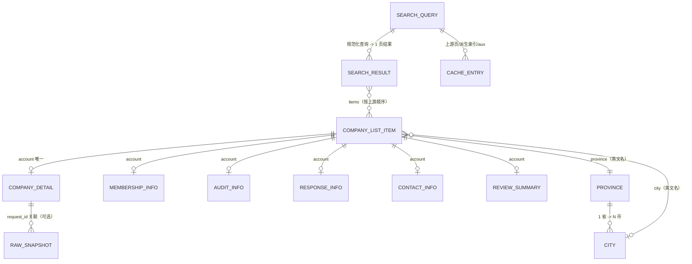
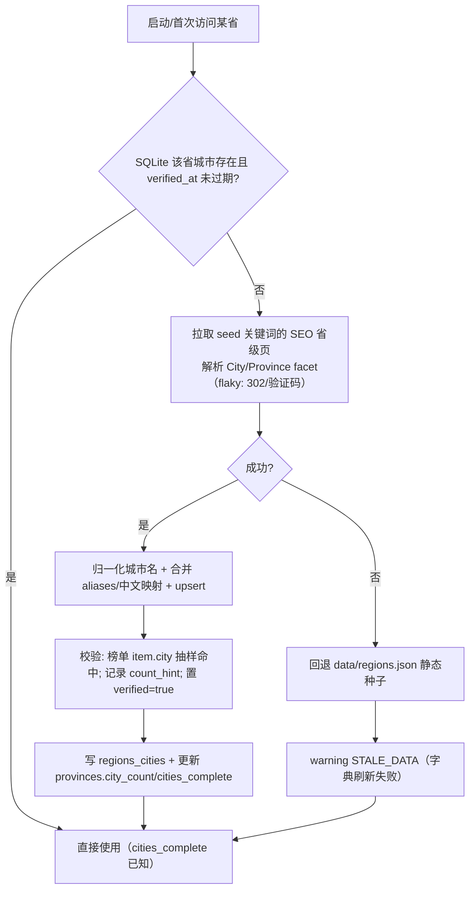

# 05 数据模型与缓存设计

> 版本：0.1 ｜ 状态：Approved（M0 评审通过） ｜ 负责人：membership-researcher ｜ 最后更新：2026-11-15
> 关联：[docs/README.md](README.md)（固定契约）｜[01 需求](01-requirements.md)｜[02 架构](02-architecture.md)｜[03 REST API](03-rest-api.md)（**对外 Schema/枚举/warnings 的权威来源**，本文与之对齐）｜[04 CLI/MCP](04-cli-mcp.md)｜[07 运维](07-operations.md)｜[research/upstream-api.md](research/upstream-api.md)｜[research/anonymous-completeness.md](research/anonymous-completeness.md)｜[research/membership-tiers.md](research/membership-tiers.md)｜[ADR-0001](decisions/0001-json-first-upstream.md)、[0003](decisions/0003-city-client-side-filter.md)、[0005](decisions/0005-membership-tier-enum.md)、[0007](decisions/0007-local-runtime-and-secrets.md)
> 定位：本文定义**内部数据模型 + SQLite 存储 + 缓存键/TTL + 地区字典**；REST 对外字段名/枚举/warnings 以 03 §11、§12.4、§14 为准，本文不另造同义字段。DDL 为可直接执行的 SQLite 脚本，**不包含实现代码**。

---

## 1. 范围、来源与总原则

### 1.1 本文覆盖

| 章节 | 内容 | 对应需求 |
|---|---|---|
| §2 | 数据模型总览（实体关系、数据流、实体↔存储映射） | FR-04/05/06/07/08 |
| §3 | 实体字段规范（与 03 §11 Schema 同名同义）+ 上游字段映射 + 非公开字段 | FR-04/05/06/07 |
| §4 | 规范化与质量规则（去重/地区标准化/availability/evidence/unknown/契约校验） | FR-04/05/06/13 |
| §5 | 地区字典（32 省完整清单、城市字典、生成/校验/TTL/降级） | FR-07、NFR-04 |
| §6 | SQLite 设计（PRAGMA、完整 DDL、迁移、事务、并发、备份清理） | FR-08/15 |
| §7 | 缓存策略（键/params_hash、TTL、refresh、stale、single-flight、统计、raw snapshot） | FR-08、NFR-01/02 |
| §8 | 数据生命周期与隐私 | NFR-03/06 |
| §9 | 附录（字段映射、示例、DDL 执行、待确认点、变更记录） | — |

### 1.2 与 03（对外契约）的关系

- **对外字段名/类型/枚举/warnings**：以 03 §11 Schema、§12.4 码表、§14 对齐要求为准；本文使用**同名同义字段**。
- **类型差异（唯一两处，见 §3.15）**：
  1. `company_id`：REST/JSON 用 **string**（03 §1.3，避免 JS 精度问题）；SQLite 内部用 **INTEGER**（`companies.company_id`），出站时 `String()` 序列化。
  2. 时间：REST 用 ISO8601 `+08:00`；SQLite 内部用 **INTEGER Unix 秒（UTC）**（`fetched_at`/`expires_at`/`created_at` 等），出站时格式化。
- **内部附加列**：SQLite 可存 03 未暴露的辅助列（如 `member_type`、`tier_source`、`raw_item_json`），但**不得**以同义字段名对外输出；03 §13 允许忽略未知字段，扩展列不构成契约变化。
- **上游原字段名**（`csLevel`/`mainUserAccount`/`memberSince` 等）只出现在本文 §3.13/§9.1 的映射表，不出现在 REST。

### 1.3 数据来源边界（事实纪律）

- **只用匿名公开数据**：主链路为 m 站匿名 JSON（`POST /search/supplier`、`GET /company-<account>/info.html` 页内 `ssrData`）与 5 个匿名增强 JSON（SGS 章节/响应率/TM 联系人/评价；TM 在线首期不额外请求），见 [research/upstream-api.md](research/upstream-api.md)。
- **HTML/浏览器是兜底**：桌面 `companysearch.do`、公司站 `contact-info.html`、SEO `company-search` 页仅作字段补充/交叉校验；原始快照策略见 §7.8。
- **免费会员桌面 showroom 兜底（ADR-0009）**：约 60% 免费会员的 `info.html` 会 301 到桌面 showroom（无 `ssrData`）；解析 h1/Address/Account Registered in/Business Type/Main Products/认证体系/会员与 AS 徽章/encodeComId，员工数与成立日期桌面页不公开 → `null` + `availability.not_provided_by_supplier`。批量详情路径见 07 §4.2。
- **电话/邮箱/WhatsApp 等平台不公开**（不是登录墙）：不建模为字段，见 §3.14 与 [research/anonymous-completeness.md](research/anonymous-completeness.md)。
- **未实测不编造**：本文每个字段都对应 `recon/artifacts/api/` 真实样例或 research 的选择器；标注「待验证」的项见 §9.4。

### 1.4 建模原则

1. **主键 `account`**（= `mainUserAccount` 小写比较）；`company_id`（数字 comId）、`encode_com_id` 为唯一附属键（增强接口用）。
2. **列表观测与详情观测分表**：`companies` 存列表面、`company_details` 存详情面；响应按 **详情 > 列表 > 派生** 合并（§4.5），不互相覆盖。
3. **JSON 优先 + 原值保留**：上游原值存 `raw_item_json`/`ssr_raw_json`，规范化为列；不丢证据。
4. **缓存分层**：搜索上游页（20 条/页）与本地派生索引分开缓存；城市/认证过滤是客户端行为（ADR-0003），派生索引 TTL 独立（03 §1.8）。
5. **可解释的未知**：缺失必须区分原因（`availability`）；会员等级拿不准是 `unknown`，不猜。

---

## 2. 数据模型总览

### 2.1 实体关系（Mermaid erDiagram）



> `SEARCH_RESULT` 是逻辑视图（由 `search_page_cache` + `search_indexes` + `companies` 组装）；`COMPANY_LIST_ITEM` 是投影（`companies`）；`CACHE_ENTRY`/`RAW_SNAPSHOT` 为辅助实体。

### 2.2 实体职责表（名称与 03 §11 一致）

| 实体 | 职责 | 主键/唯一键 | 存储位置 | 03 对应 |
|---|---|---|---|---|
| `SearchQuery` | 规范化查询（回显/历史/失效目标） | `query_hash` | SQLite `search_queries` | §11.11 `data.query` |
| `SearchResult` | 一页逻辑结果（query+pagination+items） | 组合（query_hash, page, page_size） | **派生**（组装） | §11.11 |
| `Pagination` | 分页与覆盖度 | — | 派生（部分列存上游页缓存/派生索引） | §11.3 |
| `CompanyListItem` | 列表行投影 | `account` | SQLite `companies` | §11.5 |
| `CompanyDetail` | 详情快照 + 增强容器 | `account`（FK） | SQLite `company_details` + 增强表 | §11.10 |
| `MembershipInfo` | 会员等级判定（tier/raw/since/evidence/confidence） | `account`（FK） | SQLite `membership_info` | §11.4 |
| `AuditInfo` | 认证供应商 + 审核章节 | `account`（FK） | SQLite `audit_info` | §11.6 |
| `ResponseInfo` | 响应率（30 天窗口） | `account`（FK） | SQLite `response_info` | §11.7 |
| `ContactInfo` | 联系人 persons + 联系通道 | `account`（FK） | SQLite `contact_info` | §11.8 |
| `ReviewSummary` | 评分 + 评价摘要 | `account`（FK） | SQLite `review_summary` | §11.9 |
| `RegionProvince` / `RegionCity` | 地区字典 | province `id`；city `(province_id, name_en)` | SQLite `regions_provinces`/`regions_cities` + 仓库 seed | §5 |
| `CacheEntry` | 通用 KV 缓存（refine/联想/地区快照/aux） | `cache_key` | SQLite `cache_entries` | §10 统计口径 |
| `RawSnapshot` | 排障原始响应（脱敏、gzip） | `id` | SQLite `raw_snapshots` + `data/raw/` | 不对外 |

### 2.3 实体 ↔ SQLite 表映射

| 实体/缓存 | SQLite 表 | 说明 |
|---|---|---|
| SearchQuery | `search_queries` | 用户查询规范化结果（用于回显/统计/失效） |
| 搜索上游页缓存 | `search_page_cache` | 1 行 = 上游 `(word,province,filters,page)` 的一页（20 条） |
| 搜索派生索引缓存 | `search_indexes` | 本地过滤（city/audited）扫描结果（account 有序列表），03 §1.8「搜索本地派生索引」 |
| CompanyListItem | `companies` | 列表行投影 + `is_ad` + 列表级 membership/audited/星级 |
| CompanyDetail | `company_details` | 详情面（ssrData + 正文补充），字段见 §3.4 |
| MembershipInfo | `membership_info` | 判定结果 + 证据 + 内部置信度/冲突标记 |
| AuditInfo / ResponseInfo / ContactInfo / ReviewSummary | `audit_info` / `response_info` / `contact_info` / `review_summary` | 四类增强各自 TTL（03 §1.8） |
| Region/Province/City | `regions_provinces` / `regions_cities` | 见 §5；仓库 seed `data/regions.json` |
| CacheEntry（通用） | `cache_entries` | `scope=regions|aux|search(小对象)`、`kind=refine|suggest|region_snapshot|aux_json` |
| 运行期元数据 | `runtime_state` | `last_refresh_at`/`last_vacuum_at`（供 03 §10 `CacheStats`） |
| RawSnapshot | `raw_snapshots` + `data/raw/*.gz` | 默认关闭（07 `raw_snapshot.enabled=false`） |

### 2.4 数据流（JSON 优先）

```mermaid
flowchart LR
    Q[查询参数] --> N[规范化 + params_hash/query_hash]
    N --> C{缓存命中且未过期?}
    C -- 是 --> R[组装 SearchResult]
    C -- 否/refresh --> U[POST m 站 /search/supplier]
    U --> F{风控/结构异常?}
    F -- 302/验证页 --> CAP[验证码流程/降级 03 §1.6]
    F -- 正常 JSON --> P[规范化 dataList]
    P --> W[事务: upsert companies + search_page_cache]
    W --> LF{有 city/audited 本地过滤?}
    LF -- 是 --> SC[带预算扫描上游页 / 写 search_indexes]
    LF -- 否 --> R
    SC --> R
    R --> D[按 account 取详情（03 §8）]
    D --> C2{基础详情缓存未过期?}
    C2 -- 否 --> U2[GET /company-<acc>/info.html → ssrData + 正文]
    U2 --> W2[事务: upsert company_details + membership_info]
    W2 --> E[增强 JSON: audit/response/contacts/reviews（TTL 各自）]
    E --> W3[各自事务 upsert 四张增强表]
    W3 --> OUT[组装 CompanyDetail（详情>列表>派生；availability）]
```



---

## 3. 字段规范

> 约定：类型用 JSON 记法（与 03 §11 一致；`["string","null"]` 表示可空）；「必填」= 响应中 key 必存在（值可为 null）；「来源」= 上游字段 / HTML 选择器 / 增强接口 / 派生；「匿名可得性」：`✅匿名`（主链路可得）、`◐XHR`（需公开 XHR，主链路已纳入）、`⚠️未填`（供应商未填则缺）、`❌不公开`、`⛔未抓`（首期不抓）。null 语义统一见 §4.3。

### 3.1 SearchQuery（`data.query` 的内部模型）

| 字段 | 类型 | 必填 | 来源 | 匿名可得性 | null 语义 | 示例 | 备注 |
|---|---|---|---|---|---|---|---|
| `query_hash` | string | 是 | 派生（§7.2） | — | — | `sha256:9f1c…` | **内部键**（03 不暴露）；不含 page/refresh，含 city/filters/page_size |
| `keyword` | string\|null | 是 | 请求参数 | — | null=地区模式 | `glass` | trim + 空白折叠；CJK 先走地区映射（03 §7.3） |
| `keyword_effective` | string | 是 | 派生 | — | — | `glass` / `langfang` | 实际发上游的 `word`（地区模式为地区词） |
| `province` | string\|null | 是 | 请求参数 + 字典 | — | null=不限省 | `Hebei` | 英文规范名（§5） |
| `province_zh` | string\|null | 是 | 字典派生 | — | null=字典未收录 | `河北` | 展示/回显 |
| `city` | string\|null | 是 | 请求参数 + 字典 | — | null=不限市 | `Langfang` | 英文规范名；**仅本地过滤，不进上游** |
| `city_zh` | string\|null | 是 | 字典派生 | — | null=未收录 | `廊坊` | 展示/回显 |
| `search_mode` | enum<keyword,region,mixed> | 是 | 派生（03 §7.4） | — | — | `region` | — |
| `region_validated` | boolean | 是 | 派生 | — | — | `true` | 地区条件是否严格生效 |
| `filters` | object | 是 | 请求参数 | — | 全 null=无过滤 | 见 §3.1.1 | 规范化枚举值（非上游码） |
| `page` | integer | 是 | 请求参数 | — | — | `1` | 1..100（03 §7.2） |
| `page_size` | integer | 是 | 请求参数 | — | — | `20` | 1..100；上游原生 20，>20 拼接/裁剪（03 §1.7） |
| `refresh` | boolean | 是 | 请求参数 | — | — | `false` | 只影响读缓存行为 |
| `created_at` / `last_used_at` | integer(epoch s) | 是 | 派生 | — | — | `1763217600` | 内部列（DB UTC epoch） |
| `use_count` | integer | 是 | 派生 | — | — | `3` | 内部统计 |

**3.1.1 `filters` 子结构**（与 03 §7.2/§11.11 一致；`audited` 为本地过滤，其余映射上游码见 §4.8）

| 字段 | 类型 | 取值 | 说明 |
|---|---|---|---|
| `category_code` | string\|null | `^[0-9]{6,12}$` | 上游 `catCode` |
| `membership_tier` | string\|null | `diamond`\|`gold`\|null | 上游 `memberLevel=50/30`；**仅 diamond/gold**（03 §7.3-5） |
| `audited` | boolean\|null | true/false/null | **本地过滤**（03 §7.3-6） |
| `management_certification` | string\|null | 上游认证码/字典名 | 映射 `managementCertification` |
| `business_type` | string\|null | manufacturer\|trading_company\|group_corporation\|other | 映射 `comBusinessType` 1/2/4/8 |
| `annual_revenue` | string\|null | 见 §4.8 | 映射 `annualRevenue` 1–7 |
| `rd_capacity` | string\|null | oem\|odm\|quick_response\|fast_delivery\|small_amount_payment | 映射 `rdCapacity` 4/5/01/02/03 |

### 3.2 SearchResult / Pagination（逻辑视图）

**`SearchResult` = `{query, pagination, items[]}`**（03 §11.11）。内部不单独建表；由缓存与索引组装。

**`Pagination`（03 §11.3，逐字段一致）**

| 字段 | 类型 | 必填 | 来源 | 说明 |
|---|---|---|---|---|
| `page` | integer | 是 | 请求回显 | 1..100 |
| `page_size` | integer | 是 | 请求回显 | 1..100 |
| `total` | integer | 是 | 上游 `total` / 本地匹配数 | 2000 封顶时为下界；本地过滤时为已扫描匹配数（03 §7.6） |
| `total_page` | integer | 是 | 派生 `ceil(total/page_size)` | ≥1 |
| `has_more` | boolean | 是 | 派生 | 本地过滤时含 `scan_limited` 规则 |
| `total_capped` | boolean | 是 | 上游 `total>2000` | 对应上游 `totalNum="2,000+"` |
| `total_display` | string | 是 | 派生 | 千分位串或 `"2,000+"` |
| `page_clamped` | boolean | 是 | 派生 | 请求页>末页被夹取（上游行为） |
| `total_is_lower_bound` | boolean | 是 | 派生 | 本地过滤扫描未穷尽时 true |
| （内部）`upstream_pages_scanned` | integer | 是 | 派生 | 本次读取/扫描的上游页数（内部排障，不对外） |
| （内部）`cache_key`/`index_key` | string | 是 | 派生 | 本次命中/写入的缓存键（内部） |

> 上游原始 `total`/`totalNum`/`totalPage`/`page` 保存在 `search_page_cache`（§3.2.1），组装时映射为上述字段；不要直接把 `totalNum` 当对外字段。

**3.2.1 上游页缓存行（内部）**

| 列 | 类型 | 来源 | 说明 |
|---|---|---|---|
| `params_hash` / `cache_key` | TEXT | 派生 | `search:` + sha256（§7.2，不含 city/page_size） |
| `word` / `province` / `filters_json` | TEXT | 请求规范化值 | 用于失效与审计 |
| `page` / `page_size` | INTEGER | 上游页 | page 1..100；page_size 恒 20 |
| `total` / `total_num_raw` / `total_capped` / `total_page` | INTEGER/TEXT/INTEGER/INTEGER | 上游 `total`/`totalNum`/派生/`totalPage` | `total_num_raw` 是上游原文（如 `"2,000+"`），对外映射 `total_display` |
| `item_count` / `payload_json` | INTEGER/TEXT(JSON) | 派生 | `payload_json` 存规范化后的 `CompanyListItem[]`（含广告行，03 §7.5-6） |
| `source` / `result_status` / `warnings_json` | TEXT | 派生 | 枚举同 README |
| `fetched_at` / `expires_at` | INTEGER | 派生 | epoch 秒 |

**3.2.2 派生索引行（内部，`search_indexes`）**

| 列 | 类型 | 说明 |
|---|---|---|
| `index_key` | TEXT PK | `searchidx:` + sha256(上游参数 + 本地过滤条件 + page_size) |
| `upstream_params_hash` | TEXT | 对应上游页哈希（可复用页缓存） |
| `local_filters_json` | TEXT(JSON) | `{"city":"Langfang","audited":null}` |
| `page_size` | INTEGER | 1..100 |
| `total_matched` | INTEGER | 已扫描匹配数（`total` 下界来源） |
| `total_is_lower_bound` | INTEGER | 0/1 |
| `scanned_pages` / `scan_budget` | INTEGER | 扫描页数/预算（03 §7.6 默认 10） |
| `accounts_json` | TEXT(JSON) | 有序 account 列表（去重后），按页切片 |
| `fetched_at` / `expires_at` | INTEGER | TTL 6h |
| `source` / `result_status` / `warnings_json` | TEXT | 枚举同上 |

### 3.3 CompanyListItem（`companies`；03 §11.5）

| 字段（REST） | 内部列 | 类型（REST） | 必填 | 来源 | 匿名可得性 | null 语义 | 示例 |
|---|---|---|---|---|---|---|---|
| `account` | `account` TEXT PK | string | 是 | 上游 `mainUserAccount` | ✅匿名 | — | `xingchenglass` |
| `company_id` | `company_id` **INTEGER** | string | 是 | 上游 `id` | ✅匿名 | — | `"1800987236"` |
| `encode_com_id` | `encode_com_id` | string\|null | 是 | 上游 `encodeComId` | ✅匿名 | null=缺失 | `"UCJfyzwThnqK"` |
| `company_name` | `company_name` | string | 是 | 上游 `name` trim | ✅匿名 | — | `Hebei Xingchen Glass Technology Co., Ltd.` |
| `province` | `province` TEXT | string\|null | 是 | 上游 `province` + 字典校验 | ✅匿名 | null=未知 | `Hebei` |
| `city` | `city` TEXT | string\|null | 是 | 上游 `city` + 字典校验 | ✅匿名 | null=未知 | `Langfang` |
| `country` | `country` | string\|null | 是 | 上游 `country` | ✅匿名 | null=未知 | `China` |
| `main_products` | `main_products_json` + `main_product_text`(内部) | string[] | 是 | 上游 `mainProduct` 逗号切分 + trim | ✅匿名 | `[]`=未填 | `["Glass Cup","French Press"]` |
| `business_types` | `business_types_json` | string[] | 是 | 上游 `businessTypeList`；详情优先 | ✅匿名 | `[]` | `["Manufacturer/Factory & Trading Company"]` |
| `membership` | 见 §3.5（`membership_info`） | object | 是 | `csLevel`/`memberType` 判定 | ✅匿名 | 无证据→tier=unknown | `{"tier":"diamond",…}` |
| `audited` | `audited` INTEGER(0/1/NULL) | boolean\|null | 是 | 上游 `auditType`+`showAuditLogo`；详情 `sgsMember` 优先（§4.10） | ✅匿名 | null=缺失/冲突 | `true` |
| `capability_stars` | `capability_stars` INTEGER | integer\|null | 是 | 上游 `companySymbol.stars`→int | ✅匿名 | null=无字段；0=有指数且 0 星（§4.9） | `2` |
| `system_certifications` | `system_certifications_json` | string[] | 是 | 上游 `systemCertificationList`；详情 HTML 优先/合并 | ✅匿名 | `[]` | `["ISO 9001","BSCI"]` |
| `employees` | `employees` INTEGER | integer\|null | 是 | 列表 `comEmployee`（多为 null）；CompanyDetail 中由详情正文补全 | ⚠️未填 | null=未填 | `null` |
| `turnover` | `turnover` TEXT | string\|null | 是 | 上游 `comTurnOver`（`""`→null） | ⚠️未填/⛔未抓 | null=未填 | `null` |
| `plant_area` | `plant_area` TEXT | string\|null | 是 | 上游 `comPlantArea`（`""`→null） | ⚠️未填/⛔未抓 | null=未填 | `null` |
| `company_url` | `company_url` | string\|null | 是 | 上游 `companyUrl`（m 站首页） | ✅匿名 | null=缺失 | `https://m.made-in-china.com/company-xingchenglass/` |
| `company_info_url` | `company_info_url` | string\|null | 是 | 上游 `companyInfoUrl` | ✅匿名 | null=缺失 | `…/info.html` |
| `detail_source` | `last_source` | enum<json,html,browser,cache> | 是 | 派生（本条列表观测通道） | — | — | `json` |
| `is_ad` | `is_ad` INTEGER | boolean | 是 | 上游 `showAd`/`ad`/`advertise`（§4.11） | ✅匿名 | — | `false` |

**内部附加列（03 未暴露，仅存储/排障）**：`province_zh`、`city_zh`、`com_ownership`、`production_lines`、`rd_capacity_json`、`quick_response`、`fast_delivery`、`leading_factory`、`minisite_url`、`traffic_url`、`ad_id`、`first_seen_at`、`last_seen_at`、`last_request_id`、`raw_item_json`。如 03 后续 Schema 扩展这些字段，按 03 新版本输出。

### 3.4 CompanyDetail（`company_details` + 增强表；03 §11.10）

`CompanyDetail` = `CompanyListItem` 全部字段（**除 `is_ad`**）+ 下列字段。

| 字段（REST） | 内部列 | 类型 | 必填 | 来源 | 匿名可得性 | null 语义 | 示例 |
|---|---|---|---|---|---|---|---|
| `address` | `address` | string\|null | 是 | 详情 HTML `Address:`（移动正文/桌面 showroom） | ✅匿名（HTML） | null=未填 | `100 meters north of …` |
| `established_at` | `established_at` | string(YYYY-MM-DD)\|null | 是 | 上游 `ssrData.companyInfo.content.establishment` | ✅匿名 | null=未填（空串归一） | `2015-10-30` |
| `main_products` | `main_products_json` | string[] | 是 | 详情 `mainProducts`（详情优先于列表） | ✅匿名 | `[]` | `["Glass Cup",…]` |
| `business_types` | `business_types_json` | string[] | 是 | 详情 `businessTypes`（优先）→ 列表 | ✅匿名 | `[]` | `["Manufacturer/Factory & Trading Company"]` |
| `system_certifications` | `system_certifications_json` | string[] | 是 | 详情 HTML `Management System Certification` → 列表合并去重 | ✅匿名（HTML） | `[]` | `["ISO 9001","BSCI"]` |
| `employees` | `employees` | integer\|null | 是 | 详情 HTML `Number of Employees:` | ✅匿名（HTML） | null=未填/解析失败 | `21` |
| `membership` | §3.5 | object | 是 | `memberLevel`/`memberSince`/`csLevel` | ✅匿名 | tier=unknown 兜底 | 见 §3.5 |
| `audited` | 见 §3.6（`audit_info`/`companies`） | boolean\|null | 是 | `ssrData.sgsMember` 优先 | ✅匿名 | null=缺失/冲突 | `true` |
| `capability_stars` | `capability_stars` | integer\|null | 是 | `ssrData.companySymbol.stars`→int / 列表兜底 | ✅匿名 | null=缺失 | `2` |
| `turnover` / `plant_area` | 见 companies | string\|null | 是 | 列表字段（详情无） | ⚠️未填/⛔未抓 | null | `null` |
| `company_url` / `company_info_url` | 见 companies | string\|null | 是 | 列表字段 | ✅匿名 | null | 同列表 |
| `detail_source` | details.`source` | enum | 是 | 基础详情通道 | — | — | `json` |
| `include` | 由请求派生（不存库） | string[] | 是 | 请求回显（排序固定 audit,response,contacts,reviews） | — | `[]`（none） | `["audit","response"]` |
| `enrichment` | 四张增强表组装 | object | 是 | `{audit,response,contacts,reviews}`；未请求/失败=null | — | 见 §4.3 | 见附录 B |
| `availability` | `availability_json` | array[{field,reason}] | 是 | 派生 | — | `[]`=无缺失 | `[{"field":"turnover","reason":"not_provided_by_supplier"}]` |

**内部附加列**：`address_city`/`address_province`（地址解析派生）、`employee_text`、`management_certifications_json`（详情 HTML 原文切分，和 `system_certifications_json` 合并前）、`field_sources_json`（字段级溯源）、`ssr_raw_json`（ssrData 原文，可选）、`warnings_json`、`last_request_id`。

### 3.5 MembershipInfo（`membership_info`；03 §11.4）

| 字段（REST） | 内部列 | 类型 | 必填 | 来源 | 匿名可得性 | null 语义 | 示例 |
|---|---|---|---|---|---|---|---|
| `tier` | `tier` | enum<diamond,gold,free,unknown> | 是 | 判定（§4.5） | — | 无法判定→unknown | `diamond` |
| `raw_cs_level` | `raw_cs_level` | integer\|null | 是 | 上游列表 `csLevel` | ✅匿名 | null=无（免费/未知） | `50` |
| `raw_member_level` | `raw_member_level` | string\|null（diamond/gold/null） | 是 | 上游详情 `memberLevel` | ✅匿名 | null=未抓/免费 | `"diamond"` |
| `since_year` | `since_year` | integer(1999–2100)\|null | 是 | 上游详情 `memberSince`（仅详情） | ✅匿名 | null=未抓/免费 | `2025` |
| `evidence` | `evidence_json` | string[] | 是 | 判定过程 | — | `[]` | `["json:csLevel=50","json:memberLevel=diamond"]` |
| `confidence` | `confidence` | enum<high,medium,low> | 是 | 判定（§4.4） | — | — | `high` |
| （内部）`member_type` | `member_type` | integer\|null | — | 上游 `memberType`（10=Diamond/1=Gold 辅助校验） | ✅匿名 | null | `10` |
| （内部）`is_diamond_member` | `is_diamond_member` | boolean\|null | — | 上游顶层 `isDiamondMember` | ✅匿名 | null | `true` |
| （内部）`tier_source` | `tier_source` | enum<detail_ssr,list_json,pc_badge,derived,none> | — | 判定 | — | — | `detail_ssr` |
| （内部）`has_conflict` | `has_conflict` | boolean | — | 列表/详情冲突 | — | — | `false` |
| （内部）`external_customer_tier` | `external_customer_tier` | string\|null | — | **外部数据**（CRM/销售） | ❌不可抓 | null=未知 | `null` |
| （内部）`updated_at` | `updated_at` | integer | — | 派生 | — | — | epoch |

> `membership` **不含** `audited`/`capability_stars`（03 §11.4 明确正交字段放顶层），避免同义双写。
> `external_customer_tier` 仅内部预留（KA/SKA/优享/尊享/MKA 等外部口径），**抓取阶段恒 null**、不对外输出（ADR-0005）。

### 3.6 AuditInfo（`audit_info`；03 §11.6）

| 字段（REST `enrichment.audit`） | 内部列 | 类型 | 必填 | 来源 | 匿名可得性 | null 语义 | 示例 |
|---|---|---|---|---|---|---|---|
| `audited` | `audited` | boolean | 是 | 详情 `sgsMember` / 列表 `auditType`+`showAuditLogo` | ✅匿名 | — | `true` |
| `sections` | `sections_json` | array[{name,audited}] | 是 | 增强 `multi-search/sgs/report`（9 章节） | ✅匿名（增强） | `[]`=未取/未认证 | `[{"name":"General Information","audited":true}]` |
| `audited_section_count` | `audited_section_count` | integer(0–9) | 是 | 派生 | — | — | `5` |
| `agency` | `agency` | string\|null | 是 | 桌面 About `.about-tip` | ⛔未抓（首期） | null=未抓 | `null` |
| `report_no` | `report_no` | string\|null | 是 | 桌面 About `.sgs-serail-wrap` | ⛔未抓（首期） | null=未抓 | `null` |
| `verify_url` | `verify_url` | string\|null | 是 | 桌面 About 外链 | ⛔未抓（首期） | null=未抓 | `null` |
| `verified_items_count` | `verified_items_count` | integer\|null | 是 | 桌面 About `.sr-as-status` | ⛔未抓（首期） | null=未抓 | `null` |
| `source` / `fetched_at` | `source`/`fetched_at` | enum/ISO | 是 | 派生 | — | — | `json`/… |
| （内部）`evidence_json` / `expires_at` / `result_status` / `warnings_json` | 同左 | — | — | 派生 | — | — | — |

> 首期 `agency/report_no/verify_url/verified_items_count` 恒 `null`（03 §8.4：PC About 兜底通道未启用，标「待验证」）；启用后仅补这 4 字段，`sections` 仍来自 SGS JSON，两套来源不互相替代。

### 3.7 ResponseInfo（`response_info`；03 §11.7）

| 字段（REST `enrichment.response`） | 内部列 | 类型 | 必填 | 来源 | 匿名可得性 | null 语义 | 示例 |
|---|---|---|---|---|---|---|---|
| `avg_response_hours` | `avg_response_hours` | number\|null | 是 | 上游 `l30BusiReplyDurAvg` | ✅匿名（增强） | null=无数据 | `8.54` |
| `timely_reply_ratio` | `timely_reply_ratio` | number(0–1)\|null | 是 | `l30BusiIntimeReplyRatio` | ✅匿名（增强） | null=无数据 | `0.7949` |
| `top_avg_response_hours` | `top_avg_response_hours` | number\|null | 是 | `l30TopReplyDurAvg` | ✅匿名（增强） | null=无数据 | `null` |
| `top_timely_reply_ratio` | `top_timely_reply_ratio` | number\|null | 是 | `l30TopIntimeReplyRatio` | ✅匿名（增强） | null=无数据 | `null` |
| `range_display` | `range_display` | string\|null | 是 | `l30BusiReplyDurAvgRange` | ✅匿名（增强） | null=无 | `≤8.54h` |
| `window_days` | `window_days` | integer（固定 30） | 是 | 派生 | — | — | `30` |
| `as_of` | `as_of` | string `YYYYMMDD` | 是 | 请求 `date`（今天-2天） | — | — | `20261113` |
| `source` / `fetched_at` | `source`/`fetched_at` | enum/ISO | 是 | 派生 | — | — | `json`/… |
| （内部）`availability_reason` / `expires_at` / `result_status` | 同左 | — | — | 派生 | — | `not_provided_by_supplier`（供应商无响应数据） | — |

### 3.8 ContactInfo（`contact_info`；03 §11.8）

| 字段（REST `enrichment.contacts`） | 内部列 | 类型 | 必填 | 来源 | 匿名可得性 | null 语义 | 示例 |
|---|---|---|---|---|---|---|---|
| `persons` | `persons_json` | array[{name,id,title,department,online,chat_available}] | 是 | 增强 `im.do?xcase=getSubAccount`；`title/department` 首期不抓（null） | ◐XHR | `[]`=无 | `[{"name":"cindy","id":"UCJfyzwThnqK_00","title":null,"department":null,"online":null,"chat_available":true}]` |
| `primary` | `primary_json` | object\|null | 是 | 公司站 contact HTML（首期不抓） | ⛔未抓（首期） | null=未抓 | `null` |
| `channels` | `channels_json` | object | 是 | 派生（固定值） | ❌不公开 | 五通道恒 null + `reason=not_public_by_platform` | `{"phone":null,…,"reason":"not_public_by_platform"}` |
| `inquiry_url` | `inquiry_url` | string\|null | 是 | 列表/详情 HTML（稳定性待验证） | ⚠️待验证 | null=缺失 | `null` |
| `source` / `fetched_at` | `source`/`fetched_at` | enum/ISO | 是 | 派生 | — | — | `json`/… |
| （内部）`expires_at` / `result_status` / `warnings_json` | 同左 | — | — | 派生 | — | — | — |

> **禁止**把 `channels.*` 设计成「登录后可见」：平台不公开（research §2.2/§6.1）。`persons[].chat_available=true` 仅表示有 TM 子账号 id，不代表在线。

### 3.9 ReviewSummary（`review_summary`；03 §11.9）

| 字段（REST `enrichment.reviews`） | 内部列 | 类型 | 必填 | 来源 | 匿名可得性 | null 语义 | 示例 |
|---|---|---|---|---|---|---|---|
| `rating_value` | `rating_value` | number(0–5)\|null | 是 | 详情 `reviewStatistics.rating` 解析 | ✅匿名 | null=无评论 | `4.9` |
| `rating_display` | `rating_display` | string\|null | 是 | 上游 `"4.9/5"` | ✅匿名 | null=无评论 | `4.9/5` |
| `review_count` | `review_count` | integer\|null | 是 | 增强 `content.totalCount` | ◐XHR | null=未取/无评论 | `24` |
| `items` | `items_json` | array（≤10 条） | 是 | 增强 `reviewSearchItemVOList` | ◐XHR | `[]`=无 | 见附录 B |
| `source` / `fetched_at` | `source`/`fetched_at` | enum/ISO | 是 | 派生 | — | — | `json`/… |
| （内部）`availability_reason` / `expires_at` / `result_status` | 同左 | — | — | 派生 | — | `no_reviews` | — |

> `items[].sender_name` 为平台打码值（如 `A***r`），`sender_country` 为公开评价国家；**不存**评价人身份/IP/账号（§8.4）。

### 3.10 RegionProvince / RegionCity（`regions_*`；03 §5 响应字段）

**Province**

| 字段（REST `provinces[]`） | 内部列 | 类型 | 必填 | 来源 | 说明 |
|---|---|---|---|---|---|
| `name` | `name_en` | string | 是 | 上游 facet label（m 站 refine / SEO 面板） | 展示名，也是 `province` 参数规范值（特殊 3 项除外） |
| `name_zh` | `name_zh` | string | 是 | **本地映射**（seed 人工维护） | 中文展示/输入识别 |
| `city_count` | `city_count` | integer\|null | 是 | 派生（`regions_cities` 计数） | 未知 null |
| `cities_complete` | `cities_complete` | boolean | 是 | 派生/seed | false 时城市参数按「透传 + 本地过滤 + warning」处理（03 §7.3） |
| `source` | `source` | enum<refine,seo_facet,static> | 是 | 派生 | 字典来源 |
| `verified_at` | `verified_at` | ISO8601 | 是 | 派生 | 生成/校验时间 |
| （内部）`api_value` | `api_value` | string | — | 上游 facet `value` | **m 站 `province` 参数值**（特殊项与展示名不同，§5.2） |
| （内部）`com_province_value` | `com_province_value` | string\|null | — | 桌面 `comProvince` | 仅桌面兜底；部分待验证 |
| （内部）`seo_code` / `in_mobile_facet` / `in_seo_facet` / `sort_order` | 同左 | — | — | 派生 | 生成/校验用 |

**City**

| 字段（REST `cities[]`） | 内部列 | 类型 | 必填 | 来源 | 说明 |
|---|---|---|---|---|---|
| `name` | `name_en` | string | 是 | SEO 城市 facet（`CC_<Prov>_<City>`） | 与列表 `item.city` 对齐，也是 `city` 参数规范值 |
| `name_zh` | `name_zh` | string | 是 | seed/本地映射 | 中文输入识别 |
| `province` | 由 `province_id` JOIN 得到 | string | 是 | 派生 | 所属省英文名 |
| `source` | `source` | enum<seo_facet,static,derive> | 是 | 派生 | — |
| `verified` | `verified` | boolean | 是 | 派生 | 是否实测核验（河北 11 城 true） |
| `count_hint` | `count_hint` | integer\|null | 是 | SEO facet count（seed 关键词下） | 仅热度参考 |
| （内部）`seo_code` / `aliases_json` / `verified_at` | 同左 | — | — | 派生/seed | 校验/别名 |

### 3.11 CacheEntry（`cache_entries`，内部）

| 字段 | 类型 | 必填 | 来源 | null 语义 | 示例 | 备注 |
|---|---|---|---|---|---|---|
| `cache_key` | string | 是 | 派生（§7.1） | — | `aux:refine:sha256:ab12…` | 主键 |
| `scope` | enum<search,detail,enrich,regions,aux> | 是 | 派生 | — | `aux` | 搜索/详情/增强的实体缓存不用本表存 payload（§2.3） |
| `kind` | string | 是 | 派生 | — | `refine`/`suggest`/`region_snapshot`/`aux_json` | — |
| `params_json` | string(JSON) | 是 | 派生 | `{}` | `{"word":"glass","province":"Hebei"}` | 参数快照 |
| `payload_json` | string\|null | 是 | 上游响应（规范化/原文截取） | null=占位 | — | >64KB 建议 `gzip-base64` |
| `payload_encoding` | enum<identity,gzip-base64> | 是 | 派生 | — | `identity` | — |
| `source` / `result_status` | enum | 是 | 派生 | — | `json`/`success` | 同 README |
| `fetched_at` / `expires_at` | integer | 是 | 派生 | — | epoch | TTL 见 §7.3 |
| `size_bytes` / `hit_count` / `last_accessed_at` | integer | 是 | 派生 | — | `2048`/`3`/epoch | 统计/淘汰 |
| `warnings_json` | string(JSON) | 是 | 派生 | `[]` | — | — |

### 3.12 RawSnapshot（`raw_snapshots`，内部，可选）

| 字段 | 类型 | 必填 | 来源 | null 语义 | 示例 | 备注 |
|---|---|---|---|---|---|---|
| `id` / `request_id` | integer / string | 是 | 自增/派生 | — | `42`/`req_01H…` | 与日志关联 |
| `url` / `method` / `http_status` / `content_type` | string | 是/可空 | 上游请求/响应 | null=网络失败/未知 | `https://m.made-in-china.com/search/supplier` | query 脱敏（§8.3） |
| `request_meta_json` | string(JSON) | 是 | 脱敏请求信息 | `{}` | `{"word":"glass","page":1}` | 不含 Cookie/Authorization |
| `response_sha256` / `body_path` / `body_bytes` / `body_encoding` | string/integer/enum | 是 | 派生 | — | `data/raw/20261115/…json.gz` | gzip 文件 |
| `purpose` | enum<debug,parse_error,upstream_changed,captcha> | 是 | 派生 | — | `parse_error` | 触发原因 |
| `error_code` | string\|null | 是 | 派生 | null=无 | `PARSE_ERROR` | 引用 README 错误码 |
| `created_at` | integer | 是 | 派生 | — | epoch | 保留期 §7.8 |

### 3.13 上游字段 → 本地字段映射（核心必查项）

> 完整 CSV 见 §9.1；03 §15 为对外映射表的最终版本，本文确保存储侧与其一致。

| 上游来源 | 上游字段/路径 | 本地/对外字段 | 转换规则 | 匿名可得性 |
|---|---|---|---|---|
| 列表 JSON | `mainUserAccount` | `account` | 小写/trim；主键 | ✅匿名 |
| 列表 JSON | `id` | `company_id` | INTEGER 存储 → string 输出 | ✅匿名 |
| 列表 JSON | `encodeComId` | `encode_com_id` | 原样 | ✅匿名 |
| 列表 JSON | `name` | `company_name` | trim | ✅匿名 |
| 列表 JSON | `csLevel` | `membership.raw_cs_level` → `tier` | 50→diamond、30→gold、其他/空→unknown（不猜 free） | ✅匿名 |
| 列表 JSON | `memberType` | `membership_info.member_type`（内部） | 10/1 辅助校验 | ✅匿名 |
| 列表 JSON | `auditType` / `showAuditLogo` | `audited` | 规则 §4.10（冲突→null） | ✅匿名 |
| 列表 JSON | `province` / `city` / `country` | `province`/`city`/`country` | 原样 + 字典校验（中文名派生内部列） | ✅匿名 |
| 列表 JSON | `mainProduct` | `main_products[]` | 逗号切分 + trim | ✅匿名 |
| 列表 JSON | `businessTypeList` | `business_types[]` | 原样 | ✅匿名 |
| 列表 JSON | `systemCertificationList` | `system_certifications[]` | 原样 | ✅匿名 |
| 列表 JSON | `comEmployee` / `employee` | `employees` | 列表多 null；详情正文补 | ⚠️未填 |
| 列表 JSON | `comTurnOver` | `turnover` | 空串→null | ⚠️未填 |
| 列表 JSON | `comPlantArea` | `plant_area` | 空串→null | ⚠️未填 |
| 列表 JSON | `companySymbol.stars` → int | `capability_stars` | 规则 §4.9 | ✅匿名 |
| 列表 JSON | `showAd` / `ad` / `advertise` / `deliveryType` / `adsId` | `is_ad` | 规则 §4.11；保留原始标志 | ✅匿名 |
| 列表 JSON | `companyUrl` / `companyInfoUrl` | `company_url` / `company_info_url` | 原样 | ✅匿名 |
| 列表 JSON | `productReduce[]` | 内部 `products_json`（首期不对外） | 截取 id/name/url/image/price_num/min_order | ✅匿名 |
| 列表 JSON | `leadingFactory` / `quickResponse` / `fastDelivery` / `rdCapacityList` / `productionLinesNumbers` / `comOwnerShip` | 内部附加列（首期不对外） | 原样 | ✅匿名 |
| 详情 ssrData | `logUsername` | `account` 校验 | 与请求/列表比对 | ✅匿名 |
| 详情 ssrData | `comId`（顶层数字） | `company_id` 校验 | 与列表 id 交叉校验 | ✅匿名 |
| 详情 ssrData | `companyInfo.content.comId`（加密） | `encode_com_id` | 与列表 encodeComId 交叉校验 | ✅匿名 |
| 详情 ssrData | `memberLevel` | `membership.raw_member_level` → `tier` | diamond/gold；其他→unknown | ✅匿名 |
| 详情 ssrData | `memberSince` | `membership.since_year` | `"2025"`→2025 | ✅匿名 |
| 详情 ssrData | `isDiamondMember` | 内部 `is_diamond_member` | bool | ✅匿名 |
| 详情 ssrData | `establishment` | `established_at` | 空串→null；YYYY-MM-DD | ✅匿名 |
| 详情 ssrData | `mainProducts[]` / `businessTypes[]` | `main_products` / `business_types`（详情优先） | trim | ✅匿名 |
| 详情 ssrData | `sgsMember` / `auditReportLogo.*` | `audited` / `audit_info` 内部 | bool/原样 | ✅匿名 |
| 详情 ssrData | `reviewStatistics.rating` / `reviewListUrl` | `reviews.rating_value/rating_display` | 解析 + 原样 | ✅匿名 |
| 详情 ssrData | `companySymbol.stars` | `capability_stars`（交叉校验） | int | ✅匿名 |
| 详情 ssrData | `onlineTradeAble` / `om` / `rd[]` | 内部附加列 | — | ✅匿名 |
| 详情 ssrData | `leadingFactory`（字符串 `"false"`） | 内部附加列 | 字符串→bool（类型不一致需兼容） | ✅匿名 |
| 详情 HTML 正文 | `Number of Employees:` / `Address:` / `Management System Certification:` | `employees` / `address` / `system_certifications`（详情优先） | label:value 解析；管理认证切分 | ✅匿名（HTML） |
| 详情 HTML | `.contact-customer-info` / `.info-item` | `contacts.primary`（首期不抓） | 有则取 | ⛔未抓（首期） |
| 增强 JSON | `sgs/report.data[].content/audit` | `audit.sections[]` | `{name,audited}` | ✅匿名（增强） |
| 增强 JSON | `replyRate.data[0].l30*` | `response.*` | 字段直映（§3.7） | ✅匿名（增强） |
| 增强 JSON | `getSubAccount` | `contacts.persons[]` | `{name,id}`；title/department null | ◐XHR |
| 增强 JSON | `user/review/front/next` | `reviews.*` | 聚合 + ≤10 条摘要 | ◐XHR |
| 桌面兜底 | About `.about-tip` / `.sgs-serail-wrap` / `.sr-as-status` | `audit.agency/report_no/verify_url/verified_items_count` | 首期不抓，恒 null | ⛔未抓（首期） |

### 3.14 非公开 / 不建模字段清单

| 字段 | 结论 | 原因 | 客户端处理 |
|---|---|---|---|
| 供应商电话 `phone` / 邮箱 `email` / WhatsApp / Skype / 微信 | ❌ 不建模 | **平台不公开**（不是登录墙；20 页 × 多通道 0 命中） | `contacts.channels` 恒 null + `reason="not_public_by_platform"`（03 §11.8） |
| 营业执照注册号/执照图 | ❌ 不建模 | 仅 "verified business licenses" 文案 | 不建字段 |
| 审核报告全文 / PDF / 明细 | ❌ 不建模 | `report.html` 301→About；`auditReport.do?xcase=viewReportDetail` 需登录 | 只存 sections/编号（首期编号不抓）；03 §8.4 |
| 站内信 / 询盘篮 / 收藏 / 订单 / 交易 GMV | 🔒 不涉及 | 需登录、买家私有数据，超出范围 | 不建模 |
| 登录后才有的公司字段 | ⚠️ 未验证 | 无账号；匿名页面无 "Sign in to view 联系方式" 门禁 | 不设计「登录解锁」路径（03 OQ-01） |
| KA / SKA / GSKA / 优享 / 尊享 / MKA | ⚠️ 不可抓 | 阿里口径 / MIC 大客户内部口径，公网页面无标识 | 不进入 `tier`；仅内部 `external_customer_tier` 预留（§3.5） |

### 3.15 内部列 ↔ REST 字段类型映射（仅两处差异）

| 项 | 内部（SQLite/模型） | REST（03 §11） | 转换点 |
|---|---|---|---|
| `company_id` | INTEGER（上游数字 comId） | string（`^[0-9]+$`） | 出站序列化 `String()`；入站查找时按 03 §8.2 顺序解析 |
| 时间戳（`fetched_at`/`expires_at`/`created_at`/`updated_at`/`verified_at`） | INTEGER Unix 秒（UTC） | string ISO8601 `+08:00`（`format: date-time`） | 出站格式化 `Asia/Shanghai`；入站按 epoch 存储 |
| `evidence` | TEXT(JSON) 存 string[] | string[] | 直接透传（元素格式 `<source>:<field>=<value>`，§4.4） |
| `availability` | TEXT(JSON) 存 array[{field,reason}] | array[{field,reason}] | 直接透传（§4.3） |
| 其余字段 | 列名与 REST 同名（snake_case） | 同名 | — |

---

## 4. 规范化与质量规则

### 4.1 身份、去重、广告与分页

1. **主键**：`account = mainUserAccount.trim()`（保持上游大小写；匹配时小写比较，03 §8.2）。公司名不参与主键。
2. **唯一约束**：`account` 唯一；`company_id`、`encode_com_id` 建 partial unique index（允许多个 null）。
3. **跨页/跨查询去重**：以 `account` 合并（缺省回退 `company_id`），保留首次出现顺序；拼接窗口/本地扫描去重时 03 要求 `warning DUPLICATES_REMOVED`。
4. **翻页夹取**：上游 `page > total_page` 返回末页内容；组装时 `page_clamped=true`，扫描时按 `total_page` 截断防重复。
5. **广告位**：上游 `ad/showAd/advertise=true` 条目**保留**并置 `is_ad=true`（03 §7.5-6），首期**不自动过滤**，保证与上游分页 1:1；CLI 人类可读输出可过滤（04 定义）。
6. **page_size（1..100）**：上游每页固定 20 条（传 pageSize=100 仍返回 20 条且 totalPage 按 100 计算）。数据层**只缓存原生 20 条上游页**，对外 `page_size` 由组装层按 03 §1.7 拼接/裁剪：
   - `page_size=20`：1:1；
   - `page_size` 为 20 倍数：连续上游页拼接；
   - 其他：覆盖窗口 `[(page-1)*page_size, page*page_size)` 后裁剪；
   - 发生拼接/裁剪时由 03 加 `PAGE_SIZE_NOT_NATIVE` warning。
7. **page 范围**：1..100；>100 由 03 校验拒绝（`OUT_OF_RANGE`）。
8. **空结果也缓存**：total=0 的上游页写入缓存（TTL 见 §7.3），避免反复请求。
9. **公司 lookup 顺序**（03 §8.2）：`account` > 纯数字 `comId`（上游 `/company/<comId>` 301 反查）> `encodeComId`（**只查本地索引**）；`encodeComId` 未索引 → 404 `ENCODE_COM_ID_NOT_INDEXED`，本地索引来自 `companies.encode_com_id`（唯一索引支持）。

### 4.2 地区标准化与 region 模式

1. **省**：中文/别名/英文 → 字典 `api_value` 调上游（m 站 `province`）；列表行 `province` 再做字典校验，未识别保留原文（内部记录）。
2. **市**：字典 `name_en`；上游无 city 参数 → 客户端过滤 `item.city`（大小写/空白归一，支持 `aliases`；ADR-0003）。
3. **region 关键词模式**（ADR-0004 / 03 §7.4）：`search_mode ∈ {keyword,region,mixed}`，`region_validated` 标记地区是否严格生效：
   - 仅 province → `word=<省英文>` + `province=<api_value>`（服务端严格）；
   - 仅 city → `word=<市英文>` + `province=<推导省>`；
   - province+city → `word=<市英文>` + `province`；
   - keyword+地区 → `mixed`，`word=keyword`。
4. **后置校验去噪**：地区词是「关键词命中」不是严格地区枚举（实测 `langfang` 首位 27/30，其余为噪声）。规则：
   - 有 province：丢弃 `item.province != province` 的行；
   - 有 city：仅保留 `item.city == city`（或别名命中）；
   - 过滤由派生索引记录，被丢弃条数记入 03 的 `CITY_FILTERED_LOCALLY.details`（不新增 warning 码）。
5. **中文词**：上游英文站中文关键词 = 0；先走地区字典映射（03 §7.3-1），未命中产品中文 → 03 返回 `NON_ENGLISH_KEYWORD`。
6. **地址辅助校验**（详情）：`address` 尾部解析城市/省（内部列）与列表值交叉校验；不一致仅记录内部 evidence，不覆盖对外值。

### 4.3 缺失语义与 `availability`（03 §8.6）

- **只在详情**输出 `availability: [{field, reason}]`（列表项无该字段）。
- **含义**：`availability` 只列「**已尝试解析且确认缺失**」的字段；未请求的增强（`include` 不含）不进入 availability（用 `include` 回显判断）。
- **reason 枚举**（固定 5 值，README/03 §1.5）：`not_provided_by_supplier`｜`not_public_by_platform`｜`no_reviews`｜`fetch_blocked`｜`needs_login`。
- **存储**：`company_details.availability_json` 存同一数组；由组装层生成。

| 场景 | reason | 说明 |
|---|---|---|
| 供应商没填（turnover/plant_area/employees/established_at…） | `not_provided_by_supplier` | 不是隐藏/登录问题 |
| 电话/邮箱/IM/执照/审核全文 | `not_public_by_platform` | 任何匿名途径都没有 |
| 无评论导致评分缺失 | `no_reviews` | 不是 fetch_blocked |
| 增强请求了但被抓取拦截/失败 | `fetch_blocked` | 同时 `enrichment.X=null` + `ENRICHMENT_PARTIAL` |
| 登录后可见字段（当前无此类公开字段） | `needs_login` | **保留值，不用于公司公开字段**（03 §8.6-6） |
| 首期未抓的增强源字段（agency/report_no 等） | **不填 reason**（null） | 未请求/未抓，由 03 `include` + `enrichment` 语义表达；不要伪装成平台不公开 |

### 4.4 evidence 与置信度

- **evidence 元素格式**（03 §11.4）：`<source>:<field>=<value>` 或 `<source>:<page_type>`，如
  `"json:csLevel=50"`、`"json:memberLevel=diamond"`、`"html:badge=Diamond Member"`、`"html:since=2025"`。
- **保留**：`membership_info.evidence_json`（对外 `membership.evidence`）+ `companies.raw_item_json`（列表原始 item）+ `company_details.ssr_raw_json`（可选）。
- **置信度规则**：

  | 场景 | confidence |
  |---|---|
  | 详情 `memberLevel` 命中 diamond/gold（与列表一致或列表缺失） | high |
  | 仅列表 `csLevel` 50/30（结构化字段） | high |
  | 列表/详情冲突（以详情为准） | medium（内部 `has_conflict=true`，evidence 保留双源） |
  | 仅 PC 徽章/文案 | medium |
  | 无任何证据 → unknown | low |

- **audited 证据**：详情 `sgsMember`/`auditReportLogo` → high；列表 `auditType`+`showAuditLogo` → high；冲突 → null + 内部 evidence（§4.10）。

### 4.5 会员等级判定（对齐 ADR-0005 与 03 §8.8）

```text
输入：列表项 L(csLevel/memberType)、详情 D(memberLevel/memberSince/isDiamondMember)、可选 PC 徽章 P
1) D.memberLevel ∈ {diamond,gold}          → tier = D.memberLevel；tier_source=detail_ssr；confidence=high
2) else L.csLevel == 50                     → tier = diamond；tier_source=list_json；confidence=high
3) else L.csLevel == 30                     → tier = gold；tier_source=list_json；confidence=high
4) else P 命中 Diamond/Gold 文案/图标        → tier = 对应值；tier_source=pc_badge；confidence=medium
5) else                                     → tier = unknown；tier_source=none；confidence=low
free（保守）：页面完整加载 且 无会员徽章 且 无 AS 且 无 member-since → tier=free，confidence=medium；
             否则 unknown（抓取失败不得写 free）。
冲突：D 与 L 不一致 → tier 取 D，has_conflict=true，evidence 保留双源（03 §8.8）
```

- **来源顺序**沿用 ADR-0005（列表 `csLevel` 为主 → 详情 `memberLevel/memberSince` 补全/确认 → PC 徽章兜底 → unknown）；冲突仲裁取详情（更完整），不修改 ADR 的来源顺序。
- `since_year` 只从详情 `memberSince`（或 PC tooltip `Since YYYY`）取；**禁止**从简介正文/成立年份推断。
- `external_customer_tier` 仅内部预留（KA/SKA/优享/尊享/MKA），抓取阶段恒 null、不对外（ADR-0005）。

### 4.6 派生字段规则

| 派生字段 | 规则 |
|---|---|
| `total_display` | 未封顶：`total` 千分位（`"669"`、`"1,234"`）；封顶：`"2,000+"` |
| `total_capped` | 上游 `total>2000`（返回 2000）或 `totalNum` 含 `+` |
| `page_clamped` | 上游响应 `page != 请求 page`（且请求 page>末页） |
| `total_is_lower_bound` | 本地过滤扫描预算用尽且未到上游末页（03 §7.6） |
| `has_more` | 普通分页：`page<total_page`；本地过滤：或 `scan_limited` |
| `search_mode`/`region_validated` | 按 03 §7.4 输入组合表 |
| `province_zh`/`city_zh` | 地区字典映射；未收录为 null |
| `minisite_url` | `https://<account>.en.made-in-china.com`（内部，不对外） |
| `position`（内部） | 组装后 1 基序号（不对外，03 Schema 无此字段） |

### 4.7 契约校验（触发 `UPSTREAM_CHANGED` 的条件）

- 列表 JSON 必须含：`total`(int)、`totalNum`、`page`(int)、`pageSize`、`totalPage`、`dataList`(array)；`dataList` 每项至少含 `name`、`mainUserAccount`（缺则丢弃该行并记录内部计数）。
- 详情必须有 `<script type="text/json" id="ssrData">` 且 `companyInfo.code==0`、`companyInfo.content.comName` 非空。
- 增强接口缺 `data`/`content` → 按 partial（`enrichment.X=null` + `ENRICHMENT_PARTIAL`），不整体报错。
- 校验失败 → 03 的 `UPSTREAM_CHANGED`/`PARSE_ERROR`，并按 §7.8 落快照。

### 4.8 结构化过滤 → 上游码（对齐 03 §7.3-4/5/6）

| 03 参数 | 上游参数 | 取值映射 | 服务端/本地 |
|---|---|---|---|
| `province` | `province` | §5 `api_value` | 服务端 |
| `category_code` | `catCode` | 直传（字典校验；未知类目上游返回空结果，不产生 warning） | 服务端 |
| `membership_tier` | `memberLevel` | `diamond`→`50`；`gold`→`30` | 服务端；**仅 diamond/gold**，`free/unknown` → 03 返回 `INVALID_PARAM`（`UNSUPPORTED_MEMBERSHIP_FILTER`） |
| `audited` | —（**本地过滤**） | true/false | 本地（03 §7.3-6：`memberLevel="0,1,3"` 是 AS-only 档，不代表全部 AS） |
| `management_certification` | `managementCertification` | 字典码/名 → 码 | 服务端 |
| `business_type` | `comBusinessType` | manufacturer→1、trading_company→2、group_corporation→4、other→8 | 服务端 |
| `annual_revenue` | `annualRevenue` | under_1m_usd→1 … over_100m_usd→7 | 服务端 |
| `rd_capacity` | `rdCapacity` | oem→4、odm→5、quick_response→01、fast_delivery→02、small_amount_payment→03（v1 单值） | 服务端 |
| `city` | —（无上游参数） | — | 本地（ADR-0003） |
| 员工数 | —（无 JSON 参数） | — | 首期 Out（03 §7.12-6） |

### 4.9 `capability_stars` 的 0 与 null（03 §7.9 委托 05 定义）

- 上游 `companySymbol` 存在且 `stars`/`intStars` 可解析为 0–5 → 取该值（**0 = 有 Supplier Capability Index 且为 0 星**）。
- `companySymbol` 缺失、`stars` 为 null/空串/不可解析 → `null`（**无指数**）。
- 列表与详情都有值时以详情为准；不一致记录内部 evidence，不改变数值语义。

### 4.10 `audited` 的判定与 null（03 §7.9「矛盾/缺失为 null」的执行规则）

```text
证据源：
  L1 = 列表 auditType(0/1)；L2 = 列表 showAuditLogo(true/false)
  D1 = 详情 sgsMember(true/false)；D2 = 详情 auditReportLogo.showAuditLogo(true/false)
规则（强→弱）：
1) D1/D2 存在：任一 true → audited=true；两者都 false → audited=false；
   若 D1 与 D2 矛盾 → 取 true（有认证徽章即认证）+ 内部 evidence 记录
2) 否则看列表：L1==1 或 L2==true → true；L1==0 且 L2==false → false；
   仅一个字段存在且为否定值 → false（可解释）；两个字段矛盾 → null + 内部 evidence
3) 全部缺失 → null（03 §11.5 可空）
4) 详情与列表矛盾（详情 true/列表 false 或反之）→ 以详情为准（详情页更完整），内部记录冲突
```
- `audit_info.audited`（增强对象）与顶层 `audited` 必须一致；`audit_info` 未请求时顶层仍按上述规则给出。
- 认证与等级正交：**禁止**用 `tier`/`csLevel` 推 `audited`，也禁止用 `audited` 反推等级。

### 4.11 `is_ad` 判定（03 §7.9）

- 主判据：上游 `showAd == true` → true（03 §7.9 来源列 `ad/showAd/advertise`）。
- 辅助：`deliveryType=="ads"` 或 `advertise` 对象存在且 `showAd` 缺失时，按 true 处理并在内部记录原文；`showAd==false` 且无其他广告标志 → false。
- 原始标志全部保留在 `companies.raw_item_json`；如实测发现口径差异，按 03 修订后再调整（§9.4）。

### 4.12 warning 码：不在本文新造

- **warning 码表以 03 §12.4 为准**（03 编写中，§12.4 定稿后本文复核）。本节只定义**数据层触发点 → 使用哪个 03 码**，不引入新码名。
- 数据层只使用 canonical 22 码中的：`STALE_DATA`、`ENRICHMENT_PARTIAL`、`NON_EXHAUSTIVE`、`CLIENT_SIDE_FILTER`、`CITY_FILTERED_LOCALLY`、`CITY_FILTER_TRUNCATED`、`CITY_FILTER_EMPTY`、`CITY_NOT_IN_DICTIONARY`、`CITY_PROVINCE_MISMATCH`、`ADDRESS_MISMATCH`、`REGION_DICTIONARY_INCOMPLETE`、`DUPLICATES_REMOVED`、`PAGE_SIZE_NOT_NATIVE`、`TOTAL_CAPPED`、`PAGE_CLAMPED`、`HTML_FALLBACK`、`BROWSER_FALLBACK`、`CACHE_WRITE_FAILED`、`MEMBER_EVIDENCE_CONFLICT`、`UNKNOWN_CERTIFICATION`；地区词模式/参数规范化等**通过 `query` 回显表达，不产生 warning**。

| 数据层触发 | 使用 03 码 | 备注 |
|---|---|---|
| 上游失败回退过期缓存 | `STALE_DATA` | `meta.stale=true`、`source=cache` |
| 增强失败（audit/response/contacts/reviews 任一） | `ENRICHMENT_PARTIAL` | `details.failed[]` |
| 本地过滤扫描预算用尽 / total 封顶 | `NON_EXHAUSTIVE` | `details.reason` |
| `audited` 等非上游过滤 | `CLIENT_SIDE_FILTER` | `details.filters` |
| city 本地过滤 | `CITY_FILTERED_LOCALLY` | `details.city/matched/scanned_pages/scan_budget/upstream_total` |
| 拼接/扫描去重 | `DUPLICATES_REMOVED` | `details.removed` |
| page_size 非 20 | `PAGE_SIZE_NOT_NATIVE` | `details.upstream_page_size=20` |
| 地区词模式（非 warning） | 通过 `query.search_mode=region` / `keyword_effective` 回显 | — |
| city 推导 province（非 warning） | 通过 `query.province_inferred` 回显 | — |
| 城市不在字典（字典不完整时透传） | `CITY_NOT_IN_DICTIONARY` | `details.city/province` |
| 参数规范化（非 warning） | 通过 `query` 规范化回显表达 | — |
| 类目码未校验（非 warning） | 直传上游；未知类目由上游返回空结果 | — |
| HTML 兜底 | `HTML_FALLBACK` | `details.endpoint` |
| 缓存写入失败（可选） | `CACHE_WRITE_FAILED` | 默认仅日志，不影响响应（03 §1.8-6） |

---

## 5. 地区字典

### 5.1 结构与来源

- **Province（32 项）**：`name`（MIC 英文展示名/规范参数值）、`name_zh`（中文）、内部 `api_value`（m 站参数值，特殊项不同）、`com_province_value`（桌面 `comProvince`，仅兜底）、`seo_code`、`city_count`、`cities_complete`、`source`、`verified_at`。
- **City（按省）**：`name`、`name_zh`、`province`、`source`、`verified`、`count_hint`；内部 `seo_code`/`aliases`。
- **来源**：省 = m 站 refine `province` facet（31 项）+ SEO 面板 `CP_`（32 项，多 `Qinghai`）→ 客户端字典 **32 项**；市 = SEO 过滤面板（`CC_<Prov>_<City>`，主来源，能解析出城市链接）+ 地区频道 `/region/`（约 25 个主要城市子站，交叉校验）+ 静态 seed（中文映射/离线兜底）。
- **仓库 seed**：`data/regions.json`（与 08 W1.6 对齐），首次启动导入 SQLite；刷新失败回退 seed。
- **REST 映射**：`GET /api/regions` 返回 03 §5 的 `provinces[]`/`cities[]`（字段见 §3.10），`name_en`→`name`；`province` 参数接受英文/中文（03 §5）。

### 5.2 省份完整清单（32 项，按 03 §5 响应顺序）

> m 站 refine 31 项（缺 Qinghai）+ SEO 面板 32 项（多 Qinghai）；本地收录 32 项。**特殊三项 `name`（展示名）≠ `api_value`（m 站参数值）**：`Inner Mongolia`→`InnerMongolia`、`Hongkong S.A.R.`→`Hongkong`、`Taiwan, China`→`Taiwan`；`province` 参数必须传 `api_value`，传展示名会 `total=0`。Macao 两套 facet 均无，暂不收录（§9.4）。中文名为本地 seed。

| # | 中文名 | `name`（MIC 英文） | `api_value`（m 站参数） | PC `comProvince`（待验证） | SEO `CP_` 代码 | 来源 |
|---|---|---|---|---|---|---|
| 1 | 广东 | Guangdong | `Guangdong` | `Guangdong` | `C1--CP_Guangdong` | refine |
| 2 | 山东 | Shandong | `Shandong` | `Shandong` | `C1--CP_Shandong` | refine |
| 3 | 浙江 | Zhejiang | `Zhejiang` | `Zhejiang` | `C1--CP_Zhejiang` | refine |
| 4 | 江苏 | Jiangsu | `Jiangsu` | `Jiangsu` | `C1--CP_Jiangsu` | refine |
| 5 | 河北 | Hebei | `Hebei` | `Hebei`（实测） | `C1--CP_Hebei` | refine（城市已核验） |
| 6 | 福建 | Fujian | `Fujian` | `Fujian` | `C1--CP_Fujian` | refine |
| 7 | 河南 | Henan | `Henan` | `Henan` | `C1--CP_Henan` | refine |
| 8 | 上海 | Shanghai | `Shanghai` | `Shanghai` | `C1--CP_Shanghai` | refine |
| 9 | 安徽 | Anhui | `Anhui` | `Anhui` | `C1--CP_Anhui` | refine |
| 10 | 天津 | Tianjin | `Tianjin` | `Tianjin` | `C1--CP_Tianjin` | refine |
| 11 | 湖南 | Hunan | `Hunan` | `Hunan` | `C1--CP_Hunan` | refine |
| 12 | 江西 | Jiangxi | `Jiangxi` | `Jiangxi` | `C1--CP_Jiangxi` | refine |
| 13 | 湖北 | Hubei | `Hubei` | `Hubei` | `C1--CP_Hubei` | refine |
| 14 | 北京 | Beijing | `Beijing` | `Beijing` | `C1--CP_Beijing` | refine |
| 15 | 辽宁 | Liaoning | `Liaoning` | `Liaoning` | `C1--CP_Liaoning` | refine |
| 16 | 四川 | Sichuan | `Sichuan` | `Sichuan` | `C1--CP_Sichuan` | refine |
| 17 | 重庆 | Chongqing | `Chongqing` | `Chongqing` | `C1--CP_Chongqing` | refine |
| 18 | 陕西 | Shaanxi | `Shaanxi` | `Shaanxi` | `C1--CP_Shaanxi` | refine |
| 19 | 广西 | Guangxi | `Guangxi` | `Guangxi` | `C1--CP_Guangxi` | refine |
| 20 | 山西 | Shanxi | `Shanxi` | `Shanxi` | `C1--CP_Shanxi` | refine |
| 21 | 海南 | Hainan | `Hainan` | `Hainan` | `C1--CP_Hainan` | refine |
| 22 | 云南 | Yunnan | `Yunnan` | `Yunnan` | `C1--CP_Yunnan` | refine |
| 23 | 甘肃 | Gansu | `Gansu` | `Gansu` | `C1--CP_Gansu` | refine |
| 24 | 香港 | Hongkong S.A.R. | `Hongkong` | `Hongkong S.A.R.`（待验证） | `C1--CP_Hongkong` | refine |
| 25 | 内蒙古 | Inner Mongolia | `InnerMongolia` | `Inner Mongolia`（待验证） | `C1--CP_InnerMongolia` | refine |
| 26 | 吉林 | Jilin | `Jilin` | `Jilin` | `C1--CP_Jilin` | refine |
| 27 | 贵州 | Guizhou | `Guizhou` | `Guizhou` | `C1--CP_Guizhou` | refine |
| 28 | 黑龙江 | Heilongjiang | `Heilongjiang` | `Heilongjiang` | `C1--CP_Heilongjiang` | refine |
| 29 | 新疆 | Xinjiang | `Xinjiang` | `Xinjiang` | `C1--CP_Xinjiang` | refine |
| 30 | 宁夏 | Ningxia | `Ningxia` | `Ningxia` | `C1--CP_Ningxia` | refine |
| 31 | 台湾 | Taiwan, China | `Taiwan` | `Taiwan, China`（待验证） | `C1--CP_Taiwan` | refine |
| 32 | 青海 | Qinghai | `Qinghai` | `Qinghai`（待验证） | `C1--CP_Qinghai` | seo_facet |

### 5.3 城市字典：来源、生成与校验

**河北已验证样本（11 城；前 10 城来自 SEO 面板 `glass` seed，Chengde 于 2026-11-16 经 JSON 关键词补验）**

| 城市 | 中文 | SEO 代码 | count_hint |
|---|---|---|---|
| Shijiazhuang | 石家庄 | `C1--CP_Hebei--CC_Hebei_Shijiazhuang` | 215 |
| Hengshui | 衡水 | `C1--CP_Hebei--CC_Hebei_Hengshui` | 138 |
| Cangzhou | 沧州 | `C1--CP_Hebei--CC_Hebei_Cangzhou` | 98 |
| Xingtai | 邢台 | `C1--CP_Hebei--CC_Hebei_Xingtai` | 71 |
| Baoding | 保定 | `C1--CP_Hebei--CC_Hebei_Baoding` | 55 |
| Langfang | 廊坊 | `C1--CP_Hebei--CC_Hebei_Langfang` | 45 |
| Handan | 邯郸 | `C1--CP_Hebei--CC_Hebei_Handan` | 19 |
| Tangshan | 唐山 | `C1--CP_Hebei--CC_Hebei_Tangshan` | 14 |
| Qinhuangdao | 秦皇岛 | `C1--CP_Hebei--CC_Hebei_Qinhuangdao` | 13 |
| Zhangjiakou | 张家口 | `C1--CP_Hebei--CC_Hebei_Zhangjiakou` | 1 |
| Chengde | 承德 | `C1--CP_Hebei--CC_Hebei_Chengde` | -（2026-11-16 JSON 关键词补验，SEO count 未采集） |

**生成与校验流程**



- **刷新触发**：懒加载（首次访问某省 / `verified_at` 超过 30d）；不阻塞搜索主流程。
- **校验规则**：①城市名能在该省搜索结果 `item.city` 找到（抽样 1 页 ≥95%）；②`seo_code` 与 `CC_` 拼接一致；③中文名人工确认后写 seed；④`count_hint` 仅参考（不同 seed 关键词会变化）；⑤全部城市解析成功才置 `cities_complete=true`。
- **TTL**：城市/省字典 30 天（`cache.ttl_regions_s`）；刷新失败回退 seed，不覆盖 `verified_at`。
- **缺失城市降级**（对齐 03 §7.3-3）：
  1. 中文/别名 → seed 映射为英文城市名；
  2. 省 `cities_complete=false` 且城市不在字典 → **透传**城市原值（作地区词 + 本地过滤），warning `CITY_NOT_IN_DICTIONARY`；
  3. 省 `cities_complete=true` 且城市未命中 → 03 返回 `INVALID_PARAM`（`UNKNOWN_CITY`，`details.allowed_cities`）；
  4. 城市不在字典但英文名可直接过滤（大小写/空白归一）→ 本地匹配 + warning；0 匹配时 `total=0` 正常返回（可带 `CITY_FILTERED_LOCALLY` details）。

### 5.4 地区模式关键词选择（03 §7.3-7）

| 用户输入 | 上游 `word` | 上游 `province` | 本地过滤 | `search_mode` |
|---|---|---|---|---|
| 仅 province | 省英文名（小写，如 `hebei`） | 省 `api_value` | — | `region` |
| 仅 city | 市英文名（如 `langfang`） | 推导省（可能缺失） | `city` | `region` |
| province + city | 市英文名 | province | `city` | `region` |
| keyword + 地区 | keyword 原文 | province（如有） | city（如有） | `mixed` |

---

## 6. SQLite 设计

### 6.1 文件、目录与连接设置

- 位置：`${data_dir}/mic.sqlite`（默认 `~/.mic-client/data/mic.sqlite`，07 §2）；同目录 `-wal`/`-shm`；原始快照 `${data_dir}/raw/`；备份 `${data_dir}/backups/`（建议 07 目录图补充，§9.4）。
- **文件名说明**：统一为 **`mic.sqlite`**（`schema_version=1`）；03 已在 v0.2.1 回改，07 与本文一致。
- 连接建立后（每个连接）执行：

```sql
PRAGMA journal_mode = WAL;          -- 读写并发；WAL 与主库同目录
PRAGMA synchronous = NORMAL;        -- WAL 下兼顾性能与安全
PRAGMA foreign_keys = ON;           -- 必须显式开启（SQLite 默认关闭）
PRAGMA busy_timeout = 5000;         -- 单写者竞争等待 5s 再报 SQLITE_BUSY
PRAGMA temp_store = MEMORY;         -- 小库，临时表放内存
PRAGMA wal_autocheckpoint = 1000;   -- 约 4MB WAL 自动 checkpoint
```

- 单写者：REST/CLI/MCP 共用一个进程内 SQLite（1 写 + 读连接或单连接串行）；不允许多进程写同库（ADR-0007）。运行期每小时/关闭前 `PRAGMA optimize`；`quick_check` 在 `mic doctor` 中执行。

### 6.2 完整 DDL（migration `0001_init.sql`，可直接执行）

```sql
-- =====================================================================
-- MIC Client SQLite schema v1（与 docs/03-rest-api.md §11 对齐；内部列标注）
-- 约定：时间 = INTEGER Unix 秒（UTC）；布尔 = INTEGER 0/1；JSON = TEXT。
-- 枚举：source(json|html|browser|cache)、status(success|partial|stale)、
--       tier(diamond|gold|free|unknown)、availability_reason(5 值)。
-- =====================================================================

-- 1) 迁移版本表 ---------------------------------------------------------
CREATE TABLE IF NOT EXISTS schema_migrations (
  version      INTEGER PRIMARY KEY,                 -- 迁移序号
  name         TEXT    NOT NULL UNIQUE,             -- 如 0001_init
  applied_at   INTEGER NOT NULL DEFAULT (CAST(strftime('%s','now') AS INTEGER)),
  app_version  TEXT,
  checksum     TEXT                                 -- 迁移文件 sha256
);

-- 2) 运行期元数据（CacheStats.last_refresh_at/last_vacuum_at 等） --------
CREATE TABLE IF NOT EXISTS runtime_state (
  key        TEXT PRIMARY KEY,
  value      TEXT,
  updated_at INTEGER NOT NULL DEFAULT (CAST(strftime('%s','now') AS INTEGER))
);

-- 3) 查询历史（SearchQuery 内部模型） ------------------------------------
CREATE TABLE IF NOT EXISTS search_queries (
  query_hash        TEXT PRIMARY KEY,               -- sha256(规范化查询，不含 page/refresh)
  params_json       TEXT NOT NULL,                  -- 规范化参数快照（含原始中文值）
  keyword           TEXT,                           -- 规范化后关键词（地区模式为 NULL）
  keyword_effective TEXT NOT NULL,                  -- 实际发上游 word
  province          TEXT,                           -- 英文规范名
  city              TEXT,                           -- 英文规范名（本地过滤）
  search_mode       TEXT NOT NULL
                    CHECK (search_mode IN ('keyword','region','mixed')),
  region_validated  INTEGER NOT NULL DEFAULT 0 CHECK (region_validated IN (0,1)),
  filters_json      TEXT NOT NULL DEFAULT '{}',
  page              INTEGER NOT NULL DEFAULT 1 CHECK (page BETWEEN 1 AND 100),
  page_size         INTEGER NOT NULL DEFAULT 20 CHECK (page_size BETWEEN 1 AND 100),
  refresh           INTEGER NOT NULL DEFAULT 0 CHECK (refresh IN (0,1)),
  created_at        INTEGER NOT NULL DEFAULT (CAST(strftime('%s','now') AS INTEGER)),
  last_used_at      INTEGER NOT NULL DEFAULT (CAST(strftime('%s','now') AS INTEGER)),
  use_count         INTEGER NOT NULL DEFAULT 1
);
CREATE INDEX IF NOT EXISTS idx_search_queries_last_used ON search_queries(last_used_at);

-- 4) 搜索上游页缓存（1 行 = 上游 20 条/页） ------------------------------
CREATE TABLE IF NOT EXISTS search_page_cache (
  cache_key            TEXT PRIMARY KEY,            -- 'search:' || params_hash
  params_hash          TEXT NOT NULL,               -- sha256(规范化上游参数，含 page；不含 city/page_size)
  upstream_params_json TEXT NOT NULL,               -- 实际发上游参数
  word                 TEXT NOT NULL,               -- 小写规范化 word
  province             TEXT,
  filters_json         TEXT NOT NULL DEFAULT '{}',
  page                 INTEGER NOT NULL CHECK (page BETWEEN 1 AND 100),
  page_size            INTEGER NOT NULL DEFAULT 20 CHECK (page_size = 20),
  total                INTEGER NOT NULL CHECK (total >= 0),
  total_num_raw        TEXT,                        -- 上游 totalNum 原文（如 "2,000+"）
  total_capped         INTEGER NOT NULL DEFAULT 0 CHECK (total_capped IN (0,1)),
  total_page           INTEGER NOT NULL CHECK (total_page >= 0),
  item_count           INTEGER NOT NULL DEFAULT 0,
  payload_json         TEXT NOT NULL,               -- CompanyListItem[]（含广告行）
  upstream_url         TEXT,
  http_status          INTEGER,
  source               TEXT NOT NULL CHECK (source IN ('json','html','browser','cache')),
  result_status        TEXT NOT NULL DEFAULT 'success'
                       CHECK (result_status IN ('success','partial','stale')),
  warnings_json        TEXT NOT NULL DEFAULT '[]',
  fetched_at           INTEGER NOT NULL,
  expires_at           INTEGER NOT NULL,
  last_request_id      TEXT,
  hit_count            INTEGER NOT NULL DEFAULT 0,
  last_accessed_at     INTEGER
);
CREATE INDEX IF NOT EXISTS idx_search_page_cache_expires ON search_page_cache(expires_at);
CREATE INDEX IF NOT EXISTS idx_search_page_cache_params  ON search_page_cache(params_hash, page);

-- 5) 搜索派生索引（city/audited 本地过滤扫描结果） -----------------------
CREATE TABLE IF NOT EXISTS search_indexes (
  index_key            TEXT PRIMARY KEY,            -- 'searchidx:' || sha256(上游参数+本地过滤+page_size)
  params_hash          TEXT NOT NULL,               -- 对应上游页参数 hash
  upstream_params_json TEXT NOT NULL,
  local_filters_json   TEXT NOT NULL DEFAULT '{}',  -- {"city":..,"audited":..}
  page_size            INTEGER NOT NULL CHECK (page_size BETWEEN 1 AND 100),
  total_matched        INTEGER NOT NULL DEFAULT 0 CHECK (total_matched >= 0),
  total_is_lower_bound INTEGER NOT NULL DEFAULT 0 CHECK (total_is_lower_bound IN (0,1)),
  scanned_pages        INTEGER NOT NULL DEFAULT 0,
  scan_budget          INTEGER NOT NULL DEFAULT 10,
  accounts_json        TEXT NOT NULL DEFAULT '[]',  -- 有序 account 列表（去重后）
  source               TEXT NOT NULL CHECK (source IN ('json','html','browser','cache')),
  result_status        TEXT NOT NULL DEFAULT 'success'
                       CHECK (result_status IN ('success','partial','stale')),
  warnings_json        TEXT NOT NULL DEFAULT '[]',
  fetched_at           INTEGER NOT NULL,
  expires_at           INTEGER NOT NULL,
  hit_count            INTEGER NOT NULL DEFAULT 0,
  last_accessed_at     INTEGER
);
CREATE INDEX IF NOT EXISTS idx_search_indexes_expires ON search_indexes(expires_at);
CREATE INDEX IF NOT EXISTS idx_search_indexes_params  ON search_indexes(params_hash);

-- 6) 公司列表快照（CompanyListItem 投影） -------------------------------
CREATE TABLE IF NOT EXISTS companies (
  account                    TEXT PRIMARY KEY,      -- mainUserAccount（保持上游大小写）
  company_id                 INTEGER,               -- 上游数字 comId（输出时转 string）
  encode_com_id              TEXT,                  -- encodeComId
  company_name               TEXT NOT NULL,
  province                   TEXT,
  city                       TEXT,
  country                    TEXT,
  province_zh                TEXT,                  -- 内部派生（字典）
  city_zh                    TEXT,                  -- 内部派生（字典）
  main_products_json         TEXT NOT NULL DEFAULT '[]',
  main_product_text          TEXT,                  -- 内部：上游 mainProduct 原文
  products_json              TEXT NOT NULL DEFAULT '[]',  -- 内部：productReduce 精简
  business_types_json        TEXT NOT NULL DEFAULT '[]',
  system_certifications_json TEXT NOT NULL DEFAULT '[]',
  membership_tier            TEXT NOT NULL DEFAULT 'unknown'
                             CHECK (membership_tier IN ('diamond','gold','free','unknown')),
  raw_cs_level               INTEGER,
  since_year                 INTEGER,
  capability_stars           INTEGER CHECK (capability_stars BETWEEN 0 AND 5),
  audited                    INTEGER CHECK (audited IN (0,1)),
  employees                  INTEGER,
  turnover                   TEXT,
  plant_area                 TEXT,
  company_url                TEXT,
  company_info_url           TEXT,
  is_ad                      INTEGER NOT NULL DEFAULT 0 CHECK (is_ad IN (0,1)),
  detail_source              TEXT NOT NULL DEFAULT 'json'
                             CHECK (detail_source IN ('json','html','browser','cache')),
  -- 内部附加列（03 未暴露）：
  com_ownership              TEXT,
  production_lines           TEXT,
  rd_capacity_json           TEXT NOT NULL DEFAULT '[]',
  quick_response             INTEGER CHECK (quick_response IN (0,1)),
  fast_delivery              INTEGER CHECK (fast_delivery IN (0,1)),
  leading_factory            INTEGER CHECK (leading_factory IN (0,1)),
  minisite_url               TEXT,
  traffic_url                TEXT,
  ad_id                      TEXT,
  first_seen_at              INTEGER NOT NULL,
  last_seen_at               INTEGER NOT NULL,
  last_request_id            TEXT,
  raw_item_json              TEXT NOT NULL           -- 列表原始 item（证据）
);
CREATE UNIQUE INDEX IF NOT EXISTS uq_companies_company_id
  ON companies(company_id) WHERE company_id IS NOT NULL;
CREATE UNIQUE INDEX IF NOT EXISTS uq_companies_encode_id
  ON companies(encode_com_id) WHERE encode_com_id IS NOT NULL;
CREATE INDEX IF NOT EXISTS idx_companies_region    ON companies(province, city);
CREATE INDEX IF NOT EXISTS idx_companies_tier      ON companies(membership_tier);
CREATE INDEX IF NOT EXISTS idx_companies_audited   ON companies(audited);
CREATE INDEX IF NOT EXISTS idx_companies_last_seen ON companies(last_seen_at);

-- 7) 公司详情快照 -------------------------------------------------------
CREATE TABLE IF NOT EXISTS company_details (
  account                   TEXT PRIMARY KEY
                            REFERENCES companies(account) ON DELETE CASCADE,
  company_name              TEXT NOT NULL,          -- 详情页公司名（校验/兜底）
  address                   TEXT,
  address_city              TEXT,                   -- 内部：地址解析
  address_province          TEXT,                   -- 内部：地址解析
  established_at            TEXT,                   -- YYYY-MM-DD
  employees                 INTEGER,
  employee_text             TEXT,                   -- 内部：正文原文
  business_types_json       TEXT NOT NULL DEFAULT '[]',
  main_products_json        TEXT NOT NULL DEFAULT '[]',
  system_certifications_json TEXT NOT NULL DEFAULT '[]',
  management_certifications_json TEXT NOT NULL DEFAULT '[]', -- 内部：详情 HTML 原文切分
  rd_capacity_json          TEXT NOT NULL DEFAULT '[]',
  online_trade_able         INTEGER CHECK (online_trade_able IN (0,1)),
  leading_factory           INTEGER CHECK (leading_factory IN (0,1)),
  logo_url                  TEXT,
  rating_value              REAL,                   -- 详情评分（与 reviews 交叉校验）
  rating_display            TEXT,
  review_list_url           TEXT,
  sgs_member                INTEGER CHECK (sgs_member IN (0,1)),
  field_sources_json        TEXT NOT NULL DEFAULT '{}',  -- {字段: json|html|derived}
  availability_json         TEXT NOT NULL DEFAULT '[]',  -- [{field,reason}]
  ssr_raw_json              TEXT,                   -- ssrData 原文（可选，≤64KB 截断）
  minisite_url              TEXT,
  fetched_at                INTEGER NOT NULL,
  expires_at                INTEGER NOT NULL,
  source                    TEXT NOT NULL CHECK (source IN ('json','html','browser','cache')),
  result_status             TEXT NOT NULL DEFAULT 'success'
                            CHECK (result_status IN ('success','partial','stale')),
  warnings_json             TEXT NOT NULL DEFAULT '[]',
  last_request_id           TEXT
);
CREATE INDEX IF NOT EXISTS idx_company_details_expires ON company_details(expires_at);

-- 8) 会员等级判定 -------------------------------------------------------
CREATE TABLE IF NOT EXISTS membership_info (
  account                TEXT PRIMARY KEY
                         REFERENCES companies(account) ON DELETE CASCADE,
  tier                   TEXT NOT NULL DEFAULT 'unknown'
                         CHECK (tier IN ('diamond','gold','free','unknown')),
  raw_cs_level           INTEGER,
  raw_member_level       TEXT CHECK (raw_member_level IN ('diamond','gold')),
  since_year             INTEGER CHECK (since_year BETWEEN 1999 AND 2100),
  evidence_json          TEXT NOT NULL DEFAULT '[]',   -- string[]
  confidence             TEXT NOT NULL DEFAULT 'low'
                         CHECK (confidence IN ('high','medium','low')),
  -- 内部附加列：
  member_type            INTEGER,
  is_diamond_member      INTEGER CHECK (is_diamond_member IN (0,1)),
  tier_source            TEXT NOT NULL DEFAULT 'none'
                         CHECK (tier_source IN ('detail_ssr','list_json','pc_badge','derived','none')),
  has_conflict           INTEGER NOT NULL DEFAULT 0 CHECK (has_conflict IN (0,1)),
  external_customer_tier TEXT,                        -- 外部口径预留（KA/SKA/优享…），默认 NULL
  updated_at             INTEGER NOT NULL
);
CREATE INDEX IF NOT EXISTS idx_membership_tier ON membership_info(tier);

-- 9) 认证供应商 / 审核章节 ---------------------------------------------
CREATE TABLE IF NOT EXISTS audit_info (
  account                TEXT PRIMARY KEY
                         REFERENCES companies(account) ON DELETE CASCADE,
  audited                INTEGER CHECK (audited IN (0,1)),
  sections_json          TEXT NOT NULL DEFAULT '[]', -- [{name,audited}]
  audited_section_count  INTEGER CHECK (audited_section_count BETWEEN 0 AND 9),
  agency                 TEXT,                       -- 首期不抓，NULL
  report_no              TEXT,                       -- 首期不抓，NULL
  verify_url             TEXT,                       -- 首期不抓，NULL
  verified_items_count   INTEGER,                    -- 首期不抓，NULL
  evidence_json          TEXT NOT NULL DEFAULT '[]', -- 内部
  source                 TEXT CHECK (source IN ('json','html','browser','cache')),
  fetched_at             INTEGER,
  expires_at             INTEGER,
  result_status          TEXT DEFAULT 'success'
                         CHECK (result_status IN ('success','partial','stale')),
  warnings_json          TEXT NOT NULL DEFAULT '[]'
);
CREATE INDEX IF NOT EXISTS idx_audit_info_expires ON audit_info(expires_at);

-- 10) 响应率（30 天窗口） ----------------------------------------------
CREATE TABLE IF NOT EXISTS response_info (
  account                TEXT PRIMARY KEY
                         REFERENCES companies(account) ON DELETE CASCADE,
  avg_response_hours     REAL CHECK (avg_response_hours IS NULL OR avg_response_hours >= 0),
  timely_reply_ratio     REAL CHECK (timely_reply_ratio IS NULL OR timely_reply_ratio BETWEEN 0 AND 1),
  top_avg_response_hours REAL CHECK (top_avg_response_hours IS NULL OR top_avg_response_hours >= 0),
  top_timely_reply_ratio REAL CHECK (top_timely_reply_ratio IS NULL OR top_timely_reply_ratio BETWEEN 0 AND 1),
  range_display          TEXT,
  window_days            INTEGER NOT NULL DEFAULT 30 CHECK (window_days = 30),
  as_of                  TEXT,                       -- YYYYMMDD
  source                 TEXT NOT NULL CHECK (source IN ('json','html','browser','cache')),
  fetched_at             INTEGER NOT NULL,
  expires_at             INTEGER NOT NULL,
  availability_reason    TEXT CHECK (availability_reason IN
                         ('not_provided_by_supplier','not_public_by_platform',
                          'no_reviews','fetch_blocked','needs_login')),
  result_status          TEXT NOT NULL DEFAULT 'success'
                         CHECK (result_status IN ('success','partial','stale')),
  warnings_json          TEXT NOT NULL DEFAULT '[]'
);
CREATE INDEX IF NOT EXISTS idx_response_info_expires ON response_info(expires_at);

-- 11) 联系人 / 联系通道 -------------------------------------------------
CREATE TABLE IF NOT EXISTS contact_info (
  account                   TEXT PRIMARY KEY
                            REFERENCES companies(account) ON DELETE CASCADE,
  persons_json              TEXT NOT NULL DEFAULT '[]',  -- [{name,id,title,department,online,chat_available}]
  primary_json              TEXT,                        -- 首期不抓，NULL
  channels_json             TEXT NOT NULL DEFAULT '{}',  -- 五通道 null + reason=not_public_by_platform
  inquiry_url               TEXT,
  source                    TEXT NOT NULL CHECK (source IN ('json','html','browser','cache')),
  fetched_at                INTEGER NOT NULL,
  expires_at                INTEGER NOT NULL,
  result_status             TEXT NOT NULL DEFAULT 'success'
                            CHECK (result_status IN ('success','partial','stale')),
  warnings_json             TEXT NOT NULL DEFAULT '[]'
);
CREATE INDEX IF NOT EXISTS idx_contact_info_expires ON contact_info(expires_at);

-- 12) 评分 / 评价摘要 ---------------------------------------------------
CREATE TABLE IF NOT EXISTS review_summary (
  account             TEXT PRIMARY KEY
                      REFERENCES companies(account) ON DELETE CASCADE,
  rating_value        REAL CHECK (rating_value IS NULL OR rating_value BETWEEN 0 AND 5),
  rating_display      TEXT,
  review_count        INTEGER CHECK (review_count IS NULL OR review_count >= 0),
  items_json          TEXT NOT NULL DEFAULT '[]',   -- ≤10 条脱敏摘要
  source              TEXT NOT NULL CHECK (source IN ('json','html','browser','cache')),
  fetched_at          INTEGER NOT NULL,
  expires_at          INTEGER NOT NULL,
  availability_reason TEXT CHECK (availability_reason IN
                      ('not_provided_by_supplier','not_public_by_platform',
                       'no_reviews','fetch_blocked','needs_login')),
  result_status       TEXT NOT NULL DEFAULT 'success'
                      CHECK (result_status IN ('success','partial','stale')),
  warnings_json       TEXT NOT NULL DEFAULT '[]'
);
CREATE INDEX IF NOT EXISTS idx_review_summary_expires ON review_summary(expires_at);

-- 13) 地区字典：省 ------------------------------------------------------
CREATE TABLE IF NOT EXISTS regions_provinces (
  id                 INTEGER PRIMARY KEY,
  name_en            TEXT NOT NULL UNIQUE,          -- REST provinces[].name（MIC 英文展示名）
  name_zh            TEXT NOT NULL,                 -- 本地中文 seed
  api_value          TEXT NOT NULL UNIQUE,          -- m 站 province 参数值（特殊项不同）
  com_province_value TEXT,                          -- PC comProvince（兜底，部分待验证）
  seo_code           TEXT UNIQUE,                   -- C1--CP_Hebei
  city_count         INTEGER,                       -- 已收录城市数（NULL=未知）
  cities_complete    INTEGER NOT NULL DEFAULT 0 CHECK (cities_complete IN (0,1)),
  in_mobile_facet    INTEGER NOT NULL DEFAULT 0 CHECK (in_mobile_facet IN (0,1)),
  in_seo_facet       INTEGER NOT NULL DEFAULT 0 CHECK (in_seo_facet IN (0,1)),
  sort_order         INTEGER NOT NULL DEFAULT 0,
  source             TEXT NOT NULL DEFAULT 'bootstrap'
                     CHECK (source IN ('refine','seo_facet','static','bootstrap')),
  verified_at        INTEGER,
  updated_at         INTEGER NOT NULL
);

-- 14) 地区字典：市 ------------------------------------------------------
CREATE TABLE IF NOT EXISTS regions_cities (
  id          INTEGER PRIMARY KEY,
  province_id INTEGER NOT NULL
              REFERENCES regions_provinces(id) ON DELETE CASCADE,
  name_en     TEXT NOT NULL,                        -- REST cities[].name
  name_zh     TEXT,                                 -- REST cities[].name_zh
  seo_code    TEXT,                                 -- C1--CP_Hebei--CC_Hebei_Langfang
  aliases_json TEXT NOT NULL DEFAULT '[]',
  count_hint  INTEGER,
  source      TEXT NOT NULL DEFAULT 'seo_facet'
              CHECK (source IN ('seo_facet','static','derive')),
  verified    INTEGER NOT NULL DEFAULT 0 CHECK (verified IN (0,1)),
  verified_at INTEGER,
  updated_at  INTEGER NOT NULL,
  UNIQUE (province_id, name_en),
  UNIQUE (province_id, seo_code)
);
CREATE INDEX IF NOT EXISTS idx_regions_cities_province ON regions_cities(province_id);

-- 15) 通用 KV 缓存（refine/suggest/region 快照/aux） --------------------
CREATE TABLE IF NOT EXISTS cache_entries (
  cache_key        TEXT PRIMARY KEY,
  scope            TEXT NOT NULL
                   CHECK (scope IN ('search','detail','enrich','regions','aux')),
  kind             TEXT NOT NULL,                  -- refine | suggest | region_snapshot | aux_json
  params_json      TEXT NOT NULL DEFAULT '{}',
  payload_json     TEXT,
  payload_encoding TEXT NOT NULL DEFAULT 'identity'
                   CHECK (payload_encoding IN ('identity','gzip-base64')),
  source           TEXT NOT NULL CHECK (source IN ('json','html','browser','cache')),
  result_status    TEXT NOT NULL DEFAULT 'success'
                   CHECK (result_status IN ('success','partial','stale')),
  fetched_at       INTEGER NOT NULL,
  expires_at       INTEGER NOT NULL,
  size_bytes       INTEGER NOT NULL DEFAULT 0,
  hit_count        INTEGER NOT NULL DEFAULT 0,
  last_accessed_at INTEGER,
  warnings_json    TEXT NOT NULL DEFAULT '[]'
);
CREATE INDEX IF NOT EXISTS idx_cache_entries_scope_expires
  ON cache_entries(scope, expires_at);

-- 16) 原始快照（可选，默认关闭） ---------------------------------------
CREATE TABLE IF NOT EXISTS raw_snapshots (
  id                INTEGER PRIMARY KEY AUTOINCREMENT,
  request_id        TEXT NOT NULL,
  url               TEXT NOT NULL,
  method            TEXT NOT NULL DEFAULT 'GET',
  http_status       INTEGER,
  content_type      TEXT,
  request_meta_json TEXT NOT NULL DEFAULT '{}',     -- 脱敏后请求信息（无 Cookie/Authorization）
  response_sha256   TEXT NOT NULL,
  body_path         TEXT NOT NULL,                  -- 相对 data_dir 的 gzip 文件
  body_bytes        INTEGER NOT NULL,
  body_encoding     TEXT NOT NULL DEFAULT 'gzip'
                    CHECK (body_encoding IN ('gzip','identity')),
  purpose           TEXT NOT NULL DEFAULT 'debug'
                    CHECK (purpose IN ('debug','parse_error','upstream_changed','captcha')),
  error_code        TEXT,                           -- 引用 README 错误码
  created_at        INTEGER NOT NULL
);
CREATE INDEX IF NOT EXISTS idx_raw_snapshots_created ON raw_snapshots(created_at);
```

### 6.3 schema 版本与迁移策略

1. **迁移文件**：`migrations/0001_init.sql`、`0002_xxx.sql`…；`schema_migrations` 记录已应用版本，事务末尾同步 `PRAGMA user_version = <version>`。
2. **启动流程**：设置 PRAGMA → 读 `user_version`/`schema_migrations`：
   - 空库：按序执行 0001..N；
   - `max(applied) < 期望版本`：执行缺失迁移；
   - `max(applied) > 期望版本`：**拒绝启动**（DB 比程序新），`CONFIG_ERROR`（提示升级程序或恢复备份）。
3. 每个迁移文件**独立事务**；失败回滚该文件并保持上一版本；迁移中禁止网络/浏览器调用。
4. 迁移文件不可修改（已发布）；修正用新迁移；`checksum` 用于启动自检（可选）。
5. **降级不支持**：恢复备份（§6.6）或删除 DB 重建。
6. 字段演进：优先新增可空列/新表；删除/改名列走「新列+回填+切换+旧列保留一个版本」。

### 6.4 事务边界与 upsert 语义

| 操作 | 事务范围 | 说明 |
|---|---|---|
| 写上游搜索页 | `BEGIN IMMEDIATE`：upsert `search_queries` + `search_page_cache` + 批量 upsert `companies`（20 行）→ `COMMIT` | 网络请求**不在**事务内 |
| 写派生索引 | 单事务：upsert `search_indexes`（引用已缓存的 `accounts_json`） | 不重复写公司 |
| 写基础详情 | 单事务：upsert `companies`（缺失时详情兜底）+ `company_details` + `membership_info` | 详情成功后一次提交 |
| 写增强 | 每类增强独立事务（`audit_info`/`response_info`/`contact_info`/`review_summary`）；失败不影响主体 → `result_status=partial` + `ENRICHMENT_PARTIAL` | 允许部分成功 |
| 地区字典刷新 | 每省一个事务（upsert 城市 + 更新省计数） | 不阻塞搜索 |
| 清理任务 | 分批事务（每批 ≤1000 行删除） | 避免长事务 |

- upsert：`INSERT ... ON CONFLICT(<pk>) DO UPDATE SET ...`；`companies` 冲突键 `account`（`company_id`/`encode_com_id` 唯一索引冲突需捕获并记日志，可能是上游数据问题）。
- `companies.raw_item_json` 每次列表观测覆盖；`company_details.ssr_raw_json` 每次详情覆盖；`membership_info.evidence_json` 随最新判定覆盖（全历史可由 raw snapshot 回溯，默认不保存）。

### 6.5 并发、busy 重试与 WAL 维护

- **并发模型**：单进程、单写连接（或池内串行写）、读可用独立连接（WAL 下读写不互斥）；MCP/REST/CLI 共享 core（ADR-0007）。
- **busy 重试**：`busy_timeout=5000` 兜底；捕获 `SQLITE_BUSY`/`SQLITE_BUSY_SNAPSHOT` 按 50/100/200/400/800ms（+抖动）重试 ≤5 次，仍失败 `INTERNAL_ERROR`（附 `request_id`）。
- **WAL**：自动 checkpoint 阈值 1000 页；批量导入/清理后、进程退出前 `PRAGMA wal_checkpoint(TRUNCATE)`。
- **长事务禁止**：事务内不做网络/浏览器/大 IO；单事务行数建议 ≤1000。
- **只读查询**：读连接不开 `BEGIN IMMEDIATE`；`PRAGMA quick_check` 由 `mic doctor` 执行。

### 6.6 数据目录、初始化与备份/清理

```text
~/.mic-client/
├── config.json
├── profiles/default/                  # 浏览器 profile（敏感，0700，07/ADR-0007）
├── data/
│   ├── mic.sqlite                     # 主库（WAL）
│   ├── mic.sqlite-wal / -shm
│   ├── raw/YYYYMMDD/*.gz              # 可选原始快照
│   └── backups/                       # 备份（建议 07 目录图补充）
└── logs/mic.log
```

- **初始化**：首次启动 `mkdir -p data data/raw logs`（0700）→ 迁移 → 导入 `data/regions.json` seed；失败 `CONFIG_ERROR`（含路径/原因）。
- **备份**：优先 `db.backup('backups/mic-YYYYMMDD-HHMMSS.sqlite')`（better-sqlite3 在线备份）；或 `VACUUM INTO`（SQLite ≥3.27）。默认每日首启一次，保留 7 份（建议配置 `backup.keep=7`，§9.4）。
- **清理**：`mic cache clear --scope ...`（07 §6）映射到删表行 + 删 raw 文件（§7.9）；`VACUUM` 每周或清理后执行（事务外）。
- **损坏恢复**：`quick_check` 失败 → 停写 → 恢复最近备份（先移走旧文件与 wal/shm）。

---

## 7. 缓存策略

### 7.1 缓存层与键（与 03 §1.8/§7.11/§8.8 对齐）

| 缓存对象 | 存储 | 键 | 值 | TTL |
|---|---|---|---|---|
| 搜索上游页 | `search_page_cache` | `search:` + sha256(规范化上游参数见 §7.2，含 page、不含 city/page_size) | 20 条 `CompanyListItem[]` + 上游 total 元数据 | 6h |
| 搜索派生索引 | `search_indexes` | `searchidx:` + sha256(上游参数 + local_filters{city,audited} + page_size) | 有序 account 列表 + 扫描元数据 | 6h |
| 公司详情基础 | `company_details` | `account` | 详情字段 + ssrData 原文 | 24h |
| 会员判定 | `membership_info` | `account` | tier/evidence/confidence | 随详情（24h） |
| 增强：audit | `audit_info` | `account`（内部用 `encode_com_id` 请求） | 9 章节 + audited | 7d |
| 增强：response | `response_info` | `account` | 30 天指标 | 6h |
| 增强：contacts | `contact_info` | `account` | persons + channels | 24h |
| 增强：reviews | `review_summary` | `account` | 评分 + ≤10 条 | 12h |
| 过滤字典 refine | `cache_entries` | `aux:refine:` + sha256(word+province+filters) | facet JSON | 30d |
| 联想/aux | `cache_entries` | `aux:suggest:`… | JSON | 24h |
| 地区快照 | `cache_entries` | `regions:provinces` / `regions:cities:<province_id>` | 字典快照 | 30d |
| 地区字典（物化） | `regions_provinces`/`regions_cities` | DB 表 | 32 省 + 城市 | 30d（`verified_at`） |
| 会员等级说明 | **进程内静态物化**（来源 `data/membership-levels.json`） | — | 03 §6 `MembershipLevelsResult` | 30d（进程生命周期） |

> 搜索/详情/增强的实体缓存不用 `cache_entries` 存 payload（避免双写）；`cache_entries` 只存非实体化数据。

### 7.2 `params_hash` / `query_hash` 规范化规则

**上游页哈希（`search_page_cache.cache_key`，03 §7.11）**

1. 参数集：`word`、`province`（`api_value`）、`catCode`、`comBusinessType`（多值）、`managementCertification`、`annualRevenue`、`rdCapacity`、`memberLevel`（过滤值）、`page`；`page_size` 恒 20（**不参与**）。
2. `word` 规范化：`trim` → 连续空白折叠为单空格 → **小写**（缓存键用；发上游保留原大小写——03 §7.3-1 实测大小写不敏感）。
3. 多值参数排序后逗号连接；空数组=缺省（规范化为 null）。
4. 生成 canonical JSON：**包含全部键（缺省 null）**、键名字母序、无空格。
5. `params_hash = "sha256:" + hex(sha256(utf8(canonical)))`；`cache_key = "search:" + params_hash`。
6. **不含**：`city`（本地过滤，ADR-0003）、`page_size`（03 §1.7-7：不参与上游键）、`audited`（本地过滤）、`refresh`（控制参数）、`request_id`/时间戳。

**派生索引哈希（`search_indexes.index_key`）**

- 在 1–5 基础上额外包含：`local_filters_json`（`{"city":..,"audited":..}`，键排序）、`page_size`（1..100）→ 前缀 `searchidx:`。

**查询哈希（`search_queries.query_hash`）**

- 在 1–4 基础上包含：`city`、`audited`、`page_size`（不含 `page`/`refresh`）；用于回显历史、`POST /api/cache/refresh scope=search` 定位失效对象（展开为其所有上游页 hash + 派生索引组合）。

**示例**

```text
输入: keyword=" Glass ", province="河北", city="廊坊", page=2, page_size=20
上游 canonical = {"word":"glass","province":"Hebei","catCode":null,"comBusinessType":null,
 "managementCertification":null,"annualRevenue":null,"rdCapacity":null,"memberLevel":null,"page":2}
params_hash = "sha256:0f3c…" → cache_key = "search:sha256:0f3c…"
派生索引 key（city=Langfang） = "searchidx:" + sha256(canonical + {"city":"Langfang","audited":null} + 20)
```

### 7.3 TTL（与 03 §1.8 表一致；配置键见 07 §3 与 §9.4）

| 资源 | 03 默认 TTL | 建议配置键 | 说明 |
|---|---|---|---|
| `search_page`（上游页） | 6h | `cache.ttl_list_s`（07 已定义 21600） | — |
| `search_index`（派生索引） | 6h | `cache.ttl_search_index_s`（建议新增 21600） | 03 §1.8 |
| `company_detail`（基础详情） | 24h | `cache.ttl_detail_s`（07 已定义 86400） | — |
| `audit`（审核章节） | 7d | `cache.ttl_audit_s`（建议新增 604800） | 低变更 |
| `response`（响应率） | 6h | `cache.ttl_response_s`（建议新增 21600） | 上游 30 天滑动窗口 |
| `contacts`（TM 子账号） | 24h | `cache.ttl_contacts_s`（建议新增 86400） | — |
| `reviews`（评价） | 12h | `cache.ttl_reviews_s`（建议新增 43200） | — |
| `regions`（地区字典） | 30d | `cache.ttl_regions_s`（07 已定义 2592000） | — |
| `membership_levels`（静态） | 30d | `cache.ttl_membership_levels_s`（可选 2592000） | 进程内物化 |
| 空结果上游页 | min(列表 TTL, 1h) | `cache.ttl_empty_list_s`（建议新增 3600） | 防反复请求 |

- 过期判定：`expires_at <= now_epoch`（epoch 秒）。
- `CacheStats.ttl_seconds`（03 §10）返回上面 03 键名（`search_page/search_index/company_detail/audit/response/contacts/reviews/regions/membership_levels`）的生效值（配置覆盖后）。

### 7.4 refresh 语义（与 03 §9 对齐）

| 入口 | 语义 |
|---|---|
| 各 GET 端点 `refresh=true` | 跳过读缓存，强制上游抓取并回写；`cached=false`（03 §1.8-1） |
| `POST /api/cache/refresh` `scope=search` | 失效 `target` 规范化查询的**全部上游页缓存与派生索引**；`wait=true` 时重取一页放 `data.result` |
| `POST /api/cache/refresh` `scope=company` | 失效基础详情 + 请求的增强（未传 `include` 则全部增强）；`wait=true` 时重取 |
| `POST /api/cache/refresh` `scope=regions` | 失效省/市字典缓存；`wait=true` 时重取 `/api/regions` data（本地，不访问上游） |
| `POST /api/cache/refresh` `scope=all` | 失效全部缓存表（`search_pages/search_indexes/companies/company_details/regions/enrichment`），不涉及配置/session/profile；禁止带 `target` |
| `wait=false`（默认） | 只做本地失效，不访问上游、不占队列；返回 `invalidated` 计数（按 §7.9 表/键统计） |
| `wait=true` | 先失效（即使后续失败，**失效已生效**），再按 GET 逻辑重取；失败返回对应 GET 错误码 |
| `cache.enabled=false` | `invalidated` 全 0、`enabled=false`，不报错；`wait=true` 忽略 wait、`result=null` |

- **失效范围映射**（`invalidated` 计数键，与 03 §9.3 一致）：

| `invalidated` 键 | 对应内部表 |
|---|---|
| `search_pages` | `search_page_cache` |
| `search_indexes` | `search_indexes` |
| `companies` | `companies` |
| `company_details` | `company_details` |
| `enrichment` | `audit_info` + `response_info` + `contact_info` + `review_summary` |
| `regions` | `regions_provinces` + `regions_cities`（+ `cache_entries` scope=regions） |
| `total` | 上述合计 |

### 7.5 stale-while-error 与 partial（03 §1.8/§8.8）

1. 读缓存未过期 → 命中（`cached=true, stale=false, source=cache`）。
2. 过期 → 回源成功 → 覆盖（`cached=false, source=json`）。
3. 回源失败且有过期缓存 → 返回旧值：`cached=true, stale=true, source=cache`，`fetched_at`=旧快照时间，warning `CACHE_STALE`；不阻断调用方。
4. 回源失败且无缓存 → 03 错误码（`UPSTREAM_UNAVAILABLE`/`NEED_HUMAN_VERIFICATION` 等）。
5. 详情基础成功、增强失败 → `enrichment.X=null` + `availability {field:"enrichment.X",reason:"fetch_blocked"}` + `ENRICHMENT_PARTIAL`；基础失败才走 stale/错误。
6. 缓存写入失败不改变本次响应（记日志 + 可选 `CACHE_WRITE_FAILED`，默认仅日志）。
7. stale 数据不得改写 `fetched_at`（保留原始快照时间）。

### 7.6 single-flight 与限速（03 §1.9）

- **single-flight**：以 `cache_key`/`account` 为键维护进行中请求表；相同键并发合并为一次上游抓取；等待方各自独立 `request_id`，`meta` 按各自请求计算。
- **上游队列**：全局单并发（`rate.upstream_max_concurrency=1`）+ 间隔 1.5–2.5s 抖动；缓存命中不占队列。
- **增强并发**：不同 host 的增强允许受控并发（`rate.enrichment_parallelism` 默认 2，仅 m/www/data 不同 host）。
- **队列超时**：预计等待 > `rest.queue_max_wait_ms`（默认 5000）→ `RATE_LIMITED`（429，`Retry-After`）。
- **熔断**：同一上游端点连续失败 ≥5 → 冷却 30s，期间快速失败 `UPSTREAM_UNAVAILABLE`（`details.circuit_open=true`），半开重试（02 定义）。

### 7.7 缓存统计口径（03 §10 委托 05 定义）

- **`entries`**（03 §10）统计映射：

| `entries` 键 | 口径 |
|---|---|
| `search_pages` | `COUNT(*) FROM search_page_cache` |
| `search_indexes` | `COUNT(*) FROM search_indexes` |
| `companies` | `COUNT(*) FROM companies` |
| `company_details` | `COUNT(*) FROM company_details` |
| `enrichment` | `audit_info + response_info + contact_info + review_summary` 行数和 |
| `regions` | `COUNT(*) FROM regions_provinces`（03 示例=32） |
| `total` | 上述合计 |

- **`stale_entries`**：上述被统计表中 `expires_at <= now_epoch` 的行数和（regions 不计入 stale，或按 `verified_at+30d` 判断；实现取后者一致口径）。
- **`db.size_bytes`**：主库文件大小（不含 WAL）；**`db.wal_size_bytes`**：`mic.sqlite-wal` 文件大小（不存在为 0）。
- **`hit_stats`**：进程生命周期内 `hits/(hits+misses)`；缓存命中/未命中在 core 层计数（GET/CLI/MCP 共享）；重启清零。
- **`last_refresh_at`**：最近一次 `POST /api/cache/refresh` 的时间（写 `runtime_state`）；**`last_vacuum_at`**：最近一次清理/VACUUM（写 `runtime_state`）。
- **统计 SQL 示例**（排障/实现参考）：

```sql
-- 各表规模/过期
SELECT 'search_pages' AS t, COUNT(*) AS n,
       SUM(CASE WHEN expires_at <= CAST(strftime('%s','now') AS INTEGER) THEN 1 ELSE 0 END) AS expired
FROM search_page_cache
UNION ALL
SELECT 'search_indexes', COUNT(*),
       SUM(CASE WHEN expires_at <= CAST(strftime('%s','now') AS INTEGER) THEN 1 ELSE 0 END)
FROM search_indexes
UNION ALL
SELECT 'company_details', COUNT(*),
       SUM(CASE WHEN expires_at <= CAST(strftime('%s','now') AS INTEGER) THEN 1 ELSE 0 END)
FROM company_details;

-- enrichment 合计
SELECT (SELECT COUNT(*) FROM audit_info) + (SELECT COUNT(*) FROM response_info)
     + (SELECT COUNT(*) FROM contact_info) + (SELECT COUNT(*) FROM review_summary) AS enrichment;
```

### 7.8 原始快照（RawSnapshot）策略

- **默认关闭**（`raw_snapshot.enabled=false`，07）；仅排障/契约异常时开启。
- **触发**：`PARSE_ERROR` / `UPSTREAM_CHANGED` / `NEED_HUMAN_VERIFICATION`；debug 模式采样成功响应。
- **内容**：请求方法/URL（query 脱敏）/表单体、响应状态/头（剔除 `Set-Cookie`/`Authorization`）、响应体；**绝不**保存 cookie/profile/storageState/登录态。
- **文件**：gzip → `${data_dir}/raw/YYYYMMDD/<request_id>-<sha8>.<ext>.gz`；单文件 ≤2MB（超出截断+内部记录）；总配额 200MB，按保留期淘汰。
- **DB 行**：`raw_snapshots` 元数据 + sha256；与日志 `request_id` 关联。
- **保留**：7 天（`raw_snapshot.retention_days`）；`mic cache clear --scope raw --older-than 7d` 清理（07 §6）。

> 注：`purpose` 枚举为内部集合；错误码仍引用 README/03，不新增错误码。

### 7.9 缓存失效/清理映射

| 03 refresh scope / 07 CLI scope | 内部动作 |
|---|---|
| `search` / `mic cache clear --scope list` | 删 `search_page_cache` + `search_indexes`（按 target 或全部） |
| `company` / `--scope detail` | 删 `company_details` + 四张增强表（或按 account） |
| `regions` | 删 `regions_*`（从 seed 重建）+ `cache_entries(scope=regions)` |
| `all` / `--scope all` | 删上述全部 + `cache_entries`（不含 `raw_snapshots`/`runtime_state`；raw 用 `--scope raw`） |
| `--scope raw` | 删 `raw_snapshots` 行 + `data/raw/` 文件（按保留期/older-than） |

- 清空全部缓存不要求删 `search_queries`（可选 `--include-history`）；`mic cache clear --scope all` 后 `regions` 从 `data/regions.json` 重建、schema 保留。

---

## 8. 数据生命周期与隐私

### 8.1 留存与清理矩阵

| 数据 | 保留 | 清理方式 | 备注 |
|---|---|---|---|
| `search_page_cache` | TTL 6h + 宽限 7d（供 stale） | 定时/启动清理 | 建议 `cache.purge_grace_s`=604800（§9.4） |
| `search_indexes` | TTL 6h + 宽限 7d | 同上 | — |
| `search_queries` | 90d（仅统计） | `mic cache clear --scope all` | 不含 payload；可配关闭历史 |
| `companies` | 未见 180d 后删除（级联详情/增强） | 定时清理 | `data.company_retention_days=180`（建议） |
| `company_details` + 四增强表 | 随公司删除；否则 TTL 后保留供 stale | 级联/定时 | — |
| `regions_*` | 长期（30d 刷新） | 清库后从 seed 重建 | — |
| `raw_snapshots` | 7d | `mic cache clear --scope raw` | 默认关闭 |
| `logs` | 14d（轮转） | logrotate/内置轮转 | 建议 07 补配置 |
| `backups` | 7 份 | 自动淘汰最旧 | 建议 |

- 删除权：删除 `~/.mic-client` 即清除全部本地数据（07 §9）。

### 8.2 profile / cookie / 会话保护

- `profiles/` 权限 `0700`；`storageState`/cookie 视为**凭据**：不写 DB（schema 无 cookie/token 字段）、不进日志、不进 raw snapshot、不提交仓库（`.gitignore` 覆盖）。
- 会话仅以"可用/失效"布尔放内存/`runtime_state`（如需要），不落 cookie 内容。
- SQLite 中不存在登录态相关列；`encode_com_id`/`account` 属半公开标识，可存储。

### 8.3 日志脱敏

- 结构化日志（07 §8）字段：`ts, level, request_id, endpoint, params_hash, cache_hit, upstream_calls, duration_ms, status, error_code, warnings[]` 等。
- **禁止**记录：`Cookie`、`Set-Cookie`、`Authorization`、`storageState`、profile 路径内容、响应全文（除非 raw snapshot）。
- `upstream_url` 脱敏：保留 host+path+业务参数白名单，剔除追踪/会话参数。
- 日志与 `request_id` 关联：DB 行存 `last_request_id`，便于"日志↔缓存/快照"回溯。

### 8.4 不存储非公开字段

- schema 中**没有** `phone/email/whatsapp/skype/wechat/business_license_no/audit_report_body` 等列（§3.14）；上游若变化，先改文档/ADR 再迁移。
- 评价只存脱敏摘要：`items[].sender_name` 为平台打码值；`sender_country` 为公开评价国家；**不存**评价人身份/IP/账号。
- 供应商名称/地址/联系人姓名/公开评分属公开档案数据，允许存储；清理时随公司删除。

---

## 9. 附录

### 9.1 上游字段 → 本地/对外字段映射（CSV 风格）

> 03 §15 为最终对外映射表（已完成，v0.2.1）；本表是存储侧补充，字段名与 03 §11 一致。

```csv
source_group,upstream_field,local_field,type,transform,availability
list_json,mainUserAccount,account,string,trim(case preserved),anonymous
list_json,id,company_id,string(wire)/integer(db),int->String(),anonymous
list_json,encodeComId,encode_com_id,string,raw,anonymous
list_json,name,company_name,string,trim,anonymous
list_json,csLevel,membership.raw_cs_level -> tier,integer->enum,50->diamond;30->gold;else unknown,anonymous
list_json,memberType,membership_info.member_type(internal),integer,10/1 auxiliary,anonymous
list_json,auditType,audited,boolean,rule 4.10,anonymous
list_json,showAuditLogo,audited,boolean,rule 4.10,anonymous
list_json,province,province,string,raw + dict validation,anonymous
list_json,city,city,string,raw + dict validation,anonymous
list_json,country,country,string,raw,anonymous
list_json,mainProduct,main_products,string[],trim+split,anonymous
list_json,businessTypeList,business_types,string[],raw,anonymous
list_json,systemCertificationList,system_certifications,string[],raw,anonymous
list_json,comTurnOver,turnover,string,empty->null,supplier_if_filled
list_json,comPlantArea,plant_area,string,empty->null,supplier_if_filled
list_json,comEmployee,employees,integer,null in list; detail fills,supplier_if_filled
list_json,companySymbol.stars,capability_stars,integer,rule 4.9,anonymous
list_json,showAd/ad/advertise/deliveryType/adsId,is_ad,boolean,rule 4.11,anonymous
list_json,companyUrl,company_url,string,raw,anonymous
list_json,companyInfoUrl,company_info_url,string,raw,anonymous
list_json,productReduce,companies.products_json(internal),object[],subset,anonymous
list_json,leadingFactory/quickResponse/fastDelivery/rdCapacityList/productionLinesNumbers/comOwnerShip,internal columns,..,raw,anonymous
detail_ssr,logUsername,account,string,cross-check,anonymous
detail_ssr,comId (top-level),company_id,integer,cross-check,anonymous
detail_ssr,companyInfo.content.comId,encode_com_id,string,raw (encrypted),anonymous
detail_ssr,memberLevel,membership.raw_member_level -> tier,enum,diamond/gold/unknown,anonymous
detail_ssr,memberSince,membership.since_year,integer,parse year (details only),anonymous
detail_ssr,isDiamondMember,membership_info.is_diamond_member(internal),boolean,raw,anonymous
detail_ssr,establishment,established_at,date,empty->null,anonymous
detail_ssr,mainProducts,main_products,string[],trim each,anonymous
detail_ssr,businessTypes,business_types,string[],raw,anonymous
detail_ssr,sgsMember,audited,boolean,strong evidence,anonymous
detail_ssr,auditReportLogo.*,audit_info/internal,string,raw,anonymous
detail_ssr,reviewStatistics.rating,reviews.rating_value/rating_display,number/string,parse + raw,anonymous
detail_ssr,reviewStatistics.reviewListUrl,review_list_url,string,raw,anonymous
detail_ssr,companySymbol.stars,capability_stars,integer,cross-check,anonymous
detail_ssr,onlineTradeAble/om/rd[],internal columns,..,raw,anonymous
detail_ssr,leadingFactory,internal column,boolean,string "false" -> false,anonymous
detail_html,Number of Employees,employees,integer,label:value,anonymous
detail_html,Year of Establishment,established_at,date,cross-check,anonymous
detail_html,Management System Certification,system_certifications,string[],split comma,anonymous
detail_html,Address,address,string,raw,anonymous
detail_html,Contact person/department/title,contacts.primary(not fetched),object,if present,not_fetched
enrich_json,sgs/report.data[].content/audit,enrichment.audit.sections,object[],{name,audited},anonymous
enrich_json,replyRate.data[0].l30*,enrichment.response.*,number/string,raw,anonymous
enrich_json,getSubAccount.<cid>[],enrichment.contacts.persons,object[],{name,id},xhr
enrich_json,review/front/next.content.*,enrichment.reviews.*,mixed,aggregate + items<=10,xhr
desktop_fallback,About .about-tip/.sgs-serail-wrap/.sr-as-status,enrichment.audit.agency/report_no/verify_url/verified_items_count,..,not fetched (null),not_fetched
derived,-,province_zh/city_zh/minisite_url/position,..,computed,derived
```

### 9.2 示例 JSON（与 03 §11 同构；完整示例见 03 §7.7/§7.8/§8.5）

**A) CompanyListItem（列表项；取自 `mobile-search/supplier-search-glass-p1.full.json` 自然结果行）**

```jsonc
{
  "account": "gsglassmirror",
  "company_id": "1936521904",
  "encode_com_id": "OFqfYEklHgIa",
  "company_name": "Hangzhou Kongshing Smart Home Co., Ltd.",
  "province": "Zhejiang",
  "city": "Hangzhou",
  "country": "China",
  "main_products": ["Mirror Tempered Glass"],
  "business_types": ["Manufacturer/Factory"],
  "membership": {
    "tier": "diamond",
    "raw_cs_level": 50,
    "raw_member_level": null,
    "since_year": null,
    "evidence": ["json:csLevel=50"],
    "confidence": "high"
  },
  "audited": true,
  "capability_stars": 3,
  "system_certifications": ["ISO 9001", "ISO 50001"],
  "employees": null,
  "turnover": null,
  "plant_area": null,
  "company_url": "https://m.made-in-china.com/company-gsglassmirror/",
  "company_info_url": "https://m.made-in-china.com/company-gsglassmirror/info.html",
  "detail_source": "json",
  "is_ad": false
}
```

**B) CompanyDetail（节选；基础字段来自 `xingchenglass-info-ssrData.json`，增强结构对应 03 §8.5）**

```jsonc
{
  "account": "xingchenglass",
  "company_id": "1800987236",
  "encode_com_id": "UCJfyzwThnqK",
  "company_name": "Hebei Xingchen Glass Technology Co., Ltd.",
  "province": "Hebei",
  "city": "Langfang",
  "country": "China",
  "address": "100 meters north of the intersection of Xinsheng Road and West Outer Ring Road, Xinzhang Office, Bazhou City, Langfang City, Hebei Province",
  "established_at": "2015-10-30",
  "main_products": ["Glass Cup", "French Press", "Coffee Pot", "Glass Jar", "Teapot"],
  "business_types": ["Manufacturer/Factory & Trading Company"],
  "membership": {
    "tier": "diamond",
    "raw_cs_level": 50,
    "raw_member_level": "diamond",
    "since_year": 2025,
    "evidence": ["json:csLevel=50", "json:memberLevel=diamond"],
    "confidence": "high"
  },
  "audited": true,
  "capability_stars": 2,
  "system_certifications": [],
  "employees": 21,
  "turnover": null,
  "plant_area": null,
  "company_url": "https://m.made-in-china.com/company-xingchenglass/",
  "company_info_url": "https://m.made-in-china.com/company-xingchenglass/info.html",
  "detail_source": "json",
  "include": ["audit", "response", "contacts", "reviews"],
  "enrichment": {
    "audit": {
      "audited": true,
      "sections": [{ "name": "General Information", "audited": true }],
      "audited_section_count": 1,
      "agency": null, "report_no": null, "verify_url": null, "verified_items_count": null,
      "source": "json", "fetched_at": "2026-11-15T23:16:40+08:00"
    },
    "response": {
      "avg_response_hours": 8.54, "timely_reply_ratio": 0.7949,
      "top_avg_response_hours": null, "top_timely_reply_ratio": null,
      "range_display": "≤8.54h", "window_days": 30, "as_of": "20261113",
      "source": "json", "fetched_at": "2026-11-15T23:16:41+08:00"
    },
    "contacts": {
      "persons": [{ "name": "cindy", "id": "UCJfyzwThnqK_00", "title": null,
                    "department": null, "online": null, "chat_available": true }],
      "primary": null,
      "channels": { "phone": null, "email": null, "whatsapp": null,
                    "skype": null, "wechat": null, "reason": "not_public_by_platform" },
      "inquiry_url": null, "source": "json", "fetched_at": "2026-11-15T23:16:41+08:00"
    },
    "reviews": {
      "rating_value": 4.9, "rating_display": "4.9/5", "review_count": 24,
      "items": [{ "review_id": "FJZxrWmMYnqc", "rating": 5,
                  "title": "Glass Seasoning Storage Jar with Screw Lids and Spoons",
                  "content": "", "sender_name": "A***r", "sender_country": "Spain",
                  "created_at": "2026-08-28",
                  "product_title": "Glass Seasoning Storage Jar with Screw Lids and Spoons",
                  "product_url": "https://m.made-in-china.com/product/Glass-Seasoning-Storage-Jar-with-Screw-Lids-and-Spoons-2229409395.html" }],
      "source": "json", "fetched_at": "2026-11-15T23:16:42+08:00"
    }
  },
  "availability": [
    { "field": "turnover", "reason": "not_provided_by_supplier" },
    { "field": "plant_area", "reason": "not_provided_by_supplier" }
  ]
}
```

> 示例说明：`xingchenglass` 的 `audit.sections` 完整 9 章节结构取自 `sgs-audit-report-sections-salienceglass.json`（xingchen 明细未留档，示例截取 1 条）；`agency/report_no` 首期恒 null（03 §8.4）。

### 9.3 DDL 执行与初始化步骤

```bash
# 1) 目录（权限 0700）
mkdir -p ~/.mic-client/data/raw ~/.mic-client/logs
chmod 700 ~/.mic-client/data

# 2) 应用迁移（实现时由代码在事务中执行；手动排障）
sqlite3 ~/.mic-client/data/mic.sqlite < migrations/0001_init.sql

# 3) 校验
sqlite3 ~/.mic-client/data/mic.sqlite "PRAGMA journal_mode; PRAGMA foreign_keys; \
  SELECT name FROM sqlite_master WHERE type='table' ORDER BY name;"

# 4) 版本（应用迁移后由程序写入；手动执行时）
sqlite3 ~/.mic-client/data/mic.sqlite "PRAGMA user_version = 1;"

# 5) 导入地区种子（示例；完整 32 省以 data/regions.json 为准）
sqlite3 ~/.mic-client/data/mic.sqlite <<'SQL'
INSERT OR REPLACE INTO regions_provinces
  (id,name_en,name_zh,api_value,com_province_value,seo_code,city_count,cities_complete,
   in_mobile_facet,in_seo_facet,sort_order,source,verified_at,updated_at)
VALUES
  (5,'Hebei','河北','Hebei','Hebei','C1--CP_Hebei',10,1,1,1,5,'refine',NULL,
   CAST(strftime('%s','now') AS INTEGER));
SQL

# 6) 日常维护
sqlite3 ~/.mic-client/data/mic.sqlite "PRAGMA quick_check;"
sqlite3 ~/.mic-client/data/mic.sqlite "VACUUM;"
```

### 9.4 待确认点（评审/实现前需 Lead 或对应文档 Owner 决策）

| # | 问题 | 影响 | 建议 | 决策方 |
|---|---|---|---|---|
| 1 | 03 §12.4（warnings 码表）、§14（05 对齐要求）、§15（映射表）仍在编写 | 05 与 03 的最终一致性 | 03 定稿后按 §12.4/§14/§15 复核本文；本文不新造码名（§4.12） | api-writer/Lead |
| 2 | ~~SQLite 文件名不一致~~ | 文档一致性/运维路径 | **已解决（2026-11-15 评审）**：统一 `mic.sqlite`，03 v0.2.1 已回改 | — |
| 3 | TTL 配置键：`cache.ttl_search_index_s`/`ttl_audit_s`/`ttl_response_s`/`ttl_contacts_s`/`ttl_reviews_s`/`ttl_empty_list_s` 未在 07 定义 | 配置项落地 | 07 Owner 统一增补（默认值见 §7.3）；`CacheStats.ttl_seconds` 用 03 键名 | 07 |
| 4 | `capability_stars` 0 与 null 规则（§4.9）需 03/06 认可 | 星级语义/测试断言 | 采用"上游可解析=值（含 0）；缺失=null" | 03/06 |
| 5 | `audited` 冲突→null 规则（§4.10）需 03 §11.5 复核 | 认证字段一致性 | 采用"详情优先、矛盾为 null、证据保留" | 03/06 |
| 6 | `search_indexes`（派生索引）落库方式与 `entries.search_indexes` 统计口径 | 缓存统计/命中率 | 本文方案：独立表 + 6h TTL；03 §10 已列该键 | 02/03 |
| 7 | `search_queries` 历史保留期/是否含敏感关键词 | 隐私/存储 | 默认 90d、可配置关闭；`mic cache clear --scope all` 可清 | 07/用户 |
| 8 | 备份目录 `~/.mic-client/data/backups/` 与保留份数 | 运维目录约定 | 07 §2 目录图增补；默认 7 份 | 07 |
| 9 | `raw_snapshot.purpose` 枚举/配额/触发策略 | 排障与隐私 | 默认关闭；仅错误触发；≤2MB/文件、200MB 配额 | 07 |
| 10 | 城市字典全量来源与人工校对（300+ 城市，OQ-03） | 地区模式质量 | SEO 面板自动生成 + seed 校对；中文名人工补；未完成省 `cities_complete=false` | 01/04 |
| 11 | Macao（澳门）是否支持 | 地区覆盖 | 上游两套 facet 均无；暂不收录，需要时再验证 | Lead/用户 |
| 12 | 员工数/turnover 等首期不抓字段是否后续启用桌面兜底 | 字段完整度 | 首期保持 null（不填 reason）；按 OQ/AC 再定 | 01/02 |

### 9.5 变更记录

| 日期 | 版本 | 变更 | 作者 |
|---|---|---|---|
| 2026-11-15 | 0.1 | 初稿：12 实体（与 03 §11 同名同义）+ 上游映射 + 32 省字典 + SQLite DDL/迁移/事务 + 缓存键/TTL/降级 + 生命周期/隐私 | membership-researcher |
