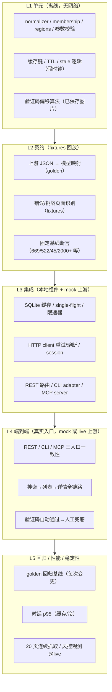

# 06 测试计划与验收（Test Plan & Acceptance）

> 版本：0.1 ｜ 状态：Approved（M0 评审通过） ｜ 负责人：req-writer ｜ 最后更新：2026-11-15 ｜ 关联：[docs/README.md](README.md)（固定契约）｜[01 需求](01-requirements.md)（FR/NFR/AC）｜[02 架构](02-architecture.md)｜[03 REST API](03-rest-api.md)｜[04 CLI/MCP](04-cli-mcp.md)｜[05 数据与缓存](05-data-and-cache.md)｜[07 运维](07-operations.md)｜[research/upstream-api.md](research/upstream-api.md)｜[research/captcha-autosolve.md](research/captcha-autosolve.md)｜[research/anonymous-completeness.md](research/anonymous-completeness.md)｜[recon/notes.md](../recon/notes.md)

> **文档定位**：本文是 M1–M4 的**测试与验收基线**：测什么、怎么测、用什么数据、达到什么标准算通过。
> **不变量**：用例必须引用 [01](01-requirements.md) 的 FR/NFR/AC 编号；错误码/枚举/响应包以 [docs/README.md](README.md) §3.5 与 [03](03-rest-api.md) 为准；字段名以 03/05 定稿为准。
> **事实纪律**：golden 数据来自 2026-11-15 实测（`recon/artifacts/api/` 等）；上游会变，**live 基线漂移需记录并复核，不得静默改期望**；未实测结论标「待验证」。
> **范围**：本文不写测试代码；命令与脚本名以 M1 实现后的 `package.json` 为准，文中标注「实现后可用」。

---

## 0. 摘要（TL;DR）

| 项 | 数量/说明 |
|---|---|
| 测试分层 | 5 层：L1 单元 → L2 契约（fixtures）→ L3 集成（mock/本地组件）→ L4 端到端（REST/CLI/MCP）→ L5 回归/性能/稳定性（含 `@live` 真实匿名上游） |
| 测试环境 | E1 离线单元、E2 fixtures 契约、E3 本地服务/入口、E4 真实匿名上游（低配额、人工触发） |
| 用例数 | **64 条**（TC-01…TC-64）；覆盖 AC-01…AC-57 与 AC-N01…N06（追踪见 §10.1） |
| golden fixtures | 来自 `recon/artifacts/api/` 的搜索/refine/公司 ssrData/增强 JSON/地区词矩阵/验证码图片 |
| 固定回归基线 | `glass+Hebei=669`、xingchenglass diamond/2025/2015-10-30、hnfinsulation gold/2019-12-20、salienceglass 增强样例等（§3.2） |
| 验收 | DoD 清单（§6）：P0 全过、P1 ≥90%、无 blocker、AC 覆盖率 100%、已知限制经 Lead 接受 |
| 已知限制 | 登录态差异、审核报告全文、产品搜索、员工数过滤、全量城市字典、合规口径等（§8） |



---

## 1. 测试目标与原则

| 原则 | 说明 |
|---|---|
| 契约优先 | 上游 JSON/字段/错误码/枚举以 01+03+05 为契约；契约测试先于功能细节 |
| 离线优先 | 绝大多数用例离线可跑（fixtures + mock），保证可重复、快速、不触发风控 |
| live 谨慎 | 真实上游用例单列、低配额、串行限速、可跳过；失败先区分「上游变化」与「客户端 bug」 |
| 基线可追溯 | 每个断言引用 fixture/AC；live 数字变化必须记录时间与证据（`request-examples.sh` 复核） |
| 不测非公开 | 不测试登录态私有数据、审核报告全文、写操作；不构造对上游的异常/攻击流量 |
| 可观测 | 每个用例断言不仅看结果，也看 `meta`（cached/stale/source/warnings）与日志字段 |

---

## 2. 测试策略与环境

### 2.1 分层策略

| 层 | 范围 | 依赖 | 网络 | 执行频率 | 覆盖 AC 侧重 |
|---|---|---|---|---|---|
| L1 单元 | 参数校验、规范化、tier/audited 判定、地区字典映射、缓存键/TTL、限速器、验证码偏移算法 | Node 22；无上游；假时钟/内存 DB | 无 | 每次提交 | AC-08/14/16/17/27/28/30/31/32/34/37/49 |
| L2 契约 | 上游响应 fixtures → 内部/REST 模型；挑战页识别；固定基线断言；错误码映射 | `recon/artifacts/api/` golden | 无（回放） | 每次提交 | AC-01…07、09…13、15、18…22、24、33、38、46、51、53 |
| L3 集成 | SQLite（临时库）、single-flight、限速/重试/熔断、session/cookie jar、REST 路由、CLI/MCP adapter | 本地进程 + mock upstream（HTTP stub） | 本地回环 | 每次合并 | AC-25、34…45、48…50、52、54…57 |
| L4 端到端 | 三入口一致性、搜索→列表→详情、验证码自动通过→人工兜底、`mic auth` 流程（可见环境） | 完整构建产物 + mock/live 上游 | 可选 | 每日/里程碑 | AC-19、23、26、45、47、56、57、N03 |
| L5 回归/性能/稳定性 | golden 回归、p95 时延、20 页连续抓取、验证码通过率/风控触发率 | 真实匿名上游（`@live`），低配额 | 是 | 每周/发布前 | AC-N01、N02、N05、N06 |

### 2.2 Mock 上游 vs 真实匿名上游

| 维度 | Mock 上游（默认） | 真实匿名上游（`@live`） |
|---|---|---|
| 目的 | 确定性验证业务逻辑/契约/异常注入 | 验证真实可达性、字段现状、风控行为、性能 |
| 数据源 | L2 golden fixtures（`recon/artifacts/api/`）+ 手工构造的挑战页/错误页 | 实时 `m.made-in-china.com` / `www` / `captcha` |
| 网络 | 无（HTTP stub/依赖注入） | 有（必须限速 1.5–2.5s、串行、失败重试 ≤2） |
| 频率 | 每次提交/CI | 人工触发、每周/发布前；CI 默认跳过 |
| 断言 | 精确值（fixture 决定） | 区间/契约（上游数字可能漂移，见 §3.2 备注） |
| 失败处理 | 视为 bug | 先复核上游（`recon/artifacts/api/request-examples.sh`），再判定客户端 bug / 基线漂移 |

> 规则：**live 结果不得作为唯一证据**；任何来自 live 的新事实必须先落 `recon/artifacts/`（或注明快照路径）再更新期望。

### 2.3 测试环境

| 环境 | 用途 | 关键配置 | 注意事项 |
|---|---|---|---|
| E1 离线单元 | L1 | `MIC_DATA_DIR=$(mktemp -d)`、`MIC_RATE_MIN_MS=0`、`MIC_RATE_MAX_MS=0`、固定 `TZ=Asia/Shanghai` | 不读 `~/.mic-client` 真实数据；不联网 |
| E2 fixtures 契约 | L2 | fixtures 根目录指向 `recon/artifacts/api`；假时钟；mock HTTP | fixtures 只读，测试不得回写 |
| E3 本地服务/入口 | L3、L4 | `mic serve --host 127.0.0.1 --port <ephemeral>`；临时 SQLite；`MIC_PROFILE_DIR` 指向临时目录 | REST 端口用随机空闲端口，避免与本机 8899 冲突；测试后清理进程 |
| E4 真实匿名上游 | L5、部分 L4 | `~/cloak-env/bin/cloak-run node ...`；限速 1.5–2.5s；独立测试 profile | 人工/夜间执行；不在共享 IP 上高频跑；失败即停并记录 |

**依赖与约定**

| 项 | 要求 |
|---|---|
| Node | Node 22（`~/cloak-env/bin/cloak-run node -v` 校验） |
| cloakbrowser | cloakbrowser 0.6.5 + playwright-core 1.65（`~/cloak-env`，见 [07](07-operations.md) §1） |
| 数据目录 | 测试一律用临时目录（`MIC_DATA_DIR`/`MIC_PROFILE_DIR`/`MIC_LOG_DIR` 覆盖），不污染 `~/.mic-client` |
| 图形会话 | 仅 `mic auth` 的 E2E 用例需要 `DISPLAY`；其余可无头 |
| 时间/随机 | 假时钟 + 固定随机种子（限速抖动、request_id 生成可注入）；测试断言不依赖真实时间 |
| 测试框架 | 以实现仓库为准（建议 Vitest/Node test runner）；本文只约定用例与应用，不写代码 |

---

## 3. 测试数据与 fixtures

### 3.1 golden fixtures 清单（来自 `recon/artifacts/api/`）

> 路径相对仓库根；`*.full.json` 为完整响应，其余 `dataList` 可能被截断（带 `_note`），**契约断言以 total/结构为准，条数断言需注意**。

| fixture | 内容 | 用途（TC） |
|---|---|---|
| `mobile-search/supplier-search-glass-p1.full.json` | 20 条全字段；total=2000、totalPage=100；含广告/等级/认证差异 | TC-01/16/18/19/20/35 |
| `mobile-search/supplier-search-province-hebei.json` | `word=hebei&province=Hebei`，total=1101、totalPage=56（dataList 截断 2 条） | TC-02/13 |
| `mobile-search/supplier-search-province-hebei-diamond.json` | `province=Hebei&memberLevel=50`，total=522、totalPage=27 | TC-09 |
| `mobile-search/supplier-search-multifilter.json` | 5 条件组合，total=45、totalPage=3 | TC-11 |
| `mobile-search/supplier-refine-glass.json` / `supplier-refine-glass-hebei.json` | facet 字典（类目/认证/会员/省/营收/能力） | TC-09/12、字典测试 |
| `filters/facet-dictionaries.json` | 字典汇总：memberLevel（50/30/0,1,3）、certification 44 项、province 31、营收 7、能力 5、经营模式 4 | TC-09/10/11/12 |
| `filters/province-list.json` | 31 个英文省名 | TC-06 |
| `filters/seo-filter-codes.json` | 32 省 + 河北 10 城 count（Langfang 45 等）+ SEO 过滤码 | TC-03（参照）、P2 兜底 |
| `keywords/region-keyword-matrix.json` | 地区词 × 关键词矩阵（669/1101/1666/278/1438/245/1102/0 等） | TC-02/04/14/17 |
| `mobile-company/xingchenglass-info-ssrData.json` | 钻石：memberLevel=diamond、memberSince=2025、sgsMember=true、establishment=2015-10-30、rating=4.9/5、stars=2、encodeComId=UCJfyzwThnqK | TC-21/30/31 |
| `mobile-company/hnfinsulation-info-ssrData.json` | 金牌：memberLevel=gold、establishment=2019-12-20、memberSince=2025、sgsMember=true | TC-22/30 |
| `mobile-company/lvxingmirror-info-ssrData.json` | 钻石 + stars 0（单灰星样本；memberSince=2018 见匿名审计） | TC-30/34 |
| `mobile-company/e2e-list-to-detail-validation.json` | 列表 csLevel=50 ↔ 详情 memberLevel=diamond、auditType=1 ↔ sgsMember=true 一致性 | TC-30 |
| `mobile-company/contact-page-visible-fields.json` | contact 页匿名可见字段（Year of Establishment/Address/联系人等） | TC-22/23 |
| `company-json/sgs-audit-report-sections-salienceglass.json` | 9 章节，5 true/4 false | TC-24 |
| `company-json/reply-rate-salienceglass.json` | `l30BusiReplyDurAvgRange="≤1.74h"`、`l30BusiIntimeReplyRatio=1`、`l30BusiReplyDurAvg=1.74` | TC-25 |
| `company-json/tm-sub-accounts-salienceglass.json` | 联系人 4 人（Lisa/Kaia/Luna/Amanda），仅 name/id | TC-26 |
| `company-json/tm-online-status-salienceglass.json` | `{"<encode>_00":{"online":true,"status":1}}` | TC-26 |
| `company-json/company-reviews-xingchenglass.json` | 评价列表（overallReview=5、senderName 打码、标题/产品等） | TC-27 |
| `headers/mobile-company-numeric-301.txt` | 数字 comId → 301 Location（反查 account） | TC-29 |
| `headers/*-302-*.txt`、`headers/get-refine-404-without-xhr-header.txt` | 302/挑战/缺 XHR 头行为 | TC-48/52、TC-57 |
| `recon/artifacts/captcha/run1/`（bg-x3.png、crop-bg.png、crop-jig.png、gets.json、checks.json） | 验证码背景/拼图/接口交换 | TC-49（离线算法） |
| `recon/artifacts/captcha/autosolve/attempt-1.json`、`autosolve-t2/attempt-1.json` | 已通过样本（x=219 / x=114，repCode=0000） | TC-49 |
| `recon/artifacts/probe8/xingchen-home.html`、`probe9/xingchen-contact.html`、`probe11-anon/hnf_contact.html` | PC 公司站 HTML（徽章/字段解析兜底） | TC-23、P2 兜底 |
| `desktop/seo-filter-page-matrix.json`、`desktop-search-keyword-matrix.json` | SEO 页 HTTP 行为/行数（P2 兜底参考） | TC-03 参照、P2 |
| `recon/artifacts/probe10/city-langfang-p1.html` | 城市列表页 30 行全 Langfang（SEO） | 交叉校验参照（不混入口径） |

**已知 fixture 缺口（待补录，M1 前）**：

| 缺口 | 影响 | 补录方式 |
|---|---|---|
| m 站 `company-<account>/info.html` **完整 HTML**（含 ssrData + 正文） | TC-21/23 目前只能分别用 ssrData JSON + 解析后的字段样例；HTML 提取需 live | 用 `recon/artifacts/api/request-examples.sh` 以移动 UA 抓 1 份（xingchenglass、hnfinsulation）入 `recon/artifacts/api/mobile-company/` |
| `xingchenglass` employees=21、完整地址（正文） | AC-21 的精确断言暂标 live/待补录 | 同上（当前证据见 research/upstream-api.md §3.4） |
| 免费会员（free）真实样本 | AC-28 的 `free` 分支仅有规则断言，无真实样本 | 后续抽样补录 |
| 失败 captcha check 响应样本 | TC-50 需构造（`repCode=6111`） | mock 构造并在用例注明「构造数据」 |

### 3.2 固定回归基线（每次回归必须断言）

| # | 场景/查询 | 期望基线 | 证据 |
|---|---|---|---|
| B-01 | `word=glass` | total=2000、totalNum=`"2,000+"`、totalPage=100、pageSize=20、20 条 | `supplier-search-glass-p1.full.json` |
| B-02 | `word=glass&province=Hebei` | total=669、totalPage=34 | `keywords/region-keyword-matrix.json`（hebei-prov-facet） |
| B-03 | `word=glass&province=Hebei&memberLevel=50` | total=522、totalPage=27 | `supplier-search-province-hebei-diamond.json` |
| B-04 | 五条件组合（Hebei+Diamond+ISO9001:2015+catCode 1500000000+Manufacturer） | total=45、totalPage=3 | `supplier-search-multifilter.json` |
| B-05 | `word=hebei` / `hebei&province=Hebei` | total=1101、totalPage=56 | `supplier-search-province-hebei.json` / matrix |
| B-06 | `word=shijiazhuang` / `+province=Hebei` | 1666 / 1438 | matrix |
| B-07 | `word=langfang` / `+province=Hebei` | 278 / 245 | matrix |
| B-08 | `glass hebei` / `hebei glass` | 1102 | matrix |
| B-09 | 中文 `河北` / `玻璃` | 上游 0（客户端按 01/ADR-0004 直接 `INVALID_PARAM`，不请求） | matrix / desktop matrix |
| B-10 | `xingchenglass` 列表 | csLevel=50（diamond）；encodeComId=`UCJfyzwThnqK`；comId=1800987236 | hebei fixtures / ssrData |
| B-11 | `xingchenglass` 详情 | memberLevel=diamond、memberSince=2025、sgsMember=true、establishment=2015-10-30、rating=4.9/5、stars=2 | `xingchenglass-info-ssrData.json` |
| B-12 | `hnfinsulation` 详情 | memberLevel=gold、establishment=2019-12-20、memberSince=2025、sgsMember=true、employees=80（正文）、Mgmt. Cert 含 ISO9001:2015 | `hnfinsulation-info-ssrData.json`、`contact-page-visible-fields.json` |
| B-13 | `lvxingmirror` 详情 | diamond、memberSince=2018（匿名审计）、stars=0（单灰星） | `lvxingmirror-info-ssrData.json` + research/anonymous-completeness.md §1.2 |
| B-14 | salienceglass 增强 | SGS 9 章节（5 已审/4 未审）；响应率 `≤1.74h`、及时率 1.0；TM 联系人 4 人；在线 `true` | `company-json/*` |
| B-15 | 验证码 | Focus Captcha 自动通过 2/2（新 profile 首次尝试，偏移 219/114，repCode=0000） | `captcha-autosolve.md` §3、`captcha/autosolve*` |
| B-16 | 河北城市（SEO 参照，不混 JSON） | 河北 10 城：Shijiazhuang 215、Hengshui 138、Cangzhou 98、Xingtai 71、Baoding 55、Langfang 45、Handan 19、Tangshan 14、Qinhuangdao 13、Zhangjiakou 1；SEO glass+Hebei facet=1299 | `filters/seo-filter-codes.json` |
| B-17 | 地区模式城市过滤（JSON 口径） | `langfang&province=Hebei` total=245；扫描后过滤 Langfang，`matched` 数量**待验证**（ADR-0003 扫描语义） | matrix + ADR-0003 |

> 漂移处理：live 回归若 B-01…B-17 变化 → ① 用 `request-examples.sh` 复测确认；② 记录新证据到 `recon/artifacts/`；③ 区分「上游数据自然变化」（如搜索结果增减）与「契约破坏」（字段/结构变化）——前者更新基线需 Lead 批准，后者报 `UPSTREAM_CHANGED` 缺陷。

### 3.3 fixture 使用规则

1. **只读**：测试不得修改 `recon/artifacts/`；派生的变体（如构造 302/缺字段）放在测试临时目录并注明来源。
2. **截断标记**：含 `_note`/`_meta` 的 fixture 字段为人工标注，不是上游字段，测试映射时必须忽略。
3. **典型字段断言**：断言前先按 03/05 的 Schema 校验结构；不得依赖 fixture 中未在 Schema 声明的字段。
4. **地区/口径**：SEO 页与 JSON 口径不同（1299 vs 669），测试中不得交叉断言；交叉校验用例必须显式标注 `source`。
5. **验证码素材**：`recon/artifacts/captcha/` 的图片/JSON 只用于离线算法单测；不得把 `secretKey`/`token` 写入仓库文档或日志断言。

### 3.4 敏感数据与脱敏策略

| 数据 | 处理 |
|---|---|
| 公司公开档案（名称/地区/主营/等级/认证） | 可入 fixtures（公开数据）；测试输出保持原样 |
| 联系人姓名/部门/职位（公开） | 可入 fixtures；测试日志不得额外扩散 |
| 电话/邮箱/WhatsApp/微信 | **平台不公开**；fixtures/断言中不得出现，Schema 断言其恒 `null` + `not_public_by_platform` |
| cookie/storageState/`Set-Cookie` | `headers/*.txt` 可能含会话 cookie：测试进程不得打印/持久化；若仓库对外发布需先脱敏 `set-cookie` 值 |
| profile 路径/用户名 | 日志断言不得包含绝对路径；错误 details 不得泄漏（AC-53） |
| request_id/token | 仅用于关联，不进文档示例的固定断言 |

---

## 4. 用例矩阵（TC-01…TC-64）

> 列说明：**关联** = FR/NFR + AC；**自动化建议**：`A` 自动化（离线/mock）、`L` `@live` 真实上游、`M` 手工/抽样；**优先级**：P0 必须通过，P1 应通过。

### 4.1 搜索与过滤（FR-01/02/06/07）

| TC | 关联 | 前置/步骤 | 预期 | 级别 | 自动化 |
|---|---|---|---|---|---|
| TC-01 | FR-01；AC-01 | mock 上游返回 `supplier-search-glass-p1.full.json`；调用搜索 `keyword=glass&page=1&page_size=20` | `search_mode=keyword`、`keyword_effective=glass`、`items.length=20`、`total=2000`、`total_capped=true`、`total_display="2,000+"`、`total_page=100`、`meta.source=json` | P0 | A |
| TC-02 | FR-01；AC-02 | mock 返回 `supplier-search-province-hebei.json`；请求 `province=Hebei`（无 keyword） | `search_mode=region`、`keyword_effective=hebei`、`region_validated=true`、`items` 全部 `province=Hebei`、`query.search_mode=region`/`keyword_effective` 回显（非 warning） | P0 | A |
| TC-03 | FR-01/02/07；AC-03/09 | mock 2 个分页（hebei 截断 fixtures 或派生页）；请求 `province=河北&city=廊坊` | 中文映射 `Hebei`/`Langfang`；`search_mode=region`；扫描后仅返回 `city=Langfang` 条目；warning `CITY_FILTERED_LOCALLY`（`scanned_pages`/`matched`）；预算不足时 `total_is_lower_bound=true` + `NON_EXHAUSTIVE` | P0 | A |
| TC-04 | FR-01；AC-04 | mock 669 结果口径（`region-keyword-matrix.json` B-02）；请求 `keyword=glass&province=Hebei` | `search_mode=mixed`、`total=669`、`total_page=34`、`total_display="669"`、`total_capped=false` | P0 | A |
| TC-05 | FR-01；AC-04/08 | 请求 keyword/province/city 全空；记录 mock 上游调用次数 | `INVALID_PARAM`（400）、`details.field` 指明缺失；上游调用次数 **0** | P0 | A |
| TC-06 | FR-07；AC-31 | 请求 `province=河北`；mock 返回 fixture | 归一化为 `Hebei`；`query.province` 回显英文；无 `INVALID_PARAM` | P0 | A |
| TC-07 | FR-01/07；AC-04/08 | 请求 `keyword=玻璃` / `keyword=河北玻璃`；记录调用次数 | `INVALID_PARAM`（`details.reason=NON_ENGLISH_KEYWORD`，03）；上游调用次数 0（不返回「静默空结果」） | P0 | A |
| TC-08 | FR-02/07；AC-08/31/32 | 请求 `province=Foo`、`city=未知中文城市`、`membership_tier=free` | `INVALID_PARAM`（`UNKNOWN_PROVINCE`/`UNKNOWN_CITY`/`UNSUPPORTED_MEMBERSHIP_FILTER`）；`details.allowed_*` 提供可用值；无上游请求 | P0 | A |
| TC-09 | FR-02/06；AC-05 | mock `province-hebei-diamond` fixture；请求 `province=Hebei&membership_tier=diamond` | 上游参数 `memberLevel=50`（断言请求体）；`total=522`；items `membership.tier` 全 diamond | P0 | A |
| TC-10 | FR-02；AC-07 | mock 2 页含 audited=true/false 混合；请求 `province=Hebei&audited=true` | 客户端过滤：仅 `audited=true` 条目；warning `CLIENT_SIDE_FILTER`；结果非穷尽时 `NON_EXHAUSTIVE`；不因过滤删改 total 语义（`total_is_lower_bound`） | P1 | A |
| TC-11 | FR-02；AC-06 | mock multifilter fixture；请求五条件组合 | 上游参数映射正确（`province=Hebei`、`memberLevel=50`、`managementCertification=-5`、`catCode=1500000000`、`comBusinessType=1`）；`total=45`、`total_page=3` | P1 | A |
| TC-12 | FR-02；AC-08 | 请求 `category_code=abc`、`annual_revenue=99`、`business_type=foo` | `INVALID_PARAM`（`INVALID_ENUM`/`OUT_OF_RANGE`）；无上游请求 | P0 | A |

### 4.2 分页、列表与规范化（FR-03/04）

| TC | 关联 | 前置/步骤 | 预期 | 级别 | 自动化 |
|---|---|---|---|---|---|
| TC-13 | FR-03；AC-10/12 | mock 2 页（含 1 条重复 account）；请求 page=1、page=2 | 页回显正确、`has_more` 正确；跨页 `account` 去重；去重时 warning `DUPLICATES_REMOVED` | P0 | A |
| TC-14 | FR-03；AC-10 | mock 上游对 page=101 返回末页（page=100 内容）；请求 `keyword=glass&page=101` | 客户端检测 `returned_page≠requested_page` → `page_clamped=true`、`has_more=false`；不把末页重复当新页 | P0 | A |
| TC-15 | FR-03；AC-08/10 | 请求 `page=0`、`page=101`（>100） | `INVALID_PARAM`（`details.reason=OUT_OF_RANGE`）；无上游请求 | P0 | A |
| TC-16 | FR-03；AC-11 | 同 TC-01；再 mock 669 口径 | 封顶：`total=2000`/`total_capped=true`/`total_display="2,000+"`/`total_page=100`；未封顶：`total=669`/`total_capped=false`/`"669"` | P0 | A |
| TC-17 | FR-03；AC-13 | mock 上游 `{"total":0,"dataList":[]}`（或 live `keyword=glass&province=Qinghai`） | `items=[]`、派生状态 success、`has_more=false`；**不返回 NOT_FOUND**（200/ok:true） | P0 | A+L |
| TC-18 | FR-04；AC-15 | 回放 glass full fixture（含 `showAd=true`/`ad=true`/`deliveryType=ads`） | `items` 保留 20 条（与上游分页 1:1）；广告条目 `is_ad=true`；JSON 不删除广告；CLI table 输出默认隐藏广告行（04） | P0 | A |
| TC-19 | FR-04；AC-14/16/18 | 回放 glass full fixture；逐条校验 Schema | 固定字段全部存在（缺失为 null 不省略 key）；`main_products` 拆分去空白；`stars` 为 int；`account` 小写；`company_url=https://m.made-in-china.com/company-<account>/`、`company_info_url=.../info.html`（03 示例）；`is_ad`/`detail_source` 存在；空串→null | P0 | A |
| TC-20 | FR-04/06；AC-17/27 | 回放 glass full fixture（19×csLevel=50、1×30；auditType 18×1、2×0） | tier 映射：50→diamond、30→gold；audited：auditType=1→true、0→false；**不得**由 csLevel 反推 audited | P0 | A |

### 4.3 公司详情与会员识别（FR-05/06）

| TC | 关联 | 前置/步骤 | 预期 | 级别 | 自动化 |
|---|---|---|---|---|---|
| TC-21 | FR-05；AC-19 | mock info 页响应（ssrData=fixture，正文见缺口）；`GET /api/companies/xingchenglass` | `membership.tier=diamond`、`membership.since_year=2025`、`audited=true`、`established_at=2015-10-30`、`capability_stars=2`、`main_products` 含 Glass Cup、`encode_com_id=UCJfyzwThnqK`；`include=reviews` 时 `enrichment.reviews.rating_display` 含 `4.9/5` | P0 | A（正文部分 L/待补录） |
| TC-22 | FR-05；AC-20 | mock hnfinsulation 响应 + 正文样例 | tier=gold、`established_at=2019-12-20`、`audited=true`、`since_year=2025`、`address` 含 Caofeidian、`employees=80`、`management_certifications` 含 ISO9001:2015 | P0 | A+L |
| TC-23 | FR-05；AC-21/24 | xingchenglass（正文 employees=21、地址 Bazhou/Langfang、无 Mgmt cert）、hnf（无评分）、kaishanda（未认证） | 缺失字段 `null` 且 `availability[]` 含 `{field,reason}`（`not_provided_by_supplier`/`no_reviews`，03 §8.6）；`audited=false` 非 null；缺失不中断详情 | P1 | A（fixture 待补录）/M |
| TC-24 | FR-05；AC-22 | 回放 `sgs-audit-report-sections` fixture；调用 `include=audit` | `enrichment.audit.sections` 9 项、`audited_section_count=5`（true 计数）；`agency/report_no` 首期为 null（03 §8.5）；结构符合 03 Schema | P1 | A |
| TC-25 | FR-05；AC-22 | 回放 `reply-rate` fixture；`include=response` | `enrichment.response.range_display="≤1.74h"`、`timely_reply_ratio=1`、`avg_response_hours=1.74`、`window_days=30` | P1 | A |
| TC-26 | FR-05；AC-22 | 回放 `tm-sub-accounts` + `tm-online-status` fixtures；`include=contacts` | `enrichment.contacts.persons` 4 人（name 保留；title/department 首期 null，符合 03 §8.3）；`channels.phone/email` 恒 null + `reason=not_public_by_platform`；在线状态 true | P1 | A |
| TC-27 | FR-05/06；AC-22/24 | 回放 `company-reviews-xingchenglass.json`；`include=reviews` | `enrichment.reviews` 解析正确（rating_display/rating_value、sender_name 打码、items）；无评论公司 → `rating_value=null` + `availability[{field:"reviews",reason:"no_reviews"}]`（03） | P1 | A |
| TC-28 | FR-05/08；AC-25 | 连续两次 `GET /api/companies/xingchenglass`；再 `refresh=true` | 第 2 次 `meta.cached=true`、`source=cache`、上游 0 次；`refresh=true` 后 `cached=false` 且重新请求 | P0 | A |
| TC-29 | FR-05；AC-23 | mock `headers/mobile-company-numeric-301.txt`（因 `comId` 数字触发 301 → Location 含账号）；并测试 encodeComId 未索引、完全未知 ID | 数字 comId → 解析出 `account=xingchenglass`；encodeComId 未索引 → `INVALID_PARAM`（`ENCODE_COM_ID_NOT_INDEXED`，03）；未知 → `NOT_FOUND`（`COM_ID_UNRESOLVED`） | P1 | A |
| TC-30 | FR-06；AC-26 | 回放 `e2e-list-to-detail-validation.json`；再构造冲突（列表 30/详情 diamond） | 一致场景：csLevel=50 ↔ memberLevel=diamond、auditType=1 ↔ sgsMember=true；冲突场景：详情优先 + `evidence` 保留双源 + confidence 降级 | P0 | A |
| TC-31 | FR-06；AC-27 | 构造列表/详情 JSON 变体：auditType 1/0、sgsMember true/false、无信号 | audited=true/false/true/false/null 三态正确；与 tier 独立；禁止 csLevel→audited 推断 | P0 | A |
| TC-32 | FR-06；AC-28 | 构造：列表无 csLevel；详情完整无徽章；详情被挑战/残缺 | 列表 → `unknown`；完整详情无徽章 → `free`（medium，需样本复核）；残缺 → `unknown`（low）且不猜 diamond/gold | P0 | A（free 样本待补） |
| TC-33 | FR-06/09/11；AC-29 | 调用 `GET /api/membership/levels` 与 MCP `explain_membership` | 按 03 §6 返回：`tiers` 固定 4 项（diamond/gold/free/unknown，价格 diamond 59800、gold 31100）、`audit`（AS 与 tier 正交）、`big_customer_programs`（优享/尊享/MKA，公网不可识别）、`not_mic_tiers`（KA/SKA/GSKA 澄清，禁止进入 tier）、`raw_field_mapping`；数据模型 `external_customer_tier` 抓取阶段恒 null（05） | P0 | A |
| TC-34 | FR-06；AC-30 | 回放 lvxingmirror ssrData（stars=0 单灰星） | `capability_stars=0`（合法 0–5），不映射 tier；无星级 → null（区别于 0） | P1 | A |

### 4.4 缓存（FR-08）

| TC | 关联 | 前置/步骤 | 预期 | 级别 | 自动化 |
|---|---|---|---|---|---|
| TC-35 | FR-08；AC-34 | 同参数连续请求 2 次（mock 上游计数） | 第 2 次 `cached=true`、`stale=false`、`source=cache`、`fetched_at` 不变；上游计数 1；data 与第 1 次一致（除 request_id） | P0 | A |
| TC-36 | FR-08；AC-35 | 假时钟越过列表 TTL/详情 TTL；mock 上游 503 | 返回旧值：`stale=true`、`source=cache`、warning `STALE_DATA`、`fetched_at` 为旧时间；无缓存时返回 `UPSTREAM_UNAVAILABLE`（503） | P0 | A |
| TC-37 | FR-08；AC-36 | `refresh=true`；`POST /api/cache/refresh` scope=search/all；CLI `mic cache refresh` | 跳过读、成功回写、`cached=false`；`--no-cache` 不读不写；刷新受限速/风控约束 | P0 | A |
| TC-38 | FR-08；AC-37 | 并发 5 个相同键请求（mock 上游延迟固定） | 上游仅 1 次（single-flight）；其余复用；缓存写 1 次；无竞态错误 | P1 | A |
| TC-39 | FR-08；AC-38 | 写入若干缓存条目；查询 stats；clear 后复查 | stats 条目数/命中/未命中/大小正确；`mic cache clear` 后条目归零；损坏 DB → `CONFIG_ERROR` 提示 | P1 | A |

### 4.5 入口一致性（FR-09/10/11）

| TC | 关联 | 前置/步骤 | 预期 | 级别 | 自动化 |
|---|---|---|---|---|---|
| TC-40 | FR-09；AC-39 | 启动 `mic serve`（临时端口）；检查监听地址；请求 `/health` | 仅监听 127.0.0.1；成功包 `{ok:true,data,meta{request_id,cached,stale,fetched_at,source,warnings}}`；失败包 `{ok:false,error{code,message,details},meta}`；`/health` 不触发上游 | P0 | A |
| TC-41 | FR-09/13；AC-40/51 | 注入各错误（mock）：非法参数/未知公司/限流/上游 503/上游 5xx 超时/PARSE | HTTP 映射正确（400/404/429+Retry-After/503/502/409）；错误码仅 README 11 个；`request_id` 入日志 | P0 | A |
| TC-42 | FR-09/07/06；AC-33/29 | 请求 `/api/regions`、`/api/regions?province=河北`、`/api/membership/levels` | 32 省字典（含 Qinghai，与 05 一致）；河北城市列表；TTL 30d 缓存（二次 `cached=true`）；未收录省 → `INVALID_PARAM`（`UNKNOWN_PROVINCE`）+ `details.allowed_provinces` | P1 | A |
| TC-43 | FR-09；AC-41 | 对 `/api/search/factories`、`/api/companies/{account}`、`/api/cache/stats`、`/api/cache/refresh` 做契约测试 | 状态/结构/Schema 与 03 一致；`data` 字段与 core 模型一致；未知路由 404 | P0 | A |
| TC-44 | FR-10；AC-42 | `mic search --keyword glass --province Hebei --json`（mock 上游注入） | stdout 为**纯 JSON**（可 `jq` 解析）、无日志混入；data 与 REST 相同；stderr 有日志；退出码 0 | P0 | A |
| TC-45 | FR-10；AC-43 | 分别注入：成功/参数错误/未找到/上游不可用/需要人工验证/限流/内部错误 | 退出码 0/2/3/4/5/6/1；错误信息写 stderr；退出码与 03 错误码映射一致（04 §映射表） | P1 | A |
| TC-46 | FR-11；AC-44 | 以 stdio 启动 `mic mcp`；`initialize` → `tools/list` → 依次调用 4 tools | 4 个 tool 名/描述/inputSchema 正确；非法参数 → tool error（`isError=true`，含 `INVALID_PARAM`）；不暴露写操作 tool | P1 | A |
| TC-47 | FR-11/09/10；AC-45 | 同一查询经 REST、CLI `--json`、MCP 三入口（同一 mock 上游/缓存） | items 字段集合、排序、分页值一致（排除 `request_id`/`fetched_at` 等易变字段后逐字节相等）；warnings 语义一致 | P0 | A |

### 4.6 异常、风控与降级（FR-12/13）

| TC | 关联 | 前置/步骤 | 预期 | 级别 | 自动化 |
|---|---|---|---|---|---|
| TC-48 | FR-12；AC-46 | 构造三形态响应：① 302 `Location: https://captcha.made-in-china.com/verification.html?...`；② 987B 含 `__tst_status`；③ 5.6–5.9KB 含 `请验证`/`Focus Captcha` | 均识别为挑战（不解析为业务数据）；触发挑战处理路径（自动解或 `NEED_HUMAN_VERIFICATION`）；`meta.warnings`/错误 details 说明挑战类型 | P0 | A |
| TC-49 | FR-12；AC-47 | 用 `recon/artifacts/captcha/run1/` 的 bg/crop 图片离线跑算法；对照 `autosolve/attempt-1.json`（x=219）与 `autosolve-t2/attempt-1.json`（x=114）；mock `/captcha/check` 返回 0000 | 算法偏移与标注误差 ≤5px；mock check 成功；通过后会话 cookie 复用；仅记录脱敏字段 | P1 | A |
| TC-50 | FR-12；AC-48 | mock `/captcha/check` 连续返回 6111（构造）；最多 5 次 | ≤5 次后返回 `CAPTCHA_SOLVE_FAILED`/`NEED_HUMAN_VERIFICATION`（03 定），提示 `mic auth`；不无限重试；退出码 5（CLI） | P0 | A |
| TC-51 | FR-12；AC-49 | 配置 `MIC_RATE_MIN_MS=1500/MIC_RATE_MAX_MS=2500`，mock 上游记录时间戳；并发两类请求 | 相邻上游请求间隔在 [1.5s, 2.5s]；同 host 串行；公司页不并发；限速可配置为 0（测试） | P0 | A |
| TC-52 | FR-12/13；AC-50 | mock：先 302 两次后 200；再连续 3 次 503/挑战失败 | 302 重试 ≤2 次后成功（记录 retry_count）；连续 3 次失败 → 熔断（60s）返回 `RATE_LIMITED`/stale 或 `UPSTREAM_UNAVAILABLE`；熔断期不请求上游 | P1 | A |
| TC-53 | FR-13；AC-51/53 | mock：ssrData 缺失/字段改名（UPSTREAM_CHANGED）；JSON 截断（PARSE_ERROR）；测试 HTML 兜底配置关闭/开启两种 | 关闭：错误码正确、`details` 含 `snapshot_id` 不含 cookie/HTML；开启：`source=html` + warning `HTML_FALLBACK`；不新增错误码 | P0 | A |
| TC-54 | FR-13/08；AC-52/35 | 详情主数据失败 + 有过期缓存 + 增强失败；对比无缓存场景 | 有缓存：`stale=true` + `STALE_DATA` + 增强 `ENRICHMENT_PARTIAL`；无缓存：对应错误码；主体/增强可分 | P0 | A |
| TC-55 | FR-13；AC-51/53 | 遍历 README 11 错误码触发条件；检查所有 error 响应 | 仅 11 个 code；无同义新码；`details` 无敏感信息；`INTERNAL_ERROR` 含 `request_id` | P0 | A |
| TC-56 | FR-14；AC-54/55 | 触发搜索/缓存/挑战/错误场景后读结构化日志与 stats | 日志字段齐全（`ts/level/request_id/entry/phase/duration_ms/cache/source/error_code`）；无 cookie/token/电话/邮箱；指标计数可聚合（hit/miss/stale/302/captcha/error） | P1 | A |
| TC-57 | FR-15；AC-56/57 | 检查配置优先级（CLI/env/文件/默认）；缺 profile 时执行需浏览器能力；运行 `mic doctor` | 高优先级覆盖生效并与 `mic config show` 标注来源一致；缺 profile + 需浏览器 → `CONFIG_ERROR` 含 `mic auth` 提示；doctor 检查 Node/cloak-env/profile/数据目录/SQLite/上游连通性并给出修复提示 | P1 | A |
| TC-58 | NFR-03；AC-N03 | 启动服务/CLI/MCP；检查监听、文件权限、端点清单、日志/错误、遥测 | 仅 127.0.0.1；profile/data 权限 700、文件 600；不调用登录后接口；MCP 仅 stdio；无外发遥测；help/README 有本地无鉴权声明 | P0 | A+M |

### 4.7 性能与稳定性（NFR-01/02/05/06）

| TC | 关联 | 前置/步骤 | 预期 | 级别 | 自动化 |
|---|---|---|---|---|---|
| TC-59 | NFR-01；AC-N01 | ① 缓存命中：预热后连续 100 次 REST 搜索/详情，取 p50/p95；② 冷搜索：mock/真实单次上游，20 样本；③ 冷详情 20 样本；④ CLI 冷搜索 20 样本 | 缓存命中 p95<100ms；冷搜索 p95<3s；冷详情 p95<5s（page_size=20、排除限速等待）；CLI <5s；记录环境与样本 | P0 | A+L |
| TC-60 | NFR-02；AC-N02 | `@live`：同一会话 `mic search --keyword hebei --pages 1-20 --format ndjson`，限速 1.5–2.5s；重复 3 个时段 | 20 页成功率 ≥95%；记录 302/验证码/重试次数；无封禁；数据去重正常 | P0 | L |
| TC-61 | NFR-02；AC-N02 | `@live`：触发验证码 ≥20 次（新 profile/公司页/挑战场景），记录自动解成功/失败/人工兜底 | 自动解通过率 ≥80%（样本不足时标「待积累」，不得伪造）；失败均可降级 `NEED_HUMAN_VERIFICATION` 并 `mic auth` 可用 | P0 | L+M |
| TC-62 | NFR-05；AC-N05 | 跑单测/契约测试覆盖率报告；核对每 FR 至少 1 个自动化用例 | core 覆盖率 ≥80%（口径：行覆盖，以实现仓库配置为准）；FR 覆盖矩阵无空缺；离线可跑 | P1 | A+M |
| TC-63 | NFR-06；AC-N06 | 人工检查：限速配置/串行/single-flight/无并发轰炸/只匿名公开数据/不建模非公开字段/使用声明 | 全部满足；合规口径（OQ-09）未确认项在发布说明中列为「限制」 | P0 | M |
| TC-64 | NFR-04；AC-N04 | 对照 01/03/04/05/06：字段名、错误码、枚举、warning、AC 编号一致性检查 | 无同义不同名/悬空编号；变更记录与 ADR 可追溯；实现与文档偏差为 0（或已登记） | P1 | M |

---

## 5. 异常与风控用例细则（注入方法）

> 本节说明 §4.6 的构造方式，保证离线可复现；真实上游行为以 research 文档为准（不在此重复实测）。

| 场景 | 注入方法（离线） | 断言要点 |
|---|---|---|
| 302 → Focus Captcha | HTTP mock 返回 `302` + `Location: https://captcha.made-in-china.com/verification.html?srcUrl=...`（参考 `headers/*-302-*.txt`、`recon/notes.md` §2） | 判为挑战；不产生业务数据；触发自动解/人工路径；记录挑战类型 |
| EdgeOne JS challenge | 返回 ~987B HTML 含 `document.cookie="__tst_status=...`（见 research/anonymous-completeness.md §4.4） | 判为挑战；不解析 DOM；重试策略生效 |
| Focus Captcha HTML 页 | 返回 5.6–5.9KB 含「请验证」/`Focus Captcha`（`recon/artifacts/captcha/verification.html` 可取样） | 判为挑战；`NEED_HUMAN_VERIFICATION` 提示含 `mic auth` |
| 自动解成功 | mock `/captcha/get`（读取 `run1/get0-meta.json`/`gets.json` 结构）+ `/captcha/check` `repCode=0000`；算法用 `run1` 图片 | 偏移误差 ≤5px；会话 cookie 固化；后续请求复用（无第二次挑战） |
| 自动解失败 | mock `/captcha/check` `repCode=6111`（构造） | 最多 5 次；转人工兜底；不重试超限 |
| 上游 5xx/超时 | mock 返回 500/504 或延迟超过 `MIC_UPSTREAM_TIMEOUT_MS` | `UPSTREAM_UNAVAILABLE`；重试 ≤2（可重试）；有缓存 → stale |
| 302 间歇 | mock 先 302 两次再 200 | 重试后成功；`retry_count` 记录；不超过阈值 |
| 连续失败熔断 | mock 连续 3 次 503/挑战失败 | 熔断 60s；期间不请求上游；返回可重试错误或 stale |
| 上游改版 | 删除/改名 ssrData 关键字段、搜索 JSON 缺 `dataList`/`total` | `UPSTREAM_CHANGED`（结构不符）；可 HTML 兜底时 `source=html` + `HTML_FALLBACK`；不抛 INTERNAL_ERROR |
| 解析失败 | 截断 JSON、HTML 非预期 | `PARSE_ERROR` + `details.snapshot_id`；`meta` 可见；不泄敏感信息 |
| 缓存损坏 | 写坏 SQLite 文件/锁表 | `CONFIG_ERROR`（数据目录/SQLite）或可恢复提示；不崩溃；`mic doctor` 报 FAIL |
| 配置非法 | 非法 JSON、越界端口、未知键 | `CONFIG_ERROR` 给出文件名+键名（不打印内容）；未知键 → warning `CONFIG_UNKNOWN_KEY` 并继续 |
| 字段缺失（上游未填） | 从 fixture 删除 `systemCertificationList`/`establishment` 等 | 字段 null + 正确 `availability_reason`；不误判为登录/风控问题 |
| 2000+ 封顶 | 用 B-01 fixture | `total=2000`/`total_capped=true`/`"2,000+"`/`total_page=100`/`NON_EXHAUSTIVE`；`total_is_lower_bound` 语义在扫描场景 |
| 城市过滤扫描预算 | mock 多页（> `scan_max_pages`） | 预算内扫描；耗尽 → `total_is_lower_bound=true` + `NON_EXHAUSTIVE`；`CITY_FILTERED_LOCALLY` 的 `scanned_pages/matched` 正确 |

---

## 6. 验收清单（DoD）

### 6.1 功能 DoD（按 FR）

| FR | DoD 核对项 | 对应 AC | 通过标准 |
|---|---|---|---|
| FR-01 | 三模式判定、中文映射/拒绝、参数校验、回显 | AC-01～04 | 用例全过 |
| FR-02 | 省服务端过滤、城市客户端扫描过滤、其余过滤映射、非法值拦截 | AC-05～09 | 用例全过 |
| FR-03 | 20/页、page 1–100、封顶、夹取、去重、空结果、非穷尽 | AC-10～13 | 用例全过 |
| FR-04 | 字段完整性、is_ad 保留、规范化、tier 派生、URL 生成 | AC-14～18 | 用例全过 |
| FR-05 | ssrData 核心字段、正文补充、增强契约、查找解析、缺失语义、缓存 | AC-19～25 | P0 全过；增强 P1 ≥90% |
| FR-06 | tier 优先级、audited 三态、since_year、free/unknown、evidence/confidence、KA 边界、stars 独立 | AC-26～30 | 用例全过；free 样本限制登记 |
| FR-07 | 32 省、河北 10 城、中文映射、非法/透传、regions API | AC-31～33 | 用例全过 |
| FR-08 | 键规范化、TTL、refresh、stale、single-flight、stats | AC-34～38 | 用例全过 |
| FR-09 | 本地边界、响应包、错误映射、端点能力 | AC-39～41 | 用例全过 |
| FR-10 | `mic` 全子命令、`--json` 纯度、退出码、table 规则 | AC-42～43 | P0 全过 |
| FR-11 | 4 tools、Schema 校验、只读、错误语义、三入口一致 | AC-44～45 | 用例全过 |
| FR-12 | 挑战识别、自动解、人工兜底、限速、302/熔断、会话复用 | AC-46～50 | P0 全过；自动解实网 P1 |
| FR-13 | 11 错误码、降级链、派生状态、敏感信息、重试边界 | AC-51～53 | 用例全过 |
| FR-14 | 日志字段/脱敏/分级、指标 | AC-54～55 | 用例全过 |
| FR-15 | 配置优先级/自检/profile 缺失/目录权限/可移植 | AC-56～57 | 用例全过 |

### 6.2 非功能 DoD

| NFR | 通过标准 | 对应 |
|---|---|---|
| NFR-01 性能 | TC-59 达标（缓存 p95<100ms；冷搜索<3s；冷详情<5s；CLI<5s） | AC-N01 |
| NFR-02 稳定性/风控 | TC-60 ≥95% 页成功率；TC-61 自动解 ≥80%（样本不足需记录）；熔断/退避生效 | AC-N02 |
| NFR-03 安全边界 | TC-58/TC-63 全过；仅回环、权限、无敏感泄漏、无登录后接口、MCP stdio | AC-N03 |
| NFR-04 可维护性 | TC-64 一致性检查通过；Schema 单一来源；ADR 齐全 | AC-N04 |
| NFR-05 可测试性 | TC-62 覆盖率 ≥80%；每 FR ≥1 用例；离线可跑 | AC-N05 |
| NFR-06 合规礼仪 | TC-63 通过；限速/只读/数据最小化/声明齐全；OQ-09 未决项列为发布限制 | AC-N06 |

### 6.3 文档—实现一致性检查

| 检查项 | 方法 | 通过标准 |
|---|---|---|
| FR/NFR/AC 编号 | 脚本扫描 01 vs 03/04/05/06 引用 | 无悬空/无未引用编号（AC 覆盖率矩阵 100%） |
| 错误码 | 全局 grep 实现与文档 | 仅 README 11 个；无同义新码 |
| 枚举 | Schema 校验 | `status` 3 值、`source` 4 值、`tier` 4 值、`availability_reason` 5 值、`audited` 三态 |
| warning 码 | 对照 03 §7.6/§12.4 与 §10.2 | 文档引用的 warning 均可在 03/04 找到；无自造名 |
| 字段命名 | 03/05 Schema vs 实现序列化 | 全部 snake_case；上游字段名只在映射层出现 |
| 缓存 TTL/分页语义 | 与 03/05 逐项对表 | TTL 列表 6h/详情 24h/地区 30d；page_size=20 基线 |
| 响应包 | README §3.5 | 成功/失败包字段与示例一致 |

### 6.4 安全边界检查

- [ ] REST 默认仅 `127.0.0.1:8899`；非回环需显式确认并 WARN（AC-N03）
- [ ] 无鉴权说明出现在 README/07/help；无对外网络暴露默认值
- [ ] 不调用任何登录后接口（`auditReport.do?xcase=viewReportDetail` 等）；实现中无登录态抓取
- [ ] 电话/邮箱/WhatsApp/微信恒 `null` + `not_public_by_platform`；不建模「登录可得」
- [ ] profile/cookie/storageState 权限 600、目录 700；不进仓库、不进日志、不进错误
- [ ] MCP 仅 stdio；无写操作 tool；无遥测外发
- [ ] 日志/错误脱敏抽查通过（AC-53/54）
- [ ] 限速/串行/single-flight/熔断配置生效（NFR-02/06）

### 6.5 发布准入（Exit Criteria）

1. P0 用例 **100%** 通过；P1 用例 ≥90% 通过（未过项有记录与豁免结论）。
2. AC-01…AC-57 与 AC-N01…N06 覆盖率 100%（§10.1 矩阵无空缺）。
3. `@live` 冒烟（1 次搜索 + 1 次详情）成功，或失败原因明确为上游风控且有换算/降级证据。
4. 无 blocker 缺陷；已知限制（§8）与开放问题（01 §11）经 Lead 确认并写入发布说明。
5. 文档一致性检查（§6.3）通过；变更记录更新。

---

## 7. 性能与稳定性测试

### 7.1 时延测量方法

| 项 | 约定 |
|---|---|
| 指标 | p50/p95/max；样本 ≥20（缓存命中建议 100） |
| 数据来源 | 结构化日志 `duration_ms`（区分 `cache`、`upstream_ms`、`overhead_ms`）；排除 `MIC_RATE_*` 等待 |
| 场景 | ① 缓存命中：预热后连续读；② 冷搜索：`page_size=20`；③ 冷详情：ssrData+正文（无增强）；④ 详情+增强（≤3 接口）；⑤ CLI 冷搜索（含 Node 启动） |
| 环境 | 开发机（当前环境）、网络至上游 RTT 记录；mock 模式注入固定延迟用于对比 core 开销 |
| 目标 | 同 [01 NFR-01](01-requirements.md) 与 AC-N01；超目标需记录环境/样本/瓶颈 |
| 记录 | 每次发布前填「结果记录模板」（下表）并归档 |

### 7.2 稳定性测试

| 项 | 方法 | 观测指标 | 通过标准 |
|---|---|---|---|
| 长会话抓取 | 同一会话 `--pages 1-20`（`@live`），限速 1.5–2.5s；3 个时段各 1 次 | 成功率、302 次数、验证码次数、重试次数、去重条数 | 成功率 ≥95%；无封禁；数据完整 |
| 验证码 | 新 profile/公司页触发 ≥20 次；记录自动解结果 | 触发率、自动解成功率、人工兜底次数 | 自动解 ≥80%（样本不足标待积累） |
| 熔断/退避 | mock 连续失败 | 熔断时长、恢复行为、上游请求数 | 熔断 60s 内 0 请求；恢复后可继续 |
| 缓存一致性 | 并发/过期/刷新交叉 | stale 比例、命中率、SQLite busy | 无数据错乱/无锁死；WAL 正常 |
| 资源 | 连续运行 1h（查询+缓存） | 内存/句柄/SQLite 大小 | 无持续泄漏；稳定 |

### 7.3 结果记录模板

| 日期 | 版本 | 环境/网络 | 场景 | 样本 | p50 | p95 | max | 失败/告警 | 结论 |
|---|---|---|---|---|---|---|---|---|---|
| | | | | | | | | | |

---

## 8. 已知限制与不测范围

| # | 限制/不测项 | 说明 |
|---|---|---|
| K-01 | 登录态差异未验证 | 无账号；匿名页面无「登录取字段」占位；不做登录后数据测试（OQ-08）；`mic auth` 只验证人工过验证码/会话固化 |
| K-02 | 审核报告全文/PDF | 平台不公开（301→About Us）；只测章节状态/编号/外链 |
| K-03 | 产品搜索（36/页）、价格区间 | 首期范围外（01 O-02/O-12）；不测 |
| K-04 | 员工数过滤（SEO `NE_`） | 首期不支持（O-06/O-10）；不测 |
| K-05 | 全量城市字典 | M1 只保证已实测城市（河北 10 城+样本）；未收录城市按透传/报错规则测，不测全量覆盖 |
| K-06 | 多语言展示厅 | 未验证；仅英文站 |
| K-07 | 免费会员（free）样本 | 现有样本全为 30/50；`free` 分支规则测 + 后续补真实样本 |
| K-08 | 验证码通过率大样本 | 现仅 2/2；TC-61 需积累 ≥20 次（可跨周期汇总） |
| K-09 | SEO 与 JSON 口径 | 不混用（1299 vs 669）；SEO 仅作参照/兜底，不做主链断言 |
| K-10 | `page_size>20` 性能 | 03 定义为尽力而为；性能基线仅 20，>20 仅记录不设硬目标（OQ-03） |
| K-11 | Windows 原生 / 多 MCP 客户端版本 | 未验证；仅 Linux 当前环境（macOS 部分场景可测）；MCP 协议版本待验证 |
| K-12 | 合规口径（OQ-09） | 条款/robots/验证码自动化的允许边界待确认；发布前列为限制，不扩大抓取范围 |
| K-13 | 压力/DoS/渗透测试 | 不做（本机工具、非服务端产品）；安全边界以配置/代码审查验证 |
| K-14 | 上游写操作/账号操作 | 不做；只读客户端 |
| K-15 | 绝对「全量」保证 | 上游 total 2000 封顶 + 100 页上限 + 扫描预算 → 不承诺全量，测试断言「非穷尽语义正确」而非「数据完整」 |

> 未验证/待补录项统一标注「待验证/待补录」，不得以推测替代证据（01 §7.4）。

---

## 9. 回归执行清单（实现后可用）

> 命令为**目标形态**（M1 后可用）；脚本名/参数以 M1 的 `package.json` 与 [07](07-operations.md) 为准。所有测试使用临时目录，避免污染 `~/.mic-client`。

### 9.1 前置

```bash
# 环境自检（Node 22 / cloak-env / profile / 数据目录 / 上游连通性）
~/cloak-env/bin/cloak-run node dist/cli.js doctor

# 离线测试统一环境
export TZ=Asia/Shanghai
export MIC_DATA_DIR="$(mktemp -d)"
export MIC_LOG_DIR="$(mktemp -d)"
export MIC_PROFILE_DIR="$(mktemp -d)/profile"
export MIC_RATE_MIN_MS=0
export MIC_RATE_MAX_MS=0
```

### 9.2 批次清单

| 批次 | 命令（示例） | 预期 | 触发时机 |
|---|---|---|---|
| B1 静态检查 | `npm run lint && npm run typecheck`（实现后可用） | 0 error | 每次提交 |
| B2 单元 | `npm run test:unit` | L1 全过；覆盖率报告生成 | 每次提交 |
| B3 契约/fixtures | `npm run test:contract`（fixtures 根指向 `recon/artifacts/api`） | L2 全过；B-01…B-15 断言通过 | 每次提交/合并 |
| B4 集成（mock 上游） | `npm run test:integration` | L3 全过（缓存/限速/重试/REST/CLI/MCP adapter） | 每次合并 |
| B5 E2E（本地服务） | 见 9.3 | L4 全过；三入口一致 | 每日/里程碑 |
| B6 验证码离线 | `npm run test:captcha:offline`（使用 `recon/artifacts/captcha/run1`） | TC-49 通过 | 每次合并 |
| B7 live 冒烟 | 见 9.4（限速 1.5–2.5s；单次） | 搜索+详情成功；基线合理（见 B-02/B-11） | 每周/发布前（人工） |
| B8 live 稳定性 | 见 9.5（`--pages 1-20`；3 时段） | TC-60 通过 | 每周/发布前（人工） |
| B9 性能 | `npm run perf`（实现后可用，输出 p50/p95） | TC-59 达标 | 发布前 |
| B10 一致性 | `npm run test:docs-consistency`（实现后可用；或人工按 §6.3） | 无悬空编号/无同义名 | 发布前 |

### 9.3 E2E（本地服务）示例

```bash
# 启动服务（随机端口，临时数据目录）
~/cloak-env/bin/cloak-run node dist/cli.js serve --host 127.0.0.1 --port 18899 &

# 健康检查 + 搜索 + 详情（mock 或 live 由 env 决定）
curl -s http://127.0.0.1:18899/health | jq .
curl -s 'http://127.0.0.1:18899/api/search/factories?keyword=glass&province=Hebei&page=1&page_size=20' | jq '.ok,.data.pagination'
curl -s 'http://127.0.0.1:18899/api/companies/xingchenglass' | jq '.data.membership'

# CLI 一致性（--json 与 REST data 对比）
~/cloak-env/bin/cloak-run node dist/cli.js search --keyword glass --province Hebei --json | jq '.data.items[0].account'
```

> 说明：cloak-run 路径按实际安装调整（当前为 `~/cloak-env/bin/cloak-run`）；REST 端口用空闲端口；结束后 kill 进程并清理临时目录。

### 9.4 live 冒烟（人工，限速）

```bash
export MIC_RATE_MIN_MS=1500 MIC_RATE_MAX_MS=2500
~/cloak-env/bin/cloak-run node dist/cli.js search --keyword glass --province Hebei --page 1 --json
# 预期：ok:true；total 与 B-02 接近（669，允许上游变化，须记录）；warnings 无语义错误
~/cloak-env/bin/cloak-run node dist/cli.js company xingchenglass --json
# 预期：membership.tier=diamond（或上游变化，记录）；established_at/memberSince 存在或按缺失语义 null
```

### 9.5 live 稳定性（人工，每周/发布前）

```bash
export MIC_RATE_MIN_MS=1500 MIC_RATE_MAX_MS=2500
~/cloak-env/bin/cloak-run node dist/cli.js search --keyword hebei --pages 1-20 --format ndjson \
  | tee /tmp/mic-live-20pages.ndjson
# 统计：成功页数/302/验证码/重试/去重；≥95% 页成功
```

> `@live` 用例失败处理：① 重复 1 次（间隔 ≥60s）；② 仍失败则用 `recon/artifacts/api/request-examples.sh` 复核上游；③ 结论写入测试记录（上游变化 vs 客户端缺陷）；④ 不自动改 golden，需 Lead 批准。

---

## 10. 附录

### 10.1 AC ↔ TC 追踪矩阵

| AC | TC | AC | TC | AC | TC |
|---|---|---|---|---|---|
| AC-01 | TC-01 | AC-20 | TC-22 | AC-39 | TC-40 |
| AC-02 | TC-02 | AC-21 | TC-23 | AC-40 | TC-41 |
| AC-03 | TC-03 | AC-22 | TC-24/25/26/27 | AC-41 | TC-43 |
| AC-04 | TC-04/05 | AC-23 | TC-29 | AC-42 | TC-44 |
| AC-05 | TC-09 | AC-24 | TC-23/27 | AC-43 | TC-45 |
| AC-06 | TC-11 | AC-25 | TC-28 | AC-44 | TC-46 |
| AC-07 | TC-10 | AC-26 | TC-30 | AC-45 | TC-47 |
| AC-08 | TC-05/07/08/12/15 | AC-27 | TC-20/31 | AC-46 | TC-48 |
| AC-09 | TC-03 | AC-28 | TC-32 | AC-47 | TC-49 |
| AC-10 | TC-13/14/15 | AC-29 | TC-33 | AC-48 | TC-50 |
| AC-11 | TC-16 | AC-30 | TC-34 | AC-49 | TC-51 |
| AC-12 | TC-13 | AC-31 | TC-06/08 | AC-50 | TC-52 |
| AC-13 | TC-17 | AC-32 | TC-03/08 | AC-51 | TC-41/53/55 |
| AC-14 | TC-19 | AC-33 | TC-42 | AC-52 | TC-54 |
| AC-15 | TC-18 | AC-34 | TC-35 | AC-53 | TC-53/55 |
| AC-16 | TC-19 | AC-35 | TC-36/54 | AC-54 | TC-56 |
| AC-17 | TC-20 | AC-36 | TC-37 | AC-55 | TC-56 |
| AC-18 | TC-19 | AC-37 | TC-38 | AC-56 | TC-57 |
| AC-19 | TC-21 | AC-38 | TC-39 | AC-57 | TC-57 |
| AC-N01 | TC-59 | AC-N02 | TC-60/61 | AC-N03 | TC-58 |
| AC-N04 | TC-64 | AC-N05 | TC-62 | AC-N06 | TC-63 |

### 10.2 引用与证据索引

| 类型 | 路径 |
|---|---|
| 上游接口与限制 | [research/upstream-api.md](research/upstream-api.md)、[recon/notes.md](../recon/notes.md)、`recon/artifacts/api/endpoints.json` |
| golden fixtures | `recon/artifacts/api/`（索引见 `recon/artifacts/api/README.md`） |
| 匿名字段边界 | [research/anonymous-completeness.md](research/anonymous-completeness.md) |
| 会员体系 | [research/membership-tiers.md](research/membership-tiers.md)、[ADR-0005](decisions/0005-membership-tier-enum.md) |
| 验证码 | [research/captcha-autosolve.md](research/captcha-autosolve.md)、`recon/artifacts/captcha/` |
| 城市过滤决策 | [ADR-0003](decisions/0003-city-client-side-filter.md)、[03](03-rest-api.md) §7.6 |
| 地区词模式 | [ADR-0004](decisions/0004-region-keyword-mode.md) |
| 环境/命令 | [07](07-operations.md) |

### 10.3 变更记录

| 日期 | 版本 | 变更 | 作者 |
|---|---|---|---|
| 2026-11-15 | 0.1 | 初稿：测试策略/环境、fixtures 与回归基线、TC-01…TC-64 矩阵、异常注入细则、DoD、性能稳定性、已知限制、回归清单、AC↔TC 矩阵 | req-writer |
