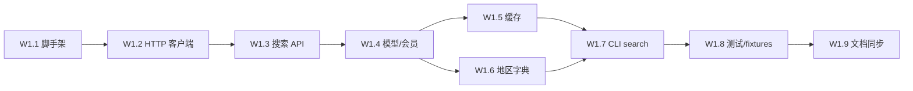

# 08 路线图、任务拆解与开放问题

> 版本：0.1 ｜ 状态：Approved（M0 评审通过） ｜ 负责人：lead ｜ 最后更新：2026-11-15
> 关联：[01 需求](01-requirements.md) ｜ [02 架构](02-architecture.md) ｜ [06 测试](06-test-acceptance.md) ｜ [decisions/](decisions/README.md)

---

## 1. 阶段总览

| 阶段 | 目标 | 状态 | 验收 |
|---|---|---|---|
| **M0 侦察 + 文档** | 摸清上游链路/风控/会员/匿名字段；产出完整文档基线 | ✅ 完成（2026-11-15，评审通过） | [docs/review-report.md](review-report.md) 通过（docs/README §4 清单） |
| **M1 搜索主链路** | JSON 搜索 + 列表 + 地区模式 + 城市过滤 + SQLite 缓存 + CLI `search` | ✅ 完成（2026-11-15） | 三种搜索模式可用；缓存命中；live smoke 通过 |
| **M2 详情与会员** | 公司详情（ssrData+正文+增强 JSON）+ 会员识别 + 缓存 + CLI `company` | ✅ 完成（2026-11-16） | 详情字段齐全；tier/audited/evidence 正确；unknown 不乱填 |
| **M3 三入口** | REST + MCP + `mic auth`/`doctor` | ✅ 完成（2026-11-16） | REST 端点 + 4 个 MCP tools + 人工兜底可用 |
| **M4 收尾** | 测试补齐、文档同步、发布（README/示例/回归） | ✅ 完成（2026-11-16，v1.0.8） | 244 tests 全绿；live-smoke 7/7；文档与实现一致 |

> 规则（ADR-0006）：**每个阶段先更新对应文档/接口契约，再改代码**；行为变更需补 ADR。

## 2. M0 完成物（本次）

- [x] 上游接口调研（22 端点，JSON 优先）→ [research/upstream-api.md](research/upstream-api.md)
- [x] 匿名信息完整度审计 → [research/anonymous-completeness.md](research/anonymous-completeness.md)
- [x] Focus Captcha 自动通过（实测 2/2）→ [research/captcha-autosolve.md](research/captcha-autosolve.md)
- [x] 会员体系与 KA/SKA 澄清 → [research/membership-tiers.md](research/membership-tiers.md)
- [x] 地区词当 keyword / 纯地区列举验证 → recon/notes.md §5.4
- [x] 目录重组（docs 编号化、research/ 证据分离、profile 外移、README/术语/ADR）
- [x] 正式文档 01–08 + glossary + decisions 基线

## 3. M1 工作包（搜索主链路）

| ID | 工作包 | 主要文件 | 依赖 | 验收 |
|---|---|---|---|---|
| W1.1 | 工程脚手架（TS/ESLint/Vitest/目录） | `package.json`、`tsconfig.json`、`src/` | M0 文档批准 | `npm run build`/`test` 可跑 |
| W1.2 | HTTP 客户端（gzip/cookie jar/重试/限速/single-flight） | `src/core/http/client.ts` | W1.1 | 单测覆盖重试/超时/限速 |
| W1.3 | 上游搜索 API client（m 站 JSON + refine 字典） | `src/core/api/search.ts` | W1.2 | 契约测试对 golden 样例 |
| W1.4 | 规范化模型（zod schema + 字段映射 + membership） | `src/core/models/*`、`src/core/membership/*` | W1.3、05 文档 | schema 单测；tier 映射正确 |
| W1.5 | SQLite 缓存层（DDL/TTL/refresh/stale） | `src/core/cache/*` | W1.4、05 文档 | TTL/命中/过期/回退单测 |
| W1.6 | 地区字典（31 省 + 城市 + 中英映射） | `src/core/regions/*`、`data/regions.json` | 05 文档 | 省/市映射与校验单测 |
| W1.7 | CLI：`search`/`regions`/`cache`（含 `--json`） | `src/adapters/cli/*` | W1.3–W1.6 | 三种搜索模式 e2e；缓存二次命中 |
| W1.8 | 测试与 fixtures（golden JSON、回归基线） | `tests/fixtures/*`、`tests/*` | W1.7 | 06 文档用例矩阵 M1 部分通过 |
| W1.9 | 文档同步（实现偏差回写 01/03/04/05） | `docs/*` | W1.7 | 文档与实现一致 |

**M1 任务依赖图**

## 4. M2 工作包（详情与会员）

| ID | 工作包 | 依赖 | 验收 |
|---|---|---|---|
| W2.1 | m 站公司详情 client（ssrData + 正文补充） | M1 | golden 样例解析正确 |
| W2.2 | 增强 JSON（SGS 章节/响应率/联系人/在线/评分） | W2.1 | 字段齐全、失败可降级 partial |
| W2.3 | 公司详情规范化与 evidence/缺失原因 | W2.1、05 文档 | tier/audited/evidence 正确 |
| W2.4 | 缓存详情 + 增强数据策略 | W2.3 | TTL/回退/单测 |
| W2.5 | CLI `company` + 回归测试 | W2.4 | 会员三态（diamond/gold/unknown）样例通过 |

## 5. M3 工作包（三入口与人工兜底）

| ID | 工作包 | 依赖 | 验收 |
|---|---|---|---|
| W3.1 | REST server（Fastify；端点见 03） | M1/M2 core | 03 文档每个端点有集成测试 |
| W3.2 | MCP server（stdio；4 tools） | M1/M2 core | 04 文档 tools 可用、错误语义正确 |
| W3.3 | `mic auth`（可见浏览器人工过验证码/登录） | captcha 算法移植 | 返回 409 后 auth 可恢复 |
| W3.4 | `mic doctor` / `mic config` / `mic serve` | W3.1 | 环境自检输出可用 |
| W3.5 | 三入口一致性测试（同查询同字段） | W3.1、W3.2 | 一致性用例通过 |

## 6. M4 工作包（收尾）

| ID | 工作包 | 验收 |
|---|---|---|
| W4.1 | 测试补齐 + 覆盖率目标（core ≥80%） | 06 文档 DoD 全绿 |
| W4.2 | 文档同步与示例（README/CLI 帮助/示例集） | 文档与实现一致 |
| W4.3 | 打包与发布（npm bin / 本地安装说明） | 新机器按 07 手册可跑通 |
| W4.4 | 上游契约回归与风控观测报告 | 契约测试/风控指标有基线 |

## 7. 开放问题（OQ）

| ID | 问题 | 影响 | 建议 | 状态/决策人 |
|---|---|---|---|---|
| OQ-01 | 登录态是否改变公司公开字段（电话/邮箱是否出现）？ | 字段设计/`mic auth` 价值 | `mic auth` 后做一次差分对照（匿名 vs 登录） | 待验证 / 用户可提供账号 |
| OQ-02 | 审核报告全文/PDF 是否可能获取？ | audit 字段深度 | 目前证据：report.html 301→About，仅有编号+外链；暂按「不公开」 | 待验证 |
| OQ-03 | 城市字典全量来源与准确性（300+ 城市） | 地区模式质量 | 用 refine/SEO 链接抓一次生成 + 静态表校验；缓存 30d | 待实现（M1） |
| OQ-04 | `total` 超过 2000 时如何表达覆盖度？ | API/CLI 语义 | 返回 `total=2000` + `total_capped=true` + warnings | 文档已定（02/03） |
| OQ-05 | 上游 cookie/会话有效期与复用策略？ | 稳定性 | 观测失效时间；失效自动 `mic auth` 提示 | 待观测 |
| OQ-06 | Focus Captcha 升级风险？ | 自动通过可用性 | 算法可替换 + 人工兜底；监控失败率 | 持续 |
| OQ-07 | 是否需要共享/远程访问（鉴权）？ | 架构 | 当前仅本地回环（ADR-0007）；需要时另立 ADR | 待用户确认 |
| OQ-08 | 是否扩展到 Alibaba 等其他平台？ | 架构扩展点 | core 抽象 `PlatformAdapter`；暂不实现 | 待用户确认 |
| OQ-09 | 是否提供 GUI/Web UI？ | 范围 | 首期不做（REST/CLI/MCP 已覆盖） | 待用户确认 |
| OQ-10 | 数据保留期与清理策略？ | 隐私/存储 | 默认 raw snapshot 关闭、TTL 如上；`mic cache clear` 全清 | 已定（05/07） |
| OQ-11 | 评价明细接口与更多增强字段？ | 数据丰富度 | 已打通 reviews JSON；其余按需补充 | 可选 |
| OQ-12 | 多语言输出（中文展示映射）？ | 可用性 | 默认英文原文 + 字典中文标签；按需扩展 | 待用户确认 |

## 8. 风险登记表

| 风险 | 概率 | 影响 | 缓解 |
|---|---|---|---|
| 上游 JSON 接口改版/下线 | 中 | 高 | 契约测试 + `UPSTREAM_CHANGED` + HTML 兜底 + 原始快照 |
| 风控升级/验证码改版 | 中 | 中 | 自动解 + `mic auth` 人工兜底 + 限速缓存 |
| 2000 条封顶/分页限制导致覆盖不全 | 高 | 中 | 文档标注非穷尽；城市/地区拆查询；缓存 |
| 城市字典不准/缺失 | 中 | 中 | 生成+校验流程；缺失降级 warnings |
| 登录差异导致字段预期不一致 | 低 | 低 | OQ-01 待验证；字段 null + reason |
| 本机环境差异（NixOS/显示/Node） | 低 | 中 | `mic doctor` + 07 手册 |
| 合规/条款风险 | 低 | 高 | 本地个人使用、限速、不转售、不建非公开字段 |

## 9. 下一步

1. ✅ 文档评审完成（2026-11-15）：见 [docs/review-report.md](review-report.md)；
2. ✅ 跨文档契约收敛：warning 码/分页/TTL/中文关键词/广告默认/库名（见 review-report §4）；
3. 🔜 **用户批准后进入 M1**（W1.1 脚手架 → W1.2 HTTP 客户端）；
4. M1 完成后再评估 OQ-01（登录差分，需要用户账号）与 OQ-03（城市字典生成）。
